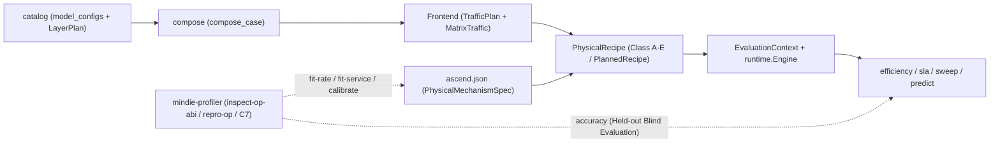

# Contributing to `mindie-sim` — Incremental Calibration, Operator Recipes & Model Catalog Guide

[中文](CONTRIBUTING.md) · **English** · [Back to Project Homepage](README.en.md)

> [!IMPORTANT]
> This document is the **hardware-neutral master contribution guide** for `mindie-sim` (and its companion `mindie-profiler`), covering silicon calibration across **Ascend A2, A3, and A5**, incremental operator `PhysicalRecipe`s (including first-class custom Attention kernels), and model catalog onboarding for both human engineers and coding Agents (Claude Code, Codex, DSH, Cursor, etc.). For chip-specific microarchitecture invariants, interconnect topologies, and `ascend.json` patch templates, consult the hardware sub-pages below.

---

## 0. Hardware Calibration & Microarchitecture Sub-Pages

All hardware targets share the **single canonical execution spine, 7 architectural prohibitions, 5-domain silicon microbenchmark protocol, `PhysicalRecipe` work-conservation law, and `meta`-device catalog gate** defined in this guide. For per-generation SRAM ceilings, native matrix precisions, cross-core paths, and intra-node / SuperPoD topologies, refer to the corresponding sub-page:

| Generation | Microarch / Preset | Registered SKUs ([`ascend.json`](mindie_sim/backends/profiles/ascend.json)) | Common `compose --hardware` Aliases | Key Physical Characteristics | Chip Sub-Page |
| :--- | :--- | :--- | :--- | :--- | :--- |
| **Ascend A2** | `DAV_2201`<br/>(`npu_arch_2201`) | `Ascend910B1`, `B2`, `B2C`, `B3`, `B4`, `B4-1` (6 SKUs) | `a2`, `910b`, `910b1..b4`, `800i-a2` | Single-Die package (`20/24 AIC`), `L0C = 128 KiB`, `UB = 192 KiB`, `L2 = 192 / 96 MiB`, native BF16/INT8/INT4 (**no native FP8**), AIC<->AIV via GM/L2, 8P HCCS / 16P bridged | [**Ascend A2 Guide**](docs/contributing/ascend-a2.md) |
| **Ascend A3** | `DAV_2201` Dual-Die<br/>(`npu_arch_2201`) | `Ascend910_9391`, `9392`, `9381`, `9382`, `9372`, `9362` (6 SKUs) | `a3`, `910c`, `800i-a3-8p`, `800i-a3-16p`, `a3-pod` | **Dual-Die package (`dies_per_package = 2`, 1 rank per Die `Phy-ID 0..15`)**, intra-package `SIO` (`448 GB/s`) + intra-node `HCCS_SW` + **CloudMatrix 384** SuperPoD, `L2 = 192 / 168 MiB` | [**Ascend A3 Guide**](docs/contributing/ascend-a3.md) |
| **Ascend A5** | `DAV_3510`<br/>(`npu_arch_3510`) | `Ascend950DT_9581`, `9582`, `Ascend950PR_9579`, `Ascend950PR_958b` (4 SKUs + commercial derived aliases `425-96`, `486-96`, `547-96`, `547-144`) | `a5`, `950`, `950pr_958b`, `425-96..547-144`, `a5-pod`, `a5-server-dt`, `a5-pod-pr` | Single-Die package (`32 AIC / 64 AIV` base, `28/32/36 AIC` derived SKUs), **`L0C = 256 KiB`**, `UB = 248 KiB`, `L2 = 128 MiB` (DT `4.0 TB/s` / PR `1.6` & `1.4 TB/s`), **native FP8/INT8/BF16**, on-chip `l0c->ub` path, `K_8` `per_pair` UB direct mesh & **Atlas 950 SuperPoD** | [**Ascend A5 Guide**](docs/contributing/ascend-a5.md) |

---

## 1. Core Architectural Invariants: Single Canonical Spine & Seven Iron Prohibitions

### 1.1 Single Canonical Execution Spine

`mindie-sim` enforces a **single mechanism-first causal execution spine**. Single-operator evaluation, pure-model forward graphs, 4D efficiency breakdowns, SLA hardware-scaling solvers, and PD/topology Pareto sweeps all lower onto the exact same discrete-event `runtime.Engine`:



Module ownership along the spine:
- **Model Catalog & Case Synthesis**: [`mindie_sim/model_catalog.py`](mindie_sim/model_catalog.py) and `mindie_sim/catalog/*` parse model structure across six orthogonal weight/KV/state ledgers, composed deterministically into a `Case` by [`mindie_sim/compose/__init__.py`](mindie_sim/compose/__init__.py).
- **Physical Mechanisms & Topology Materialization**: [`mindie_sim/schema/physical_mechanisms.py`](mindie_sim/schema/physical_mechanisms.py) defines immutable `MemoryHierarchySpec`, `MatrixPolicySpec`, and `PhysicalMechanismSpec`; [`mindie_sim/backends/ascend.py`](mindie_sim/backends/ascend.py) and [`mindie_sim/schema/hardware.py`](mindie_sim/schema/hardware.py) materialize [`mindie_sim/backends/profiles/ascend.json`](mindie_sim/backends/profiles/ascend.json) into frozen `Hardware`, `Device`, and `Link` views.
- **Recipe Lowering & Single-Pass Evaluation Context**: [`mindie_sim/prediction/physical_recipe_registry.py`](mindie_sim/prediction/physical_recipe_registry.py) and [`mindie_sim/prediction/body_defaults.py`](mindie_sim/prediction/body_defaults.py) bind every `OpSpec` to a work-conserving `OperatorPlan` / `Program`, evaluated under a single `EvaluationContext` (constructing `CostModel` and `ExecutionBindings` once per evaluation) on `runtime.Engine`.
- **Calibration & Held-Out Accuracy Loop**: [`mindie_sim/__main__.py`](mindie_sim/__main__.py), [`mindie_sim/observations/service_fitting.py`](mindie_sim/observations/service_fitting.py), [`mindie_sim/observations/calibration.py`](mindie_sim/observations/calibration.py), and [`mindie_sim/observations/resource_services.py`](mindie_sim/observations/resource_services.py) consume microbenchmarks and `mindie-profiler` captures without ever injecting measured latencies back into the execution loop.

### 1.2 Seven Iron Prohibitions

Every human contributor and coding Agent must obey all **7 iron prohibitions** before editing Python or JSON (violations fail automated CI gates):

| # | Prohibition | Code-Level Enforcement & Exact Error |
| :--- | :--- | :--- |
| **Rule 1** | **Zero Sidecar Calculators or Shadow IRs**<br/>Never create or restore standalone formula estimators, private subgraph IRs, sidecar communication calculators, or efficiency-side `max(...)` patches outside `runtime.Engine`. | `hygiene` in [`scripts/verify_m1.py`](scripts/verify_m1.py) scans and blocks banned sidecar modules and imports (`opflow`, `op_formulas`, `prediction.piecewise`, `prediction.subgraphs`, etc.). |
| **Rule 2** | **Zero Silent Fallbacks & No `ResourceEnvelope` Peak-Division**<br/>Default matrix lowering uses `SteadyMatmul`; never use `ResourceEnvelope` or stuff total `context.work` into a single unphased `Stage`. Unmodeled operators or core structures must raise explicitly rather than emitting zero work (only declared sync primitives in `CONTROL_FAMILIES` carry empty payloads). | `ResourceEnvelope.lower()` in [`mindie_sim/prediction/program/`](mindie_sim/prediction/program/) raises `ModelingError("resource_envelope_banned")`; public timing entry points raise `UnmodeledCapabilityError` carrying `mindie-unmodeled-structure-hint/1` via [`unmodeled_gate.py`](mindie_sim/prediction/efficiency/unmodeled_gate.py). |
| **Rule 3** | **100% Structural/Tensor Generalization (Zero `model_id` Branches, LUTs, or Residual Multipliers)**<br/>Never branch on `model_id` / model names in `implementation_selection`, fusion passes, or `PhysicalRecipe`s (`model_scopes` distinguishes `target` vs. `draft` subgraphs only); trigger mechanisms strictly from layer structure, cache contiguity, quantization dtypes, and hardware `Geometry`. Never hardcode `(model_name, M, N, K)` lookup tables, back-fit `step/body/e2e` windows, or invent heuristic discount multipliers. | [`mindie_sim/observations/service_fitting.py`](mindie_sim/observations/service_fitting.py) rejects `step` / `body` / `serving` / `e2e` windows and `target_ms` / `residual_ms` fields; [`scripts/verify_m2.py`](scripts/verify_m2.py) audits zero envelope hits across the full model catalog. |
| **Rule 4** | **Zero Container Image SHA Dispatch or Host/Intranet Leakage**<br/>Never commit local `$HOME` paths, private lab IPs, or container-digest branches (`docker.io/`, `swr.cn-`, `@sha256:`). | Enforced by [`scripts/verify_m1.py`](scripts/verify_m1.py); source provenance uses `{repository, revision, relative_path, source_sha256}` and captures use `capture://<capture-id>/<member>`. |
| **Rule 5** | **`buffer_units.l2 = 1` Die-Shared L2 Invariant**<br/>Whenever `device.buffers` declares `"l2"`, `device.buffer_units.l2` **must equal `1`** (one shared L2 pool per physical Die, never multiplied by AIC/AIV core counts). | [`mindie_sim/schema/hardware.py`](mindie_sim/schema/hardware.py) raises `ModelingError("shared_l2_buffer_requires_one_die_owner")` if `buffer_units.l2 != 1`. |
| **Rule 6** | **Differential Numeric-Literal & Tautological-Constant Gate**<br/>Write natural math and structural indices (`0`, `1`, `2`, `0.5`, `100`, `1000`, `1024`, `1e-6..1e-12`, subscripts/slices/`len` checks) directly, and **never** define digit-word constants (`ZERO = 0`, `ONE = 1`, `SIXTY_FOUR = 64`, `THREE_FLOAT = 3.0`); extract non-trivial protocol/algebraic constants into semantic `UPPER_SNAKE_CASE` module/class symbols and hardware constants into `ascend.json`. | [`scripts/check_no_magic_numbers.py`](scripts/check_no_magic_numbers.py) diffs the AST against `--base` and exits `1` on unnamed magic numbers or digit-word constants. |
| **Rule 7** | **Cohesion-First Structural Governance, Canonical Concept Ownership & Unix `LF` Line Endings**<br/>Keep a single cohesive physical domain together in one self-contained module (`~1,800` lines is a soft review guideline rather than a hard cliff; exceeding it is permitted when genuinely cohesive and structured into focused functions); never slice classes or kernels into artificial `*_helpers.py` / `*_mixin.py` / `*_part*.py` shards. Keep individual functions readable (target `<= 150` lines, `<= 6` control-flow nesting depth, excluding declarative data tables), keep package peer counts bounded (`<= 20` target), enforce a strict downward ratchet on flat `mindie_sim/prediction/*.py` modules, route all device operator recipes into `mindie_sim/prediction/operators/<family>/`, reuse canonical concepts (`RequestView` / `AdmissionMemoryView` / `PrimitiveTable`) with zero parallel structs, keep `[Role]`/`[Invariants]`/`[Timeouts & Locks]`/`[Side-Effect Policy]` in the top 30 lines, and use Unix `LF` (`\n`) everywhere. | [`scripts/check_arch_governance.py`](scripts/check_arch_governance.py) (`AG001..AG008`) and [`.github/scripts/check_lf_eol.py`](.github/scripts/check_lf_eol.py) block parallel systems, artificial shard files, flat operator regressions, and `\r\n` line endings. |

### 1.3 Full-Stack Upstream Source Routing & Cross-Repo SSOT Discipline

1. **Mount & Sync Fresh Upstream `HEAD`s Across the Ascend Stack**:
   - Ascend model graphs, operator tiling, and kernel implementations span multiple upstream repositories. When an operator lives outside `vllm-ascend` or `ops-transformer`, **mount the actual owning repository and `git fetch` its latest `HEAD` revision** instead of guessing or working against a stale snapshot:

     | Upstream Tier | Representative Repositories | Owned Scope |
     | :--- | :--- | :--- |
     | **Serving Frameworks & Model Recipes** | `vllm-ascend` (plus upstream `vllm`), `cann-recipes-infer`, `MindIE-SD`, `xllm` | Model forward assembly, default feature flags (e.g., DBO merge state), `cann-recipes-infer` reference fusion recipes, `MindIE-SD` speculative/multimodal/diffusion paths |
     | **Official CANN Operator Libraries** | `cann/ops-transformer`, `cann/ops-nn`, `torch-npu` | `ops-transformer` (MLA Prolog, MQSMLA, MC2, MoE Routing/GMM tiling & kernels); `ops-nn` (RMSNorm, LayerNorm, dynamic quant, SwiGLU, dense Matmul); `torch-npu` (PTA `OpApi` bindings) |
     | **Specialized Attention & DSL Kernels** | `fla-npu`, `flash-attn-npu`, `cannbot-dsl`, `xllm-ops` | `fla-npu` (KDA / GDN chunked & recurrent linear attention); `flash-attn-npu` (FlashAttention / sparse & hybrid-window kernels); `cannbot-dsl` / `xllm-ops` (DSL / Triton / AscendC fused ops) |

   - **Conflict Resolution Rule**: Record the verified `{repository, revision}` before editing. Whenever an old issue description or historical assumption conflicts with fresh upstream source code + real `msprof` captures, **follow fresh upstream source + real captures** and document the upstream evolution in your PR evidence.
2. **`mindie-sim <-> mindie-profiler` Cross-Repo SSOT Contract**:
   - `mindie_sim.observed_contracts`, `mindie_sim.subgraph_math`, and `mindie_sim.structure*` act as the single source of truth consumed by `mindie-profiler`: [`mindie_sim/prediction/fusion_regions.py`](mindie_sim/prediction/fusion_regions.py) maintains single-owner fused region lineage (`absorbed_source_ops` vs. `FusionBoundary`, unioning `structure_subgraph_memberships` without double-charging shared composite calls); [`mindie_sim/compose/runtime.py`](mindie_sim/compose/runtime.py) stamps explicit `recipe_binding_origins` (`caller` / `stack_profile` / `body_default`); and [`mindie_sim/structure/__init__.py`](mindie_sim/structure/__init__.py) supports `--draft-prepare` / `draft_prepare=True` for prefill draft-KV preparation, keeps only structural topology keys in `execution.resource_geometry` so `compare_cohorts` preserves stable `graph_id`s across calibrations, and sanitizes CLI file inputs to `source: {"kind": "case_file", "sha256": ...}`. Whenever you touch those modules or `source_boundary`, mount `../profiler` and run both test suites together.

---

## 2. Playbook A: Standardized 5-Domain Silicon Measurement & Calibration SOP

Whether calibrating Ascend A2, A3, A5, or a new SKU variant, all silicon measurements and primitive fits follow the same **5-domain microbenchmark protocol** and **CLI pipeline**.

### 2.1 Four Global Measurement Rules (Across A2 / A3 / A5)

1. **VRAM Safety & Zero Weight Pollution**: Run `npu-smi info` first to confirm no competing processes on the target NPU/Die; allocate only bounded synthetic tensors (never full LLM weights), capping single-process HBM at **`<= 8 GiB`** with **`>= 2 GiB`** free headroom.
2. **DVFS Clock Warmup (30-GEMM Lock)**: Idle Ascend AIC cores clock down to `100 MHz`. Before timing, run **`30` consecutive `4096 × 4096` BF16 GEMMs** to lock AIC at peak frequency, then run `5` warmups + `20` timed iterations (`torch.npu.Event(enable_timing=True)`) across `3` independent trials per point.
3. **`>= 3 × L2` Rotating Cold-HBM Ring vs. Single-Buffer L2-Hot Pair**:
   - For any operator whose working set is `< 2 × L2`, pre-allocate a contiguous rotating ring totaling **`>= 3 × L2_per_die`** (e.g., `>= 576 MiB` for `192 MiB` L2, `>= 504 MiB` for `168 MiB` L2, `>= 384 MiB` for `128 MiB` L2, `>= 288 MiB` for `96 MiB` L2) and rotate slots each iteration to evict L2 and measure cold-HBM `duration_us`;
   - Pair with a fixed single-buffer measurement (`l2_hot_duration_us`) to separate `mte2_*_dram` from `mte2_*_l2` service rates.
4. **`2.5 ms` `StreamBlocker` Dual-Mode Timing (Mandatory for `< 50 µs` Kernels & `4 KiB` Collectives)**:
   - Eager Python `OpApi` host dispatch (`~15–45 µs`) masks microsecond device execution. For `< 50 µs` kernels and `4 KiB` HCCL collectives, record both **unblocked eager** and **RTS stream-saturated** timings by enqueuing a **`>= 2.5 ms` blocking GEMM (`StreamBlocker`)** first so all `20` timed launches + start/end `Event`s queue into hardware RTS before the stream drains—isolating the pure device inclusive completion minimum:

```python
import math
import statistics
import torch
import torch_npu

WARMUP_GEMM_ITERS = 30
WARMUP_GEMM_DIM = 4096
BLOCKER_TARGET_MS = 2.5
MIN_SINGLE_GEMM_MS = 0.05
MIN_BLOCKER_REPS = 1
WARMUP_SLOT = 0
MS_TO_US = 1000.0
BENCH_WARMUPS = 5
BENCH_TIMED_ITERS = 20


def lock_aic_frequency(device: torch.device) -> tuple[torch.Tensor, torch.Tensor]:
    """Run 30x 4096^2 BF16 GEMMs to lock AIC out of 100 MHz idle DVFS state."""
    a = torch.randn((WARMUP_GEMM_DIM, WARMUP_GEMM_DIM), dtype=torch.bfloat16, device=device)
    b = torch.randn((WARMUP_GEMM_DIM, WARMUP_GEMM_DIM), dtype=torch.bfloat16, device=device)
    for _ in range(WARMUP_GEMM_ITERS):
        _ = torch.matmul(a, b)
    torch.npu.synchronize()
    return a, b


def calibrate_stream_blocker(a: torch.Tensor, b: torch.Tensor) -> int:
    """Find repeat count of 4096^2 GEMM that blocks the NPU stream for >= 2.5 ms."""
    start_ev = torch.npu.Event(enable_timing=True)
    end_ev = torch.npu.Event(enable_timing=True)
    start_ev.record()
    _ = torch.matmul(a, b)
    end_ev.record()
    torch.npu.synchronize()
    elapsed_ms = float(start_ev.elapsed_time(end_ev))
    single_ms = (
        elapsed_ms
        if math.isfinite(elapsed_ms) and elapsed_ms > MIN_SINGLE_GEMM_MS
        else MIN_SINGLE_GEMM_MS
    )
    return max(MIN_BLOCKER_REPS, math.ceil(BLOCKER_TARGET_MS / single_ms))


def measure_rts_stream_saturated_us(fn, blocker_pair: tuple[torch.Tensor, torch.Tensor], blocker_reps: int) -> float:
    """Measure pure RTS device completion time with host dispatch hidden behind a 2.5ms StreamBlocker."""
    for _ in range(BENCH_WARMUPS):
        fn(WARMUP_SLOT)
    torch.npu.synchronize()

    events = [
        (torch.npu.Event(enable_timing=True), torch.npu.Event(enable_timing=True))
        for _ in range(BENCH_TIMED_ITERS)
    ]
    a, b = blocker_pair
    for _ in range(blocker_reps):
        _ = torch.matmul(a, b)
    for idx, (s_ev, e_ev) in enumerate(events):
        s_ev.record()
        fn(idx)
        e_ev.record()
    torch.npu.synchronize()
    samples_us = [s_ev.elapsed_time(e_ev) * MS_TO_US for s_ev, e_ev in events]
    return float(statistics.median(samples_us))
```

### 2.2 Five Standard Measurement Domains

1. **Domain 1: RTS Inclusive Completion Minima (`Launch & Completion Minima`)**
   - Measure 1-element AIV `torch.add` (`[1]` BF16), minimal AIC `torch.matmul` (`[1, 16] @ [16, 16]` BF16), tiny AIV `torch_npu.npu_rms_norm` (`[1, 128]` BF16), and minimal quantized Matmul.
   - Populate `device.kernel_invocations.<class>.minimum_ms` (`startup_ms` stays `0.0`) under the inclusive floor law:

     $$
     T_{\text{kernel}} = \max(T_{\text{minimum}},\, T_{\text{startup}} + T_{\text{program}})
     $$

     Never treat `minimum_ms` as an additive startup term or bake eager Python host dispatch into device profiles.
2. **Domain 2: Dense Cube GEMM Peak, M-Knee & Decode GEMV**
   - Benchmark only precisions natively supported by the target `compute_arch` (`BF16/FP16/INT8/INT4` on A2/A3—never synthetic native FP8; `BF16/FP16/INT8/FP8` on A5).
   - Cover saturated `4096³`, LLM projections `(4096, 18432, 7168)`, M-knee sweeps `M ∈ {1, 16, 32, 64, 128, 256, 512, 1024, 2048}`, tiny `(32, 32, 7168)`, and `NK_transposed` vs. `KN_contiguous` vs. `FRACTAL_NZ` layouts.
3. **Domain 3: MoE Grouped Matmul (`npu_grouped_matmul` / W4A8 / MXFP)**
   - Cover wide experts `(E=32, K=7168, N=4096)` and narrow experts `(E=64, K=2048, N=1024)` across `M ∈ {32, 256, 4096, 16384}`.
   - **Mandatory Histogram Retention**: Every sample **must retain exact integer `group_list` / `expert_rows` arrays**, pairing deterministic balanced routing against skewed routing with `0`-token tail experts to verify `zero_token_expert_weight_skip` and touched-byte MBU.
4. **Domain 4: Attention Microbenchmarks (CANN Baselines + First-Class Custom Attention Kernels)**
   - **CANN Out-of-the-Box Baselines**: Measure `npu_fusion_attention` (Prefill) and supported `npu_fused_infer_attention_score` / `npu_incre_flash_attention` (Decode across `B ∈ {1, 8, 16, 32, 64}`, `L ∈ {4096, 16384, 32768}`).
   - **Custom Attention Kernels (AscendC `.o`, Triton-Ascend, TileLang, ATB / XLLM / SGLang Paged / FlashMLA / Sparse / Linear Attention)**: Treat custom kernels as first-class citizens—benchmark your custom kernel entrypoint directly under the same clock lock, rotating cold ring, and `2.5 ms` `StreamBlocker` protocol without forcing it into `IFA`/`FIA`, and record: (a) `(B_q, B_k, split_k)` and active `BlockDim`; (b) custom KV page / quant / sparse block-table layout; and (c) cross-core workspace bytes (`GM/L2` ping-pong on A2/A3 vs. on-chip `l0c->ub` on A5).
   - **Absorbed MLA (`512+64`) Byte-Accounting Rule**: Both built-in and custom absorbed MLA kernels share one physical page slice for `c_kv` + `k_rope` (`576 × 2 = 1152 B` per BF16 token row)—never double-count separate K and V buffers.
5. **Domain 5: AIV Vector / Reduction / Quant / Gather / Atomic & Hierarchical Collectives**
   - AIV primitives: measure `npu_rms_norm`, `npu_add_rms_norm`, `npu_swiglu`, `npu_dynamic_quant`, `index_select`, and `index_add_` / `scatter_add_` (separating logical payload bytes from `128 B` cacheline physical RMW traffic `hbm_atomic_rmw`).
   - Hierarchical collectives: sweep `4 KiB` (stream-saturated) through `256 MiB` `AllReduce`, `ReduceScatter`, `AllGather`, and `AllToAll` across each physical fabric tier (A2 8P HCCS / 16P bridged; A3 intra-package `SIO` vs. intra-node `HCCS_SW` vs. SuperPoD; A5 `K_8` `per_pair` UB direct mesh vs. SuperPoD), fitting non-negative affine $t = \alpha + x / R$ for `alpha_us` and effective unidirectional bandwidth.

### 2.3 Service-Fitting, Single-Op Repro & Held-Out Validation CLI Workflow

1. **Fit Single-Channel Service Curves or Resource Rates (`train` vs. `heldout` Strictly Split)**
   Prepare a sample packet compatible with both [`mindie_sim/observations/service_fitting.py`](mindie_sim/observations/service_fitting.py) (`fit-service` reads `work`) and [`mindie_sim/observations/captures.py`](mindie_sim/observations/captures.py) (`fit-rate` reads `work_bytes`), with at least `2` distinct training work knots, an interior `heldout` sample inside the training work domain for interpolation, `boundary` in `{"resource_phase", "device_kernel"}`, and sanitized `capture://` URIs:
   ```json
   {
     "resource": "hbm",
     "work_unit": "bytes",
     "identity": "AscendSKU:npu_rms_norm:bf16:cold_ring",
     "boundary": "device_kernel",
     "active_units": 48,
     "provenance": {
       "capture": "capture://ascend-microbench-202611/domain5_vector.json",
       "window": "resource_phase"
     },
     "samples": [
       {"work": 16777216, "work_bytes": 16777216, "duration_ms": 0.0132, "run_id": "trial-1", "repeat_index": 0, "source": "capture://ascend-microbench-202611/domain5_vector.json", "split": "train"},
       {"work": 134217728, "work_bytes": 134217728, "duration_ms": 0.0985, "run_id": "trial-1", "repeat_index": 0, "source": "capture://ascend-microbench-202611/domain5_vector.json", "split": "train"},
       {"work": 67108864, "work_bytes": 67108864, "duration_ms": 0.0498, "run_id": "trial-2", "repeat_index": 0, "source": "capture://ascend-microbench-202611/domain5_vector.json", "split": "heldout"}
     ]
   }
   ```
   Run the fitting and calibration commands:
   ```bash
   # Fit non-negative affine service curve (startup_ms + units_per_ms) and evaluate interpolated heldout error
   python3 -m mindie_sim fit-service hbm_read_samples.json -o state/calibration/hbm_service_fit.json

   # Fit pure resource byte rate and setup term (reads samples[*].work_bytes)
   python3 -m mindie_sim fit-rate hbm_read_samples.json -o state/calibration/hbm_rate_fit.json

   # Stream explicit PrimitiveKey observations into a SQLite primitive catalog
   python3 -m mindie_sim calibrate state/calibration/primitives.sqlite primitive_samples.jsonl -o state/calibration/inventory.json
   ```

2. **Pair with `mindie-profiler` C-ABI Inspection, Sanitized Repro Generation & C7 Supply Binding**
   ```bash
   # 1. Inspect pinned operator C-ABI signature, tensor slots, and padding semantics (using a catalog CANN version such as 8.0)
   python3 -m mindie_profiler inspect-op-abi aclnnFusedInferAttentionScoreV2 --version 8.0

   # 2. Generate a self-contained single-op reproducer from a sanitized capture (--flush-mb >= 3x L2)
   python3 -m mindie_profiler repro-op \
     --capture capture_sanitized.json \
     --occurrence-index 0 \
     --flush-mb 576 \
     --l2-bytes 201326592 \
     --warmup 10 --iters 50 \
     --output-dir state/calibration/repro_op

   # 3. Bind profiler SQLite observations via explicit bindings.jsonl, or predict with C7 supply
   python3 -m mindie_sim bind-profiler profiler_catalogue.sqlite state/calibration/primitives.sqlite bindings.jsonl -o state/calibration/bind_report.json
   python3 -m mindie_sim predict case.json --supply c7_report.json --supply-hardware <REGISTERED_SKU> -o state/calibration/pred.json

   # 4. Evaluate boundary-aligned accuracy and configuration ranking on an independent heldout packet
   python3 -m mindie_sim accuracy heldout_packet.json -o state/calibration/accuracy_report.json
   ```

---

## 3. Playbook B: Incremental Operator `PhysicalRecipe` & Custom Attention Integration

### 3.1 Recipe Interface Contract & Two-Layer Extension Model

Every operator in `mindie-sim` lowers through one of two physical recipe forms sharing the same two-stage contract:
1. **Five General Physical Mechanism Classes (`Class A–E`)** under `mindie_sim/prediction/`, dispatched via [`mindie_sim/prediction/physical_recipe_registry.py`](mindie_sim/prediction/physical_recipe_registry.py):
   - **Class A** (`TiledFlashAndPagedAttentionRecipe`): Flash / Paged / Latent / Sparse Attention tiled pipelines;
   - **Class B** (`TiledSparseIndexerRecipe`): Sparse Indexer scoring and on-chip UB Top-K updates;
   - **Class C** (`ChunkedLinearAttentionRecipe`): GDN / KDA chunked linear attention and block-triangular solve;
   - **Class D** (`AIVTiledVectorAndGatherRecipe`): AIV elementwise, RMSNorm, dynamic quant, gather, atomic add, and short conv;
   - **Class E** (`TopologyCollectiveRecipe`): Topology-aware collectives (`AllReduce`, `ReduceScatter`, `AllGather`, `AllToAll`).
2. **Source-Audited `PlannedRecipe`**: For kernel-source-audited operators (such as A2/A3 [`operators/paged_mla/`](mindie_sim/prediction/operators/paged_mla/__init__.py) and [`w4a8.py`](mindie_sim/prediction/operators/mx_quant_matrix/w4a8.py), or A5 `paged_mla.py` and `gdn_recurrent.py`), wrap `build(op: OpSpec, geometry: Geometry) -> OperatorPlan` + `lower(context: RecipeContext) -> Program` in `PlannedRecipe(build)` from [`mindie_sim/prediction/mechanism.py`](mindie_sim/prediction/mechanism.py).

### 3.2 Stage Work Conservation & Split Read Pipes (`mte2_aic` vs. `mte2_aiv`)

Every new or refined recipe must strictly conserve prepared work across issued stages:

$$
W_{\text{prepared}} = W_{\text{plan}} = \sum_{s \in \text{issued stages}} W_s
$$

Obey four physical invariants:
1. **Bucket Matrix FLOPs by Compute Dtype**: Put Cube FLOPs in `Work(matrix={dtype: flops})`; passing `"cube"` inside `Work.resources` immediately raises `ValueError("matrix_work_requires_explicit_precision")`.
2. **Conserve `mte2_aic` and `mte2_aiv` Independently**: In [`mindie_sim/prediction/physical_recipe_base.py`](mindie_sim/prediction/physical_recipe_base.py), `mte2_aic` (`GM/L2 -> L1/L0`) and `mte2_aiv` (`GM/L2 -> UB`) both map to the `"mte2"` phase category, while `_phase_amounts` **loops independently per physical resource name**:

   $$
   W_{s, r} = W_r \cdot \frac{\alpha_{s, c(r)}}{\sum_j \alpha_{j, c(r)}}
   $$

   Each split read pipe strictly conserves its own declared bytes without smearing AIC weight reads onto AIV pipes.
3. **True Core Owner Placement**: Bind private per-core pipes via `context.owned(owner, cores, roles)` (`cube`, `mte1`, `mte2_aic`, `fixpipe` on `owner ∈ [0, P_AIC)`; `vector`, `mte2_aiv`, `mte3` on paired AIV sub-cores `2*owner` / `2*owner+1`), while shared pools (`hbm`, `l2`) contend globally. **Tail tiles never borrow idle sibling cores' private pipes or `L1`/`UB` SRAM.**
4. **Query Geometry Dynamically**: Never branch on hardcoded SKU strings inside a recipe; read `L0C` / `UB` / `L2` capacities and pipe ratios from `geometry.buffers`, `geometry.resource_units`, and `geometry.physical_mechanisms`.

### 3.3 Clean-Core `PhysicalRecipe` Template & Side-Effect-Free Registration

Below is a reference `PlannedRecipe` skeleton passing all Clean-Core gates (4-part header, zero unnamed magic numbers, dynamic SRAM checks, and per-owner placement):

```python
"""Finite Cube+Vector operator pipeline parameterized by Device Geometry.

[Role] Partition declared operator work into AIC/AIV stages on the shared Engine.
[Invariants] Conserves exact prepared work per physical pipe; checks geometry
  SRAM capacities dynamically without hardcoding SKU labels.
[Timeouts & Locks] O(owners) stage construction; no I/O, locks or device calls.
[Side-Effect Policy] Pure immutable Work/OperatorPlan/KernelProgram records.
"""
from __future__ import annotations

from mindie_sim.schema.common import ModelingError, dtype_bytes
from .mechanism import Geometry, OperatorPlan, Work
from .program import KernelProgram, ParallelProgram, RecipeContext, Stage

IMPLEMENTATION = "ascend_custom_fused_op"
SOURCE = {
    "repository": "cann/ops-transformer",
    "revision": "a3925fd49cd256ad478d2faf983bf2961b8ae2c8",
    "relative_path": "custom_family/op_kernel/custom_kernel.h",
    "source_sha256": "0123456789abcdef0123456789abcdef0123456789abcdef0123456789abcdef",
}

AIC_AIV_RATIO = 2
ACCUM_DTYPE = "fp32"
REQUIRED_L0C_BYTES = 131072
REQUIRED_UB_BYTES = 163840
AIV_ROLES = frozenset({"vector", "mte2_aiv", "mte3"})


def build(op, geometry: Geometry) -> OperatorPlan:
    if geometry.buffers.get("l0c", 0) < REQUIRED_L0C_BYTES:
        raise ModelingError(f"custom_op_l0c_capacity:{REQUIRED_L0C_BYTES}")
    if geometry.buffers.get("ub", 0) < REQUIRED_UB_BYTES:
        raise ModelingError(f"custom_op_ub_capacity:{REQUIRED_UB_BYTES}")
    if geometry.resource_units.get("vector") != geometry.compute_units * AIC_AIV_RATIO:
        raise ModelingError("custom_op_requires_1_to_2_aic_aiv_pipes")

    m_rows, n_cols, k_dim = (int(axis) for axis in op.local_shape[-3:])
    aic_count = max(1, int(geometry.compute_units))
    active_owners = min(aic_count, max(1, m_rows))

    act_dtype = str(op.dtype or "bf16")
    elem_bytes = dtype_bytes(act_dtype)
    accum_bytes = dtype_bytes(ACCUM_DTYPE)
    in_bytes = (m_rows * k_dim + k_dim * n_cols) * elem_bytes
    gm_bridge_bytes = m_rows * n_cols * accum_bytes
    out_bytes = m_rows * n_cols * elem_bytes
    cube_flops = 2 * m_rows * n_cols * k_dim
    vec_ops = m_rows * n_cols

    load_work = Work(resources={"hbm": in_bytes, "mte2_aic": in_bytes})
    cube_work = Work(
        matrix={act_dtype: cube_flops},
        resources={"hbm": gm_bridge_bytes, "fixpipe": gm_bridge_bytes},
    )
    epilogue_work = Work(resources={
        "hbm": gm_bridge_bytes + out_bytes,
        "mte2_aiv": gm_bridge_bytes,
        "vector": vec_ops,
        "mte3": out_bytes,
    })
    total = load_work + cube_work + epilogue_work

    def lower(ctx: RecipeContext):
        share = 1.0 / float(active_owners)

        def owner_chain(owner: int) -> KernelProgram:
            w_load = load_work.scaled(share)
            w_cube = cube_work.scaled(share)
            w_epi = epilogue_work.scaled(share)

            aic_place = ctx.owned(owner, aic_count, {"mte2_aic"})
            cube_place = ctx.owned(owner, aic_count, {"cube", "fixpipe"})
            epi_place = {
                ctx.resource_names[role]: (AIC_AIV_RATIO * owner,)
                for role in AIV_ROLES if role in ctx.resource_names
            }
            return KernelProgram((
                Stage("aic_load", ctx.bind(w_load), placement=aic_place),
                Stage("aic_mmad_store", ctx.bind(w_cube),
                      after=("aic_load",), placement=cube_place),
                Stage("aiv_epilogue", ctx.bind(w_epi),
                      after=("aic_mmad_store",), placement=epi_place),
            ))

        return KernelProgram((
            Stage("owners", program=ParallelProgram(
                tuple(owner_chain(idx) for idx in range(active_owners))
            )),
        ))

    return OperatorPlan(total, lower, metadata={
        "implementation": IMPLEMENTATION,
        "source": SOURCE,
        "active_aic_owners": active_owners,
    })
```

To mount onto the spine without disturbing unrelated SKUs or existing baselines:
- **General family binding**: add the family to the corresponding `*_FAMILIES` set in [`mindie_sim/prediction/physical_recipe_registry.py`](mindie_sim/prediction/physical_recipe_registry.py).
- **Architecture-guarded default**: register in [`mindie_sim/prediction/body_defaults.py`](mindie_sim/prediction/body_defaults.py) behind explicit capability and geometry checks (`case.machine.arch_family`, buffer capacities, pipe ratios, and `explicit_implementation_preserved` caller overrides).

### 3.4 Three Progressive Tiers (Tiers 1–3) for Custom Attention Kernels

`mindie-sim` **never locks Attention onto built-in CANN `IFA`/`FIA` kernels**. Integrate custom AscendC, Triton-Ascend, TileLang, or ATB/XLLM/SGLang FlashMLA / block-sparse / hybrid-window kernels via the lightest tier that captures your physical change:

#### Tier 1 — Parametric Reuse (Different Tile / Page / Split-K Sizes, Same Intra-Core Topology)
When your kernel keeps the standard `Q load -> KV refill -> QK Cube -> Online Softmax -> PV Cube -> rescale store` pipeline and only changes `(B_q, B_k)`, KV block size, or double-buffer slots, **write zero Python**—override `physical_mechanisms.attention` or `case.runtime` directly (explicit `recipes` take top priority in [`mindie_sim/prediction/program/`](mindie_sim/prediction/program/), falling back to `Class A` `TiledFlashAndPagedAttentionRecipe` in [`mindie_sim/prediction/operators/attention/attention_pipeline.py`](mindie_sim/prediction/operators/attention/attention_pipeline.py)):

```json
{
  "runtime": {
    "kv_block_size": 64,
    "attention_policy": {
      "query_tile": 64,
      "kv_storage": "paged",
      "reuse_kv_across_query_heads": true
    },
    "kernels": {
      "recipes": {
        "flash_attention_decode": {
          "kind": "staged_gqa_decode",
          "query_tile": 32,
          "key_tile": 64,
          "slots": 2
        }
      }
    }
  }
}
```

#### Tier 2 — Custom Intra-Core Pipeline (`PlannedRecipe` for SplitCore Ping-Pong, Custom Quant / Mask / Workspace)
When your kernel changes stage dependencies, online dequantization, or AIC<->AIV workspace handoffs (e.g., L2/GM score/prob ping-pong on A2/A3 `DAV_2201` vs. direct `l0c->ub` on A5 `DAV_3510`):
1. Implement `build(op, geometry) -> OperatorPlan` wrapped in `PlannedRecipe(build)` under `mindie_sim/prediction/operators/<custom_attn>.py`, requiring explicit `"l1"`, `"l0c"`, and `"ub"` SRAM capacities on `geometry.buffers` (without hardcoded chip-fallback constants) and separating L2-resident score/probability ping-pong traffic from cold HBM KV reads;
2. Register `(phase, "attention", "<custom_recipe>")` in [`mindie_sim/prediction/implementations.py`](mindie_sim/prediction/implementations.py), [`mindie_sim/prediction/physical_recipe_registry.py`](mindie_sim/prediction/physical_recipe_registry.py), or [`mindie_sim/prediction/program/`](mindie_sim/prediction/program/).

```python
"""Custom SplitCore Attention with geometry-checked SRAM and L2 ping-pong.

[Role] Model a custom AscendC/Triton attention kernel whose QK/PV run on AIC
  and Online-Softmax runs on paired AIVs across an explicit GM/L2 workspace.
[Invariants] Requires explicit per-owner L1, L0C and UB capacities on Device
  Geometry (e.g. L0C=128KiB/UB=192KiB on A2/A3, L0C=256KiB/UB=248KiB on A5).
  Cold KV pages hit HBM; score/probability workspaces omit HBM traffic only
  when all live ping-pong slots fit in effective shared L2.
[Timeouts & Locks] O(owners + bounded tile window); no I/O, locks or devices.
[Side-Effect Policy] Pure immutable Work, OperatorPlan and PipelineProgram.
"""
from __future__ import annotations

from mindie_sim.schema.common import ModelingError, dtype_bytes
from ..mechanism import Geometry, OperatorPlan, PlannedRecipe, Work
from ..program import KernelProgram, ParallelProgram, PipelineProgram, RecipeContext, Stage

RECIPE_ID = "custom_flash_paged_attn"
SOURCE = {
    "repository": "org/custom-ascend-ops",
    "revision": "fedcba9876543210fedcba9876543210fedcba98",
    "relative_path": "csrc/attention/custom_paged_attn.h",
    "source_sha256": "abcdef0123456789abcdef0123456789abcdef0123456789abcdef0123456789",
}

AIC_AIV_RATIO = 2
ACCUM_DTYPE = "fp32"
SOFTMAX_VEC_OPS_PER_ELEM = 8
RESCALE_VEC_OPS_PER_OUT = 2
PINGPONG_SLOTS = 2
DEFAULT_BQ = 16
DEFAULT_BK = 128
DEFAULT_HEAD_DIM = 128
DEFAULT_L2_FRACTION = 0.75
AIV_ROLES = frozenset({"vector", "mte2_aiv", "mte3"})


def _ceil_div(numerator: int, denominator: int) -> int:
    return (numerator + denominator - 1) // denominator


def build(op, geometry: Geometry) -> OperatorPlan:
    cfg = dict(dict(op.metadata).get("custom_attn_config", {}))
    b_q = int(cfg.get("b_q", DEFAULT_BQ))
    b_k = int(cfg.get("b_k", DEFAULT_BK))
    qk_dim = int(cfg.get("head_dim", DEFAULT_HEAD_DIM))
    v_dim = int(cfg.get("v_head_dim", qk_dim))
    q_subtasks = max(1, int(cfg.get("query_groups", 1)))
    kv_len = max(1, int(cfg.get("kv_len", b_k)))
    q_dtype = str(cfg.get("query_dtype") or op.dtype or "bf16")
    kv_dtype = str(cfg.get("kv_dtype") or q_dtype)
    q_elem_b = dtype_bytes(q_dtype)
    kv_elem_b = dtype_bytes(kv_dtype)
    acc_elem_b = dtype_bytes(ACCUM_DTYPE)

    # 1. Enforce explicit per-owner SRAM limits declared on the target SKU Geometry.
    q_l1_bytes = int(b_q * qk_dim * q_elem_b)
    kv_slot_bytes = int(b_k * (qk_dim + v_dim) * kv_elem_b)
    needed_l1 = q_l1_bytes + PINGPONG_SLOTS * kv_slot_bytes
    score_bytes = int(b_q * b_k * acc_elem_b)
    prob_bytes = int(b_q * b_k * q_elem_b)
    pv_acc_bytes = int(b_q * v_dim * acc_elem_b)
    needed_l0c = max(score_bytes, pv_acc_bytes)
    needed_ub = pv_acc_bytes + score_bytes + prob_bytes

    l1_cap = int(geometry.buffers.get("l1", 0))
    l0c_cap = int(geometry.buffers.get("l0c", 0))
    ub_cap = int(geometry.buffers.get("ub", 0))
    if min(l1_cap, l0c_cap, ub_cap) <= 0:
        raise ModelingError("custom_attn_requires_explicit_sram_buffers")
    if l1_cap < needed_l1 or l0c_cap < needed_l0c or ub_cap < needed_ub:
        raise ModelingError(
            f"custom_attn_sram_overflow:l1={needed_l1}:l0c={needed_l0c}:ub={needed_ub}"
        )
    if geometry.buffer_units.get("l2", 1) != 1:
        raise ModelingError("shared_l2_buffer_requires_one_die_owner")
    if geometry.resource_units.get("vector") != geometry.compute_units * AIC_AIV_RATIO:
        raise ModelingError("custom_attn_requires_paired_aic_aiv")

    aic_count = max(1, int(geometry.compute_units))
    active_owners = min(aic_count, q_subtasks)
    k_tiles = _ceil_div(kv_len, b_k)

    # 2. Separate L2-resident AIC<->AIV score/prob ping-pong from cold HBM KV reads.
    hierarchy = getattr(geometry.physical_mechanisms, "memory_hierarchy", None)
    eff_l2 = (float(hierarchy.effective_l2_bytes) if hierarchy is not None
              else float(geometry.buffers.get("l2", 0)) * DEFAULT_L2_FRACTION)
    live_ws_bytes = PINGPONG_SLOTS * active_owners * (score_bytes + prob_bytes)
    ws_in_l2 = live_ws_bytes <= eff_l2
    has_l2_pipe = "l2" in geometry.resource_units

    def _ws_io(amount: int, pipe: str) -> dict[str, float]:
        res: dict[str, float] = {pipe: float(amount)}
        if has_l2_pipe and ws_in_l2:
            res["l2"] = float(amount)
        if not ws_in_l2:
            res["hbm"] = float(amount)
        return res

    kv_read_bytes = kv_slot_bytes
    out_bytes = int(b_q * v_dim * q_elem_b)
    qk_flops = 2 * b_q * b_k * qk_dim
    pv_flops = 2 * b_q * b_k * v_dim
    softmax_ops = b_q * b_k * SOFTMAX_VEC_OPS_PER_ELEM + b_q * v_dim * RESCALE_VEC_OPS_PER_OUT

    q_prologue = Work(resources={"hbm": q_l1_bytes, "mte2_aic": q_l1_bytes})
    tile_kv_load = Work(resources={"hbm": kv_read_bytes, "mte2_aic": kv_read_bytes})
    tile_qk = Work(matrix={q_dtype: qk_flops}, resources=_ws_io(score_bytes, "fixpipe"))
    tile_softmax = Work(resources={
        **_ws_io(score_bytes, "mte2_aiv"),
        "vector": softmax_ops,
    }) + Work(resources=_ws_io(prob_bytes, "mte3"))
    tile_pv = Work(matrix={q_dtype: pv_flops}, resources=_ws_io(prob_bytes, "mte2_aic"))
    epilogue_out = Work(resources={"hbm": out_bytes, "fixpipe": out_bytes})

    per_subtask = (
        q_prologue
        + (tile_kv_load + tile_qk + tile_softmax + tile_pv).scaled(k_tiles)
        + epilogue_out
    )
    total = per_subtask.scaled(q_subtasks)

    def lower(ctx: RecipeContext):
        def owner_program(owner: int) -> KernelProgram:
            subtasks_here = _ceil_div(max(0, q_subtasks - owner), active_owners)
            aic_io = ctx.owned(owner, aic_count, {"mte2_aic"})
            aic_cube = ctx.owned(owner, aic_count, {"cube", "fixpipe"})
            aic_pv = ctx.owned(owner, aic_count, {"cube", "mte2_aic"})
            aiv_place = {
                ctx.resource_names[role]: (AIC_AIV_RATIO * owner,)
                for role in AIV_ROLES if role in ctx.resource_names
            }

            def tile_step(_idx: int):
                return (
                    Stage("kv_cold_load", ctx.bind(tile_kv_load), placement=aic_io),
                    Stage("aic_qk_to_ws", ctx.bind(tile_qk),
                          after=("kv_cold_load",), placement=aic_cube),
                    Stage("aiv_online_softmax", ctx.bind(tile_softmax),
                          after=("aic_qk_to_ws",), placement=aiv_place),
                    Stage("aic_pv", ctx.bind(tile_pv),
                          after=("aiv_online_softmax",), placement=aic_pv),
                )

            loop = PipelineProgram(k_tiles * subtasks_here, PINGPONG_SLOTS, tile_step)
            return KernelProgram((
                Stage("q_load", ctx.bind(q_prologue.scaled(subtasks_here)), placement=aic_io),
                Stage("kv_loop", after=("q_load",), program=loop),
                Stage("out_store", ctx.bind(epilogue_out.scaled(subtasks_here)),
                      after=("kv_loop",), placement=aic_cube),
            ))

        return KernelProgram((
            Stage("owners", program=ParallelProgram(
                tuple(owner_program(idx) for idx in range(active_owners))
            )),
        ))

    return OperatorPlan(total, lower, metadata={
        "implementation": RECIPE_ID,
        "source": SOURCE,
        "workspace_l2_resident": ws_in_l2,
        "live_workspace_bytes": live_ws_bytes,
    })


CUSTOM_ATTN_RECIPE = PlannedRecipe(build)
```

#### Tier 3 — Custom Access Geometry (Sparse Masks / Compressed KV / Hybrid Sliding-Window + Sink)
When your kernel introduces a new **global memory-access geometry** while reusing Tier 1 (`Class A`) or Tier 2 (`PlannedRecipe`) intra-core pipelines, plan conserved **cold HBM unique-row unions vs. L2/MTE2 private refills** in the `Frontend` ([`mindie_sim/prediction/operators/attention/attention.py`](mindie_sim/prediction/operators/attention/attention.py)) via `AttentionAccessSpec` + `plan_attention_traffic()` from [`mindie_sim/prediction/memory_traffic.py`](mindie_sim/prediction/memory_traffic.py):

```python
from mindie_sim.prediction.memory_traffic import (
    AttentionAccessSpec,
    AttentionSchedule,
    apply_traffic_plan,
    plan_attention_traffic,
)

CUSTOM_ROW_BYTES = 640.0
CUSTOM_TOPK_ROWS = 2048
CUSTOM_WINDOW_TOKENS = 4096
CUSTOM_QUERY_TILE = 64
CUSTOM_KEY_TILE = 128
CUSTOM_PAGE_TABLE_BYTES = 1024.0


def attach_custom_sparse_window_traffic(op, hierarchy, q_lens: tuple[int, ...], ctx_lens: tuple[int, ...]):
    access = AttentionAccessSpec(
        q_lengths=q_lens,
        context_lengths=ctx_lens,
        representation="custom_compressed_kv",
        row_bytes=CUSTOM_ROW_BYTES,
        phase=op.phase,
        topk=CUSTOM_TOPK_ROWS,
        window=CUSTOM_WINDOW_TOKENS,
        # Dynamic unknown Top-K selections MUST stay False so per-query gathers
        # are never falsely deduplicated across batch requests.
        selected_rows_known=False,
    )
    schedule = AttentionSchedule(
        query_tile=CUSTOM_QUERY_TILE,
        key_tile=CUSTOM_KEY_TILE,
        resident=True,
        page_bytes=CUSTOM_PAGE_TABLE_BYTES,
    )
    traffic = plan_attention_traffic(access, hierarchy, schedule)
    return apply_traffic_plan(op, traffic)
```

---

## 4. Playbook C: Adding Model Configurations & Zero-Delta Meta-Device Conservation

Adding a model to `mindie-sim` enforces **independent dual-track zero-delta reconciliation** (never using `mindie_sim` helpers to grade themselves) in **4 steps**:

### Step 1: Add the Raw Config & Register Catalog Keys
1. Place the upstream HuggingFace `config.json` at `mindie_sim/model_configs/<model-key>.json` (or `mindie_sim/catalog/configs/<model-key>.json` for fleet multimodal/SuperPoD families).
2. Register the canonical lowercase `<model-key>` and common aliases in `CORE_CATALOG_ENTRIES` (or `FLEET_CATALOG_ENTRIES`) and `MODEL_ALIASES` inside [`mindie_sim/catalog/fleet.py`](mindie_sim/catalog/fleet.py).

### Step 2: Build Exact `ModelSpec` & Six Orthogonal Ledgers in `mindie_sim/catalog/<family>.py`
Reuse existing architecture builders (`deepseek.py`, `qwen.py`, `glm.py`, `kimi.py`, or `fleet.py`) to emit `LayerPlan` sequences and `ModelSpec`, strictly separating **6 physical quantities**:
1. **Logical source parameters (`source_owned=True`)**: exact integer `rows * cols * count` matching checkpoint tensor element counts;
2. **Source storage bytes**: including group-quantization scales and zero-points;
3. **Runtime-resident / pre-cast weights (`source_owned=False, runtime_owned=True`)**: e.g., `router_precast` FP32 copies or `indexer_wk_prepared_fp32`, counted in runtime HBM without inflating logical source parameters;
4. **KV payload bytes (`capacity_padded=False`)**: summed per layer by true attention structure (GQA, absorbed MLA `512+64`, sliding `window`, or cross-layer `kv_owner_layer_id` sharing);
5. **KV allocated bytes (`capacity_padded=True`)**: including page-block padding and quantization scale bytes;
6. **Linear recurrent / short-conv / compressor state (`O(1)` sequence state)**: tracked separately in `state_bytes_per_request`.

> [!TIP]
> - If a checkpoint includes a vision tower while only the text backbone is modeled, set `ModelSpec(..., accounting_scope="text_backbone")` explicitly; `"full_checkpoint"` requires modeling the vision tower and projector/aligner parameters in full.
> - For native MTP / NextN / DSpark / Eagle3 speculative heads, declare explicit `layer_plans`, embedding/LM-head sharing, `execution_mode ∈ {"stack", "sequential_mtp", "cyclic_nextn", "block_dspark", "eagle3_serial"}`, and generalized draft context fields (`independent_context: bool`, `context_projection_mode ∈ {"none", "fused_kv_bank", "per_layer_qkv", "mla_prolog"}`, `dcp_sharded: bool`) in [`DraftSpec`](mindie_sim/catalog/draft_spec.py), and verify prefill draft-cache reconciliation via `mindie-sim structure --draft-prepare`, `mindie-sim graph --draft-prepare --export-structure`, and `compare_cohorts`—never implicitly clone the final decoder layer or assume external drafters use MLA.
> - Across all **37 core catalog models + 4 distinct architecture presets (41 models across `G1–G11` families)**, preserve exact source-level structural truths: `Gemma-4` (`G10`) uses standard `RMSNorm` (`norm_weight_offset=0.0`, `4` norms on dense / `7` on MoE layers, weight-free `v_norm`, `k_eq_v=True` omitting `v_proj` on full-attention layers, and YOCO `num_kv_shared_layers`); `MiniMax-M3` / `M3.1-Flash` (`G8`) uses `(1+w)` `GemmaRMSNorm` (`norm_weight_offset=1.0`, `swigluoai`) plus the 7-layer dense GQA DSpark drafter ([`mindie_sim/catalog/minimax_draft.py`](mindie_sim/catalog/minimax_draft.py), `#20167`, `per_layer_qkv`, `dcp_sharded=False`); `Step-5-Preview` (`G9`) uses native CSA `_C_ascend.npu_indexer_region_score`, `supports_torch_compile=False` (`do_not_compile=True`), `fp32_residual=True`, and 3-layer `cyclic_nextn` (`92..94`); and `Kimi-K3` (`G5`) uses 5-layer GQA DSpark (`fused_kv_bank`, `dcp_sharded=False`, `#15851`) whereas `Kimi-K3.1` uses 5-layer MLA DSpark (`mla_prolog`).
> - Delegate non-divisible expert parallelism (e.g., `E=288, EP=64`) to [`mindie_sim/catalog/expert_slots.py`](mindie_sim/catalog/expert_slots.py) rather than rejecting `E % EP != 0`.

### Step 3: Wire the Independent `torch.device("meta")` Reference Oracle & Manifest
1. Verify (or extend) independent shape derivation in [`tests/_oracles/catalog_meta_oracle.py`](tests/_oracles/catalog_meta_oracle.py) and [`tests/_oracles/cache_meta_oracle.py`](tests/_oracles/cache_meta_oracle.py). **Iron rule: oracle files must NEVER `import mindie_sim`**—they read raw JSON directly and construct `torch.nn.Parameter` tensors under `with torch.device("meta"):` to verify `numel()` and tied-tensor deduplication (`id(tensor)`).
2. Compute the config SHA-256 (`shasum -a 256 mindie_sim/model_configs/<model-key>.json`), generate the reference declaration via `catalog_meta_oracle.declaration(reference)`, and record it in [`tests/fixtures/catalog_reference_manifest.json`](tests/fixtures/catalog_reference_manifest.json).
3. Add `<model-key>` to `CATALOG_MODELS` in [`scripts/verify_m1.py`](scripts/verify_m1.py) (incrementing the default `--require-models` count) and `MODELS` in [`scripts/verify_m2.py`](scripts/verify_m2.py).

### Step 4: Run the Zero-Delta Conservation Gate
```bash
# Verify 0 parameter/runtime/KV delta across TP/PP/CP slices (e.g. 38 models after adding 1)
python3 scripts/verify_m1.py catalog-meta --require-models 38 --output state/m1/catalog-meta.json
```
Every delta across both the new model and all existing models must equal **exact `0`**:
- `parameter_delta == 0` and `runtime_delta == 0`
- `missing_in_actual == 0`, `missing_in_reference == 0`, and `shape_mismatches == 0`
- `kv_payload_delta == 0`, `kv_allocated_delta == 0`, and `layer_sum_vs_breakdown_delta == 0` across `(tp, pp, cp) ∈ {(1,1,1), (8,1,1), (1,2,1), (1,1,2)}` and window-boundary token lengths.

---

## 5. Pre-PR Verification Gates, 5-Axis Perturbation Review & Agent Prompt Template

### 5.1 Six Mandatory Pre-PR Gate Commands (All Must Exit `0`)

Run all **6 gate commands** from the `sim` repository root before opening a PR (if your change touches `profiler`, run Gates 1 and 6 in `profiler` as well):

```bash
# Gate 1: Unix LF (\n) line-ending check across the entire repository
python3 .github/scripts/check_lf_eol.py --repo-root .

# Gate 2: Differential numeric-literal & tautological-constant AST gate
BASE_SHA="$(git merge-base HEAD origin/main)"
python3 -B scripts/check_no_magic_numbers.py --base "${BASE_SHA}" --root .

# Gate 3: Lean 4 formal specification zero-sorry / zero-admit / zero-custom-axiom gate
python3 scripts/check_lean_no_sorry.py

# Gate 4: M1 triple gate (hygiene + full-catalog meta-device 0-delta + <50ms spine benchmark)
python3 scripts/verify_m1.py hygiene --output state/m1/hygiene.json
python3 scripts/verify_m1.py catalog-meta --output state/m1/catalog-meta.json
python3 scripts/verify_m1.py spine-benchmark --output state/m1/spine-benchmark.json

# Gate 5: M2 full-catalog mechanism audit (0 ResourceEnvelope, 0 unmodeled_operator_mechanism, <50ms/step)
python3 scripts/verify_m2.py --output state/m2/audit.json

# Gate 6: Full non-live-NPU test & contract suite (parallel xdist, isolated cache)
PYTHONDONTWRITEBYTECODE=1 python3 -B -m pytest \
  -q -n auto --dist worksteal -p no:cacheprovider \
  -m "not live_npu"

# Mandatory when touching observed_contracts / subgraph_math / structure* / source_boundary:
PYTHONPATH=".:../profiler" PYTHONDONTWRITEBYTECODE=1 python3 -B -m pytest \
  -q -n auto --dist worksteal -p no:cacheprovider -m "not live_npu"
PYTHONPATH=".:../profiler" PYTHONDONTWRITEBYTECODE=1 python3 -B -m pytest \
  -q -n auto --dist worksteal -p no:cacheprovider -m "not live_npu" ../profiler/tests
```

> [!NOTE]
> **Full-Catalog Test Sharding & Shared 2-Core CI Runner Budgets**: Standard GitHub Actions `ubuntu/macos/windows-latest` runners have 2 physical cores (4 `xdist` workers), running `1.5x–2.2x` slower wall-clock than dedicated servers. Always shard full-catalog or multi-SKU sweeps with `@pytest.mark.parametrize("hardware", SKUS)` so `worksteal` balances workers instead of stalling one worker in a `10+` minute nested loop.

Optional **Tier-2 non-destructive live-NPU integration** (when holding idle A2 / A3 / A5 test cards, isolating all host directories):
```bash
TMP_ISOLATED="$(mktemp -d)"
HOME="${TMP_ISOLATED}/home" \
MINDIE_CONFIG_HOME="${TMP_ISOLATED}/config" \
MINDIE_DATA_HOME="${TMP_ISOLATED}/data" \
MINDIE_DIAGNOSTICS_ROOT="${TMP_ISOLATED}/diag" \
PYTHONDONTWRITEBYTECODE=1 python3 -B -m pytest \
  -q -p no:cacheprovider -m "live_npu"
rm -rf "${TMP_ISOLATED}"
```

### 5.2 Mandatory Code Review Rule: 5-Axis Parametric Perturbation Review

Static syntax checks cannot tell whether a named constant (even `BF16_BYTES = 2` or `A5_AIV_UNITS = 64`) should physically be a dynamic expression. Keep natural math/index literals inline (`0`, `1`, `2 * m * k * n`, `q * (q + 1) // 2`, `shape[-2:]`, `1000.0`), never define digit-word constants (`ZERO = 0`, `TWO = 2`, `_SIXTY_FOUR = 64`), and test **every number or constant in a physical formula** against all **5 counterfactual perturbations**—if any perturbation changes the value, replace the constant with a dynamic query:

| Perturbation Axis | Counterfactual Question | Required Dynamic Expression (Hardcoding Rejected) |
| :--- | :--- | :--- |
| **1. `dtype` Perturbation** | Swap `bf16` for `fp8_e4m3` (`1B`), `int8` (`1B`), `mxfp4`/`int4` (`0.5B`), `fp32` (`4B`), or set `query_dtype != kv_dtype != score_dtype` | Query `dtype_bytes(tensor_dtype)` (`float` for `0.5B` 4-bit); never write `* 2`, `* 4`, or `2 * act_bytes` in place of `key_bytes + value_bytes` |
| **2. `head_dim` Asymmetry** | Swap symmetric GQA (`qk_dim == v_dim`) for absorbed MLA (`576 != 512`), unabsorbed MLA (`192 != 128`), or linear attention (`dk != dv`) | Write Attention FLOPs as `2 * pairs * heads * (qk_dim + v_dim)` (never `4 * pairs * heads * d`) and separate `query_bytes` from `output_bytes` |
| **3. `q_len` Perturbation** | Swap single-token Decode (`q_len = 1`) for MTP verify (`q_len = 2..8`) or multi-tile Chunked Prefill (`q_len > query_tile`) | Never hardcode `sweeps - 1` or `q_len = 1`; separate **unique cold-HBM cache rows** (`1x`) from **L2/MTE2 tile-rescan rows** (`q_tiles` times) |
| **4. SKU Geometry Perturbation** | Switch among A5 (`32 AIC / 64 AIV / 256KiB L0C`), A2 (`24 AIC / 48 AIV / 128KiB L0C`), 910B4 (`20 AIC / 40 AIV`), and A3 dual-Die | Never conflate `core_count` (`aic_count`) with `units["vector"]` (`aiv_count`) or override declared SKU capacities with `64` / `24` fallbacks |
| **5. Parallelism & Dual-Plane** | Scale `TP / EP / DP / PP / PCP / DCP` from `1` to `> 1` (including mathematically well-defined hybrid-attention `PCP > 1` / `DCP > 1` not yet merged upstream) | Distinguish global tensor dims `* (W - 1) / W` from sharded dims `* (W - 1)`; model mathematically valid parallelisms from first principles rather than raising artificial errors |

### 5.3 Universal Copy-Paste System Prompt for External Coding Agents

Paste this prompt into **Claude Code (`CLAUDE.md`), OpenAI Codex (`AGENTS.md`), DSH, or Cursor (`.cursorrules`)** when contributing across A2 / A3 / A5:

````markdown
You are contributing incremental Ascend hardware calibration (`A2` / `A3` / `A5`), operator `PhysicalRecipe`s, or model catalog definitions to `mindie-sim`. Read `CONTRIBUTING.en.md` (or `CONTRIBUTING.md`) and `docs/contributing/ascend-{a2,a3,a5}.md`, and follow every rule below without exception:

1. **Single Canonical Spine Only**:
   - Route all changes through `catalog -> compose -> Frontend -> PhysicalMechanismSpec (mindie_sim/backends/profiles/ascend.json) -> PhysicalRecipe -> EvaluationContext / runtime.Engine -> efficiency / sla / sweep / predict`.
   - NEVER recreate or import sidecar calculators (`opflow`, `op_formulas`, `prediction.piecewise`, `prediction.subgraphs`, `sol`, `afd`, `skew_analysis`, `topology_tiers`).
   - NEVER use `ResourceEnvelope` (`resource_envelope_banned`) or wrap total operator work into an unphased `Stage(context.work)`. Unknown mechanisms must raise `UnmodeledCapabilityError` / `ModelingError(f"unmodeled_operator_mechanism:{op.family}:{op.recipe}")`.

2. **Zero `model_id` Binding, Zero LUTs, Zero Residual Multipliers, Zero Host/IP Leakage**:
   - NEVER branch on `model_id` / model names in `implementation_selection`, fusion passes, or `PhysicalRecipe`s (`model_scopes` distinguishes `target` vs `draft` subgraphs only); trigger mechanisms strictly from layer structure, cache contiguity, quantization dtypes, and hardware `Geometry`.
   - Mount and sync the latest `HEAD` revision of the owning upstream repository across the Ascend stack (`vllm-ascend`, `cann-recipes-infer`, `MindIE-SD`, `cann/ops-transformer`, `cann/ops-nn`, `fla-npu`, `flash-attn-npu`, `cannbot-dsl`, `xllm` / `xllm-ops`, `torch-npu`); follow fresh upstream code + real captures over stale issue assumptions.
   - NEVER commit `$HOME` paths, private lab IPs, or container SHA branches (`docker.io/`, `swr.cn-`, `@sha256:`); use `{repository, revision, relative_path, source_sha256}` and `capture://<capture-id>/<member>`.

3. **Hardware-Specific Invariants**:
   - Shared L2 (all chips): `buffer_units.l2` MUST equal `1` per Die whenever `buffers.l2` is set.
   - **Ascend A2 (`DAV_2201`)**: Single-Die (`20/24 AIC`), `L0C = 128 KiB`, `UB = 192 KiB`, `L2 = 192 / 96 MiB`, NO native FP8 Cube, AIC<->AIV via GM/L2.
   - **Ascend A3 (`DAV_2201` Dual-Die)**: `dies_per_package = 2` (1 rank = 1 Die `Phy-ID 0..15`), separate `SIO` (`448 GB/s`) vs `HCCS_SW` vs CloudMatrix 384 `a3_superpod`.
   - **Ascend A5 (`DAV_3510`)**: Single-Die (`32 AIC / 64 AIV`), `L0C = 256 KiB`, `UB = 248 KiB`, `L2 = 128 MiB` (`4.0 TB/s` DT / `1.6` & `1.4 TB/s` PR), native FP8, `l0c->ub`, `K_8` `per_pair` UB direct mesh & Atlas 950 SuperPoD.

4. **PhysicalRecipe, Custom Attention (Tiers 1–3) & Model Catalog Conservation**:
   - Conserve stage work per physical resource ($W_{\text{prepared}} = W_{\text{plan}} = \sum_s W_s$), put Cube FLOPs in `Work(matrix={dtype: flops})`, keep `mte2_aic` and `mte2_aiv` separate, and bind private core pipes via `ctx.owned(...)`.
   - Integrate custom Attention via Tiers 1–3 rather than forcing custom kernels into `IFA`/`FIA`.
   - Register zero-`mindie_sim`-import references in `tests/_oracles/catalog_meta_oracle.py` and `tests/fixtures/catalog_reference_manifest.json` with exact `0` parameter and KV delta.

5. **5-Axis Perturbation Review, Code Hygiene & Pre-PR Gates**:
   - Write natural math/index literals inline; NEVER define digit-word constants (`ZERO`, `ONE`, `TWO`, `SIXTY_FOUR`). Keep modules `< 800` lines with 4-part headers and Unix `LF`, and pass `check_lf_eol.py`, `check_no_magic_numbers.py`, `check_lean_no_sorry.py`, `verify_m1.py`, `verify_m2.py`, and `pytest -m "not live_npu"`.
````

---

## 6. Onboarding Runtime Stacks, Four-Rung Feature Waterfall & Orthogonal Compilation

The simulator separates **what the hardware can do** from **what a serving stack has shipped**. Every optimization is a framework-neutral Layer-1 `OptimizationMechanism` ([`mindie_sim/feature_mechanisms.py`](mindie_sim/feature_mechanisms.py)) that a Layer-2 `RuntimeStackProfile` ([`mindie_sim/stack_tracks.py`](mindie_sim/stack_tracks.py)) resolves across **four explicit rungs**:

| Track | Meaning | Selection |
| :--- | :--- | :--- |
| `raw_eager` | Framework-neutral unfused PyTorch/ATen eager baseline with graph capture and `torch.compile` off (never model-gated) | `--feature-track raw_eager` |
| `merged` | Exactly what the stack's `main` branch runs today (default `vllm-ascend@405617bae` + CANN `9.3.0`) | `--feature-track merged` |
| `unmerged_pr` | `merged` plus audited in-flight PRs modeled by their real physical mechanisms (preserving multi-PR option/ref unions) | `--feature-track unmerged_pr` |
| `expected_ideal` | Stack-neutral first-principles ceiling activating every structurally eligible `OptimizationMechanism` for `(model, hardware, parallel)` | `--feature-track expected_ideal` |

- **Four-Rung Waterfall & Dual PR Ablations ([`mindie_sim/feature_mechanisms.py`](mindie_sim/feature_mechanisms.py))**: `mindie-sim feature-tracks --model <name> --hardware a5 --tp 8 --ep 8` evaluates **`raw_eager` -> `current_merged` -> `current_unmerged_pr` -> `expected_ideal` -> `hardware_roofline`** (`evaluate_target_efficiency(..., mode="exact_target")` for `0.80x` target and `1.0x` physical lower bounds), audits rung monotonicity, and emits both **`single_pr_ablation`** (`merged + {PR}`) and **`leave_one_out_ablation`** (`unmerged_pr - {PR}`). In `compose`, `--enable-opt` / `--disable-opt` isolate individual mechanisms for What-If A/B evaluation.
- **CANN `9.3.0` + `vllm-ascend@405617bae` Provenance Manifest**: Built-in `RUNTIME_STACKS` are deliberately limited to source-audited `vllm-ascend` (backed by [`mindie_sim/stacks/vllm_ascend/manifest.json`](mindie_sim/stacks/vllm_ascend/manifest.json) and [`mindie_sim/stack_tracks.py`](mindie_sim/stack_tracks.py), capturing `_A5_PROFILE` capability truth—merged `MegaMoE(enable_fused_mc2=3)`, `Chunk64`, `_C_ascend.npu_hc_pre_v3/v2`, `GBSA`, `MlaPrologV4`, omitted `GRAPH_QKV_NORM_ROPE_FUSION`, plus 35 open PRs including `PR #22147` `Chunk32`, `PR #21794` `text_gated_residual`, `PR #22333` `situglu` MegaMoE, `PR #22467` C8 `KvQuantSFA`, and `PR #22235` `msa_index_score_v2`) and `raw_eager`.
- **Orthogonal Two-Layer Compilation Flags on [`Software`](mindie_sim/schema/case.py)**: `Software` decouples outer `ModelRunner` capture (`graph_capture_mode ∈ {"none", "piecewise", "full"}`) from inner compiler flags (`enable_torch_compile`, `enable_npugraph_ex`, `enable_static_kernel`, `enable_super_kernel`): models with `do_not_compile=True` (`supports_torch_compile=False`, e.g., `Step-5-Preview` on `405617bae`) keep **`graph_capture_mode="full"`** (`FULL_DECODE_ONLY` `ACLGraph`) while disabling `enable_torch_compile` and `npugraph_ex`, whereas `graph_capture_mode != "full"` (`piecewise` / `none`) disables `enable_npugraph_ex`, `enable_static_kernel`, and `enable_super_kernel`.

**Never register an unverified third-party stack as a built-in profile.** `mindie-llm`, `sglang`, `xllm`, and every other external framework onboard exclusively through a `mindie-sim.stack-manifest/1` JSON manifest or an explicit `register_runtime_stack(...)` in the contributor's own integration, and must declare the models they actually support:

| Field | Meaning | Enforcement |
| :--- | :--- | :--- |
| `supported_models` | Models supported on the stack's **merged** `main` branch. Empty `()` means unrestricted / structural-only (e.g., `raw_eager`). | A non-empty list gates `merged` and also counts as supported on `unmerged_pr`. |
| `unmerged_pr_models` | Models whose architecture onboarding itself is still an **open PR** on that stack. | A non-empty list additionally permits those models on `unmerged_pr`, never on `merged`. |

With either field non-empty, `resolve_stack_track(...)` raises `model_not_supported_by_runtime_stack:<stack>:<model>:<track>` when a real stack track cannot serve the model. `raw_eager` and `expected_ideal` are **always** allowed: `expected_ideal` is stack-neutral first-principles modeling and must never be blocked by an upstream framework's lack of model support.

1. **Pure JSON onboarding (zero Python changes)**: write a `mindie-sim.stack-manifest/1` document declaring `name`, `repository`, optional `supported_models` / `unmerged_pr_models`, and `bindings` (`mechanism_id` from `list_optimization_mechanisms()`, `state: "merged" | "unmerged_pr"`, `ref: "<org>/<repo>#<PR>"`, optional `models` / `archs` / `options`), then pass `--stack-manifest my_stack.json` to `mindie-sim compose` or `mindie-sim feature-tracks` (or `runtime_stack="my_stack.json"` in Python).
2. **Registering new physical mechanisms**: call `register_optimization_mechanism(OptimizationMechanism(...))` with real `OpSpec` / lowering-pass / `Software` transformations executed by the canonical engine. Never encode a latency multiplier; a mechanism must remove modeled traffic, fuse a declared boundary, or change a real `Software` field.
3. **Syncing open vs. merged PRs**: run `python3 scripts/audit_stack_prs.py --stack cann93` (or `--stack <name> --repo <owner/repo>`, or `--offline-fixture snapshot.json` in CI) to detect PRs that merged onto `main` (promote `unmerged_pr` -> `merged`) and newly opened performance PRs that are not cataloged yet.

---

## Appendix: Flat Sibling Worktree Workflow & PR Design-Principles Gate (`device-tool`)

1. **Flat Sibling + Isolated Linked-Worktree Workflow**: Keep your primary checkout clean on `main` and develop inside an isolated linked worktree under `../.worktrees/` (granting sandboxed coding CLIs such as Codex CLI or Claude Code access to both `../sim` and `../.worktrees/sim-<topic>` so shared `.git/worktrees` metadata writes succeed):
   ```bash
   git -C ../sim fetch origin
   git -C ../sim worktree add -b feat/<topic> ../.worktrees/sim-<topic> origin/main
   cd ../.worktrees/sim-<topic>
   ```
   Verify that built wheels also install and run outside the repository checkout:
   ```bash
   python3 -B -c "import mindie_sim.prediction.runtime.accel_build as b; b.build_accel()"
   uv build
   tmpdir="$(mktemp -d)" && uv venv "$tmpdir/venv" && uv pip install --python "$tmpdir/venv/bin/python" dist/*.whl
   (cd "$tmpdir" && "$tmpdir/venv/bin/mindie-sim" --help) && rm -rf "$tmpdir"
   ```
2. **PR Design-Principles Gate (`--profile device-tool`)**: Every PR must fill out [`.github/pull_request_template.md`](.github/pull_request_template.md) and pass `python3 .github/scripts/check_pr_checklist.py --profile device-tool --body-file <pr_body.md>` with concrete evidence per ID (docs-only PRs may specify `not-applicable: docs-only`):
   - `DEV-ZERO-CTX`: Simulation, synthesis, and catalog paths never load weights, import `torch_npu`, or initialize NPU device contexts (`0 MiB` HBM delta).
   - `DEV-READONLY-PATH`: Analytical CLI/API paths never mutate input artifacts or leak host `$HOME` paths, private intranet IPs, or image SHAs, and explicitly re-raise `TimeoutError` before `except OSError:`.
   - `DEV-TOPOLOGY`: Preserves Die-shared `L2` (`buffer_units.l2 == 1`), A2/A3 dual-Die/A5 (`DT` + `PR_9579/958b`) topologies, and stage work conservation (no `ResourceEnvelope`, raising `UnmodeledCapabilityError` on unmodeled structures); zero `model_id` operator branches, aligned with fresh upstream `HEAD`s across the Ascend stack and compatible with the `mindie-profiler` SSOT contract.
   - `DEV-BOUNDED-MEM`: Streams large captures (`<= 512 MiB` peak RAM), keeps core modules `< 800` lines with 4-part headers, passes `check_no_magic_numbers.py` (zero digit-word constants), shards multi-SKU catalog tests via `parametrize` with wall-clock headroom for shared 2-core / 4-worker `xdist` runners, and enforces Unix `LF` (`\n`).
