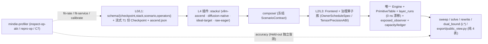

# `mindie-sim` 外部贡献者与外部 AI Agent 增量校准及研发总指南

**中文** · [English](CONTRIBUTING.en.md) · [返回项目主页](README.md)

> [!IMPORTANT]
> 本指南是 `mindie-sim`（及配套 `mindie-profiler`）的**硬件无关主干贡献规范（Master Guide）**，统一适用于 **Ascend A2 / A3 / A5 全系芯片**的硅实测校准、增量算子物理配方（`PhysicalRecipe`，含自定义 Attention 内核）开发与新模型目录接入，面向人类工程师与外部 AI 编码 Agent（Claude Code、Codex、DSH、Cursor 等）。芯片代际专属的微架构不变量、拓扑语义与 `ascend.json` 补丁模板请参阅下方对应的硬件子页面。

---

## 零、硬件校准与微架构子页面导航（Hardware Sub-Pages）

所有芯片共享本主文档定义的**唯一执行主干、7 条架构红线、五域微基准协议、`PhysicalRecipe` 守恒律与 `meta` 模型对账门禁**；涉及具体芯片的片上缓存上限、原生算力精度、核间通路与机内/超节点互联拓扑时，请按目标硬件查阅对应子页面：

| 硬件代际 | 微架构 / 能力预设 | 已注册 SKU 范围（[`ascend.json`](mindie_sim/backends/profiles/ascend.json)） | `compose --hardware` 常用别名 | 核心物理特征摘要 | 专属校准子页面 |
| :--- | :--- | :--- | :--- | :--- | :--- |
| **Ascend A2** | `DAV_2201`<br/>(`npu_arch_2201`) | `Ascend910B1`、`B2`、`B2C`、`B3`、`B4`、`B4-1`（6 款） | `a2`、`910b`、`910b1..b4`、`800i-a2` | 单封装单 Die（`20/24 AIC`），`L0C = 128 KiB`，`UB = 192 KiB`，`L2 = 192 / 96 MiB`，原生 BF16/INT8/INT4（**无原生 FP8**），AIC<->AIV 经 GM/L2 通信，8P HCCS / 16P 桥接 | [**Ascend A2 校准与开发指南**](docs/contributing/ascend-a2.md) |
| **Ascend A3** | `DAV_2201` 双 Die<br/>(`npu_arch_2201`) | `Ascend910_9391`、`9392`、`9381`、`9382`、`9372`、`9362`（6 款） | `a3`、`910c`、`800i-a3-8p`、`800i-a3-16p`、`a3-pod` | **单封装双 Die（`dies_per_package = 2`，每 Die 独立 Rank `Phy-ID 0..15`）**，片内 `SIO`（`448 GB/s`）+ 机内 `HCCS_SW` + **CloudMatrix 384** 超节点，`L2 = 192 / 168 MiB` | [**Ascend A3 校准与开发指南**](docs/contributing/ascend-a3.md) |
| **Ascend A5** | `DAV_3510`<br/>(`npu_arch_3510`) | `Ascend950DT_9581`、`9582`、`Ascend950PR_9579`、`Ascend950PR_958b`（4 款，另支持商用派生别名 `425-96`、`486-96`、`547-96`、`547-144`） | `a5`、`950`、`950pr_958b`、`425-96..547-144`、`a5-pod`、`a5-server-dt`、`a5-pod-pr` | 单封装单 Die（`32 AIC / 64 AIV` 基线，商用派生覆盖 `28/32/36 AIC`），**`L0C = 256 KiB`**，`UB = 248 KiB`，`L2 = 128 MiB`（DT `4.0 TB/s` / PR `1.6` & `1.4 TB/s`），**原生 FP8/INT8/BF16**，新增片上 `l0c->ub` 直连，`K_8` `per_pair` UB 直连网与 **Atlas 950 SuperPoD** | [**Ascend A5 校准与开发指南**](docs/contributing/ascend-a5.md) |

---

## 一、核心架构铁律：唯一主干与绝对红线（External Agent 必读）

### 1.1 唯一因果执行主干（Single Canonical Spine）

`mindie-sim` 采用**运行时无关、机理优先（Mechanism-First）单主干因果架构（`Core <-> RuntimeStackAdapter`）**。单算子评估、纯模型前向图、4 阶段 / 3 责任人因果瀑布、4D 效率拆解、全网格 SLA/PD 寻优与纯四表导出全部共享同一条单向无环主干，并最终收敛到同一个离散事件驱动引擎 `runtime.Engine` 与同一份常驻 `PrimitiveTable`：



主干各层代码职责边界如下：
- **L0 不可变契约与显式四形态边界**：[`mindie_sim/schema/checkpoint.py`](mindie_sim/schema/checkpoint.py)、[`mindie_sim/schema/stack.py`](mindie_sim/schema/stack.py)、[`mindie_sim/schema/scenario.py`](mindie_sim/schema/scenario.py) 与 [`mindie_sim/schema/operators.py`](mindie_sim/schema/operators.py) 定义 `CheckpointQuantMap`、`RuntimeStackAdapter`、逐原生层 `CacheStateABI`、显式四形态 `DeploymentMode`（`colocated | pd_disaggregated | pd_prefill | pd_decode`，零 `"auto"`/`"pd"` 猜测、零 `5000.0 ms` TTFT 强转）、`TensorPrecisionABI`、`OwnerScheduleSpec` 与 `CoDesignOpportunity`；L0 严禁导入任何具体推理引擎实现。
- **L1 模型目录、流式 Checkpoint 与硬件规格**：[`mindie_sim/model_catalog.py`](mindie_sim/model_catalog.py) 与 [`mindie_sim/catalog/checkpoint_reader.py`](mindie_sim/catalog/checkpoint_reader.py) 流式解析 `> 50 MiB` ModelSlim / HF `quantization_config` 并内置 71 份实扫开源权重描述（[`mindie_sim/catalog/data/curated_checkpoints.json`](mindie_sim/catalog/data/curated_checkpoints.json)）；[`mindie_sim/backends/ascend.py`](mindie_sim/backends/ascend.py) 与 [`mindie_sim/schema/hardware.py`](mindie_sim/schema/hardware.py) 将 [`mindie_sim/backends/profiles/ascend.json`](mindie_sim/backends/profiles/ascend.json) 物化为冻结的 `Hardware` / `Device` / `Link` 视图。
- **L4 可插拔运行时栈与组合根**：[`mindie_sim/stacks/registry.py`](mindie_sim/stacks/registry.py) 按 `WorkloadDomain` 路由 `vllm-ascend`（LLM/VLM）、`diffusion-native`（Diffusion/DiT）、`ideal-target`、`raw-eager` 及自定义 JSON 清单 / `mindie_sim.stacks` 入口点；[`mindie_sim/compose/__init__.py`](mindie_sim/compose/__init__.py) 作为组合根冻结 `ScenarioContract`（`stacks/` 绝不导入 `compose/` 或 `export/`）。
- **L2/L3 统一引擎、精确 Cohort 回放与统一显存账本**：[`mindie_sim/prediction/runtime/engine.py`](mindie_sim/prediction/runtime/engine.py)、[`mindie_sim/prediction/execution/layer_runs.py`](mindie_sim/prediction/execution/layer_runs.py)（93L/61L/48L `0 ns` 漂移原生层 Cohort 回放）、[`mindie_sim/prediction/runtime/exposed_observer.py`](mindie_sim/prediction/runtime/exposed_observer.py)（$O((N+G)\log(N+G))$ 扫描线归因）与 [`mindie_sim/prediction/capacity/ledger.py`](mindie_sim/prediction/capacity/ledger.py)（逐 Die 同时并存峰值 `ResidentMemoryReceipt`）共同提供单一物理与容量真值；[`mindie_sim/export/public_view.py`](mindie_sim/export/public_view.py) 强制纯 4 表白名单投影。
- **实测校准与盲测闭环**：[`mindie_sim/__main__.py`](mindie_sim/__main__.py)、[`mindie_sim/observations/service_fitting.py`](mindie_sim/observations/service_fitting.py)、[`mindie_sim/observations/calibration.py`](mindie_sim/observations/calibration.py) 与 [`mindie_sim/observations/resource_services.py`](mindie_sim/observations/resource_services.py) 负责消费微基准及 `mindie-profiler` 观测数据，严禁将实测耗时反向注入主干执行循环。

---

### 1.2 七条绝对架构红线（7 Iron Prohibitions）

外部贡献者与外部 AI Agent 在修改任何代码或 JSON 前，必须逐条遵守以下 **7 条绝对红线**（门禁脚本自动拦截违规提交）：

| 编号 | 绝对红线 | 代码级拦截机制与精确报错 |
| :--- | :--- | :--- |
| **红线 1** | **零旁路计算器与第二套 IR**<br/>严禁新建或恢复独立于 `runtime.Engine` 的公式估算器、私有子图 IR、独立通信耗时计算器或效率侧 `max(...)` 补丁。 | [`scripts/verify_m1.py`](scripts/verify_m1.py) 的 `hygiene` 门禁自动扫描并阻断 `opflow`、`op_formulas`、`prediction.piecewise`、`prediction.subgraphs` 等旁路模块及导入。 |
| **红线 2** | **零静默回退与严禁 `ResourceEnvelope` `1.0x` 峰值除法兜底**<br/>默认矩阵路径统一采用 `SteadyMatmul`；严禁使用 `ResourceEnvelope`，也严禁把整个算子的 `context.work` 塞入单个未分相的聚合 `Stage` 变相伪装包络；未知算子或未建模结构必须显式报错，绝不静默放行零工作量（仅显式声明的控制同步族 `CONTROL_FAMILIES` 允许空载荷）。 | [`mindie_sim/prediction/program/`](mindie_sim/prediction/program/) 中 `ResourceEnvelope.lower()` 直接抛出 `ModelingError("resource_envelope_banned")`；所有公开计时入口通过 [`unmodeled_gate.py`](mindie_sim/prediction/efficiency/unmodeled_gate.py) 统一抛出携带 `mindie-unmodeled-structure-hint/1` 的 `UnmodeledCapabilityError`。 |
| **红线 3** | **100% 结构与张量属性泛化（零 `model_id` 绑定、零 LUT 与零残差乘子）**<br/>算子选择（`implementation_selection`）、融合 pass 与 `PhysicalRecipe` **严禁按 `model_id` / 模型名分支绑定**（`model_scopes` 仅允许区分 `target` / `draft` 子图作用域），必须仅依据层结构类型、缓存连续性、量化精度与硬件 `Geometry` 泛化触发，确保同构新模型零代码继承校准结果；严禁按 `(model_name, M, N, K)` 硬编码耗时查表、反向拟合 `step/body/e2e` 窗口或虚构经验折损乘子。 | [`mindie_sim/observations/service_fitting.py`](mindie_sim/observations/service_fitting.py) 硬性拒绝 `step` / `body` / `serving` / `e2e` 窗口及 `target_ms` / `residual_ms` 字段；[`scripts/verify_m2.py`](scripts/verify_m2.py) 审计全量目录模型零包络命中。 |
| **红线 4** | **严禁容器镜像 SHA 分发与私有开发机/内网路径泄漏**<br/>源码与配置中严禁出现宿主机个人家目录绝对路径（如 macOS/Linux `$HOME/...` 本地绝对路径）、实验室内网 IP 或按容器镜像 Digest（`docker.io/`、`swr.cn-`、`@sha256:`）做分支路由。 | [`scripts/verify_m1.py`](scripts/verify_m1.py) 自动扫描阻断；源码溯源统一使用 `{repository, revision, relative_path, source_sha256}`，抓包引用统一使用 `capture://<capture-id>/<member>`。 |
| **红线 5** | **`buffer_units.l2 = 1` 共享 L2 容量归属不变量**<br/>只要在 `device.buffers` 中声明了 `"l2"` 容量，`device.buffer_units.l2` **必须且只能等于 `1`**（每颗物理 Die 共享唯一 L2 池，绝不能按 AIC/AIV 核数倍乘）。 | [`mindie_sim/schema/hardware.py`](mindie_sim/schema/hardware.py) 在解析硬件声明时强校验：若 `buffer_units.l2 != 1` 直接抛出 `ModelingError("shared_l2_buffer_requires_one_die_owner")`。 |
| **红线 6** | **增量数字与假常量门禁（Differential Numeric-Literal Gate）**<br/>自然数学与结构索引（`0`、`1`、`2`、`0.5`、`100`、`1000`、`1024`、`1e-6..1e-12`、下标/切片/`len` 比较）直接写字面量，**严禁定义 `ZERO = 0`、`ONE = 1`、`SIXTY_FOUR = 64`、`THREE_FLOAT = 3.0` 等同义数字英文假常量**；非平凡协议/代数常数提取为含真实领域名词的模块/类级 `UPPER_SNAKE_CASE` 常量，硬件常数写入 `ascend.json`。 | [`scripts/check_no_magic_numbers.py`](scripts/check_no_magic_numbers.py) 通过 AST 结构掩码比对 `--base` 提交，拦截未命名的非自然数字字面量及一切数字英文同义词假常量（退出码 `1`）。 |
| **红线 7** | **内聚优先结构治理、单一真源归属与 Unix `LF` 行尾**<br/>保持单一内聚物理域完整落在同一模块内（`~1,800` 行仅为软性评审参考而非硬性截断上限，内聚合理且声明 `[Role]` 允许超出），严禁为了凑行数强拆 `*_helpers.py` / `*_mixin.py` / `*_part*.py` 碎片；单函数保持可读（`~150` 非表行数仅为软性基线，真正单算法内聚流程超过 `150` 行时可在函数 docstring 中声明 `[Cohesive-Pipeline]` 并保持控制流嵌套 `<= 6` 层硬上限，声明式数据表除外），包内平铺文件数受控（目标 `<= 20`）且 `mindie_sim/prediction/*.py` 平铺文件数只减不增；所有设备算子配方统一归口至 `mindie_sim/prediction/operators/<family>/` 并复用唯一规范契约（`RequestView` / `AdmissionMemoryView` / `PrimitiveTable` / `ScenarioContract`）；文件前 30 行必须包含四段式契约文档头，全仓非二进制文件强制 Unix `LF`（`\n`）。 | [`scripts/check_arch_governance.py`](scripts/check_arch_governance.py)（`AG001..AG015`，含单向分层、SCC 环检测、`AG014` 零模型名分支与 `AG015` 架构图 1:1 映射）与 [`.github/scripts/check_lf_eol.py`](.github/scripts/check_lf_eol.py) 自动阻断第二套平行系统、人工碎片拆文件、平铺算子回流及 `\r\n` 行尾。 |

---

### 1.3 全栈上游源码真源路由与跨仓 SSOT 契约纪律

1. **全栈上游源码真源路由与最新 `HEAD` 核对（防“找错仓”或“对着旧源码把正确逻辑改错”）**：
   - 昇腾模型图、算子 Tiling 与内核实现分布在多层上游仓库中；若某个算子不在 `vllm-ascend` 或 `ops-transformer`，**必须按职责边界挂载并核对对应的真实上游代码仓（并先 `git fetch` 同步最新 `HEAD` revision）**，严禁靠猜测补写或对着旧快照修改：

     | 上游层级 | 代表代码仓 | 典型归属范围（找不到算子时按此表挂载） |
     | :--- | :--- | :--- |
     | **推理框架与模型配方层** | `vllm-ascend`（含上游 `vllm`）、`cann-recipes-infer`、`MindIE-SD`、`xllm` | 模型前向拼装、特性默认开关（如 DBO 下库状态）、`cann-recipes-infer` 模型级参考融合配方、`MindIE-SD` 投机/多模态/扩散加速路径 |
     | **CANN 官方算子库层** | `cann/ops-transformer`、`cann/ops-nn`、`torch-npu` | `ops-transformer`（MLA Prolog、MQSMLA、MC2、MoE Routing/GMM Tiling 与核函数）；`ops-nn`（RMSNorm、LayerNorm、动态量化、SwiGLU、基础 Matmul）；`torch-npu`（PTA `OpApi` 绑定与派发） |
     | **专项注意力与开源融合内核仓** | `fla-npu`、`flash-attn-npu`、`xllm-ops`、`TileLang / AscendC / Catlass` | `fla-npu`（KDA / GDN 分块与递归线性注意力内核）；`flash-attn-npu`（FlashAttention / 稀疏与混合窗口注意力内核）；`TileLang / AscendC / Catlass` / `xllm-ops`（开源融合算子与 Tiling 模板） |

   - **冲突裁决铁律**：动工前必须记录实际核对的 `{repository, revision}`；当历史 Issue 描述、旧文档假设与最新上游源码或真机 `msprof` 抓包冲突时，**一律以最新真实源码 + 实测抓包为唯一真源**，并在 PR Evidence 中写明上游演进差异（例如默认开关下库、新旧内核维度约束差异），严禁盲从过时描述把正确实现改错。
2. **`mindie-sim <-> mindie-profiler` 跨仓 SSOT 单源契约**：
   - `mindie_sim.observed_contracts`、`mindie_sim.subgraph_math` 与 `mindie_sim.structure*` 是 `mindie-profiler` 的单一事实源：[`mindie_sim/prediction/fusion_regions.py`](mindie_sim/prediction/fusion_regions.py) 统一维护单归属融合算子谱系（区分 `absorbed_source_ops` 与完整 `FusionBoundary`，求并集保留跨组 `structure_subgraph_memberships` 且杜绝共享复合算子重复计费）；[`mindie_sim/compose/runtime.py`](mindie_sim/compose/runtime.py) 显式标记 `recipe_binding_origins`（区分 `caller`、`stack_profile` 与 `body_default`）；[`mindie_sim/structure/__init__.py`](mindie_sim/structure/__init__.py) 支持 `--draft-prepare` / `draft_prepare=True` 导出投机预填充草稿缓存构建子图，其 `execution.resource_geometry` 仅保留拓扑结构键以维持跨标定态 `graph_id` 稳定，且 CLI 默认将输入路径脱敏为 `source: {"kind": "case_file", "sha256": ...}`。修改上述模块或算子 `source_boundary` 时，必须挂载同级 `../profiler` 联合运行跨仓测试套件。

---

## 二、Playbook A（通用篇）：标准化五域硅实测方法论与校准闭环 SOP

无论是校准 Ascend A2、A3 还是 A5（乃至新派生 SKU），所有硅实测数据采集与原语拟合均遵循统一的 **五域微基准协议** 与 **CLI 闭环管线**。

### 2.1 全局采集四项硬纪律（跨 A2 / A3 / A5 通用）

1. **显存安全与零权重污染**：采集前执行 `npu-smi info` 确认目标卡/Die 无竞争进程；全程仅分配有界合成张量（不加载大模型权重），单进程显存峰值限制在 **`<= 8 GiB`** 且保留 **`>= 2 GiB`** 空闲余量。
2. **DVFS 锁频预热（30-GEMM Clock Warmup）**：昇腾 AIC 空闲态会降频至 `100 MHz`。正式计时前必须连续执行 **`30` 次 `4096 × 4096` BF16 GEMM** 将 AIC 锁定在当前 SKU 最高频，每个测试点执行 `5` 次预热 + `20` 次 `torch.npu.Event(enable_timing=True)` 计时并重复 `3` 组独立 Trial。
3. **`>= 3 × L2` 旋转冷 HBM 环 vs 单缓冲 L2-Hot 对照**：
   - 对于单次工作集 `< 2 × L2` 的算子，必须预分配总字节数 **`>= 3 × L2_per_die`** 的连续旋转张量池（例如：`192 MiB` L2 机型取 `>= 576 MiB`；`168 MiB` L2 机型取 `>= 504 MiB`；`128 MiB` L2 机型取 `>= 384 MiB`；`96 MiB` L2 机型取 `>= 288 MiB`），每次迭代轮转不同槽位彻底驱逐 L2 缓存，记录冷 HBM 耗时 `duration_us`；
   - 同时在固定单缓冲上测量 `l2_hot_duration_us`，用于分离 `mte2_*_dram` 与 `mte2_*_l2` 服务速率。
4. **`2.5 ms` `StreamBlocker` 双模态小算子计时（`< 50 µs` 算子与 `4 KiB` 集合通信必选）**：
   - Eager 模式下 Python `OpApi` 下发开销（约 `15–45 µs`）会掩盖微秒级硬件真实执行时间。对于耗时 `< 50 µs` 的小算子和 `4 KiB` HCCL 集合通信，必须同时记录 **Eager 无阻塞模式** 与 **RTS 流饱和模式（Stream-Saturated）**：在目标流上预先入队一个耗时约 **`2.5 ms` 的阻塞算子（`StreamBlocker`）**，趁设备执行阻塞算子期间将后续 `20` 组被测算子及起止 `Event` 全部压入硬件 RTS 队列，从而精确分离出纯设备侧包容性完成下界（Inclusive Completion Minimum）：

```python
import math
import statistics
import torch
import torch_npu

WARMUP_GEMM_ITERS = 30
WARMUP_GEMM_DIM = 4096
BLOCKER_TARGET_MS = 2.5
MIN_SINGLE_GEMM_MS = 0.05
MIN_BLOCKER_REPS = 1
WARMUP_SLOT = 0
MS_TO_US = 1000.0
BENCH_WARMUPS = 5
BENCH_TIMED_ITERS = 20


def lock_aic_frequency(device: torch.device) -> tuple[torch.Tensor, torch.Tensor]:
    """Run 30x 4096^2 BF16 GEMMs to lock AIC out of 100 MHz idle DVFS state."""
    a = torch.randn((WARMUP_GEMM_DIM, WARMUP_GEMM_DIM), dtype=torch.bfloat16, device=device)
    b = torch.randn((WARMUP_GEMM_DIM, WARMUP_GEMM_DIM), dtype=torch.bfloat16, device=device)
    for _ in range(WARMUP_GEMM_ITERS):
        _ = torch.matmul(a, b)
    torch.npu.synchronize()
    return a, b


def calibrate_stream_blocker(a: torch.Tensor, b: torch.Tensor) -> int:
    """Find repeat count of 4096^2 GEMM that blocks the NPU stream for >= 2.5 ms."""
    start_ev = torch.npu.Event(enable_timing=True)
    end_ev = torch.npu.Event(enable_timing=True)
    start_ev.record()
    _ = torch.matmul(a, b)
    end_ev.record()
    torch.npu.synchronize()
    elapsed_ms = float(start_ev.elapsed_time(end_ev))
    single_ms = (
        elapsed_ms
        if math.isfinite(elapsed_ms) and elapsed_ms > MIN_SINGLE_GEMM_MS
        else MIN_SINGLE_GEMM_MS
    )
    return max(MIN_BLOCKER_REPS, math.ceil(BLOCKER_TARGET_MS / single_ms))


def measure_rts_stream_saturated_us(fn, blocker_pair: tuple[torch.Tensor, torch.Tensor], blocker_reps: int) -> float:
    """Measure pure RTS device completion time with host dispatch hidden behind a 2.5ms StreamBlocker."""
    for _ in range(BENCH_WARMUPS):
        fn(WARMUP_SLOT)
    torch.npu.synchronize()

    events = [
        (torch.npu.Event(enable_timing=True), torch.npu.Event(enable_timing=True))
        for _ in range(BENCH_TIMED_ITERS)
    ]
    a, b = blocker_pair
    for _ in range(blocker_reps):
        _ = torch.matmul(a, b)
    for idx, (s_ev, e_ev) in enumerate(events):
        s_ev.record()
        fn(idx)
        e_ev.record()
    torch.npu.synchronize()
    samples_us = [s_ev.elapsed_time(e_ev) * MS_TO_US for s_ev, e_ev in events]
    return float(statistics.median(samples_us))
```

### 2.2 五大标准测量域清单

1. **域 1：RTS 设备完成下界与微小控制面（Launch & Completion Minima）**
   - 测量 AIV 单元素 `torch.add`（`[1]` BF16）、AIC 最小矩阵乘 `torch.matmul`（`[1, 16] @ [16, 16]` BF16）、AIV 微小归一化 `torch_npu.npu_rms_norm`（`[1, 128]` BF16）及最小量化矩阵乘。
   - 写入 `device.kernel_invocations.<class>.minimum_ms`（`startup_ms` 恒为 `0.0`），对应包容性下界公式：

     $$
     T_{\text{kernel}} = \max(T_{\text{minimum}},\, T_{\text{startup}} + T_{\text{program}})
     $$

     严禁将 `minimum_ms` 当作加性启动常数，也严禁将 Eager Host 下发耗时写入设备 Profile。
2. **域 2：稠密 Cube GEMM 峰值、M-Knee 拐点与 Decode GEMV**
   - 仅测试当前芯片 `compute_arch` 原生支持的矩阵精度（A2/A3 测 `BF16/FP16/INT8/INT4`，严禁构造原生 FP8；A5 测 `BF16/FP16/INT8/FP8`）。
   - 覆盖饱和方阵 `4096³`、大模型投影 `(4096, 18432, 7168)`、拐点序列 `M ∈ {1, 16, 32, 64, 128, 256, 512, 1024, 2048}`、微小矩阵 `(32, 32, 7168)`，并对比 `NK_transposed`、`KN_contiguous` 与 `FRACTAL_NZ` 布局。
3. **域 3：MoE 分组矩阵乘（`npu_grouped_matmul` / W4A8 / MXFP）**
   - 覆盖宽专家 `(E=32, K=7168, N=4096)` 与窄专家 `(E=64, K=2048, N=1024)`，`M ∈ {32, 256, 4096, 16384}`。
   - **强制直方图留存纪律**：每条样本**必须完整保存整数数组 `group_list` / `expert_rows`**，成对采集“确定性均衡路由”与“含 0-token 尾专家的偏斜路由”，检验零行专家权重跳过率（`zero_token_expert_weight_skip`）与有效触达字节 MBU。
4. **域 4：Attention 微基准（CANN 默认基线 + 自定义 Attention 内核一等公民评测）**
   - **CANN 开箱默认基线**：采集 `npu_fusion_attention`（Prefill）及目标芯片支持的 `npu_fused_infer_attention_score` / `npu_incre_flash_attention`（Decode，`B ∈ {1, 8, 16, 32, 64}`、`L ∈ {4096, 16384, 32768}`）。
   - **自研 / 自定义 Attention 内核（AscendC `.o`、Triton-Ascend、TileLang、ATB / XLLM / SGLang 自定义 Paged / FlashMLA / Sparse / Linear Attention）**：`mindie-sim` 将自定义内核视作一等公民——无需迁就 `IFA` / `FIA`，直接用同一套锁频、旋转冷环与 `2.5 ms` `StreamBlocker` 协议**并列或替代评测你的自定义内核入口**，并额外记录：（a）`(B_q, B_k, split_k)` 与活跃 `BlockDim`；（b）非标 KV 页/量化/稀疏块表格式；（c）核间 Workspace 传递字节口径（A2/A3 的 `GM/L2` 乒乓或 A5 的 `l0c->ub` 直连）。
   - **吸收态 MLA（`512+64`）字节口径铁律**：无论内置还是自研内核，`c_kv` 与 `k_rope` 必须共享单份物理页缓存切片（每行 `576 × 2 = 1152 B`），严禁拆成 K/V 双份独立显存虚增表观带宽。
5. **域 5：AIV 向量/归约/量化/Gather/Atomic 与分层集合通信**
   - AIV 原语：测量 `npu_rms_norm`、`npu_add_rms_norm`、`npu_swiglu`、`npu_dynamic_quant`、`index_select` 及 `index_add_` / `scatter_add_`（分离逻辑有效字节与 `128 B` Cacheline 物理 RMW 事务速率 `hbm_atomic_rmw`）。
   - 分层集合通信：按芯片真实物理层级（如 A2 8P HCCS / 16P 桥接、A3 同封装双 Die `SIO` vs 跨封装 `HCCS_SW` vs SuperPoD、A5 `K_8` `per_pair` UB 直连 vs SuperPoD）分别在对应 `W` 下扫描 `4 KiB`（流饱和）至 `256 MiB` 的 `AllReduce`、`ReduceScatter`、`AllGather`、`AllToAll`，用非负仿射回归 \(t = \alpha + x / R\) 标定各层级的 `alpha_us` 与有效单向带宽。

---

### 2.3 参数拟合、单算子复现与盲测验证 CLI 工作流

1. **拟合单通道资源速率或原语响应曲线（严格隔离 `train` 与 `heldout`）**
   构造同时兼容 [`mindie_sim/observations/service_fitting.py`](mindie_sim/observations/service_fitting.py)（`fit-service` 读取 `work`）与 [`mindie_sim/observations/captures.py`](mindie_sim/observations/captures.py)（`fit-rate` 读取 `work_bytes`）契约的样本包 `hbm_read_samples.json`（`train` 至少包含 `2` 个不同工作量端点，`heldout` 样本落在训练工作量区间内以执行内插评估，`boundary` 仅限 `"resource_phase"` 或 `"device_kernel"`，源路径统一使用 `capture://` URI 脱敏）：
   ```json
   {
     "resource": "hbm",
     "work_unit": "bytes",
     "identity": "AscendSKU:npu_rms_norm:bf16:cold_ring",
     "boundary": "device_kernel",
     "active_units": 48,
     "provenance": {
       "capture": "capture://ascend-microbench-202611/domain5_vector.json",
       "window": "resource_phase"
     },
     "samples": [
       {"work": 16777216, "work_bytes": 16777216, "duration_ms": 0.0132, "run_id": "trial-1", "repeat_index": 0, "source": "capture://ascend-microbench-202611/domain5_vector.json", "split": "train"},
       {"work": 134217728, "work_bytes": 134217728, "duration_ms": 0.0985, "run_id": "trial-1", "repeat_index": 0, "source": "capture://ascend-microbench-202611/domain5_vector.json", "split": "train"},
       {"work": 67108864, "work_bytes": 67108864, "duration_ms": 0.0498, "run_id": "trial-2", "repeat_index": 0, "source": "capture://ascend-microbench-202611/domain5_vector.json", "split": "heldout"}
     ]
   }
   ```
   执行拟合与原语入库命令：
   ```bash
   # 拟合非负仿射曲线 (startup_ms + units_per_ms) 并在训练域内的 heldout 样本上自动评估内插相对误差
   python3 -m mindie_sim fit-service hbm_read_samples.json -o state/calibration/hbm_service_fit.json

   # 拟合纯资源字节速率与固定启动项 (读取 samples[*].work_bytes)
   python3 -m mindie_sim fit-rate hbm_read_samples.json -o state/calibration/hbm_rate_fit.json

   # 将显式 PrimitiveKey 样本流式写入 SQLite 原语库
   python3 -m mindie_sim calibrate state/calibration/primitives.sqlite primitive_samples.jsonl -o state/calibration/inventory.json
   ```

2. **对接 `mindie-profiler` 单算子 ABI 检查、脱敏复现生成与 C7 实测供给绑定**
   ```bash
   # 1. 查询已锁定的算子 C-ABI 签名、槽位与 Padding 语义（使用目录支持的 CANN 版本如 8.0）
   python3 -m mindie_profiler inspect-op-abi aclnnFusedInferAttentionScoreV2 --version 8.0

   # 2. 从脱敏后的 capture.json 生成自包含单算子复现脚本（按目标 Die L2 容量设置 --flush-mb >= 3x L2 与 --l2-bytes）
   python3 -m mindie_profiler repro-op \
     --capture capture_sanitized.json \
     --occurrence-index 0 \
     --flush-mb 576 \
     --l2-bytes 201326592 \
     --warmup 10 --iters 50 \
     --output-dir state/calibration/repro_op

   # 3. 将 profiler SQLite 目录通过显式 bindings.jsonl 导入原语库，或在预测时直接挂载 C7 实测供给
   python3 -m mindie_sim bind-profiler profiler_catalogue.sqlite state/calibration/primitives.sqlite bindings.jsonl -o state/calibration/bind_report.json
   python3 -m mindie_sim predict case.json --supply c7_report.json --supply-hardware <REGISTERED_SKU> -o state/calibration/pred.json

   # 4. 在独立盲测包（Held-out Packet）上生成边界对齐精度与配置排序报告
   python3 -m mindie_sim accuracy heldout_packet.json -o state/calibration/accuracy_report.json
   ```

---

## 三、Playbook B（通用篇）：增量算子物理配方（`PhysicalRecipe`）与自定义 Attention 接入

### 3.1 配方接口契约与双层扩展机制

`mindie-sim` 中所有算子执行均统一为以下两类物理配方之一，向引擎暴露一致的双阶段契约：
1. **五类通用物理机理配方（Class A–E）**：定义在 `mindie_sim/prediction/` 下，由 [`mindie_sim/prediction/physical_recipe_registry.py`](mindie_sim/prediction/physical_recipe_registry.py) 统一分发覆盖全量算子族：
   - **Class A**（`TiledFlashAndPagedAttentionRecipe`）：Flash / Paged / Latent / Sparse Attention 分块流水；
   - **Class B**（`TiledSparseIndexerRecipe`）：Sparse Indexer 打分与片上 UB TopK 更新；
   - **Class C**（`ChunkedLinearAttentionRecipe`）：GDN / KDA 分块线性注意力与块三角求逆；
   - **Class D**（`AIVTiledVectorAndGatherRecipe`）：AIV 向量、RMSNorm、动态量化、Gather、原子累加与短卷积；
   - **Class E**（`TopologyCollectiveRecipe`）：拓扑感知集合通信（AllReduce / ReduceScatter / AllGather / AllToAll）。
2. **源码级精确规划器（`PlannedRecipe`）**：针对已审阅内核源码的关键算子（如 A2/A3 的 [`operators/paged_mla/`](mindie_sim/prediction/operators/paged_mla/__init__.py)、[`w4a8.py`](mindie_sim/prediction/operators/mx_quant_matrix/w4a8.py) 或 A5 的 `paged_mla.py`、`gdn_recurrent.py`），通过 [`mindie_sim/prediction/mechanism.py`](mindie_sim/prediction/mechanism.py) 中的 `PlannedRecipe(build)` 提供 `build(op: OpSpec, geometry: Geometry) -> OperatorPlan` 与 `lower(context: RecipeContext) -> Program`。

### 3.2 工作量守恒定律与分裂读写管道（`mte2_aic` vs `mte2_aiv`）分配准则

任何新增或精化的物理配方都必须严格满足**阶段工作量守恒定律**：

$$
W_{\text{prepared}} = W_{\text{plan}} = \sum_{s \in \text{issued stages}} W_s
$$

实现时必须遵守四条物理不变量：
1. **矩阵工作量按计算精度分桶**：构造 `Work(matrix={dtype: flops}, resources={...})` 时，Cube 算力必须按实际指令精度放入 `Work.matrix`；在 `Work.resources` 中直接写入 `"cube"` 会立即触发 `ValueError("matrix_work_requires_explicit_precision")`。
2. **`mte2_aic` 与 `mte2_aiv` 独立守恒与归属隔离**：在 [`mindie_sim/prediction/physical_recipe_base.py`](mindie_sim/prediction/physical_recipe_base.py) 中，`mte2_aic`（AIC 驱动的 `GM/L2 -> L1/L0` 搬运）与 `mte2_aiv`（AIV 驱动的 `GM/L2 -> UB` 搬运）同属 `"mte2"` 阶段类别，但 `_phase_amounts` **按每个物理资源名在外层独立循环分配权重**：

   $$
   W_{s, r} = W_r \cdot \frac{\alpha_{s, c(r)}}{\sum_j \alpha_{j, c(r)}}
   $$

   因此两条分裂读管道各自严格守恒其声明字节数，绝不会把 AIC 的权重读取平摊到 AIV 管道上。
3. **真实核归属放置（Owner Placement）**：使用 `context.owned(owner, cores, roles)` 绑定每个计算核的私有管道（`cube`、`mte1`、`mte2_aic`、`fixpipe` 归属 `owner ∈ [0, P_AIC)`；`vector`、`mte2_aiv`、`mte3` 归属对应的 AIV 子核 `2*owner` / `2*owner+1`），而共享带宽池（`hbm`、`l2`）保持全局共享竞争。**尾块（Tail Tiles）绝不能借用空闲兄弟核的私有带宽或片上 `L1` / `UB` 容量**。
4. **硬件无关查询能力边界**：配方内部严禁硬编码芯片名字分支，应从 `geometry.buffers`、`geometry.resource_units` 与 `geometry.physical_mechanisms` 动态读取当前 Die 的 `L0C` / `UB` / `L2` 容量上限与管道配比。

### 3.3 硬件感知 `PhysicalRecipe` 标准编写与无污染挂载样板

下面给出符合全部 Clean-Core 门禁（4 段式文档头、零裸数字字面量、动态片上缓存容量校验、核归属绑定）的源码级配方骨架：

```python
"""Finite Cube+Vector operator pipeline parameterized by Device Geometry.

[Role] Partition declared operator work into AIC/AIV stages on the shared Engine.
[Invariants] Conserves exact prepared work per physical pipe; checks geometry
  SRAM capacities dynamically without hardcoding SKU labels.
[Timeouts & Locks] O(owners) stage construction; no I/O, locks or device calls.
[Side-Effect Policy] Pure immutable Work/OperatorPlan/KernelProgram records.
"""
from __future__ import annotations

from mindie_sim.schema.common import ModelingError, dtype_bytes
from .mechanism import Geometry, OperatorPlan, Work
from .program import KernelProgram, ParallelProgram, RecipeContext, Stage

IMPLEMENTATION = "ascend_custom_fused_op"
SOURCE = {
    "repository": "cann/ops-transformer",
    "revision": "a3925fd49cd256ad478d2faf983bf2961b8ae2c8",
    "relative_path": "custom_family/op_kernel/custom_kernel.h",
    "source_sha256": "0123456789abcdef0123456789abcdef0123456789abcdef0123456789abcdef",
}

AIC_AIV_RATIO = 2
ACCUM_DTYPE = "fp32"
REQUIRED_L0C_BYTES = 131072
REQUIRED_UB_BYTES = 163840
AIV_ROLES = frozenset({"vector", "mte2_aiv", "mte3"})


def build(op, geometry: Geometry) -> OperatorPlan:
    if geometry.buffers.get("l0c", 0) < REQUIRED_L0C_BYTES:
        raise ModelingError(f"custom_op_l0c_capacity:{REQUIRED_L0C_BYTES}")
    if geometry.buffers.get("ub", 0) < REQUIRED_UB_BYTES:
        raise ModelingError(f"custom_op_ub_capacity:{REQUIRED_UB_BYTES}")
    if geometry.resource_units.get("vector") != geometry.compute_units * AIC_AIV_RATIO:
        raise ModelingError("custom_op_requires_1_to_2_aic_aiv_pipes")

    m_rows, n_cols, k_dim = (int(axis) for axis in op.local_shape[-3:])
    aic_count = max(1, int(geometry.compute_units))
    active_owners = min(aic_count, max(1, m_rows))

    act_dtype = str(op.dtype or "bf16")
    elem_bytes = dtype_bytes(act_dtype)
    accum_bytes = dtype_bytes(ACCUM_DTYPE)
    in_bytes = (m_rows * k_dim + k_dim * n_cols) * elem_bytes
    gm_bridge_bytes = m_rows * n_cols * accum_bytes
    out_bytes = m_rows * n_cols * elem_bytes
    cube_flops = 2 * m_rows * n_cols * k_dim
    vec_ops = m_rows * n_cols

    load_work = Work(resources={"hbm": in_bytes, "mte2_aic": in_bytes})
    cube_work = Work(
        matrix={act_dtype: cube_flops},
        resources={"hbm": gm_bridge_bytes, "fixpipe": gm_bridge_bytes},
    )
    epilogue_work = Work(resources={
        "hbm": gm_bridge_bytes + out_bytes,
        "mte2_aiv": gm_bridge_bytes,
        "vector": vec_ops,
        "mte3": out_bytes,
    })
    total = load_work + cube_work + epilogue_work

    def lower(ctx: RecipeContext):
        share = 1.0 / float(active_owners)

        def owner_chain(owner: int) -> KernelProgram:
            w_load = load_work.scaled(share)
            w_cube = cube_work.scaled(share)
            w_epi = epilogue_work.scaled(share)

            aic_place = ctx.owned(owner, aic_count, {"mte2_aic"})
            cube_place = ctx.owned(owner, aic_count, {"cube", "fixpipe"})
            epi_place = {
                ctx.resource_names[role]: (AIC_AIV_RATIO * owner,)
                for role in AIV_ROLES if role in ctx.resource_names
            }
            return KernelProgram((
                Stage("aic_load", ctx.bind(w_load), placement=aic_place),
                Stage("aic_mmad_store", ctx.bind(w_cube),
                      after=("aic_load",), placement=cube_place),
                Stage("aiv_epilogue", ctx.bind(w_epi),
                      after=("aic_mmad_store",), placement=epi_place),
            ))

        return KernelProgram((
            Stage("owners", program=ParallelProgram(
                tuple(owner_chain(idx) for idx in range(active_owners))
            )),
        ))

    return OperatorPlan(total, lower, metadata={
        "implementation": IMPLEMENTATION,
        "source": SOURCE,
        "active_aic_owners": active_owners,
    })
```

#### 如何无副作用挂载到主干
- **通用算子族绑定**：在 [`mindie_sim/prediction/physical_recipe_registry.py`](mindie_sim/prediction/physical_recipe_registry.py) 中加入对应的 `*_FAMILIES` 集合。
- **架构专属默认实现**：在 [`mindie_sim/prediction/body_defaults.py`](mindie_sim/prediction/body_defaults.py) 中以严格的硬件能力与几何守卫（`case.machine.arch_family`、缓冲区容量、管道配比及 `explicit_implementation_preserved` 用户显式声明优先）挂载，确保其他芯片代际与存量模型预测结果 **100% 不变**。

---

### 3.4 专项实战：如何接入自定义 Attention 算子（AscendC / Triton / 稀疏与融合变体）

`mindie-sim` **绝不将 Attention 锁死在 CANN 内置的 `IFA` / `FIA` 上**。面对自研 AscendC 算子、Triton-Ascend 内核、TileLang 算子或 ATB / XLLM / SGLang 中的 FlashMLA / 块稀疏 / 混合窗口变体，请按变更深度由轻到重选择以下 **三级渐进扩展路径（Tiers 1–3）**：

#### Tier 1 — 参数化复用（仅分块 / 页大小 / Split-K 不同，核内流水拓扑不变）
如果自定义内核仍遵循标准的 `Q 加载 -> KV 重填 -> QK Cube -> Online Softmax -> PV Cube -> 归一化写回` 流水，仅调整了 `(B_q, B_k)` 分块大小、KV 页块粒度或双缓冲槽位数，**无需编写任何 Python 代码**，直接在 Profile 的 `physical_mechanisms.attention` 或 `Case` 的 `runtime` 中覆写参数即可（[`mindie_sim/prediction/program/`](mindie_sim/prediction/program/) 中调用方显式 `recipes` 拥有最高选择优先级，其余自动回落至 [`mindie_sim/prediction/operators/attention/attention_pipeline.py`](mindie_sim/prediction/operators/attention/attention_pipeline.py) 的 `Class A` `TiledFlashAndPagedAttentionRecipe`）：

```json
{
  "runtime": {
    "kv_block_size": 64,
    "attention_policy": {
      "query_tile": 64,
      "kv_storage": "paged",
      "reuse_kv_across_query_heads": true
    },
    "kernels": {
      "recipes": {
        "flash_attention_decode": {
          "kind": "staged_gqa_decode",
          "query_tile": 32,
          "key_tile": 64,
          "slots": 2
        }
      }
    }
  }
}
```

#### Tier 2 — 自定义核内流水配方（Custom AscendC / Triton-Ascend 核间乒乓、自定义 Quant / Mask / Workspace）
当自定义内核改变了核内阶段依赖、在线反量化或核间 Workspace 交互（例如在 A2 / A3 `DAV_2201` 上由 AIC 计算 `QK` 后经共享 L2 / GM 向 AIV 传递分数块 `S`，AIV 完成 Online-Softmax 后写回概率块 `P` 供 AIC 执行 `PV`；或在 A5 `DAV_3510` 上经 `l0c->ub` 直连传递）时：
1. 在 `mindie_sim/prediction/operators/<custom_attn>.py` 编写独立的 `build(op, geometry) -> OperatorPlan` 并封装为 `PlannedRecipe(build)`；
2. 在 [`mindie_sim/prediction/implementations.py`](mindie_sim/prediction/implementations.py)（通过 `case.runtime.kernels.lowerings` 选择）或 [`mindie_sim/prediction/physical_recipe_registry.py`](mindie_sim/prediction/physical_recipe_registry.py) / [`mindie_sim/prediction/program/`](mindie_sim/prediction/program/) 中注册 `(phase, "attention", "<custom_recipe>")`。

下面给出 **100% 通过 `check_no_magic_numbers.py` 门禁**且直接从 `geometry.buffers` 读取当前芯片 SRAM 上限（在 A2/A3 上自动执行 `L1 <= 512 KiB, L0C <= 128 KiB, UB <= 192 KiB`，在 A5 上自动放宽至 `L0C <= 256 KiB, UB <= 248 KiB`）的自定义 Attention 核间乒乓配方样板，同时精确区分 **L2 驻留的核间 Score/Prob 乒乓流量** 与 **冷 HBM KV 读取流量**：

```python
"""Custom SplitCore Attention with geometry-checked SRAM and L2 ping-pong.

[Role] Model a custom AscendC/Triton attention kernel whose QK/PV run on AIC
  and Online-Softmax runs on paired AIVs across an explicit GM/L2 workspace.
[Invariants] Enforces per-owner L1, L0C and UB capacities from Device Geometry
  (e.g. L0C=128KiB/UB=192KiB on A2/A3, L0C=256KiB/UB=248KiB on A5). Cold KV
  pages hit HBM; score/probability workspaces omit HBM traffic only when all
  live ping-pong slots fit in effective shared L2.
[Timeouts & Locks] O(owners + bounded tile window); no I/O, locks or devices.
[Side-Effect Policy] Pure immutable Work, OperatorPlan and PipelineProgram.
"""
from __future__ import annotations

from mindie_sim.schema.common import ModelingError, dtype_bytes
from ..mechanism import Geometry, OperatorPlan, PlannedRecipe, Work
from ..program import KernelProgram, ParallelProgram, PipelineProgram, RecipeContext, Stage

RECIPE_ID = "custom_flash_paged_attn"
SOURCE = {
    "repository": "org/custom-ascend-ops",
    "revision": "fedcba9876543210fedcba9876543210fedcba98",
    "relative_path": "csrc/attention/custom_paged_attn.h",
    "source_sha256": "abcdef0123456789abcdef0123456789abcdef0123456789abcdef0123456789",
}

AIC_AIV_RATIO = 2
ACCUM_DTYPE = "fp32"
SOFTMAX_VEC_OPS_PER_ELEM = 8
RESCALE_VEC_OPS_PER_OUT = 2
PINGPONG_SLOTS = 2
DEFAULT_BQ = 16
DEFAULT_BK = 128
DEFAULT_HEAD_DIM = 128
DEFAULT_L2_FRACTION = 0.75
AIV_ROLES = frozenset({"vector", "mte2_aiv", "mte3"})


def _ceil_div(numerator: int, denominator: int) -> int:
    return (numerator + denominator - 1) // denominator


def build(op, geometry: Geometry) -> OperatorPlan:
    cfg = dict(dict(op.metadata).get("custom_attn_config", {}))
    b_q = int(cfg.get("b_q", DEFAULT_BQ))
    b_k = int(cfg.get("b_k", DEFAULT_BK))
    qk_dim = int(cfg.get("head_dim", DEFAULT_HEAD_DIM))
    v_dim = int(cfg.get("v_head_dim", qk_dim))
    q_subtasks = max(1, int(cfg.get("query_groups", 1)))
    kv_len = max(1, int(cfg.get("kv_len", b_k)))
    q_dtype = str(cfg.get("query_dtype") or op.dtype or "bf16")
    kv_dtype = str(cfg.get("kv_dtype") or q_dtype)
    q_elem_b = dtype_bytes(q_dtype)
    kv_elem_b = dtype_bytes(kv_dtype)
    acc_elem_b = dtype_bytes(ACCUM_DTYPE)

    # 1. Enforce explicit per-owner SRAM limits declared on the target SKU Geometry.
    q_l1_bytes = int(b_q * qk_dim * q_elem_b)
    kv_slot_bytes = int(b_k * (qk_dim + v_dim) * kv_elem_b)
    needed_l1 = q_l1_bytes + PINGPONG_SLOTS * kv_slot_bytes
    score_bytes = int(b_q * b_k * acc_elem_b)
    prob_bytes = int(b_q * b_k * q_elem_b)
    pv_acc_bytes = int(b_q * v_dim * acc_elem_b)
    needed_l0c = max(score_bytes, pv_acc_bytes)
    needed_ub = pv_acc_bytes + score_bytes + prob_bytes

    l1_cap = int(geometry.buffers.get("l1", 0))
    l0c_cap = int(geometry.buffers.get("l0c", 0))
    ub_cap = int(geometry.buffers.get("ub", 0))
    if min(l1_cap, l0c_cap, ub_cap) <= 0:
        raise ModelingError("custom_attn_requires_explicit_sram_buffers")
    if l1_cap < needed_l1 or l0c_cap < needed_l0c or ub_cap < needed_ub:
        raise ModelingError(
            f"custom_attn_sram_overflow:l1={needed_l1}:l0c={needed_l0c}:ub={needed_ub}"
        )
    if geometry.buffer_units.get("l2", 1) != 1:
        raise ModelingError("shared_l2_buffer_requires_one_die_owner")
    if geometry.resource_units.get("vector") != geometry.compute_units * AIC_AIV_RATIO:
        raise ModelingError("custom_attn_requires_paired_aic_aiv")

    aic_count = max(1, int(geometry.compute_units))
    active_owners = min(aic_count, q_subtasks)
    k_tiles = _ceil_div(kv_len, b_k)

    # 2. Separate L2-resident AIC<->AIV score/prob ping-pong from cold HBM KV reads.
    hierarchy = getattr(geometry.physical_mechanisms, "memory_hierarchy", None)
    eff_l2 = (float(hierarchy.effective_l2_bytes) if hierarchy is not None
              else float(geometry.buffers.get("l2", 0)) * DEFAULT_L2_FRACTION)
    live_ws_bytes = PINGPONG_SLOTS * active_owners * (score_bytes + prob_bytes)
    ws_in_l2 = live_ws_bytes <= eff_l2
    has_l2_pipe = "l2" in geometry.resource_units

    def _ws_io(amount: int, pipe: str) -> dict[str, float]:
        res: dict[str, float] = {pipe: float(amount)}
        if has_l2_pipe and ws_in_l2:
            res["l2"] = float(amount)
        if not ws_in_l2:
            res["hbm"] = float(amount)
        return res

    kv_read_bytes = kv_slot_bytes
    out_bytes = int(b_q * v_dim * q_elem_b)
    qk_flops = 2 * b_q * b_k * qk_dim
    pv_flops = 2 * b_q * b_k * v_dim
    softmax_ops = b_q * b_k * SOFTMAX_VEC_OPS_PER_ELEM + b_q * v_dim * RESCALE_VEC_OPS_PER_OUT

    q_prologue = Work(resources={"hbm": q_l1_bytes, "mte2_aic": q_l1_bytes})
    tile_kv_load = Work(resources={"hbm": kv_read_bytes, "mte2_aic": kv_read_bytes})
    tile_qk = Work(matrix={q_dtype: qk_flops}, resources=_ws_io(score_bytes, "fixpipe"))
    tile_softmax = Work(resources={
        **_ws_io(score_bytes, "mte2_aiv"),
        "vector": softmax_ops,
    }) + Work(resources=_ws_io(prob_bytes, "mte3"))
    tile_pv = Work(matrix={q_dtype: pv_flops}, resources=_ws_io(prob_bytes, "mte2_aic"))
    epilogue_out = Work(resources={"hbm": out_bytes, "fixpipe": out_bytes})

    per_subtask = (
        q_prologue
        + (tile_kv_load + tile_qk + tile_softmax + tile_pv).scaled(k_tiles)
        + epilogue_out
    )
    total = per_subtask.scaled(q_subtasks)

    def lower(ctx: RecipeContext):
        def owner_program(owner: int) -> KernelProgram:
            subtasks_here = _ceil_div(max(0, q_subtasks - owner), active_owners)
            aic_io = ctx.owned(owner, aic_count, {"mte2_aic"})
            aic_cube = ctx.owned(owner, aic_count, {"cube", "fixpipe"})
            aic_pv = ctx.owned(owner, aic_count, {"cube", "mte2_aic"})
            aiv_place = {
                ctx.resource_names[role]: (AIC_AIV_RATIO * owner,)
                for role in AIV_ROLES if role in ctx.resource_names
            }

            def tile_step(_idx: int):
                return (
                    Stage("kv_cold_load", ctx.bind(tile_kv_load), placement=aic_io),
                    Stage("aic_qk_to_ws", ctx.bind(tile_qk),
                          after=("kv_cold_load",), placement=aic_cube),
                    Stage("aiv_online_softmax", ctx.bind(tile_softmax),
                          after=("aic_qk_to_ws",), placement=aiv_place),
                    Stage("aic_pv", ctx.bind(tile_pv),
                          after=("aiv_online_softmax",), placement=aic_pv),
                )

            loop = PipelineProgram(k_tiles * subtasks_here, PINGPONG_SLOTS, tile_step)
            return KernelProgram((
                Stage("q_load", ctx.bind(q_prologue.scaled(subtasks_here)), placement=aic_io),
                Stage("kv_loop", after=("q_load",), program=loop),
                Stage("out_store", ctx.bind(epilogue_out.scaled(subtasks_here)),
                      after=("kv_loop",), placement=aic_cube),
            ))

        return KernelProgram((
            Stage("owners", program=ParallelProgram(
                tuple(owner_program(idx) for idx in range(active_owners))
            )),
        ))

    return OperatorPlan(total, lower, metadata={
        "implementation": RECIPE_ID,
        "source": SOURCE,
        "workspace_l2_resident": ws_in_l2,
        "live_workspace_bytes": live_ws_bytes,
    })


CUSTOM_ATTN_RECIPE = PlannedRecipe(build)
```

#### Tier 3 — 自定义访存几何（新稀疏掩码 / 新压缩 KV 格式 / 混合窗口注意力）
当自定义 Attention 算子引入了新的**全局访存几何**（例如块稀疏选择、新型低秩/低比特压缩 KV 行格式、或局部滑动窗口 + 全局 Sink 混合掩码），但核内流水仍可复用 Tier 1（`Class A`）或 Tier 2（`PlannedRecipe`）时，应在 `Frontend`（[`mindie_sim/prediction/operators/attention/attention.py`](mindie_sim/prediction/operators/attention/attention.py) 或自定义前端模块）中通过 [`mindie_sim/prediction/memory_traffic.py`](mindie_sim/prediction/memory_traffic.py) 的 `AttentionAccessSpec` + `plan_attention_traffic()` 先完成**冷 HBM 唯一行并集 vs L2/MTE2 私用重填**的严格守恒规划，再写回 `OpSpec`：

```python
from mindie_sim.prediction.memory_traffic import (
    AttentionAccessSpec,
    AttentionSchedule,
    apply_traffic_plan,
    plan_attention_traffic,
)

CUSTOM_ROW_BYTES = 640.0
CUSTOM_TOPK_ROWS = 2048
CUSTOM_WINDOW_TOKENS = 4096
CUSTOM_QUERY_TILE = 64
CUSTOM_KEY_TILE = 128
CUSTOM_PAGE_TABLE_BYTES = 1024.0


def attach_custom_sparse_window_traffic(op, hierarchy, q_lens: tuple[int, ...], ctx_lens: tuple[int, ...]):
    access = AttentionAccessSpec(
        q_lengths=q_lens,
        context_lengths=ctx_lens,
        representation="custom_compressed_kv",
        row_bytes=CUSTOM_ROW_BYTES,
        phase=op.phase,
        topk=CUSTOM_TOPK_ROWS,
        window=CUSTOM_WINDOW_TOKENS,
        # Unknown dynamic Top-K selections MUST stay False so per-query gathers
        # are never falsely deduplicated across batch requests.
        selected_rows_known=False,
    )
    schedule = AttentionSchedule(
        query_tile=CUSTOM_QUERY_TILE,
        key_tile=CUSTOM_KEY_TILE,
        resident=True,
        page_bytes=CUSTOM_PAGE_TABLE_BYTES,
    )
    traffic = plan_attention_traffic(access, hierarchy, schedule)
    return apply_traffic_plan(op, traffic)
```

---

## 四、Playbook C：增量新增模型配置与守恒对账（`0` 参数/KV 误差门禁）

向 `mindie-sim` 新增一个模型配置时，系统强制执行**独立双轨零误差对账**（严禁用模拟器自己的权重/KV 辅助函数自证清白）。完整接入固定包含以下 **4 步**：

### 步骤 1：放入原始配置文件并注册目录键名
1. 将 HuggingFace 原始 `config.json` 放入 `mindie_sim/model_configs/<model-key>.json`（Fleet 多模态/超节点家族放入 `mindie_sim/catalog/configs/<model-key>.json`）。
2. 在 [`mindie_sim/catalog/fleet.py`](mindie_sim/catalog/fleet.py) 的 `CORE_CATALOG_ENTRIES`（或 `FLEET_CATALOG_ENTRIES`）与 `MODEL_ALIASES` 中注册规范化小写键名 `<model-key>` 及其常用大小写别名。

### 步骤 2：在 `mindie_sim/catalog/<family>.py` 构建精确 `ModelSpec` 与六本正交账本
复用现有架构构建器（`deepseek.py`、`qwen.py`、`glm.py`、`kimi.py` 或 `fleet.py`）将原始配置解析为 `LayerPlan` 序列与 `ModelSpec`，严格隔离以下 **6 类物理量**：
1. **逻辑源参数量（`source_owned=True`）**：整数 `rows * cols * count`，必须与 Checkpoint 真实张量元素数一字不差；
2. **源存储字节数**：含分组量化 Scale / Zero-Point 辅助张量；
3. **运行时常驻权重与预转换副本（`source_owned=False, runtime_owned=True`）**：例如路由器的 FP32 预转换副本 `router_precast` 或稀疏索引器预转换权重 `indexer_wk_prepared_fp32`，计入运行时显存但不虚增逻辑源参数；
4. **KV 有效载荷字节数（`capacity_padded=False`）**：按层真实注意力类型（GQA / 吸收态 MLA `512+64` / 滑动窗口 `window` / 跨层 `kv_owner_layer_id` 共享）逐层求和；
5. **KV 物理分配字节数（`capacity_padded=True`）**：包含页块对齐（Page Block Padding）与量化 Scale 字节；
6. **线性递归 / 短卷积 / 压缩器状态（`O(1)` 序列长度状态）**：独立记录于 `state_bytes_per_request`。

> [!TIP]
> - 若模型 Checkpoint 含视觉塔但仅建模文本主干，必须显式设置 `ModelSpec(..., accounting_scope="text_backbone")`；声明 `"full_checkpoint"` 则必须完整建模视觉塔与 Aligner/Projector 参数。
> - 若模型带原生 MTP / NextN / DSpark / Eagle3 投机头，必须在 [`mindie_sim/catalog/draft_spec.py`](mindie_sim/catalog/draft_spec.py) 的 `DraftSpec` 中显式声明 `layer_plans`、词表/输出头共享归属、`execution_mode ∈ {"stack", "sequential_mtp", "cyclic_nextn", "block_dspark", "eagle3_serial"}` 以及泛化上下文构建契约（`independent_context: bool`、`context_projection_mode ∈ {"none", "fused_kv_bank", "per_layer_qkv", "mla_prolog"}`、`dcp_sharded: bool`），并通过 `mindie-sim structure --draft-prepare`、`mindie-sim graph --draft-prepare --export-structure` 及 `compare_cohorts` 校验预填充草稿上下文对账，严禁从最后一层隐式猜测克隆或假定外部草稿头均为 MLA。
> - 对齐全量 **37 款核心目录模型 + 4 款独立架构预设（共 41 款，覆盖 `G1–G11` 11 个同构模型族）** 时，严守源码级结构真相：例如 `Gemma-4`（`G10`）采用标准 `RMSNorm`（`norm_weight_offset=0.0`，Dense 层 `4` 个 / MoE 层 `7` 个 Norm、无权重 `v_norm`、全注意力层 `k_eq_v=True` 省去 `v_proj` 与 YOCO `num_kv_shared_layers`）；`MiniMax-M3` / `M3.1-Flash`（`G8`）采用 `(1+w)` `GemmaRMSNorm`（`norm_weight_offset=1.0`、`swigluoai`）并配套 7 层稠密 GQA DSpark（[`mindie_sim/catalog/minimax_draft.py`](mindie_sim/catalog/minimax_draft.py)，`#20167`，`per_layer_qkv` + `dcp_sharded=False`）；`Step-5-Preview`（`G9`）使用原生 CSA `_C_ascend.npu_indexer_region_score`、`supports_torch_compile=False`（`do_not_compile=True`）、`fp32_residual=True` 与 3 层 `cyclic_nextn`（`92..94`）；`Kimi-K3`（`G5`）采用 5 层 GQA DSpark（`fused_kv_bank`、`dcp_sharded=False`，`#15851`），而 `Kimi-K3.1` 采用 5 层 MLA DSpark（`mla_prolog`）。
> - 非整除专家并行（如 `E=288, EP=64`）统一交由 [`mindie_sim/catalog/expert_slots.py`](mindie_sim/catalog/expert_slots.py) 计算物理槽位与自动 Padding，切勿硬编码 `E % EP == 0` 拦截。

### 步骤 3：接入独立 `torch.device("meta")` 参考预言机与基准清单
1. 在 [`tests/_oracles/catalog_meta_oracle.py`](tests/_oracles/catalog_meta_oracle.py) 与 [`tests/_oracles/cache_meta_oracle.py`](tests/_oracles/cache_meta_oracle.py) 中核对（或补充新架构分支）独立形状推导逻辑。**铁律：预言机文件严禁 `import mindie_sim` 任何模块**，只能直接读取原始 JSON 并在 `with torch.device("meta"):` 下构造 `torch.nn.Parameter` 校验 `numel()` 与共享张量去重（`id(tensor)`）。
2. 计算配置文件的 SHA256（`shasum -a 256 mindie_sim/model_configs/<model-key>.json`），用 `catalog_meta_oracle.declaration(reference)` 生成参考声明并写入 [`tests/fixtures/catalog_reference_manifest.json`](tests/fixtures/catalog_reference_manifest.json)。
3. 将 `<model-key>` 同步加入 [`scripts/verify_m1.py`](scripts/verify_m1.py) 的 `CATALOG_MODELS`（同步递增 `--require-models` 默认计数）与 [`scripts/verify_m2.py`](scripts/verify_m2.py) 的 `MODELS`。

### 步骤 4：运行零误差守恒对账门禁
```bash
# 运行独立 meta-device 参数与多并行度 (TP/PP/CP) KV Cache 零误差对账（假设新增 1 个模型后总数为 38）
python3 scripts/verify_m1.py catalog-meta --require-models 38 --output state/m1/catalog-meta.json
```
门禁通过的唯一标准是新增模型及存量全部模型的以下差值**精确等于 `0`**：
- `parameter_delta == 0` 且 `runtime_delta == 0`
- `missing_in_actual == 0`、`missing_in_reference == 0`、`shape_mismatches == 0`
- 在 `(tp, pp, cp) ∈ {(1,1,1), (8,1,1), (1,2,1), (1,1,2)}` 及窗口边界 Token 长度矩阵下，`kv_payload_delta == 0`、`kv_allocated_delta == 0`、`layer_sum_vs_breakdown_delta == 0`

---

## 五、提交 PR 前必跑门禁、五维微扰 Review 规范与外部 Agent 提示词模板

### 5.1 提交 PR 前必跑的 6 条门禁命令（全部 Exit 0 方可提 PR）

在 `sim` 仓库根目录下依次运行以下 **6 条门禁命令**（若修改涉及 `profiler`，同步在 `profiler` 仓库运行门禁 1 与门禁 6）：

```bash
# 门禁 1：全仓 Unix LF (\n) 行尾检查（严禁任何 CRLF \r\n）
python3 .github/scripts/check_lf_eol.py --repo-root .

# 门禁 2：增量数字与假常量 AST 门禁（放行自然数学/切片数字；严禁 TWO/SIXTY_FOUR/FOUR_FLOAT 等同义数字英文假常量与未命名魔数）
BASE_SHA="$(git merge-base HEAD origin/main)"
python3 -B scripts/check_no_magic_numbers.py --base "${BASE_SHA}" --root .

# 门禁 3：Lean 4 形式化规范零 sorry / 零 admit / 零自定义 axiom 静态门禁
python3 scripts/check_lean_no_sorry.py

# 门禁 4：M1 三连门禁（无旁路导入/私有路径/镜像字面量卫生检查 + 全目录 meta-device 零误差守恒 + <50ms 主干性能基准）
python3 scripts/verify_m1.py hygiene --output state/m1/hygiene.json
python3 scripts/verify_m1.py catalog-meta --output state/m1/catalog-meta.json
python3 scripts/verify_m1.py spine-benchmark --output state/m1/spine-benchmark.json

# 门禁 5：M2 全目录模型机理覆盖率审计（0 ResourceEnvelope、0 unmodeled_operator_mechanism、单步耗时 <50ms）
python3 scripts/verify_m2.py --output state/m2/audit.json

# 门禁 6：全量非真机单测与边界契约测试套件（并发执行，隔离宿主缓存）
PYTHONDONTWRITEBYTECODE=1 python3 -B -m pytest \
  -q -n auto --dist worksteal -p no:cacheprovider \
  -m "not live_npu"

# （涉及 observed_contracts / subgraph_math / structure* / source_boundary 时必跑）挂载同级 profiler 解锁跨仓抓包契约并验证双仓套件：
PYTHONPATH=".:../profiler" PYTHONDONTWRITEBYTECODE=1 python3 -B -m pytest \
  -q -n auto --dist worksteal -p no:cacheprovider -m "not live_npu"
PYTHONPATH=".:../profiler" PYTHONDONTWRITEBYTECODE=1 python3 -B -m pytest \
  -q -n auto --dist worksteal -p no:cacheprovider -m "not live_npu" ../profiler/tests
```

> [!NOTE]
> **全目录测试分片与共享双核 CI Runner 预算规范**：GitHub Actions 标准 `ubuntu/macos/windows-latest` Runner 仅有 2 物理核（4 线程 xdist 并发），墙钟耗时约为独占服务器的 `1.5x–2.2x`。编写遍历全目录模型或多 SKU 的测试时，**必须按 `@pytest.mark.parametrize("hardware", SKUS)` 分片**供 `worksteal` 均衡调度，严禁写成单函数双层大循环造成单 worker `10+` 分钟拖尾超时；性能门禁的墙钟上限须预留共享 4-worker 并发裕度。

**（可选）Tier-2 真机非破坏性集成验证**（仅在持有空闲 A2 / A3 / A5 测试卡时执行，强制隔离宿主目录防止环境污染）：
```bash
TMP_ISOLATED="$(mktemp -d)"
HOME="${TMP_ISOLATED}/home" \
MINDIE_CONFIG_HOME="${TMP_ISOLATED}/config" \
MINDIE_DATA_HOME="${TMP_ISOLATED}/data" \
MINDIE_DIAGNOSTICS_ROOT="${TMP_ISOLATED}/diag" \
PYTHONDONTWRITEBYTECODE=1 python3 -B -m pytest \
  -q -p no:cacheprovider -m "live_npu"
rm -rf "${TMP_ISOLATED}"
```

---

### 5.2 代码审查强制规范：五维微扰反事实审查（5-Axis Parametric Perturbation Review）

静态语法检查永远无法判断一个常数（即便是命名良好的 `BF16_BYTES = 2` 或 `A5_AIV_UNITS = 64`）在物理上是否本应是动态公式。因此：
- **自然数学与结构数字直接写字面量**（如 `0`、`1`、`2 * m * k * n`、`q * (q + 1) // 2`、`shape[-2:]`、`1000.0`），**严禁定义 `ZERO = 0`、`ONE = 1`、`TWO = 2`、`_SIXTY_FOUR = 64`、`FOUR_FLOAT = 4.0` 等同义数字英文假常量**；
- 提交者与 Reviewer 必须对 Diff 中进入物理算式的**每一个数字与命名常量**逐条做以下 **5 个反事实微扰追问**——只要任一维度微扰后该数值应当改变，就**必须改为动态查询表达式**，绝不允许保留常量：

| 微扰维度 | 反事实追问 | 必须动态推导的写法（写成常数即判退回） |
| :--- | :--- | :--- |
| **1. `dtype` 微扰** | 将 `bf16` 换成 `fp8_e4m3` (`1B`)、`int8` (`1B`)、`mxfp4`/`int4` (`0.5B`)、`fp32` (`4B`)，或令 `query_dtype != kv_dtype != score_dtype` | 所有字节宽度必须调 `dtype_bytes(tensor_dtype)`（保留 `float` 以支持 4-bit `0.5B`），严禁写 `* 2`、`* 4` 或 `2 * act_bytes` 代替 `key_bytes + value_bytes` |
| **2. `head_dim` 非对称微扰** | 将对称 GQA (`qk_dim == v_dim`) 换成吸收态 MLA (`576 != 512`)、非吸收 MLA (`192 != 128`) 或线性注意力 (`dk != dv`) | Attention FLOPs 必须写 `2 * pairs * heads * (qk_dim + v_dim)`（严禁 `4 * pairs * heads * d`）；流量拆分必须区分 `query_bytes` 与 `output_bytes`（严禁 `2 * mte3_bytes`） |
| **3. `q_len` 微扰** | 将单步 Decode (`q_len = 1`) 换成 MTP 投机验证 (`q_len = 2..8`) 或多块 Chunked Prefill (`q_len > query_tile`) | 严禁写 `sweeps - 1` 或 `q_len = 1`；必须区分 **HBM 唯一物理缓存行**（1 次）与 **L2/MTE2 分块扫描行**（`q_tiles` 次） |
| **4. 芯片代际（SKU）微扰** | 在 A5 (`32 AIC / 64 AIV / 256KiB L0C`)、A2 (`24 AIC / 48 AIV / 128KiB L0C`)、910B4 (`20 AIC / 40 AIV`) 与 A3 双 Die 间切换 | 严禁混用 `core_count` (`aic_count`) 与 `units["vector"]` (`aiv_count`)；严禁用 `64` 或 `24` 兜底覆盖硬件声明值，必须从 `die.units / die.buffers / link` 读取 |
| **5. 并行与框架双平面微扰** | 将 `TP / EP / DP / PP / PCP / DCP` 从 `1` 切到 `> 1`（含尚未在框架主线合入但数学定义完备的混合并行，如混合注意力的 `PCP > 1` / `DCP > 1`） | 明确区分全局张量维 `* (W - 1) / W` 与分片张量维 `* (W - 1)`；数学上成立的并行组合必须按第一性原理建模计算与跨卡状态/KV 通信，严禁因外部框架暂未实现而抛错拦截 |

---

### 5.3 通用外部编码 Agent 一键系统提示词模板（Universal Copy-Paste Prompt）

外部贡献者可直接将以下通用提示词块完整粘贴到 **Claude Code（`CLAUDE.md` 或首轮指令）、Codex（`AGENTS.md`）、DSH 或 Cursor（`.cursorrules`）** 中（适配 A2 / A3 / A5 全场景开发）：

````markdown
You are contributing incremental Ascend hardware calibration (`A2` / `A3` / `A5`), operator `PhysicalRecipe`s, or model catalog definitions to `mindie-sim`. Read `CONTRIBUTING.md` and the target chip guide under `docs/contributing/ascend-{a2,a3,a5}.md`, and follow every rule below without exception:

1. **Single Canonical Spine Only**:
   - Route all changes through `catalog -> compose -> Frontend -> PhysicalMechanismSpec (mindie_sim/backends/profiles/ascend.json) -> PhysicalRecipe -> EvaluationContext / runtime.Engine -> efficiency / sla / sweep / predict`.
   - NEVER recreate or import sidecar calculators (`opflow`, `op_formulas`, `prediction.piecewise`, `prediction.subgraphs`, `sol`, `afd`, `skew_analysis`, `topology_tiers`).
   - NEVER use `ResourceEnvelope` (raises `ModelingError("resource_envelope_banned")`) and NEVER wrap total operator work into a single unphased `Stage(context.work)`. Unknown mechanisms must raise `ModelingError(f"unmodeled_operator_mechanism:{op.family}:{op.recipe}")`.

2. **Zero `model_id` Binding, Zero LUTs, Zero Residual Multipliers, Zero Host/IP Leakage**:
   - NEVER branch on `model_id` / model names in `implementation_selection`, fusion passes, or `PhysicalRecipe`s (`model_scopes` may distinguish `target` vs `draft` subgraphs only); trigger mechanisms strictly from layer structure, cache contiguity, quantization dtypes, and hardware `Geometry`.
   - Before aligning operator graphs or kernel ABIs, mount and sync the latest `HEAD` revision of the owning upstream repository across the full Ascend stack (`vllm-ascend`, `cann-recipes-infer`, `MindIE-SD`, `cann/ops-transformer`, `cann/ops-nn`, `fla-npu`, `flash-attn-npu`, `xllm` / `xllm-ops`, `torch-npu`, and open `TileLang / AscendC / Catlass` kernels); when an issue assumption conflicts with fresh upstream code or real captures, follow real upstream code + captures and document the delta.
   - NEVER hardcode per-shape/per-model latency lookup tables, Zipf penalty multipliers, or whole-step/whole-body residual multipliers (`0.8x`, `0.52x`, etc.).
   - NEVER commit local host home paths (`$HOME/...`, macOS/Linux user directories), internal lab IPs, or container-image SHA routing (`docker.io/`, `swr.cn-`, `@sha256:`). Use `{repository, revision, relative_path, source_sha256}` for source provenance and `capture://<capture-id>/<member>` for benchmark/profiler captures.

3. **Hardware-Specific Invariants (`ascend-a2.md`, `ascend-a3.md`, `ascend-a5.md`)**:
   - Shared L2 rule (all chips): Whenever `buffers.l2` is set, `buffer_units.l2` MUST be `1` per Die (`shared_l2_buffer_requires_one_die_owner`).
   - **Ascend A2 (`DAV_2201`, `Ascend910B1..B4-1`)**: Single-Die (`20/24 AIC`), `L0C = 128 KiB` (`256x256` FP32 accumulators DO NOT FIT), `UB = 192 KiB`, `L2 = 192 MiB` (`B1..B3`) or `96 MiB` (`B4/B4-1`), native `bf16/fp16/fp32/hf32/int8/int4`, **NO native FP8 Cube**, AIC<->AIV via GM/L2, 8P HCCS (`per_port`) or 16P bridged.
   - **Ascend A3 (`DAV_2201` Dual-Die, `Ascend910_9362..9392`)**: `dies_per_package = 2` (1 rank = 1 physical Die `Phy-ID 0..15`, NEVER double per-Die HBM/AIC/L2 into package totals!), `L2 = 192 MiB` (`9372..9392`) or `168 MiB` (`9362`), separate intra-package `SIO` (`448 GB/s`, `0.8 us`) vs intra-node `HCCS_SW` vs CloudMatrix 384 `a3_superpod`.
   - **Ascend A5 (`DAV_3510`, `Ascend950DT_9581/9582`, `Ascend950PR_9579/958b`)**: Single-Die (`32 AIC / 64 AIV`), `L0C = 256 KiB`, `UB = 248 KiB`, `L2 = 128 MiB` (`4.0 TB/s` DT / `1.6 TB/s` `9579` / `1.4 TB/s` `958b`), native `fp8_e4m3/fp8_e5m2/int8/bf16`, direct `l0c->ub` Fixpipe path, `K_8` `per_pair` UB direct mesh (`(W-1)*47.5 GB/s`) & Atlas 950 SuperPoD (`a5_pod`).
   - Silicon microbenchmarks on all chips require: 30x `4096^2` BF16 GEMM clock warmup, `>= 3x L2_per_die` rotating cold-HBM ring paired with L2-hot, `2.5 ms` `StreamBlocker` separating RTS inclusive completion minima (`startup_ms = 0.0`) from Python host dispatch, exact integer `group_list` histograms on grouped GEMM, and unique `512+64` `c_kv` storage on absorbed MLA.

4. **PhysicalRecipe, Custom Attention (Tiers 1–3) & Model Catalog Conservation**:
   - Conserve stage work per physical resource: $W_{\text{prepared}} = W_{\text{plan}} = \sum_{s} W_s$. Put Cube FLOPs in `Work(matrix={dtype: flops})` (never `"cube"` in `resources`), keep `mte2_aic` and `mte2_aiv` separate, and bind private core resources via `ctx.owned(...)`.
   - Built-in CANN Attention ops (`npu_fusion_attention`, `IFA`, `FIA`, `paged_mla_*`) are out-of-the-box baselines ONLY — NEVER force custom Attention kernels (AscendC `.o`, Triton-Ascend, TileLang, Catlass, ATB/XLLM/SGLang custom Paged/FlashMLA/Sparse/Linear Attention) into `IFA`/`FIA`! Integrate custom Attention via Tiers 1–3: (Tier 1) override `physical_mechanisms.attention` or `case.runtime.kernels.recipes` on `Class A`; (Tier 2) add a self-contained `PlannedRecipe` in `mindie_sim/prediction/operators/<family>/` checking per-Die SRAM from `geometry.buffers`; (Tier 3) build `AttentionAccessSpec` + `plan_attention_traffic()` in `Frontend` for custom sparse/compressed-KV/hybrid-window geometry.
   - Any new model in `mindie_sim/model_configs/<name>.json` + `mindie_sim/catalog/` must register a zero-simulator-import reference in `tests/_oracles/catalog_meta_oracle.py` and `tests/fixtures/catalog_reference_manifest.json` with `0` parameter and KV byte delta.

5. **5-Axis Parametric Perturbation Review, Code Style & Pre-PR Verification Gates**:
   - Write natural math and structural numbers directly (`0`, `1`, `2 * m * k * n`, `q * (q + 1) // 2`, `shape[-2:]`, `1000.0`). NEVER define tautological digit-word constants (`ZERO = 0`, `ONE = 1`, `TWO = 2`, `SIXTY_FOUR = 64`, `FOUR_FLOAT = 4.0`, `_NUM_*`); `scripts/check_no_magic_numbers.py` explicitly rejects them.
   - Audit every literal and constant in physical formulas against the **5-Axis Perturbation Checklist**: (1) `dtype` (`dtype_bytes(...)` float, decoupled `q/k/v/out/score` dtypes), (2) `head_dim` asymmetry (`qk_dim + v_dim`, separate `q_bytes` vs `out_bytes`), (3) `q_len > 1` (MTP verify / multi-tile prefill, never `sweeps - 1`), (4) SKU geometry (`units["vector"]` vs `aic_count`, `geometry.buffers`), and (5) Parallelism & Dual-Plane (`TP/EP/DP/PP/PCP/DCP > 1` modeled from first principles, never artificially blocked when unmerged in external frameworks).
   - Follow Cohesion-First governance (`AG001`–`AG015`, `~150` non-table-line soft baseline with `[Cohesive-Pipeline]` docstring contract for genuinely cohesive single-algorithm pipelines, hard nesting `<= 6`, zero artificial `*_helpers`/`*_mixin`/`*_part*` shards or multi-arg helper chops, 4-section top-30-line docstring `[Role]`/`[Invariants]`/`[Timeouts & Locks]`/`[Side-Effect Policy]`, and Unix `LF` `\n` endings); hardware numbers go in `ascend.json`, non-trivial protocol invariants use semantic `UPPER_SNAKE_CASE` names.
   - Run and pass all gates before finishing:
     1. `python3 .github/scripts/check_lf_eol.py --repo-root .`
     2. `python3 -B scripts/check_no_magic_numbers.py --base $(git merge-base HEAD origin/main) --root .`
     3. `python3 -B scripts/check_arch_governance.py --root . --strict`
     4. `python3 scripts/check_lean_no_sorry.py`
     5. `python3 scripts/verify_m1.py hygiene && python3 scripts/verify_m1.py catalog-meta && python3 scripts/verify_m1.py spine-benchmark`
     6. `python3 scripts/verify_m2.py --output state/m2/audit.json`
     7. `PYTHONDONTWRITEBYTECODE=1 python3 -B -m pytest -q -n auto --dist worksteal -p no:cacheprovider -m "not live_npu"`
````

---

## 六、运行时栈接入、四阶段因果瀑布与正交编译契约

模拟器通过 **L0 `RuntimeStackAdapter` 协议（[`mindie_sim/schema/stack.py`](mindie_sim/schema/stack.py)）与 L4 插件注册表（[`mindie_sim/stacks/registry.py`](mindie_sim/stacks/registry.py)）** 严格分离**运行时无关核心（Core）**与**具体推理服务栈实现**：

- **内置栈插件与域感知路由（`resolve_stack_for_scenario`）**：
  - `vllm-ascend`（[`mindie_sim/stacks/vllm_ascend/`](mindie_sim/stacks/vllm_ascend/)）：LLM / VLM 默认栈，封装前缀映射、打包校验、构造豁免、`FRACTAL_NZ` 策略、投机/ACLGraph 规则、静态 `LaunchConfigCodec` 与 [`manifest.json`](mindie_sim/stacks/vllm_ascend/manifest.json)；
  - `diffusion-native`（[`mindie_sim/stacks/diffusion_native/`](mindie_sim/stacks/diffusion_native/)）：Diffusion / DiT 默认栈，绑定 `prediction/operators/diffusion/`，绝不伪造 LLM KV Cache；
  - `ideal-target`（[`mindie_sim/stacks/ideal_target/`](mindie_sim/stacks/ideal_target/)）与 `raw-eager`（[`mindie_sim/stacks/raw_eager/`](mindie_sim/stacks/raw_eager/)）：跨 LLM / VLM / Diffusion 的硬件上限与无融合 Eager 基准栈。
  - 若强制指定与 `WorkloadDomain` 不兼容的栈，立即抛出 `ModelingError("stack_domain_mismatch:...")`。
- **四阶段 / 三责任人因果瀑布与四阶特性轨道**：Before-vs-After 报告统一在单一 `Engine` 上按 `Before -> Graph_cfg ([1] ops_config) -> Graph_fwk ([2] framework_python) -> Graph_After ([3] kernel_dev_tune)` 归因，并严格遵循显式四形态部署契约（`--deployment-mode` in `{colocated, pd_disaggregated, pd_prefill, pd_decode}`，零 `"auto"`/`"pd"` 猜测、零 `5000.0 ms` TTFT 强转）。在特性机制分析层，每项优化为框架中立的 Layer-1 `OptimizationMechanism`（[`mindie_sim/feature_mechanisms.py`](mindie_sim/feature_mechanisms.py)），由 `RuntimeStackProfile` 映射到以下**四阶特性状态（4-Rung Feature Tracks）**：

| 轨道（Track） | 物理与工程语义 | CLI 选择参数 |
| :--- | :--- | :--- |
| `raw_eager` | 零可选栈级融合、关闭图捕获与 `torch.compile` 的纯 PyTorch/ATen Eager 基线（不设模型白名单门禁） | `--feature-track raw_eager` |
| `merged` | 服务栈当前主干已合入的真实机制集合（默认 `vllm-ascend` + CANN `9.3.0`） | `--feature-track merged` |
| `unmerged_pr` | `merged` 叠加已审计的活跃未合入 PR 物理机制（多 PR 同机制自动合并选项与溯源引用，绝不字典覆盖丢失） | `--feature-track unmerged_pr` |
| `expected_ideal` | 栈中立第一性原理上界：激活当前 `(model, hardware, parallel)` 结构兼容的全部 `OptimizationMechanism` | `--feature-track expected_ideal` |

- **四阶瀑布与双视角 PR 消融（[`mindie_sim/feature_mechanisms.py`](mindie_sim/feature_mechanisms.py)）**：执行 `mindie-sim feature-tracks --model <name> --hardware a5 --tp 8 --ep 8` 可一次性输出 **`raw_eager` -> `current_merged` -> `current_unmerged_pr` -> `expected_ideal` -> `hardware_roofline`**，自动审计阶梯单调性，并在 `current_unmerged_pr` 下同时给出正向单加 **`single_pr_ablation`**（`merged + {PR}`）与留一剔除 **`leave_one_out_ablation`**（`unmerged_pr - {PR}`）；`compose` 的 `--enable-opt` / `--disable-opt` 支持单机制正交 What-If 对比。
- **`Software` 正交两层编译契约（[`mindie_sim/schema/case.py`](mindie_sim/schema/case.py)）**：`Software` 将外层图捕获 `graph_capture_mode`（`"none"` / `"piecewise"` / `"full"`）与内层编译器布尔开关（`enable_torch_compile`、`enable_npugraph_ex`、`enable_static_kernel`、`enable_super_kernel`）正交解耦：模型标记 `do_not_compile=True` 时**保留 `graph_capture_mode="full"`** 而仅关闭 `enable_torch_compile` / `enable_npugraph_ex`；当 `graph_capture_mode != "full"` 或 `enable_torch_compile=False` 时，自动关闭 `enable_npugraph_ex`、`enable_static_kernel` 与 `enable_super_kernel`。

**严禁将未经验证的第三方推理栈硬编码为 Core 分支。** `mindie-llm`、`sglang`、`xllm` 等外部框架一律通过 `mindie-sim.stack-manifest/1` JSON 清单、`mindie_sim.stacks` Python `entry_points` 或 `register_stack(...)` / `register_runtime_stack(...)` 插件化接入，并如实声明模型与域支持范围：

| 字段 | 含义 | 门禁约束 |
| :--- | :--- | :--- |
| `supported_models` | 该栈**已合入主干（`merged`）**支持的模型列表；空元组 `()` 仅保留给不受限的结构基线（如 `raw_eager`）。 | 非空时门禁拦截不在列表中的 `merged` 请求，且自动计入 `unmerged_pr` 支持集。 |
| `unmerged_pr_models` | 模型接入本身仍处于**未合入 Open PR** 状态的模型列表。 | 非空时额外放行 `unmerged_pr`，但绝不在 `merged` 上放行。 |

当不满足支持集时，显式抛出 `model_not_supported_by_runtime_stack:<stack>:<model>:<track>`；而 `raw_eager` 与 `expected_ideal` 始终放行，绝不因外部框架未支持某模型而阻断第一性原理建模：

1. **纯 JSON 零代码接入**：编写符合 `mindie-sim.stack-manifest/1` 的清单文件，通过 `--stack /path/to/my_stack.json` 或 `--stack-manifest my_stack.json` 传入 CLI（或 Python `load_manifest_stack(...)` / `runtime_stack="my_stack.json"`）：
   ```json
   {
     "schema": "mindie-sim.stack-manifest/1",
     "name": "my-external-stack",
     "repository": "my-org/my-stack",
     "supported_domains": ["llm", "vlm"],
     "supported_models": ["deepseek-v3.2"],
     "unmerged_pr_models": ["qwen3.8-flash-next"],
     "bindings": [
       {"mechanism_id": "aclgraph_decode_capture", "state": "merged",
        "ref": "my-org/my-stack@main"}
     ]
   }
   ```
2. **Python `RuntimeStackAdapter` 插件接入**：实现 `mindie_sim.schema.stack.RuntimeStackAdapter` 并在外部包 `pyproject.toml` 的 `[project.entry-points."mindie_sim.stacks"]` 暴露适配器类，零修改 Core 代码即可由 [`mindie_sim/stacks/registry.py`](mindie_sim/stacks/registry.py) 自动发现。
3. **注册新物理优化机制与巡检 PR 状态**：调用 `register_optimization_mechanism(OptimizationMechanism(...))` 提供由唯一因果引擎执行的真实 `OpSpec` / Lowering Pass / `Software` 变换；运行 `python3 scripts/audit_stack_prs.py --stack cann93` 巡检已合入与新开性能 PR。

---

## 附：扁平同级 Worktree 工作流与 PR 设计原则门禁（`device-tool`）

完整英文版请参阅 [CONTRIBUTING.en.md](CONTRIBUTING.en.md)。

1. **扁平同级 + 独立链接 Worktree 开发流**：保持主检出目录停留在干净 `main`，在 `../.worktrees/` 下创建独立工作树开发：
   ```bash
   git -C ../sim fetch origin
   git -C ../sim worktree add -b feat/<topic> ../.worktrees/sim-<topic> origin/main
   ```
2. **PR 设计原则门禁（`--profile device-tool`）**：所有 PR 须填写 [`.github/pull_request_template.md`](.github/pull_request_template.md) 并通过 `python3 .github/scripts/check_pr_checklist.py --profile device-tool`，逐项给出实证记录（纯文档变更可填写 `not-applicable: docs-only`）：
   - `DEV-ZERO-CTX`：仿真、合成与目录解析路径绝不加载权重、动态导入 `torch_npu` 或初始化 NPU 上下文（`0 MiB` HBM 增量）。
   - `DEV-READONLY-PATH`：分析与预测 CLI/API 不篡改输入产物、不泄漏宿主机 `$HOME`/内网 IP/镜像 SHA，并在捕获 `OSError` 前显式重抛 `TimeoutError`。
   - `DEV-TOPOLOGY`：严格维护每 Die 唯一共享 `L2`（`buffer_units.l2 == 1`）、A2/A3 双 Die/A5（`DT` + `PR_9579/958b`）互联拓扑与阶段工作量守恒（禁用 `ResourceEnvelope`、未建模结构抛 `UnmodeledCapabilityError`）；零 `model_id` 算子硬编码，对齐所属全栈上游仓（`vllm-ascend` / `cann-recipes-infer` / `MindIE-SD` / `ops-transformer` / `ops-nn` / `fla-npu` / `flash-attn-npu` / `TileLang` / `AscendC` / `Catlass` 等）最新源码真源并保持 `mindie-profiler` SSOT 契约兼容。
   - `DEV-BOUNDED-MEM`：流式读取大抓包/大 Checkpoint（`> 50 MiB` 流式解析，`<= 512 MiB` 内存峰值）、遵循内聚优先治理与四段式契约头（`AG001`–`AG015`，`~150` 非表行软性基线与 `[Cohesive-Pipeline]` 单算法内聚声明 / 嵌套 `<= 6` 硬上限，零人为碎片文件与多参拆函数）、通过 `check_no_magic_numbers.py`（禁假常量）、多 SKU 全目录测试按 `parametrize` 分片并留足共享双核 4-worker xdist 墙钟裕度，全仓使用 Unix `LF`。
