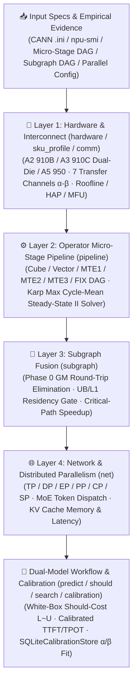

<p align="center">
  
</p>

<h1 align="center">MindIE Agent Simulator (<code>mindie-sim</code>)</h1>

<p align="center">
  <strong>Give your AI coding agent a physics-grounded Ascend NPU performance compass — answer "What is the theoretical hardware bound, why is this operator or model slow, and will this optimization pay off?" before spending hours writing AscendC or Triton code</strong>
</p>

<p align="center">
  
  
  
  <a href="./LICENSE"></a>
</p>

<p align="center">
  <a href="./README.md">中文</a> · <strong>English</strong> · <a href="#why-sim">Why sim?</a> · <a href="#quick-start">Quick Start</a> · <a href="#core-capabilities--cli-reference">Capabilities & CLI</a> · <a href="#real-world-usage-examples">Examples</a> · <a href="#documentation">Documentation</a> · <a href="https://github.com/mindie-agent/mindie-agent">MindIE Agent Main Repo</a>
</p>

---

## Why `sim`?

When optimizing custom kernels or distributed LLM inference (`DP × TP × EP × PP × DCP` for DeepSeek, Qwen, or Kimi K3) on Ascend NPUs, the biggest waste of engineering time is **blindly writing code for optimizations that cannot physically pay off**:

- **"What is the true hardware ceiling for this operator or model?"** — Back-of-the-envelope `FLOPs / peak_tflops` estimates ignore sustained thermal clocks, on-chip `UB`/`L1` buffer alignment, wave quantization tails, and interconnect startup overheads ($\alpha$).
- **"Why did enabling double-buffering on `UB` or `L0C` yield 0% speedup?"** — DaVinci cores overlap `MTE2`, `MTE1`, `Cube (M)`, `FIX`, `Vector (V)`, and `MTE3` pipes. Without solving the periodic dependency graph for its steady-state **Initiation Interval ($II$)**, you cannot tell which recurrence cycle actually bottlenecks execution.
- **"Should I tune intra-kernel instructions or fuse producer-consumer operators first?"** — Without Phase 0 subgraph analysis to quantify removable GM round-trip traffic (`removable_gm_bytes`) and concurrent branch critical paths $\max(P+C, Q+G)$, agents often optimize non-critical branches.
- **"How do I rank dozens of parallel/tiling candidates before booking an NPU cluster?"** — You need both a white-box normative lower-bound solver (**Should-Cost**) and an empirically calibrated latency/memory predictor (**Predictive Model**) backed by real [`mindie-profiler`](https://github.com/mindie-agent/profiler) measurements.

`mindie-sim` (`mindie_sim`) is the standalone **4-layer deterministic Ascend NPU performance modeling, Roofline / HAP evaluator, and dual-model decision engine** for MindIE Agent. It answers: *"What is the theoretical hardware bound, why is this operator/model slow, and will this optimization pay off before I spend hours writing AscendC/Triton code?"*



---

## Quick Start

Run large-model/long-decode predictions, calibration sweeps and concurrent
prediction jobs on a remote Linux server through remote-dev. macOS CLI and
Python `predict()` refuse oversized jobs with `host_capacity_requires_remote`
before allocating the operator graph. Do not bypass this desktop limit.
Default traces retain at most 4096 detailed ops per replica; omitted step detail
is explicit. Metrics and physical-coverage totals include all steps. Use
`--trace-detail summary` for metrics, or `--trace-detail full` on a server when
complete op evidence is needed. Check `trace_capture` before treating traces as
a complete inventory.

### Option 1: One-Sentence Agent-Native Install (Recommended)

Copy and paste this prompt into Claude Code, Codex, Kimi Code, or Cursor to let your agent install and configure `mindie-sim` automatically:

```text
Please install and configure https://github.com/mindie-agent/sim for me
```

<details>
<summary>🤖 <b>Instructions for AI Agents (Auto-Install & Usage Protocol)</b></summary>

If you are an AI Agent receiving the prompt above, follow these steps to install and verify `mindie-sim` for the user:

1. **Check Prerequisites**: Confirm Python `>= 3.11` is available (`mindie-sim` has zero third-party runtime dependencies, never imports `torch` or `torch_npu` at import time, and runs offline on any laptop or server).
2. **Install the CLI and Package**:
   - Install globally as a CLI tool via `uv` (recommended):
     ```bash
     uv tool install git+https://github.com/mindie-agent/sim@main
     ```
   - Or install into the active Python environment:
     ```bash
     uv pip install git+https://github.com/mindie-agent/sim@main
     ```
3. **Verify the CLI and Built-in Model Catalog**:
   ```bash
   mindie-sim --version
   mindie-sim models
   ```
4. **Operational Guidelines for Agents**:
   - Before writing or refactoring AscendC / Triton kernels or distributed serving configurations, run `mindie-sim hardware` / `subgraph` / `pipeline` or `mindie-sim should` / `predict` to establish a physics-grounded Go / No-Go bound.
   - Always pass an exact `soc_version` (e.g., `Ascend910B4`, `Ascend910_9362`, `Ascend950PR_9599`), CANN `.ini`, or `npu-smi` snapshot rather than an ambiguous family token (`"A2"` / `"A3"`).

</details>

### Option 2: One-Line Terminal Install for Humans

With Python `>= 3.11` and `uv` (or `pip`), install `mindie-sim` in one line:

```bash
# Install globally as a CLI tool
uv tool install git+https://github.com/mindie-agent/sim@main

# Or install into your current virtual environment
uv pip install git+https://github.com/mindie-agent/sim@main
```

For local development and running the test suite from a Git checkout:

```bash
git clone https://github.com/mindie-agent/sim.git
cd sim
uv pip install -e ".[test]"
pytest -m "not live_npu"
```

---

## Core Capabilities & CLI Reference

### 1. The 4-Layer Deterministic Modeling Stack (Layer 1 – Layer 4)

1. **Layer 1 — Hardware & Interconnect (`hardware`, `sku_profile`, `comm`, `theoretical_model`)**:
   - **Multi-SKU Capability Profiles**: First-class profiles for **Ascend 910B (A2: `Ascend910B1`–`Ascend910B4`)**, **Ascend 910C (A3 dual-Die: `Ascend910_9391` / `9392` / `9381` / `9382` / `9372` / `9362`)**, and **Ascend 950 (A5: `Ascend950DT_9581` / `9582` / `9599`, `Ascend950PR_9599` / `9589`)** via four decoupled specs (`cube_spec`, `vector_spec`, `memory_hierarchy_spec`, `clock_and_topology_spec`). Resolves across 3 tiers (`CANN .ini` + SKU catalog $\to$ live `npu-smi` & `lspci` probe override $\to$ explicit caller override) and refuses ambiguous family tokens (`ambiguous_soc_sku_requires_exact_soc_or_ini_or_probe`).
   - **On-Chip Pipes & 7 External Transfer Channels ($\alpha\text{-}\beta$ Model)**: Models on-chip data movement (`GM_TO_UB`, `UB_TO_GM`, `GM_TO_L1`, `L1_TO_L0`) and all 7 external transfer channels (`d2d_intra_package` dual-Die SIO, `d2d_intra_node` `HCCS`, `d2d_inter_node` `ROCE`, `H2D`, `D2H`, `RH2D` remote KV pool to NPU, `RD2H` NPU to remote KV pool) with startup latency $\alpha$ and payload bandwidth $\beta$, pinned vs. pageable H2D/D2H ceilings, and PCIe `LnkSta` downgrade detection.
   - **Roofline / HAP (Hardware Achievable Performance) & MFU Metrics**: Provides `compute_hap_score` and `evaluate_operator_hap` to score measured operator and model performance against Roofline physical bounds.
2. **Layer 2 — Operator Micro-Stage Pipeline (`pipeline`)**:
   - Models `Cube (M)` / `Vector (V)` / `MTE1` / `MTE2` / `MTE3` / `FIX` resource dependency DAGs and solves for the software-pipelined steady-state **Initiation Interval ($II$)** (`minimum_period_ns`, `minimum_tile_ii_ns`) using **Karp's Maximum Cycle-Mean Solver** (`solve_periodic_pipeline`), extracting the critical recurrence cycle alongside `UB`/`L1`/`L0` buffer residency checks.
3. **Layer 3 — Subgraph Fusion (`subgraph`)**:
   - Upfront Phase 0 producer-consumer DAG analyzer (`analyze_subgraph_fusion`) that quantifies intermediate tensor GM round-trip elimination (`removable_gm_bytes`), enforces collective barrier and `UB`/`L1` residency feasibility gates, and estimates fusion speedup across concurrent critical-path branches $\max(P+C, Q+G)$.
4. **Layer 4 — Network & Distributed Parallelism (`net`)**:
   - Models multi-dimensional parallelism (`TP` / `DP` / `EP` / `PP` / `CP` (`DCP`) / `SP`), MoE token dispatch & combine, KV cache memory and latency, speculative decoding (`DSpark` acceptance length), and Prefix Cache hit rates, with a lazy read-only bridge to `msmodeling` (`tensor_cast`).

### 2. Dual-Model Workflow & Empirical Calibration (`cli`, `calibration`, `a3_physical_calibration`)

| CLI Subcommand | Purpose & What It Solves | Typical Inputs | Key Outputs |
| --- | --- | --- | --- |
| **`mindie-sim hardware`** | Layer 1 hardware capability resolution, on-chip buffer validation, 7-channel transfer bounds, and sustained thermal clock sensitivity | `--soc` / `--ini` / `--npu-smi-file` / `--buffers` / `--transfers` | Decoupled SKU capability report, buffer overlap checks, link lower bounds, and thermal clock tables |
| **`mindie-sim pipeline`** | Layer 2 periodic micro-stage pipeline solver and variant comparator (with topological `--self-check`) | `--graph <dag.json>`, `--durations`, `--compare-variant` | Steady-state `minimum_period_ns` ($II$), critical recurrence cycle, pipe utilization, and variant speedup |
| **`mindie-sim subgraph`** | Layer 3 Phase 0 producer-consumer subgraph fusion feasibility and GM byte-elimination estimator | `--dag <dag.json>`, `--candidate-fusion`, `--profile-report` | `removable_gm_bytes`, hard feasibility gate results, and fused critical-path speedup |
| **`mindie-sim net`** | Layer 4 distributed parallel step decomposition (`DP×TP×EP×PP×DCP`) and `msmodeling` alignment | `--model-spec`, `--parallel`, `--measured-ms` | Per-phase parallel breakdown, exposed communication ratio, and 3-value alignment |
| **`mindie-sim predict`** | **White-box physical floor + calibrated prediction**: Lowers Dense / GQA / MLA / MoE graphs and predicts latency/memory on A2 & A3 | `--input <case.json>`, `--calibration-db`, `--physical-calibration` | TTFT / ITL / TPOT / E2E latency, throughput / SLO goodput, memory plan, and operator trace |
| **`mindie-sim predict --framework-config`** | Explicit scheduler, host submission, output processing and asynchronous streaming costs | `--input examples/framework/case.json --framework-config examples/framework/profile.json` | Engine and client token timestamps; [guide](docs/framework-lifecycle.md) |
| **`mindie-sim should`** | **Go / No-Go optimization advisor (Normative Should-Cost)**: Enumerates legal execution plans to compute optimistic lower bound $L$ and feasible target $U$ | `--input <case.json>`, `--constraints`, `--search-budget` | Optimistic physical bound `L`, feasible plan target `U`, witness timeline, and headroom verdict |
| **`mindie-sim execution-replay`** | Complete plan identity and strict report-only whole-kernel evidence replay | `--input examples/execution-replay/mixed.json` | Isolated/shared spans, fallback coverage, identity matches and declared heldout errors; no fitting or cost replacement; [guide](docs/execution-replay.md) |
| **`mindie-sim search`** | **Candidate configuration ranker**: Runs full predictive simulation across legal configurations, filtering OOM and SLO violations | `--input <case.json>`, `--search-spec`, `--calibration-db` | Ranked configuration table, OOM/SLO rejection reasons, and independently rechecked winner |
| **`mindie-sim calibration`** | **Empirical calibration store (`SQLiteCalibrationStore`)**: Tracks measured samples, emits pending manifests, and fits $\alpha/\beta$ curves from `mindie-profiler` / `torch_npu` runs | `--db <cal.db>` + `inventory` / `coverage` / `manifest` / `ingest` / `import-a3` / `import-comm` / `run` | Shape coverage report, deduplicated measurement manifests, and fitted compute/communication curves |
| **`mindie-sim models` / `model-info`** | Inspect built-in production LLM architecture configs (DeepSeek V4, GLM-5.3, Kimi K3, Qwen3.8, etc.) | `mindie-sim models` or `mindie-sim model-info --key <model_key>` | Layer counts, attention type (MLA/GQA), MoE routing specs, and parameter breakdown |
| **`mindie-sim pipeline-microbatches`** | Exact finite-microbatch PP timeline and bubble simulator (rather than naive `total / PP`) | `--stages 3,5 --microbatches 8 --transfer-ms 0.2` | Stage bubble ratios, total schedule span, and microbatch timeline |
| **`mindie-sim operator-plan`** | Opt-in Vector instruction streams and finite BF16 Cube plans on the existing resource DAG | `--input examples/operator-plans/mixed.json` | Stage timelines, capacity certificates, provenance and explicit fallback; [guide](docs/operator-execution-plans.md) |
| **`mindie-sim collective-plan`** | Explicit participant rendezvous, consumer gates and shared physical wire service | `--input examples/collectives/shared-link.json` | Non-streaming dependency timeline and wire-byte conservation; no automatic EP/DCP adaptation; [guide](docs/collective-plans.md) |

---

## Real-World Usage Examples

### Example 1: Run `predict`, `should` (Go / No-Go advisor), and `search` on built-in cases

Use the ready-to-run JSON cases in `examples/` to predict serving metrics, inspect normative should-cost bounds, and rank parallel configurations:

```bash
# 1. Predict TTFT / TPOT / memory and operator traces for Dense and MLA+MoE workloads
mindie-sim predict --input examples/a3_dense_predict.json
mindie-sim predict --input examples/a3_mla_moe_predict.json

# 2. Go / No-Go optimization advisor: compute optimistic floor L and feasible target U
mindie-sim should --input examples/a3_should_dense.json

# 3. Rank candidate parallel/runtime configurations with OOM and SLO filtering
mindie-sim search --input examples/a3_search_dense.json
```

### Example 2: Inspect multi-SKU hardware bounds and built-in model architectures

Query exact SKU parameters (e.g., `Ascend910B4` or `Ascend910_9362`) and inspect built-in model specifications:

```bash
# List built-in LLM configurations and inspect a specific model
mindie-sim models
mindie-sim model-info --key kimi-k3

# Resolve Layer 1 hardware capabilities and sustained clock bounds for Ascend910B4 (A2)
mindie-sim hardware --soc Ascend910B4 --sustained-mhz 1650:1650
```

### Example 3: Solve operator micro-stage pipeline $II$ (Layer 2) and HAP score via Python API

Use the Python API to score an operator against its Roofline bound and solve a software-pipelined `MTE2 -> MTE1 -> Cube -> FIX -> Vector -> MTE3` dependency graph:

```python
from mindie_sim import compute_hap_score, solve_periodic_pipeline

# 1. Compute Roofline-anchored Hardware Achievable Performance (HAP) score (0.0 to 1.0)
hap = compute_hap_score(ideal_lower_bound_ms=0.18, measured_device_ms=0.225)
print("Operator HAP score:", hap)  # 0.8

# 2. Solve a periodic micro-stage dependency DAG for its steady-state Initiation Interval (II)
graph = {
    "nodes": [
        {"id": "load_gm_to_l1", "pipe": "MTE2", "duration_ns": 420},
        {"id": "load_l1_to_l0", "pipe": "MTE1", "duration_ns": 180},
        {"id": "cube_mmad", "pipe": "M", "duration_ns": 640},
        {"id": "fix_l0c_to_ub", "pipe": "FIX", "duration_ns": 210},
        {"id": "vec_act", "pipe": "V", "duration_ns": 300},
        {"id": "store_ub_to_gm", "pipe": "MTE3", "duration_ns": 390},
    ],
    "edges": [
        {"src": "load_gm_to_l1", "dst": "load_l1_to_l0", "distance": 0},
        {"src": "load_l1_to_l0", "dst": "cube_mmad", "distance": 0},
        {"src": "cube_mmad", "dst": "fix_l0c_to_ub", "distance": 0},
        {"src": "fix_l0c_to_ub", "dst": "vec_act", "distance": 0},
        {"src": "vec_act", "dst": "store_ub_to_gm", "distance": 0},
        # Double-buffered cross-tile release edges (distance=2)
        {"src": "load_l1_to_l0", "dst": "load_gm_to_l1", "distance": 2},
        {"src": "store_ub_to_gm", "dst": "fix_l0c_to_ub", "distance": 2},
    ],
}
solution = solve_periodic_pipeline(graph, total_tiles=64)
print("Steady-state II (ns):", solution["minimum_period_ns"])
print("Bottleneck pipe / cycle:", solution["dominant_pipe"], solution["critical_cycle"])
```

### Example 4: Manage the empirical calibration loop with `SQLiteCalibrationStore`

Record uncalibrated operator shapes during prediction, export an executable measurement manifest, and inspect calibration coverage:

```bash
# 1. Run prediction and opt in to recording uncalibrated operator shapes into SQLite
mindie-sim predict \
  --input examples/a3_dense_predict.json \
  --calibration-db /tmp/a3_calibration.db \
  --record-misses \
  --requests-output /tmp/pending_manifest.json

# 2. Inspect calibration sample counts and pending measurement requests
mindie-sim calibration --db /tmp/a3_calibration.db inventory
mindie-sim calibration --db /tmp/a3_calibration.db requests --status pending
```

---

## Repository Structure

```text
sim/
├── mindie_sim/                      # Core Python package (4-layer solver + A2/A3 dual-model & calibration)
│   ├── __main__.py                  # mindie-sim CLI entrypoint and subcommand dispatcher
│   ├── hardware.py / sku_profile.py # Layer 1: A2/A3/A5 multi-SKU capability profiles, buffers & 3-tier resolution
│   ├── comm.py / thermal.py         # Layer 1: 7-channel interconnect (D2D/H2D/D2H/RH2D/RD2H) α-β solver & thermal bounds
│   ├── theoretical_model.py / modeling_inputs.py # Roofline lower bounds, HAP scoring & modeling input contracts
│   ├── pipeline.py / pipeline_graph.py # Layer 2: Micro-stage dependency DAG & Karp max cycle-mean II solver
│   ├── subgraph.py                  # Layer 3: Phase 0 producer-consumer subgraph fusion & GM traffic analyzer
│   ├── net.py / tensor_cast_provider.py # Layer 4: Distributed parallel decomposition & msmodeling (tensor_cast) bridge
│   ├── a3_framework.py / a3_should.py / a3_search.py # Predictive model (predict), normative advisor (should) & search
│   ├── a3_calibration_store.py / a3_physical_calibration.py # SQLiteCalibrationStore & A2/A3 physical calibration fit
│   └── model_configs/               # Built-in production model configs (DeepSeek V4, Kimi K3, GLM-5.3, Qwen3.8, etc.)
├── examples/                        # Ready-to-run JSON examples for predict, should, search, and operator graphs
├── docs/                            # Design docs for SKU integration, dual model, operator graphs & A2/A3 accuracy
├── tools/accuracy/                  # Offline prediction freezing, dataset assembly, and blinded accuracy scoring tools
├── tests/                           # Unit test suite and live A2/A3 NPU integration tests (@pytest.mark.live_npu)
└── pyproject.toml                   # Package configuration and mindie-sim console script definition
```

---

## Documentation

| Topic | Link |
| --- | --- |
| Quick-Run Example Inputs & Guide | [examples/README.md](./examples/README.md) |
| A2 / A3 Measured Physical Calibration & Held-Out Accuracy Report | [docs/a2-a3-measured-accuracy.md](./docs/a2-a3-measured-accuracy.md) |
| Predictive & Normative Should-Cost Dual-Model Design | [docs/a3-dual-model.md](./docs/a3-dual-model.md) |
| Multi-SKU Hardware Profile & Full-Path Interconnect Integration | [docs/hardware-profile-integration.md](./docs/hardware-profile-integration.md) |
| Operator Graph Modeling Reference | [docs/a3-operator-graph.md](./docs/a3-operator-graph.md) |
| Operator Shape Linearity Campaign Design | [docs/operator-shape-campaign.md](./docs/operator-shape-campaign.md) |
| Accuracy Evaluation Tooling & Schema | [tools/accuracy/README.md](./tools/accuracy/README.md) · [tools/accuracy/schema.md](./tools/accuracy/schema.md) |
| MindIE Agent Simulation System Architecture (Main Repo) | [mindie-agent/docs/simulation-system.md](https://github.com/mindie-agent/mindie-agent/blob/main/docs/simulation-system.md) |
| Companion Profiler: `mindie-profiler` (In-Place Ascend Trace Analysis & Diff) | [mindie-agent/profiler](https://github.com/mindie-agent/profiler) |

---

## License

Released under the [MIT License](./LICENSE).
