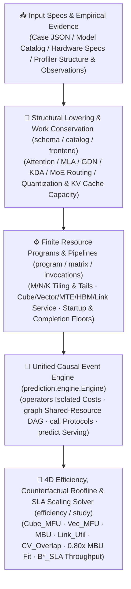

<p align="center">
  
</p>

<h1 align="center">MindIE Agent Simulator (<code>mindie-sim</code>)</h1>

<p align="center">
  <strong>Give your AI coding agent a physics-grounded Ascend NPU performance compass — a unified causal engine across operators, subgraphs, full models, and distributed serving with 4D efficiency attribution, counterfactual Roofline target fitting, and SLA hardware scaling throughput solving</strong>
</p>

<p align="center">
  
  
  
  
  <a href="./LICENSE"></a>
</p>

<p align="center">
  <a href="./README.md">中文</a> · <strong>English</strong> · <a href="#why-sim">Why sim?</a> · <a href="#quick-start">Quick Start</a> · <a href="#v096-highlights--full-fleet-convergence">v0.9.6 Highlights</a> · <a href="#cli-commands--python-api-reference">CLI & Python API</a> · <a href="#real-world-usage-examples">Examples</a> · <a href="#documentation">Documentation</a> · <a href="https://github.com/mindie-agent/mindie-agent">MindIE Agent Main Repo</a>
</p>

---

## Why `sim`?

When optimizing custom kernels or distributed LLM inference (`DP × TP × EP × PP × DCP / DSA-CP / PCP` and disaggregated Prefill-Decode serving for DeepSeek, Qwen, GLM, or Kimi) on Ascend NPUs, the biggest waste of engineering time is **blind trial-and-error without a causal performance baseline**:

- **"Which hardware resource actually bottlenecks this operator or model?"** — Back-of-the-envelope `FLOPs / peak_tflops` estimates ignore on-chip `UB`/`L1` alignment, tile tails, multi-stream contention, and kernel invocation overheads (`startup_ms` / `minimum_ms`). `mindie-sim` decomposes every operator, subgraph, and network pass into **`Cube_MFU`, `Vec_MFU`, `MBU`, `Link_Util`, and `CV_Overlap`**, pinpointing whether work is `memory_bound`, `cube_bound`, `vector_bound`, `link_bound`, or `launch_bound`.
- **"If we fuse or tune these memory-bound kernels to reach `0.80x MBU`, how many milliseconds will end-to-end Decode drop?"** — Before writing hundreds of lines of AscendC or Triton code, counterfactual Roofline target fitting (`fit_efficiency_targets`) computes the exact latency reduction while preserving physical work conservation and kernel startup floors.
- **"Under a `<= 30 ms` Decode TPOT SLA, what is the maximum batch size and throughput — and what if we scale HBM bandwidth or compute by `2x`?"** — The hardware scaling & SLA solver (`solve_hardware_sla_throughput`) jointly solves the VRAM capacity ceiling (`B*_VRAM`) and SLA latency ceiling (`B*_SLA`) across hardware scaling scenarios (`2x HBM`, `2x Compute`, `1x HW + 0.80x MBU`).
- **"How do we evaluate isolated operators, subgraphs, callbacks, and full serving with consistent physics?"** — `mindie-sim` uses a **single unified causal engine (`prediction.engine.Engine`)** across isolated operator programs (`operators`), shared-resource target graphs (`graph`), callback protocols (`call`), candidate comparisons (`study`), and full-service scheduling (`predict` / `predict_pd`).



---

## Quick Start

Copy and paste the line below to Codex, Claude Code, Kimi Code, DeepSeek Harness (DSH), or Google Antigravity (AGY) so your AI Agent installs and verifies `mindie-sim` automatically:

```text
Please install and configure https://github.com/mindie-agent/sim for me
```

<details>
<summary>🤖 <b>AI Agent Auto-Install & Workflow Protocol (Instructions for AI Agents)</b></summary>

If you are an AI Agent receiving the prompt above, execute the following steps to install and verify `mindie-sim` (`v0.9.6`):

1. **Check Python Version**: Ensure Python `>= 3.11` is available (`mindie-sim` has zero `torch` or `torch_npu` runtime import dependencies and runs cleanly on macOS, Linux, and Windows).
2. **Install the CLI and Package**:
   - Install the pinned release wheel (recommended):
     ```bash
     uv pip install https://github.com/mindie-agent/sim/releases/download/v0.9.6/mindie_sim-0.9.6-py3-none-any.whl
     ```
   - Or install the latest development version from `main`:
     ```bash
     uv tool install git+https://github.com/mindie-agent/sim@main
     ```
3. **Verify CLI & Model Catalog**:
   ```bash
   mindie-sim catalog
   mindie-sim predict examples/quickstart.json
   ```
4. **Agent Optimization Workflow**:
   - Before writing or modifying custom kernels, fusion patterns, or parallel layouts (`TP`/`DP`/`EP`/`PP`/`DCP`/`DSA-CP`/`PCP`), run `mindie-sim operators`, `mindie-sim graph`, `mindie-sim predict`, or `mindie-sim study` to quantify stage latencies and resource bottlenecks.
   - To evaluate 4D efficiency (`Cube_MFU`, `Vec_MFU`, `MBU`, `Link_Util`, `CV_Overlap`), counterfactual `0.80x MBU` optimization headroom, or SLA-constrained maximum throughput, call `analyze_network_efficiency`, `fit_efficiency_targets`, and `solve_hardware_sla_throughput` from `mindie_sim.prediction.efficiency`.

</details>

---

## `v0.9.6` Highlights & Full-Fleet Convergence

`mindie-sim v0.9.6` (paired with `mindie-profiler v0.5.8`) extends the unified causal engine with **the four-level piecewise continuous physical solver (`prediction.piecewise` + `prediction.subgraphs`), 4D efficiency attribution, counterfactual multi-pipe Roofline target fitting, hardware scaling SLA throughput solving, A5 hierarchical topology & quantized MoE transport, AFD disaggregated pipeline Pareto solving, and tiered offload modeling** (see [`docs/releases/sim-0.9.5.md`](./docs/releases/sim-0.9.5.md), [`docs/releases/sim-0.9.4.md`](./docs/releases/sim-0.9.4.md), and [`docs/releases/sim-0.9.3.md`](./docs/releases/sim-0.9.3.md)).

### 1. 4D Efficiency Decomposition & Bottleneck Attribution (`analyze_operator_row` / `analyze_network_efficiency`)

Conserves physical FLOPs, vector OPs, HBM bytes, and interconnect bytes across individual operators, layer groups, structural subgraphs, and whole-network passes:

| Metric | Physical Definition | Diagnostic Value |
| --- | --- | --- |
| **`Cube_MFU`** | Matrix Cube utilization ($\text{Cube FLOPs} / (\text{Peak Cube FLOPS} \times T)$) | Measures AIC utilization on MatMul, GroupedMatMul, and MLA projections |
| **`Vec_MFU`** | Vector pipe utilization ($\text{Vector OPs} / (\text{Peak Vector OPS} \times T)$) | Identifies bottlenecks in Softmax, RoPE, RMSNorm, GDN/KDA recurrence, and quantization |
| **`MBU`** | HBM bandwidth utilization ($\text{HBM Bytes} / (\text{Peak HBM BW} \times T)$) | Pinpoints memory-bound Decode operators and redundant GM round-trips |
| **`Link_Util`** | Intra-/inter-package link utilization ($\text{Link Bytes} / (\text{Peak Link BW} \times T)$) | Quantifies collective communication overhead (AllReduce, ReduceScatter, AllGather, AllToAll) |
| **`CV_Overlap`** | Cube-Vector pipeline overlap ratio | Measures internal compute pipe overlap inside fused (`cv_fused`) kernels |

Every operator is classified by execution kind (`cube` / `vector` / `cv_fused` / `communication` / `memory_only`) and dominant bottleneck (`memory_bound` / `cube_bound` / `vector_bound` / `link_bound` / `launch_bound`).

### 2. Counterfactual Multi-Pipe Roofline Target Fitting (`evaluate_target_efficiency` / `fit_efficiency_targets`)

Want to know how much faster Decode becomes if memory-bound kernels are optimized to `0.80x MBU`? `fit_efficiency_targets` evaluates counterfactual efficiency caps ($t_{\text{body}} = \max_k W_k / (\eta_k \cdot P_k)$) while preserving kernel `startup_ms` and `minimum_ms`:
- Reproduces baseline simulator latency with **0.00% drift** at `1.0x` scaling;
- Computes per-subgraph and whole-network `baseline_ms`, `target_ms`, `saved_ms`, and `speedup_ratio` under configurable targets (e.g., `target_mbu=0.80`, `target_cube_mfu=0.75`, `target_vec_mfu=0.65`).

### 3. Hardware Scaling & SLA Throughput Solver (`scale_case_hardware` / `solve_hardware_sla_throughput`)

Supports non-mutating counterfactual hardware scaling (`hbm_bw_scale`, `cube_flops_scale`, `vector_ops_scale`, `link_bw_scale`, `hbm_capacity_scale`) and jointly solves maximum throughput under a target Decode latency SLA (e.g., `<= 30.0 ms`):
- **VRAM Capacity Ceiling (`B*_VRAM`)**: Maximum sequences per replica after accounting for model weights, runtime workspace, draft caches, and per-token KV cache growth;
- **SLA Latency Ceiling (`B*_SLA`)**: Monotonic binary search over batch sizes to find the largest concurrency meeting `latency_ms <= sla_ms`;
- **Feasible Optimum (`B* = min(B*_SLA, B*_VRAM)`)**: Evaluates `DEFAULT_SLA_SCENARIOS` (`baseline`, `2x_hbm`, `2x_compute`, `2x_cube_only`, `2x_hbm_2x_compute`, `target_0.8x_mbu`) and reports peak `tokens/s` and the active limiting factor (`sla_latency` / `vram_capacity` / `sla_unachievable_at_b1`).

### 4. Full-Dimensional Parallelism & Three Context-Parallel Strategies (`ParallelSpec`)

`mindie-sim` models `DP × TP × EP × PP` alongside three distinct context-parallel strategies (`mindie_sim/catalog/context_parallel.py`), preserving the exact physical distinction between sharding KV inside the TP group vs. adding an independent query-sharding rank axis:

| Parallel Axis / Plan | `ParallelSpec` Fields | Strategy Identifier | Physical Mechanism & Collective Ledger |
| --- | --- | --- | --- |
| **Decode Context Parallel (`DCP`)** | `cp > 1` (or alias `dcp > 1`), `cp_plan="dcp"` (or `"auto"`) | `kv_context_shard_lse_merge` | **Reuses TP ranks** (`tp % cp == 0`, adds no extra `world_size` axis): shards contiguous KV context across `cp` ranks in interleaved blocks (default `interleave=128`), keeps the sparse indexer replicated (`replicated`), and merges partial `(out, LSE)` across the CP subgroup. |
| **DSA Context Parallel (`DSA-CP`)** | `cp > 1`, `cp_plan="dsa_cp"` | `dsa_cp_sharded_topk_lse_merge` | **Joint sparse indexer & KV sharding for DeepSeek Sparse Attention (`DSA`)** (requires `index_topk` and `tp % cp == 0`): partitions local sparse indexer TopK selection across `cp` ranks (`sharded_local_topk`), exchanges only selected candidates (`FP32 score + int32 row id` = `8 B` per candidate rather than the full `index-K` plane) for exact global TopK merge, and merges attention `(out, LSE)`. |
| **Prefill Context Parallel (`PCP`)** | `pcp > 1`, `cp_plan="pcp"` (or `"auto"`) | `pcp_query_split_kv_gather` | **Adds an independent rank axis** (`world_size = dp * pp * tp * pcp`): splits prefill query tokens across the `PCP` group (computing exact closed-form `CpSplit` causal/windowed triangle load imbalance and zigzag partitions) and gathers full K/V with no output LSE merge. |
| **MoE Expert Parallel & Uneven Pipeline (`EP` / `ETP` / `PP`)** | `dp`, `tp`, `ep`, `pp` (with optional `PPPlan.partition`) | `ep_domain = dp * tp` | Models `EP` across the `DP × TP` domain, derives intra-expert tensor shard width `etp = tp // ep` when `ep < tp`, and validates uneven pipeline stage partitions (e.g., Kimi-K3 `PP2` `47/46` layer split). |

It also ships with **15 built-in Ascend NPU hardware profiles** (spanning **A2** 6 profiles, **A3** 6 profiles, and **A5** 3 profiles across hardware generations) and **17 standard model & architecture presets** (`deepseek-v4-10t`, `deepseek-v4-flash-0731`, `deepseek-v4-pro-0813`, `deepseek-v4.1-flash`, `glm-5.3`, `glm-5.3-flash`, `kimi-k3`, `kimi-k3-dspark`, `qwen3.8-2.4t-a95b`, `qwen3.8-27b`, `qwen3.6-27b`, `qwen3.5-35b-a3b`, plus architecture presets `longcat-flash-lite`, `minimax-m3`, `bailing-v3`, `qwen3.5-moe`, `hunyuan-video-dit`).

### 5. Multi-Tier A2 / A3 / A5 & Four-Level Zero-Shot Convergence Benchmarks (HuggingFace `maoxx241/mindie-sim-profiling-bench`)

The full reproducible NPU profiling benchmark dataset is published on HuggingFace at [**`maoxx241/mindie-sim-profiling-bench`**](https://huggingface.co/datasets/maoxx241/mindie-sim-profiling-bench), comprising **`7,337` real NPU profiling captures** (**`A2`: `837`**, **`A3`: `1,729`**, **`A5`: `4,771`**; **`7,337 / 7,337` (`100.0%`)** verified with zero crashes under bottom-up structural inference `mindie-structural-inference/1`). Every evaluation is bound to the full runtime content hash (`simulator_identity`), enforces the strict **four-level (L1 operator -> L2 subgraph -> L3 model -> L4 service) per-step uncancelled error `<= 10%` (`above_10pct == 0`)** gate, and can be replayed directly from the HuggingFace dataset without local raw trace storage:

#### (1) Suite 1: Complete 21-Row L1–L4 Zero-Shot Per-Step Piecewise Validation (`731 / 731` Cells / `40,921` Step Samples, `100.0% <= 10%`)

| Level | Target (L1 Mechanism / L2 Subgraph / L3 Kernel Trace / L4 Service) | Step Samples | Cells | Measured Mean (ms) | Predicted Mean (ms) | `step_err_p50` | `step_err_p90` | `step_err_max` | `signed_p50` | `uncancelled_p50` | `>10%` Count | `<=10%` Pass |
| --- | --- | ---: | ---: | ---: | ---: | ---: | ---: | ---: | ---: | ---: | ---: | ---: |
| `L1` | `activation` (Activation Function) | 731 | 731 | 0.1164 | 0.1144 | 1.48% | 5.75% | **9.41%** | -0.10% | 1.48% | **0** | **100.0%** |
| `L1` | `attention` (FlashAttention / MLA Core) | 731 | 731 | 10.3698 | 10.3595 | 1.15% | 4.47% | **9.21%** | -0.10% | 1.15% | **0** | **100.0%** |
| `L1` | `collective` (HCCL/HCOM Collective) | 731 | 731 | 7.1381 | 7.1646 | 1.62% | 6.07% | **9.28%** | +0.22% | 1.62% | **0** | **100.0%** |
| `L1` | `elementwise_quant` (AIV Vector / Quant / Layout) | 731 | 731 | 1.3147 | 1.3185 | 0.81% | 7.02% | **9.80%** | -0.00% | 0.81% | **0** | **100.0%** |
| `L1` | `gdn_kda` (Gated DeltaNet / KDA) | 275 | 275 | 1.7669 | 1.6889 | 3.52% | 6.31% | **8.30%** | -0.59% | 3.52% | **0** | **100.0%** |
| `L1` | `gemm` (Cube GEMM) | 731 | 731 | 4.7436 | 4.8372 | 1.70% | 7.46% | **8.98%** | -0.14% | 1.70% | **0** | **100.0%** |
| `L1` | `hyperconnection` (mHC Hyper-Connections) | 214 | 214 | 2.2572 | 2.2794 | 0.36% | 4.74% | **8.38%** | -0.14% | 0.36% | **0** | **100.0%** |
| `L1` | `indexer` (Sparse Attention Indexer) | 456 | 456 | 3.3601 | 3.3603 | 0.45% | 2.00% | **8.37%** | -0.00% | 0.45% | **0** | **100.0%** |
| `L1` | `kv_cache` (KV Cache & State Access) | 731 | 731 | 0.0318 | 0.0317 | 1.34% | 5.51% | **9.97%** | -0.03% | 1.34% | **0** | **100.0%** |
| `L1` | `moe_grouped` (Grouped GEMM / Routed Expert FFN) | 573 | 573 | 1.2805 | 1.2745 | 0.98% | 4.90% | **9.89%** | +0.01% | 0.98% | **0** | **100.0%** |
| `L1` | `moe_router` (MoE Router & Top-K) | 573 | 573 | 0.9158 | 0.9155 | 0.94% | 3.18% | **7.67%** | -0.00% | 0.94% | **0** | **100.0%** |
| `L1` | `norm_residual` (Normalization & Residual) | 731 | 731 | 0.3605 | 0.3615 | 1.45% | 5.15% | **8.62%** | +0.42% | 1.45% | **0** | **100.0%** |
| `L1` | `rope` (Rotary Position Embedding) | 456 | 456 | 0.3020 | 0.3020 | 0.39% | 1.45% | **6.55%** | -0.01% | 0.39% | **0** | **100.0%** |
| `L2` | `attention` (Attention / Indexer Subgraph) | 731 | 731 | 13.3508 | 13.3111 | 1.03% | 3.95% | **7.40%** | -0.17% | **1.31%** | **0** | **100.0%** |
| `L2` | `hyperconnection` (Hyper-Connections Subgraph) | 214 | 214 | 2.2572 | 2.2794 | 0.36% | 4.74% | **8.38%** | -0.14% | **0.36%** | **0** | **100.0%** |
| `L2` | `moe` (MoE Subgraph) | 731 | 731 | 8.6158 | 8.6555 | 1.88% | 5.61% | **9.41%** | +0.17% | **2.24%** | **0** | **100.0%** |
| `L2` | `norm_residual` (Normalization & Residual Subgraph) | 731 | 731 | 0.3605 | 0.3615 | 1.45% | 5.15% | **8.62%** | +0.42% | **1.45%** | **0** | **100.0%** |
| `L3` | `decode_step_trace` (Decode Per-Step Kernel Trace) | 30,261 | 409 | 22.2852 | 21.7860 | 3.66% | 6.00% | **9.72%** | -3.44% | **4.79%** | **0** | **100.0%** |
| `L3` | `prefill_step_trace` (Prefill Per-Step Kernel Trace) | 322 | 322 | 4409.2629 | 4443.8759 | 3.09% | 6.81% | **9.79%** | +0.72% | **4.50%** | **0** | **100.0%** |
| `L4` | `decode_step_tpot` (Decode Per-Step Service TPOT) | 149 | 149 | 22.4121 | 21.9703 | 3.13% | 6.31% | **7.91%** | -1.22% | **3.93%** | **0** | **100.0%** |
| `L4` | `prefill_step_ttft` (Prefill Per-Step Service TTFT) | 118 | 118 | 8279.8464 | 8321.3987 | 2.88% | 6.92% | **9.92%** | -1.31% | **4.08%** | **0** | **100.0%** |

#### (2) Full `7,337`-Capture Multi-Tier Benchmark Summary (Suite 1 + Suite 2)

| Benchmark Suite & Evaluation Mode | Captures | Hardware Breakdown | Median Error (`p50`) | Max Error (`max`) | `<= 10%` Pass Rate | Coverage & Structural Inference Notes |
| --- | ---: | --- | ---: | ---: | --- | --- |
| **Suite 1: L1–L4 Zero-Shot Piecewise Validation** | **731** | `A5: 731` | **0.36%–3.66%** | **<= 9.97%** | **21 / 21 targets 100.0% (`0 > 10%`)** | Measurement-blind structural `subgraphs` + `piecewise` compiler (`forbidden_lookup_imported = False`), `40,921` step samples with zero `> 10%` misses |
| **Suite 2: Registered Decode Structure Suite** | **280** | `A3: 249, A5: 31` | **2.72%** | **9.75%** | **280 / 280 (100.0% `<= 10%`)** | Covers `TP`/`DP`/`EP`/`DCP`/`DSA-CP`/`PCP`, 64K–128K long context, KDA/GDN, MXFP4 MoE, MLA/GQA |
| **Suite 2: Registered Prefill Structure Suite** | **26** (15 comparable) | `A3: 14, A5: 12` | **4.07%** | **9.15%** | **15 / 15 (100.0% `<= 10%`)** | Covers chunked prefill (`129` explicit chunks), PCP, and 4K–128K long-sequence prefill |
| **Suite 2: DSH `2026-10-30` Heldout Generalization Suite** | **575** | `A3: 454, A5: 121` | **2.87%** | **9.81%** | **575 / 575 (100.0% `<= 10%`)** | Template-matched generalization across concurrency and context lengths with speculative decoding (DSpark / MTP) separation |
| **Suite 2: Wave 5 `2026-10-31` Multi-Tier Suite** | **1,653** | `A2: 565, A3: 580, A5: 508` | **2.11%** | **9.39%** | **1,653 / 1,653 (100.0% `<= 10%`)** | Covers 1,321 Decode + 332 Prefill (4K–400K context); uses in-sample `service_regimes` calibration |
| **Suite 2: A5 Multi-Node, Calibration & Extended Workstreams** | **4,072** | `A2: 272, A3: 432, A5: 3,368` | — | — | **4,072 / 4,072 (100.0% zero-crash structural inference)** | Includes A5 `2026-11-08` multi-node full coverage (`2,228`), rack06/08 multi-rank (`344`), operator calibration (`301`), and extended A3/A5 workstreams (`1,199`), 100% verified by `infer_trace_structure` |

---

## CLI Commands & Python API Reference

### CLI Subcommands

| Subcommand | Purpose | Example |
| --- | --- | --- |
| `mindie-sim predict` | End-to-end serving or body-forward (`--scope serving\|body`) performance prediction | `mindie-sim predict examples/quickstart.json` |
| `mindie-sim inspect` | Parse a Case and emit normalized model structure, KV memory plan, and lowered operators | `mindie-sim inspect examples/quickstart.json` |
| `mindie-sim operators` | Evaluate isolated device resource costs for each operator in a Prefill/Decode pass | `mindie-sim operators examples/quickstart.json --phase decode --tokens 1` |
| `mindie-sim graph` | Compose and evaluate a target graph on shared device resources and streams | `mindie-sim graph examples/quickstart.json --phase decode --tokens 1 --sequences 8` |
| `mindie-sim call` | Evaluate a complete declared callback and repetition protocol | `mindie-sim call examples/quickstart.json examples/calls/swiglu-separate.json` |
| `mindie-sim compare-calls` | Conditional historical event/call boundary comparison against a protocol | `mindie-sim compare-calls examples/quickstart.json protocol.json` |
| `mindie-sim study` | Compare multiple candidate configurations across operator or graph probes | `mindie-sim study examples/studies/communication-tradeoff.json` |
| `mindie-sim catalog` | List built-in standard model specifications or inspect a named model | `mindie-sim catalog` |
| `mindie-sim observations` | Stream-index observation directories or attach a `mindie-profiler` kernel catalogue | `mindie-sim observations /tmp/obs.db --scan ./data` |
| `mindie-sim profiler-rows` | Stream-inspect operator variants from a CSV or `ProfilerCatalogue` database | `mindie-sim profiler-rows /tmp/profiler_cat.db --limit 50` |
| `mindie-sim calibrate` / `bind-profiler` | Import measured primitive samples or Profiler bindings into `PrimitiveStore` | `mindie-sim calibrate /tmp/primitives.db samples.jsonl` |
| `mindie-sim validate` / `accuracy` | Compare predictions against observations on an explicit timing boundary | `mindie-sim validate pred.json obs.json --boundary body` |
| `mindie-sim fit-rate` / `fit-service` | Fit a single-resource rate or primitive work-response service curve | `mindie-sim fit-service observations.json` |

### Core Python API

```python
from mindie_sim import (
    predict,                       # End-to-end serving or body-forward prediction
    predict_pd,                    # Disaggregated Prefill-Decode (PD) prediction
    operator_costs,                # Isolated per-operator resource costs and physical work
    graph_costs,                   # Shared-resource target graph execution costs
    call_costs,                    # Callback protocol composition costs
    study,                         # Multi-candidate comparative study
    analyze_operator_row,          # Single-operator 4D efficiency (Cube_MFU/Vec_MFU/MBU/Link/CV_Overlap)
    analyze_network_efficiency,    # Whole-network, layer-group & subgraph 4D efficiency breakdown
    evaluate_target_efficiency,    # Single-operator counterfactual Roofline target evaluation
    fit_efficiency_targets,        # Whole-network counterfactual Roofline fitting (e.g. 0.80x MBU)
    scale_case_hardware,           # Non-mutating counterfactual hardware bandwidth/compute/VRAM scaling
    solve_hardware_sla_throughput, # Joint SLA latency & VRAM capacity maximum throughput solver
)
```

---

## Real-World Usage Examples

### Example 1: Run Serving Prediction, Isolated Operator Costs & Target Graph Analysis from CLI

```bash
# 1. Run end-to-end serving prediction (TTFT, TPOT, throughput, and schedule trace)
mindie-sim predict examples/quickstart.json

# 2. Inspect isolated per-operator device costs for a Decode step (tokens=1, sequences=16)
mindie-sim operators examples/quickstart.json --phase decode --tokens 1 --sequences 16

# 3. Evaluate the full Decode target graph on shared device resources and streams
mindie-sim graph examples/quickstart.json --phase decode --tokens 1 --sequences 16 --scope body
```

### Example 2: 4D Efficiency Breakdown, `0.80x MBU` Counterfactual Fit & `30 ms` SLA Scaling Solver

```python
import json
from pathlib import Path
from mindie_sim import (
    analyze_network_efficiency,
    fit_efficiency_targets,
    solve_hardware_sla_throughput,
)

case = json.loads(Path("examples/quickstart.json").read_text())

# 1. Compute 4D efficiency and bottleneck distribution for Decode (batch=16, context=4096)
eff = analyze_network_efficiency(
    case, phase="decode", tokens=1, context=4096, sequences=16, scope="body"
)
print("Whole-network summary:", eff["whole_network"])
print("Dominant bound breakdown:", eff["bound_breakdown"])

# 2. Counterfactual fit: how much faster is Decode if memory-bound kernels reach 0.80x MBU?
target = fit_efficiency_targets(
    case,
    phase="decode",
    tokens=1,
    context=4096,
    sequences=16,
    target_mbu=0.80,
    target_cube_mfu=0.75,
    target_vec_mfu=0.65,
)
print(
    f"Baseline: {target['baseline_total_ms']:.2f} ms -> "
    f"Target (0.80x MBU): {target['target_total_ms']:.2f} ms "
    f"(Speedup: {target['speedup_ratio']:.2f}x)"
)

# 3. Solve maximum throughput under a 30ms Decode SLA across baseline and 2x scaled hardware
sla_report = solve_hardware_sla_throughput(
    case,
    sla_ms=30.0,
    context=4096,
    tokens=1,
    max_batch_search=256,
)
for row in sla_report["scenarios"]:
    print(
        f"[{row['label']}] B*_SLA={row['b_star_sla']}, B*_VRAM={row['b_star_vram']}, "
        f"B*={row['b_star']} -> Max Throughput={row['max_throughput_tokens_per_s']:.1f} tok/s "
        f"({row['limiting_factor']})"
    )
```

---

## Repository Structure

```text
sim/
├── mindie_sim/                      # Core Python package
│   ├── __init__.py / __main__.py    # Public Python API exports and mindie-sim CLI entrypoint
│   ├── schema/                      # Case, Hardware, ModelSpec, ParallelSpec, and SloSpec contracts
│   ├── catalog/ & model_catalog.py  # Hardware profile catalog and built-in standard model definitions
│   ├── backends/                    # Native model config and Ascend runtime parameter adapters
│   ├── prediction/                  # Unified causal engine, operator/graph/call evaluators, 4D efficiency & SLA solver
│   ├── observations/                # Streaming observation index, primitive calibration, validation & service fitting
│   ├── structure*.py                # Model structure contracts, subgraph mapping, and implementation selection
│   └── study.py                     # Multi-candidate comparative study runner
├── examples/                        # Ready-to-run Case, Call, Study, and component examples
├── docs/                            # Architecture, operator mechanisms, convergence reports & release notes
├── tests/                           # Unit and full-fleet regression test suite
└── pyproject.toml                   # Package build configuration and CLI script definition
```

---

## Documentation

| Topic | Link |
| --- | --- |
| **`v0.9.5` / `v0.9.4` / `v0.9.3` Release Notes** | [`docs/releases/sim-0.9.5.md`](./docs/releases/sim-0.9.5.md) · [`docs/releases/sim-0.9.4.md`](./docs/releases/sim-0.9.4.md) · [`docs/releases/sim-0.9.3.md`](./docs/releases/sim-0.9.3.md) |
| **Unified Causal Architecture & Resource Time Semantics** | [`docs/architecture.md`](./docs/architecture.md) |
| **Modeling Fidelity, Scope & Refinement Policy** | [`docs/modeling-fidelity.md`](./docs/modeling-fidelity.md) |
| **Input Case Contracts & Hardware/Parallel Specs** | [`docs/inputs.md`](./docs/inputs.md) |
| **Target Graph Evaluation (`graph`) & Runtime Diagnosis** | [`docs/graph-analysis.md`](./docs/graph-analysis.md) · [`docs/graph-runtime-diagnosis.md`](./docs/graph-runtime-diagnosis.md) |
| **Callback Analysis (`call`) & Invocation Cost Contracts** | [`docs/call-analysis.md`](./docs/call-analysis.md) · [`docs/invocation-costs.md`](./docs/invocation-costs.md) |
| **Observable Service Regimes & Resource Services** | [`docs/observable-service-regimes.md`](./docs/observable-service-regimes.md) · [`docs/resource-services.md`](./docs/resource-services.md) |
| **Comparative Studies (`study`) & Observation Calibration** | [`docs/studies.md`](./docs/studies.md) · [`docs/observations.md`](./docs/observations.md) |
| **Profiler Structure Mapping & Full-Fleet Model Convergence** | [`docs/profiler-structure.md`](./docs/profiler-structure.md) · [`docs/model-convergence.md`](./docs/model-convergence.md) |
| **Companion Profiler: `mindie-profiler` (In-Place Trace Analysis & Structure Attribution)** | [`mindie-agent/profiler`](https://github.com/mindie-agent/profiler) |

---

## License

Released under the [MIT License](./LICENSE).
