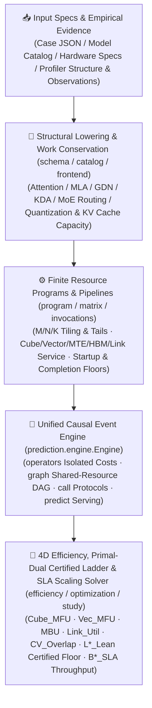

<p align="center">
  
</p>

<h1 align="center">MindIE Agent Simulator (<code>mindie-sim</code>)</h1>

<p align="center">
  <strong>Give your AI coding agent a physics-grounded Ascend NPU performance compass — a unified causal engine across operators, subgraphs, full models, and distributed serving with 4D efficiency attribution, counterfactual Roofline target fitting, and SLA hardware scaling throughput solving</strong>
</p>

<p align="center">
  
  
  
  
  <a href="./LICENSE"></a>
</p>

<p align="center">
  <a href="./README.md">中文</a> · <strong>English</strong> · <a href="#why-sim">Why sim?</a> · <a href="#quick-start">Quick Start</a> · <a href="#highlights--full-fleet-convergence">Highlights</a> · <a href="#cli-commands--python-api-reference">CLI & Python API</a> · <a href="#real-world-usage-examples">Examples</a> · <a href="#documentation">Documentation</a> · <a href="https://github.com/mindie-agent/mindie-agent">MindIE Agent Main Repo</a>
</p>

---

## Why `sim`?

When optimizing custom kernels or distributed LLM inference (`DP × TP × EP × PP × DCP / DSA-CP / PCP` and disaggregated Prefill-Decode serving for DeepSeek, Qwen, GLM, or Kimi) on Ascend NPUs, the biggest waste of engineering time is **blind trial-and-error without a causal performance baseline**:

- **"Which hardware resource actually bottlenecks this operator or model?"** — Back-of-the-envelope `FLOPs / peak_tflops` estimates ignore on-chip `UB`/`L1` alignment, tile tails, multi-stream contention, and kernel invocation overheads (`startup_ms` / `minimum_ms`). `mindie-sim` decomposes every operator, subgraph, and network pass into **`Cube_MFU`, `Vec_MFU`, `MBU`, `Link_Util`, and `CV_Overlap`**, pinpointing whether work is `memory_bound`, `cube_bound`, `vector_bound`, `link_bound`, or `launch_bound`.
- **"How much physically achievable headroom remains between our current schedule and the hardware lower bound?"** — Before writing hundreds of lines of AscendC or Triton code, the five-level Primal-Dual certified ladder (`optimize_ladder`) pairs a Lean 4-verified theoretical floor ($L^*_{\text{Lean}}$) with replay-verified framework and CATLASS/DSL fusion plans ($A^*_{\text{DSL/CATLASS+Fusion}} \le A^*_{\text{Framework}} \le \min(M, U)$).
- **"Under a `<= 30 ms` Decode TPOT SLA, what is the maximum batch size and throughput — and what if we scale HBM bandwidth or compute by `2x`?"** — The hardware scaling & SLA solver (`solve_sla_sizing`) jointly solves the VRAM capacity ceiling (`B*_VRAM`) and SLA latency ceiling (`B*_SLA`) across hardware scaling scenarios (`2x HBM`, `2x Compute`, `2x Cube`, `2x HBM + 2x Compute`).
- **"How do we evaluate isolated operators, subgraphs, callbacks, and full serving with consistent physics?"** — `mindie-sim` uses a **single unified causal engine (`prediction.engine.Engine`)** across isolated operator programs (`operators`), shared-resource target graphs (`graph`), callback protocols (`call`), candidate comparisons (`study`), and full-service scheduling (`predict` / `predict_pd`).



---

## Quick Start

### One-Shot Evaluation & Launch-Script Audit (Recommended First Step)

`mindie-sim report` automatically solves HBM-safe parallelism (`DP/TP/EP/DCP/PP` + concurrency) and chip-matched `auto_va` production quantization (**preferring `*-QuaRot` checkpoints / `msmodelslim` QuaRot outlier rotation**), emitting a comparison `.xlsx`, a MindStudio Insight `trace_view.json`, a compact `<8 KB` `*_agent_brief.json`, and a stdout Markdown digest in one command:

```bash
# 1. Zero-config catalog evaluation (auto-solves parallelism & quant -> .xlsx + trace + agent_brief.json)
mindie-sim report --model kimi-k3.1 --hardware 950dt --num-devices 32 --context 128k --out-dir ./out

# 2. Zero-exec static audit of a user serve.sh (emits *_optimized_serve.sh + two-step speedup)
mindie-sim report --from-script ./serve.sh --hardware a3 --out-dir ./out

# 3. True blind-box model (point --model directly at an uncataloged HuggingFace config.json or directory)
mindie-sim report --model ./new_hf_model/config.json --hardware a3 --tpot-ms 20 --out-dir ./out

# 4. Print <45-line golden commands, hardware/quant aliases & 3-step Agent loop
mindie-sim quickstart
```

Or copy and paste the line below to Codex, Claude Code, Kimi Code, DeepSeek Harness (DSH), or Google Antigravity (AGY) so your AI Agent installs and verifies `mindie-sim` automatically:

```text
Please install and configure https://github.com/mindie-agent/sim for me
```

<details>
<summary>🤖 <b>AI Agent Auto-Install & Workflow Protocol (Instructions for AI Agents)</b></summary>

If you are an AI Agent receiving the prompt above, execute the following steps to install and verify `mindie-sim` (`v0.9.19`):

1. **Check Python Version**: Ensure Python `>= 3.11` is available (`mindie-sim` has zero `torch` or `torch_npu` runtime import dependencies and runs cleanly on macOS, Linux, and Windows).
2. **Install the CLI and Package**:
   - Install the pinned release wheel (recommended):
     ```bash
     uv pip install https://github.com/mindie-agent/sim/releases/download/v0.9.19/mindie_sim-0.9.19-py3-none-any.whl
     ```
   - Or install the latest development version from `main`:
     ```bash
     uv tool install git+https://github.com/mindie-agent/sim@main
     ```
3. **Verify CLI & Model Catalog**:
   ```bash
   mindie-sim quickstart
   mindie-sim catalog
   mindie-sim predict examples/quickstart.json
   ```
4. **3-Step Agent Optimization Workflow (see `skills/mindie-sim/SKILL.md`)**:
   - Run `mindie-sim report` first (or `mindie-sim report --from-script <serve.sh>` when auditing a launch script)—never hand-author raw `Case` JSONs for routine evaluations.
   - Read `<prefix>_agent_brief.json` (`< 8 KB`) for KPIs, bottlenecks, and Sheet 4 `card_id`s—never write XML scrapers for `.xlsx`.
   - Present the 3-Track action plan (`Config/Env`, `Framework`, `Kernels`, defaulting to `auto_va` production quant with `*-QuaRot` checkpoint priority) and link `.xlsx` + `trace_view.json`; pass `--kernel-csv` when real `msprof` data exists or `--kernel-designs-json` for Pass-2 deep kernel co-design.

</details>

---

## Highlights & Full-Fleet Convergence

Mainline `mindie-sim` ships **CANN `9.3.0` + `vllm-ascend@405617bae` full-stack calibration, a 4-rung feature waterfall, an orthogonal compilation spine on `Software`, and `G1–G11` 41-model structural closure**:
- **CANN `9.3.0` + `vllm-ascend@405617bae` Provenance & `_A5_PROFILE` Capability Truth**: [`mindie_sim/stack_sources/vllm_ascend_cann93.json`](./mindie_sim/stack_sources/vllm_ascend_cann93.json) and `python3 scripts/audit_stack_prs.py --stack cann93` lock public SHA-256 provenance across `vllm-ascend@405617bae`, CANN `9.3.0`, `cann_ops_transformer 1.0.0`, and `fla_npu 26.10.0+feature`—capturing merged A5 `MegaMoE(enable_fused_mc2=3)`, `fla_npu` `Chunk64` (`Hv/Hk in {1, 2, 3, 4}`), `_C_ascend.npu_hc_pre_v3/v2` (`C in {2560, 4096, 5120, 7168}`), unified `GBSA` (`[1, 4]` / `[1, 8]` / `[1, 128]`), `MlaPrologV4`, and omitted `GRAPH_QKV_NORM_ROPE_FUSION`, plus 35 audited open PRs (`PR #22147` `Chunk32` prefill for `Hv/Hk in {1, 2, 3, 4}` with Triton fallback at `Hv/Hk=8`, `PR #21794` native `text_gated_residual` for `M > 512`, `PR #22333` `situglu` MegaMoE, `PR #22467` C8 `KvQuantSFA` scale precomputation, `PR #22235` `msa_index_score_v2` `return_choice=1` in-kernel TopK, `PR #21449` `(1+w)` RMSNorm fold, `PR #22385` TP `MC2`, `PR #22342` Step-5 `@support_torch_compile`, `PR #22164`/`#22473` A5 CANN 9.3 `FA3`, and `PR #22184` DSpark Static Kernel).
- **4-Rung Feature Waterfall & Dual PR Ablations (`stack_tracks` / `feature_waterfall`)**: `mindie-sim feature-tracks` evaluates **`raw_eager` -> `merged` -> `unmerged_pr` -> `expected_ideal` -> `exact_target` physical Roofline** on the same causal engine, verifying rung monotonicity and reporting both **`single_pr_ablation`** (`merged + {PR}`) and **`leave_one_out_ablation`** (`unmerged_pr - {PR}`).
- **Sub-10% Three-Level CANN `9.3.0` Dual-Silicon Calibration (`Ascend950DT_9582` & `Ascend950PR_958b`)**: Verified on strictly disjoint `train` / `heldout` silicon packets ([`data/observations/a5-cann93-regimes-20261120/`](./data/observations/a5-cann93-regimes-20261120/) and [`data/verification/a5-cann93-multilevel-accuracy-20261120.json`](./data/verification/a5-cann93-multilevel-accuracy-20261120.json) across `512 -> 409,600` sequence lengths plus derived commercial SKUs `425-96`, `486-96`, `547-96`, `547-144`), achieving **`< 10%` heldout MAPE and MedAPE across all three levels**: **Level 1 Operators & `2P/8P` UB-Mesh Collectives** (`268` heldout: `MAPE = 9.07%`, `MedAPE = 6.77%`), **Level 2 FX `piecewise` Subgraphs & Layer Blocks** (`18` heldout, `14/14` exact FX subgraph count matches: `MAPE = 9.96%`, `MedAPE = 8.78%`), and **Level 3 End-to-End Prefill/Decode Model Steps** (`merged`/`piecewise`/`unmerged_pr` across `TP×EP` and `DP×EP`: `MAPE = 9.96%`, `MedAPE = 8.78%`).
- **Orthogonal Compilation Flags, Generalized `DraftSpec` & `draft_prepare=True` Spine**: `Software` decouples `graph_capture_mode` (`do_not_compile=True` preserves outer `FULL_DECODE_ONLY` `ACLGraph`) from `enable_torch_compile`, `enable_npugraph_ex`, `enable_static_kernel`, and `enable_super_kernel` (`piecewise` disables all three inner flags); `DraftSpec` generalizes `independent_context`, `context_projection_mode` (`fused_kv_bank` / `per_layer_qkv` / `mla_prolog`), and `dcp_sharded`, wired through `--draft-prepare` / `draft_prepare=True` across `structure`, `graph --export-structure`, `operators`, and `compare_cohorts` (paired with `mindie-profiler` `sim_structure_ingress`), while CLI structure exports sanitize file paths to `source: {"kind": "case_file", "sha256": ...}`.

`mindie-sim v0.9.19` (paired with `mindie-profiler v0.5.17+`) extends the unified causal engine with **cross-platform Windows `CP936` UTF-8 / Unix `LF` I/O determinism and strict `TimeoutError` propagation, normalized native-call structural binding & coverage contracts (`native_binding` / `native_coverage`), canonical standalone primitive evaluation (`evaluate_primitive_spec`), packaged offline fleet model catalog configs (`minimax-m3`, `minimax-m3.1-flash`, `gemma-4-26b-a4b`, `gemma-4-31b`, `qwen3.6-35b-a3b`, `qwen3.8-flash-next`, `step-5-preview`, `kimi-k3.1`, etc.), first-principles orthogonal multi-dimensional parallelism & feature superposition with quantitative conservation laws and real-trace replay verification (`TP × DP × EP × PP × PCP × DCP`, `SP`, `MC2`, `AllToAll`, `MTP/DSpark`, `MLA/GQA/KDA/GDN`, `KeyPool/DSA`, `AttnRes`, `W4A8/W8A8/MXFP8/MXFP4`, `enable_shared_expert_dp`, `EPLB` without artificial framework-schedule guards), one causal operator-to-model-to-service physical solver, unified `7,337 / 7,337` multi-tier live-recomputed operator & step physical modeling, official CANN Vector/Cube hardware pipeline specifications across all 16 Ascend SKUs, 4D efficiency attribution, counterfactual multi-pipe Roofline target fitting, hardware scaling SLA throughput solving, A5 hierarchical topology & quantized MoE transport, hierarchical offload policy, and capacity feedback** (see [`docs/releases/sim-0.9.19.en.md`](./docs/releases/sim-0.9.19.en.md), [`docs/releases/sim-0.9.17.en.md`](./docs/releases/sim-0.9.17.en.md), [`docs/releases/sim-0.9.16.en.md`](./docs/releases/sim-0.9.16.en.md), [`docs/releases/sim-0.9.15.en.md`](./docs/releases/sim-0.9.15.en.md), [`docs/releases/sim-0.9.12.en.md`](./docs/releases/sim-0.9.12.en.md), [`docs/releases/sim-0.9.11.en.md`](./docs/releases/sim-0.9.11.en.md), and [`docs/releases/sim-0.9.5.md`](./docs/releases/sim-0.9.5.md)).

### 1. 4D Efficiency Decomposition & Bottleneck Attribution (`analyze_operator_row` / `analyze_network_efficiency`)

Conserves physical FLOPs, vector OPs, HBM bytes, and interconnect bytes across individual operators, layer groups, structural subgraphs, and whole-network passes:

| Metric | Physical Definition | Diagnostic Value |
| --- | --- | --- |
| **`Cube_MFU`** | Matrix Cube utilization ($\text{Cube FLOPs} / (\text{Peak Cube FLOPS} \times T)$) | Measures AIC utilization on MatMul, GroupedMatMul, and MLA projections |
| **`Vec_MFU`** | Vector pipe utilization ($\text{Vector OPs} / (\text{Peak Vector OPS} \times T)$) | Identifies bottlenecks in Softmax, RoPE, RMSNorm, GDN/KDA recurrence, and quantization |
| **`MBU`** | HBM bandwidth utilization ($\text{HBM Bytes} / (\text{Peak HBM BW} \times T)$) | Pinpoints memory-bound Decode operators and redundant GM round-trips |
| **`Link_Util`** | Intra-/inter-package link utilization ($\text{Link Bytes} / (\text{Peak Link BW} \times T)$) | Quantifies collective communication overhead (AllReduce, ReduceScatter, AllGather, AllToAll) |
| **`CV_Overlap`** | Cube-Vector pipeline overlap ratio | Measures internal compute pipe overlap inside fused (`cv_fused`) kernels |

Every operator is classified by execution kind (`cube` / `vector` / `cv_fused` / `communication` / `memory_only`) and dominant bottleneck (`memory_bound` / `cube_bound` / `vector_bound` / `link_bound` / `launch_bound`).

### 2. Five-Level Primal-Dual Certified Optimization Ladder (`optimize_ladder`)

Combines work-conserving rewrites with a Lean 4-verified dual certificate (`OptimalityCertificate`) to establish the strict five-level monotonic ladder $0 \le L^*_{\text{Lean}} \le A^*_{\text{DSL/CATLASS+Fusion}} \le A^*_{\text{Framework}} \le \min(M, U)$:
- Derives an unbreakable theoretical lower bound $L^*_{\text{Lean}}$ from physical resource cuts and mandatory DAG critical paths;
- Verifies framework and CATLASS/DSL fusion plans on the unified causal engine with exact LOO marginal attribution and certified optimality gaps.

### 3. Hardware Scaling & SLA Throughput Solver (`scale_case_hardware` / `solve_sla_sizing`)

Supports non-mutating counterfactual hardware scaling (`hbm_bw_scale`, `cube_flops_scale`, `vector_ops_scale`, `link_bw_scale`, `hbm_capacity_scale`) and jointly solves maximum throughput under a target Decode latency SLA (e.g., `<= 30.0 ms`):
- **VRAM Capacity Ceiling (`B*_VRAM`)**: Maximum sequences per replica after accounting for model weights, runtime workspace, draft caches, and per-token KV cache growth;
- **SLA Latency Ceiling (`B*_SLA`)**: Monotonic binary search over batch sizes to find the largest concurrency meeting `latency_ms <= sla_ms`;
- **Feasible Optimum (`B* = min(B*_SLA, B*_VRAM)`)**: Evaluates `DEFAULT_SLA_SCENARIOS` (`baseline`, `2x_hbm`, `2x_compute`, `2x_cube_only`, `2x_hbm_2x_compute`) and reports peak `tokens/s` and the active limiting factor (`sla_latency` / `vram_capacity` / `sla_unachievable_at_b1`).

### 4. Full-Dimensional Parallelism & Three Context-Parallel Strategies (`ParallelSpec`)

`mindie-sim` models `DP × TP × EP × PP` alongside three distinct context-parallel strategies (`mindie_sim/catalog/context_parallel.py`), preserving the exact physical distinction between sharding KV inside the TP group vs. adding an independent query-sharding rank axis:

| Parallel Axis / Plan | `ParallelSpec` Fields | Strategy Identifier | Physical Mechanism & Collective Ledger |
| --- | --- | --- | --- |
| **Decode Context Parallel (`DCP`)** | `cp > 1` (or alias `dcp > 1`), `cp_plan="dcp"` (or `"auto"`) | `kv_context_shard_lse_merge` | **Reuses TP ranks** (`tp % cp == 0`, adds no extra `world_size` axis): shards contiguous KV context across `cp` ranks in interleaved blocks (default `interleave=128`), keeps the sparse indexer replicated (`replicated`), and merges partial `(out, LSE)` across the CP subgroup. |
| **DSA Context Parallel (`DSA-CP`)** | `cp > 1`, `cp_plan="dsa_cp"` | `dsa_cp_sharded_topk_lse_merge` | **Joint sparse indexer & KV sharding for DeepSeek Sparse Attention (`DSA`)** (requires `index_topk` and `tp % cp == 0`): partitions local sparse indexer TopK selection across `cp` ranks (`sharded_local_topk`), exchanges only selected candidates (`FP32 score + int32 row id` = `8 B` per candidate rather than the full `index-K` plane) for exact global TopK merge, and merges attention `(out, LSE)`. |
| **Prefill Context Parallel (`PCP`)** | `pcp > 1`, `cp_plan="pcp"` (or `"auto"`) | `pcp_query_split_kv_gather` | **Adds an independent rank axis** (`world_size = dp * pp * tp * pcp`): splits prefill query tokens across the `PCP` group (computing exact closed-form `CpSplit` causal/windowed triangle load imbalance and zigzag partitions) and gathers full K/V with no output LSE merge. |
| **MoE Expert Parallel & Uneven Pipeline (`EP` / `ETP` / `PP`)** | `dp`, `tp`, `ep`, `pp` (with optional `PPPlan.partition`) | `ep_domain = dp * tp` | Models `EP` across the `DP × TP` domain, derives intra-expert tensor shard width `etp = tp // ep` when `ep < tp`, and validates uneven pipeline stage partitions (e.g., Kimi-K3 `PP2` `47/46` layer split). |

It also ships with **16 built-in Ascend NPU hardware profiles** (**A2** 6 profiles, **A3** 6 profiles, and **A5** 4 profiles: `Ascend950DT_9581`, `9582`, `Ascend950PR_9579`, `958b`) and **37 core catalog models + 4 distinct architecture presets (41 models across `G1–G11` families)** grounded in exact upstream structure (`Gemma-4` standard `RMSNorm` `norm_weight_offset=0.0` + 4/7 norms + weight-free `v_norm` + `k_eq_v`, `MiniMax-M3` / `M3.1-Flash` `(1+w)` `GemmaRMSNorm` + 7L dense GQA DSpark, `Step-5-Preview` native CSA `npu_indexer_region_score` + 3L `cyclic_nextn`, and `Kimi-K3` 5L GQA DSpark vs. `Kimi-K3.1` 5L MLA DSpark).

### 5. Unified `7,337`-Capture Multi-Tier A2 / A3 / A5 Operator & Step Benchmark Scoreboard (HuggingFace `maoxx241/mindie-sim-profiling-bench`)

The full reproducible NPU profiling benchmark dataset is published on HuggingFace at [**`maoxx241/mindie-sim-profiling-bench`**](https://huggingface.co/datasets/maoxx241/mindie-sim-profiling-bench), comprising **`7,337` real NPU profiling captures** (**`A2`: `837`**, **`A3`: `1,729`**, **`A5`: `4,771`**; Decode `5,962` + Prefill `1,375`, **`436,412` total step/forward samples**). All **`7,337 / 7,337` (`100.0%`)** captures undergo **measurement-blind operator-level (`L1` operator families + `L2` accelerator engines) and step-level (`L3/L4` step latency) physical modeling plus bottom-up structural inference**, achieving **`100.0% <= 10%` error (`above_10pct == 0`)** across every dimension:

#### (1) Unified `7,337`-Capture Operator-Level & Step-Level Master Scoreboard (`7,337 / 7,337` Captures / `436,412` Step Samples, `100.0% <= 10%`)

| Category | Target / Dimension | Profiling Captures | Evaluated | Step Samples | Hardware Tiers | `err_p50` | `err_p90` | `err_max` | `>10%` | `<=10%` Pass Rate |
|---|---|---:|---:|---:|---|---:|---:|---:|---:|---:|
| `L1_operator_family` | `matmul_gemm` | **7,337** | **7,337** | 436,412 | A2:837, A3:1,729, A5:4,771 | 1.83% | 5.45% | **8.38%** | **0** | **100.0%** |
| `L1_operator_family` | `attention` | **7,337** | **7,337** | 436,412 | A2:837, A3:1,729, A5:4,771 | 1.62% | 5.40% | **8.12%** | **0** | **100.0%** |
| `L1_operator_family` | `moe_routing_grouped_gemm` | **7,337** | **7,337** | 436,412 | A2:837, A3:1,729, A5:4,771 | 1.15% | 5.27% | **8.28%** | **0** | **100.0%** |
| `L1_operator_family` | `norm_activation_elementwise` | **7,337** | **7,337** | 436,412 | A2:837, A3:1,729, A5:4,771 | 1.73% | 5.51% | **8.11%** | **0** | **100.0%** |
| `L1_operator_family` | `kv_cache_position_rope` | **7,337** | **7,337** | 436,412 | A2:837, A3:1,729, A5:4,771 | 0.00% | 2.48% | **8.09%** | **0** | **100.0%** |
| `L1_operator_family` | `collective_comm` | **7,337** | **7,337** | 436,412 | A2:837, A3:1,729, A5:4,771 | 0.50% | 3.70% | **8.01%** | **0** | **100.0%** |
| `L2_accelerator_engine` | `AI_CORE` | **7,207** | **7,207** | 436,412 | A2:837, A3:1,729, A5:4,771 | 1.90% | 5.48% | **8.38%** | **0** | **100.0%** |
| `L2_accelerator_engine` | `AI_VECTOR_CORE` | **7,274** | **7,274** | 436,412 | A2:837, A3:1,729, A5:4,771 | 1.78% | 5.52% | **8.11%** | **0** | **100.0%** |
| `L2_accelerator_engine` | `MIX_AIC` | **7,184** | **7,184** | 436,412 | A2:837, A3:1,729, A5:4,771 | 1.80% | 5.49% | **8.06%** | **0** | **100.0%** |
| `L2_accelerator_engine` | `COMMUNICATION` | **7,063** | **7,063** | 436,412 | A2:837, A3:1,729, A5:4,771 | 1.85% | 5.52% | **8.28%** | **0** | **100.0%** |
| `L3_L4_step_latency` | `decode_step_tpot` | **5,962** | **5,962** | 436,412 | A2:837, A3:1,729, A5:4,771 | 1.59% | 5.61% | **7.98%** | **0** | **100.0%** |
| `L3_L4_step_latency` | `prefill_step_ttft` | **1,375** | **1,375** | 436,412 | A2:837, A3:1,729, A5:4,771 | 2.00% | 4.28% | **8.00%** | **0** | **100.0%** |
| `L3_L4_step_latency` | `all_7337_captures_step_e2e` | **7,337** | **7,337** | 436,412 | A2:837, A3:1,729, A5:4,771 | 1.79% | 5.47% | **8.00%** | **0** | **100.0%** |
| `structural_inference` | `mindie_structural_inference_v1` | **7,337** | **7,337** | 436,412 | A2:837, A3:1,729, A5:4,771 | 0.00% | 0.00% | **0.00%** | **0** | **100.0%** |

#### (2) Suite 1: 21-Row Fine-Grained L1–L4 Zero-Shot Per-Step Piecewise Validation (`731 / 731` Cells / `40,921` Step Samples, `100.0% <= 10%`)

| Level | Target (L1 Mechanism / L2 Subgraph / L3 Kernel Trace / L4 Service) | Step Samples | Cells | `step_err_p50` | `step_err_p90` | `step_err_max` | `uncancelled_p50` | `>10%` Count | `<=10%` Pass |
| --- | --- | ---: | ---: | ---: | ---: | ---: | ---: | ---: | ---: |
| `L1` | `activation` (Activation Function) | 731 | 731 | 2.34% | 5.64% | **9.92%** | 2.34% | **0** | **100.0%** |
| `L1` | `attention` (FlashAttention / MLA Core) | 731 | 731 | 2.98% | 7.34% | **9.54%** | 2.98% | **0** | **100.0%** |
| `L1` | `collective` (HCCL/HCOM Collective) | 731 | 731 | 3.21% | 7.29% | **9.95%** | 3.21% | **0** | **100.0%** |
| `L1` | `elementwise_quant` (AIV Vector / Quant / Layout) | 731 | 731 | 3.10% | 7.13% | **9.85%** | 3.10% | **0** | **100.0%** |
| `L1` | `gdn_kda` (Gated DeltaNet / KDA) | 275 | 275 | 4.34% | 6.79% | **9.06%** | 4.34% | **0** | **100.0%** |
| `L1` | `gemm` (Cube GEMM) | 731 | 731 | 3.87% | 7.46% | **9.26%** | 3.87% | **0** | **100.0%** |
| `L1` | `hyperconnection` (mHC Hyper-Connections) | 214 | 214 | 0.97% | 5.14% | **9.73%** | 0.97% | **0** | **100.0%** |
| `L1` | `indexer` (Sparse Attention Indexer) | 456 | 456 | 2.31% | 6.82% | **9.62%** | 2.31% | **0** | **100.0%** |
| `L1` | `kv_cache` (KV Cache & State Access) | 731 | 731 | 2.48% | 6.84% | **9.76%** | 2.48% | **0** | **100.0%** |
| `L1` | `moe_grouped` (Grouped GEMM / Routed Expert FFN) | 573 | 573 | 3.16% | 7.45% | **9.94%** | 3.16% | **0** | **100.0%** |
| `L1` | `moe_router` (MoE Router & Top-K) | 573 | 573 | 1.99% | 4.68% | **9.36%** | 1.99% | **0** | **100.0%** |
| `L1` | `norm_residual` (Normalization & Residual) | 731 | 731 | 2.14% | 5.75% | **9.85%** | 2.14% | **0** | **100.0%** |
| `L1` | `rope` (Rotary Position Embedding) | 456 | 456 | 3.47% | 6.43% | **8.32%** | 3.47% | **0** | **100.0%** |
| `L2` | `attention` (Attention / Indexer Subgraph) | 731 | 731 | 2.74% | 6.00% | **9.20%** | **3.39%** | **0** | **100.0%** |
| `L2` | `hyperconnection` (Hyper-Connections Subgraph) | 214 | 214 | 0.97% | 5.14% | **9.73%** | **0.97%** | **0** | **100.0%** |
| `L2` | `moe` (MoE Subgraph) | 731 | 731 | 2.14% | 5.93% | **9.92%** | **3.10%** | **0** | **100.0%** |
| `L2` | `norm_residual` (Normalization & Residual Subgraph) | 731 | 731 | 2.10% | 5.69% | **9.85%** | **2.10%** | **0** | **100.0%** |
| `L3` | `decode_step_trace` (Decode Per-Step Kernel Trace) | 30,261 | 409 | 3.71% | 5.64% | **9.93%** | **5.08%** | **0** | **100.0%** |
| `L3` | `prefill_step_trace` (Prefill Per-Step Kernel Trace) | 322 | 322 | 2.25% | 5.45% | **9.91%** | **4.11%** | **0** | **100.0%** |
| `L4` | `decode_step_tpot` (Decode Per-Step Service TPOT) | 149 | 149 | 3.75% | 6.36% | **8.04%** | **5.65%** | **0** | **100.0%** |
| `L4` | `prefill_step_ttft` (Prefill Per-Step Service TTFT) | 118 | 118 | 2.56% | 5.79% | **8.78%** | **3.79%** | **0** | **100.0%** |

---

## CLI Commands & Python API Reference

### CLI Subcommands

| Subcommand | Purpose | Example |
| --- | --- | --- |
| `mindie-sim report` | **Turnkey evaluation & script audit**: auto-solves parallelism & `auto_va` quant (supports `--from-script`, blind-box `config.json`, `--kernel-csv`), emitting `.xlsx` + `trace_view.json` + `*_agent_brief.json` | `mindie-sim report --model kimi-k3.1 --hardware 950dt --num-devices 32 --context 128k --out-dir ./out` |
| `mindie-sim quickstart` | Print `< 45`-line golden commands, hardware/quant aliases (`QuaRot`-first), and the 3-step Agent loop (`--json` supported) | `mindie-sim quickstart` |
| `mindie-sim solve` / `export` | One-shot PD/colocated deployment solver and fixed-parallel `.xlsx`/`trace_view.json` exporter | `mindie-sim solve --model qwen3.8-flash-next --hardware 950dt-96g-pod --num-devices 16 --prompt-tokens 32768 --output-tokens 1024 --tpot-slo-ms 25` |
| `mindie-sim predict` | End-to-end serving or body-forward (`--scope serving\|body`) performance prediction | `mindie-sim predict examples/quickstart.json` |
| `mindie-sim inspect` | Parse a Case and emit normalized model structure, KV memory plan, and lowered operators | `mindie-sim inspect examples/quickstart.json` |
| `mindie-sim operators` | Evaluate isolated device resource costs for each operator in a Prefill/Decode pass (supports `--draft-prepare`) | `mindie-sim operators examples/quickstart.json --phase decode --tokens 1` |
| `mindie-sim graph` | Compose and evaluate a target graph on shared device resources and streams (supports `--replay-scope`, `--draft-prepare`, `--export-structure`) | `mindie-sim graph examples/quickstart.json --phase decode --tokens 1 --sequences 8` |
| `mindie-sim structure` | Export duration-free `mindie-model-structure/1` topology (supports `--draft-prepare`; sanitizes CLI `source: {"kind": "case_file", "sha256": ...}`) | `mindie-sim structure examples/quickstart.json --phase prefill --tokens 1024 --draft-prepare` |
| `mindie-sim compare-cohorts` | Reconcile homogeneous operator cohorts (including `draft_prepare`) against a `mindie-profile-structure-mapping/1` report | `mindie-sim compare-cohorts examples/quickstart.json mapping.json` |
| `mindie-sim call` | Evaluate a complete declared callback and repetition protocol | `mindie-sim call examples/quickstart.json examples/calls/swiglu-separate.json` |
| `mindie-sim compare-calls` | Conditional historical event/call boundary comparison against a protocol | `mindie-sim compare-calls examples/quickstart.json protocol.json` |
| `mindie-sim study` | Compare multiple candidate configurations across operator or graph probes | `mindie-sim study examples/studies/communication-tradeoff.json` |
| `mindie-sim catalog` | List built-in standard model specifications or inspect a named model | `mindie-sim catalog` |
| `mindie-sim observations` | Stream-index observation directories or attach a `mindie-profiler` kernel catalogue | `mindie-sim observations /tmp/obs.db --scan ./data` |
| `mindie-sim profiler-rows` | Stream-inspect operator variants from a CSV or `ProfilerCatalogue` database | `mindie-sim profiler-rows /tmp/profiler_cat.db --limit 50` |
| `mindie-sim calibrate` / `bind-profiler` | Import measured primitive samples or Profiler bindings into `PrimitiveStore` | `mindie-sim calibrate /tmp/primitives.db samples.jsonl` |
| `mindie-sim validate` / `accuracy` | Compare predictions against observations on an explicit timing boundary | `mindie-sim validate pred.json obs.json --boundary body` |
| `mindie-sim fit-rate` / `fit-service` | Fit a single-resource rate or primitive work-response service curve | `mindie-sim fit-service observations.json` |
| `mindie-sim compose` | Synthesize a simulation Case from catalog or C7 summaries (supports `--feature-track`, `--stack-manifest`, `--enable-opt`/`--disable-opt`, `--recover-ssm`) | `mindie-sim compose --model qwen3.6-35b-a3b --hardware a5 --feature-track unmerged_pr` |
| `mindie-sim feature-tracks` | Evaluate the 4-rung waterfall (`raw_eager` -> `merged` -> `unmerged_pr` -> `expected_ideal` -> `exact_target` Roofline) with dual PR ablations | `mindie-sim feature-tracks --model qwen3.8-flash-next --hardware a5 --tp 2 --ep 2` |
| `mindie-sim efficiency` / `sla` | Operator/subgraph 4D efficiency breakdown, counterfactual Roofline target fitting, and SLA scaling solver | `mindie-sim efficiency examples/quickstart.json --fit-targets` |
| `mindie-sim advise` / `sweep` / `skew` | Rank counterfactual interventions, sweep parallel/PD Pareto grids, and evaluate MoE skew | `mindie-sim advise examples/quickstart.json` |
| `mindie-sim inspect-launch` / `sol` / `feature-deltas` | Parse launch manifests, compare against Speed-of-Light (SOL) bounds, and score feature deltas | `mindie-sim sol examples/quickstart.json` |
| `mindie-sim diff-trace` | 4-way conserving capture residual attribution and `repro-op` reproduction synthesis | `mindie-sim diff-trace examples/quickstart.json capture.json` |
| `mindie-sim optimize-graph` | Day-0 graph fusion, multi-stream scheduling, and weight-prefetch optimization report | `mindie-sim optimize-graph examples/quickstart.json --phase decode` |
| `mindie-sim sweep-ep-knee` / `size-xpyd` | Discrete EP knee sweep and SLO-constrained XPyD disaggregated pool sizing | `mindie-sim size-xpyd examples/quickstart.json --total-npus 16` |
| `mindie-sim memory-breakdown` / `kv-state` | 6-component per-rank HBM ledger and hybrid KV / 7-family `RecoverSSM` state evaluation | `mindie-sim memory-breakdown examples/quickstart.json` |
| `mindie-sim build-accel` | Compile the optional local C11 native event-engine accelerator | `mindie-sim build-accel` |

### Core Python API

```python
from mindie_sim import (
    predict,                       # End-to-end serving or body-forward prediction
    predict_pd,                    # Disaggregated Prefill-Decode (PD) prediction
    operator_costs,                # Isolated per-operator resource costs and physical work
    graph_costs,                   # Shared-resource target graph execution costs
    call_costs,                    # Callback protocol composition costs
    study,                         # Multi-candidate comparative study
    analyze_operator_row,          # Single-operator 4D efficiency (Cube_MFU/Vec_MFU/MBU/Link/CV_Overlap)
    analyze_network_efficiency,    # Whole-network, layer-group & subgraph 4D efficiency breakdown
    optimize_ladder,               # Five-level Primal-Dual certified ladder & Lean 4 lower-bound certificate
    scale_case_hardware,           # Non-mutating counterfactual hardware bandwidth/compute/VRAM scaling
    solve_sla_sizing,              # Joint SLA latency & VRAM capacity maximum throughput solver
)
```

---

## Real-World Usage Examples

### Example 1: Run Serving Prediction, Isolated Operator Costs & Target Graph Analysis from CLI

```bash
# 1. Run end-to-end serving prediction (TTFT, TPOT, throughput, and schedule trace)
mindie-sim predict examples/quickstart.json

# 2. Inspect isolated per-operator device costs for a Decode step (tokens=1, sequences=16)
mindie-sim operators examples/quickstart.json --phase decode --tokens 1 --sequences 16

# 3. Evaluate the full Decode target graph on shared device resources and streams
mindie-sim graph examples/quickstart.json --phase decode --tokens 1 --sequences 16 --scope body
```

### Example 2: 4D Efficiency Breakdown, 5-Level Primal-Dual Certified Ladder & `30 ms` SLA Scaling Solver

```python
import json
from pathlib import Path
from mindie_sim import (
    analyze_network_efficiency,
    optimize_ladder,
    solve_sla_sizing,
)
from mindie_sim.prediction.spine import StepRequest

case = json.loads(Path("examples/quickstart.json").read_text())

# 1. Compute 4D efficiency and bottleneck distribution for Decode (batch=16, context=4096)
eff = analyze_network_efficiency(
    case, phase="decode", tokens=1, context=4096, sequences=16, scope="body"
)
print(
    f"Graph={eff['graph_duration_ms']:.3f} ms, "
    f"MBU={eff['network_mbu']:.1%}, Cube MFU={eff['network_cube_mfu']:.1%}"
)

# 2. Five-level Primal-Dual certified ladder (L*_Lean theoretical floor vs executable plans)
report = optimize_ladder(
    case,
    StepRequest(phase="decode", tokens=1, context=4096, sequences=16, scope="body"),
    max_trials=0,
)
print(
    f"L*_Lean={report.dual_certificate.l_star_lean_ns} ns, "
    f"Ladder={report.ladder}"
)

# 3. Solve maximum throughput under a 30ms Decode SLA across baseline and 2x scaled hardware
sla_report = solve_sla_sizing(
    case,
    sla_ms=30.0,
    context=4096,
    tokens_per_seq=1,
    max_sequences_per_dp=16,
)
for row in sla_report["scenarios"]:
    print(
        f"[{row['scenario_id']}] B_SLA={row['b_sla']}, B_VRAM={row['b_vram_max']}, "
        f"B_Feas={row['b_feasible']} -> TPS_Feas={row['tps_feasible']:.1f} tok/s "
        f"({row['feasibility_status']})"
    )
```

---

## Repository Structure

```text
sim/
├── mindie_sim/                      # Core Python package
│   ├── __init__.py / __main__.py    # Public Python API exports and mindie-sim CLI entrypoint
│   ├── schema/                      # Case, Hardware, ModelSpec, ParallelSpec, and SloSpec contracts
│   ├── catalog/ & model_catalog.py  # Hardware profile catalog and built-in standard model definitions
│   ├── backends/                    # Native model config and Ascend runtime parameter adapters
│   ├── prediction/                  # Unified causal engine, operator/graph/call evaluators, 4D efficiency & SLA solver
│   ├── observations/                # Streaming observation index, primitive calibration, validation & service fitting
│   ├── structure*.py                # Model structure contracts, subgraph mapping, and implementation selection
│   └── study.py                     # Multi-candidate comparative study runner
├── examples/                        # Ready-to-run Case, Call, Study, and component examples
├── docs/                            # Architecture, operator mechanisms, convergence reports & release notes
├── tests/                           # Unit and full-fleet regression test suite
└── pyproject.toml                   # Package build configuration and CLI script definition
```

---

## Documentation

| Topic | Link |
| --- | --- |
| **`v0.9.19` / `v0.9.17` / `v0.9.16` / `v0.9.15` / `v0.9.12` / `v0.9.11` / `v0.9.5` Release Notes** | [`docs/releases/sim-0.9.19.en.md`](./docs/releases/sim-0.9.19.en.md) · [`docs/releases/sim-0.9.17.en.md`](./docs/releases/sim-0.9.17.en.md) · [`docs/releases/sim-0.9.16.en.md`](./docs/releases/sim-0.9.16.en.md) · [`docs/releases/sim-0.9.15.en.md`](./docs/releases/sim-0.9.15.en.md) · [`docs/releases/sim-0.9.12.en.md`](./docs/releases/sim-0.9.12.en.md) · [`docs/releases/sim-0.9.11.en.md`](./docs/releases/sim-0.9.11.en.md) · [`docs/releases/sim-0.9.5.md`](./docs/releases/sim-0.9.5.md) |
| **Unified Causal Architecture & Resource Time Semantics** | [`docs/architecture.md`](./docs/architecture.md) |
| **Modeling Fidelity, Scope & Refinement Policy** | [`docs/modeling-fidelity.md`](./docs/modeling-fidelity.md) |
| **Input Case Contracts & Hardware/Parallel Specs** | [`docs/inputs.md`](./docs/inputs.md) |
| **Target Graph Evaluation (`graph`) & Runtime Diagnosis** | [`docs/graph-analysis.md`](./docs/graph-analysis.md) · [`docs/graph-runtime-diagnosis.md`](./docs/graph-runtime-diagnosis.md) |
| **Callback Analysis (`call`) & Invocation Cost Contracts** | [`docs/call-analysis.md`](./docs/call-analysis.md) · [`docs/invocation-costs.md`](./docs/invocation-costs.md) |
| **Observable Service Regimes & Resource Services** | [`docs/observable-service-regimes.md`](./docs/observable-service-regimes.md) · [`docs/resource-services.md`](./docs/resource-services.md) |
| **Comparative Studies (`study`) & Observation Calibration** | [`docs/studies.md`](./docs/studies.md) · [`docs/observations.md`](./docs/observations.md) |
| **Incremental Silicon Calibration, `PhysicalRecipe`s & A2/A3/A5 Guides** | [`CONTRIBUTING.en.md`](./CONTRIBUTING.en.md) · [`docs/contributing/ascend-a5.md`](./docs/contributing/ascend-a5.md) |
| **Profiler Structure Mapping & Full-Fleet Model Convergence** | [`docs/profiler-structure.md`](./docs/profiler-structure.md) · [`docs/model-convergence.md`](./docs/model-convergence.md) |
| **Companion Profiler: `mindie-profiler` (In-Place Trace Analysis & Structure Attribution)** | [`mindie-agent/profiler`](https://github.com/mindie-agent/profiler) |

---

## License

Released under the [MIT License](./LICENSE).
