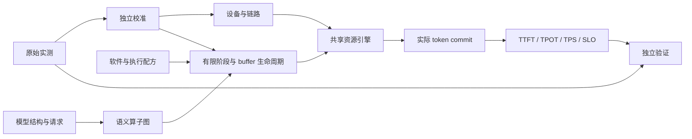

# MindIE Sim

可组合的性能建模工具。先从模型结构、硬件资源和软件执行方式推导算子工作量、数据搬运、依赖与纯模型计算开销，再加入请求调度，评估吞吐、容量和 TTFT/TPOT 服务约束。

核心不依赖 A3、Ascend 或某个模型名称。Ascend SKU 是输入适配器，GPU 可以直接声明设备、内存、计算单元、精度峰值和链路。新增硬件不需要修改调度或指标计算。

**仿真、校准和验证是三个独立操作。** `predict` 不要求实测数据；实测可以校准资源速率或精确的算子实现，也可以作为独立验证集。预测结果的 `modeled` 表示计算完成，不代表通过真实设备精度验收。

[English](README.en.md) · [架构](docs/architecture.md) · [输入和命令](docs/inputs.md) · [扩展机制](docs/extending.md) · [数据与校准](docs/observations.md) · [迁移记录](docs/migration.md) · [验证范围](docs/verification.md)

## 使用

需要 Python 3.11 或更高版本。安装和运行均不需要初始化 GPU/NPU 上下文或加载模型权重。

```sh
uv venv
uv pip install -e '.[test]'
.venv/bin/mindie-sim predict examples/quickstart.json -o /tmp/prediction.json
.venv/bin/mindie-sim inspect examples/quickstart.json -o /tmp/operators.json
.venv/bin/mindie-sim operators examples/quickstart.json --phase decode --tokens 4 --sequences 2 --context 4096 --scope model
.venv/bin/mindie-sim graph examples/quickstart.json --phase decode --tokens 1 --context 4096 --scope model
.venv/bin/mindie-sim study examples/studies/resource-tradeoff.json -o /tmp/study.json
.venv/bin/mindie-sim call examples/calls/activation-nominal.json examples/calls/swiglu-separate.json
.venv/bin/mindie-sim predict examples/disaggregated.json -o /tmp/pd.json
.venv/bin/mindie-sim catalog
```

```python
import json
from mindie_sim import predict

with open("examples/quickstart.json") as stream:
    case = json.load(stream)
result = predict(case, trace_limit=2, event_limit=256)
print(result["metrics"]["ttft_ms"])
print(result["metrics"]["output_tps"])
```

`examples/quickstart.json` 的硬件数值是演示参数。修改带宽、算力、层结构、批次、并行方式和 kernel 配方可以进行可解释的敏感性分析。`examples/cases/` 保留了迁移后的完整模型与部署声明；其中长上下文和长输出案例需要更多 CPU 仿真时间。

## 计算路径



- 模型层声明 GQA、MLA、稀疏/压缩缓存、循环状态、Dense/MoE、残差、草稿和视觉分支的结构。
- 算子层保留逻辑 FLOPs、物理字节、真实/局部/填充形状、依赖和执行 stream。
- 配方层生成有限的加载、计算、写回阶段及 buffer 占用；共享资源在同一引擎中竞争。没有用稳态吞吐替代首尾开销。
- 服务层管理到达、排队、分块 prefill、整数 token 提交、缓存预留/抢占重算、PP microbatch 和 P/D 交接。
- 校准层只接受明确匹配的原语参数。缺少条目不会改变模型结构，也不会阻止仿真。

`operators` 使用相同的执行引擎，报告各算子独立运行时间之和。默认 `--scope body` 分析 transformer body；`--scope model` 加入 embedding、末端归一化、选行和输出头，并沿用公开 frontend 的图形状与融合规则。这一结果不含调度、主机提交或草稿生成，也不等于并发图的关键路径。

`graph` 在同一引擎上组合子图或纯模型，保留依赖、stream、资源竞争以及完整 EP 参与组。它分别报告图耗时、算子独立耗时和、前驱路径与资源容量下界；这些下界不代表实测关键路径或可兑现优化收益。默认排除主机提交，显式选项可加入。媒体输入和已选择的 capture 模式有独立契约，见[图级分析](docs/graph-analysis.md)。源码算子族通过[统一选择声明](docs/operator-family-selection.md)接入普通模型调用路径。

`predict(case, scope="body", phase="decode", tokens=4, context=16384, sequences=32)` 返回单次 target body 的 `body_forward_ms`，保留图 padding 和设备通信依赖。`tokens` 是每序列全部验证行数，接收率不会减少这些计算；输入 hidden/KV 已就绪，Host 提交与跨步等待不计入该边界。PD 输入返回两个池各自的主体时间。该探针不执行服务准入或显存容量验收，具体边界见[主体 Forward](docs/body-forward.md)。

硬件调节入口、参数优先级与单位见[资源覆盖](docs/operators/resource-overrides.md)；九模型跨 A3/A5、混部/PD、单机/多机和四维资源扫描见[部署泛化验证](docs/deployment-and-bandwidth-generalization.md)。未声明的 Host 提交成本不再默认设为 20 us，可通过[显式提交参数](docs/host-submission.md)配置。

`study` 把候选配置与工作负载探针组合起来，先查看算子成本集中在哪里，再按需执行图组合和原始请求的服务约束。它只对相同工作量、路由与边界的成功候选排序，保留失败原因；详见[候选分析流程](docs/studies.md)。预测排序与 `accuracy` 的独立实测验证分开。旧实测的调用、整段 replay 与 kernel 总和分别通过[原始观测适配器](docs/capture-adapters.md)吸收。

当前按算子和数据流推进修正。已修复的量化生产者、残差融合、向量递推、批处理尾波、布局物化和地址相关的有限写队列，以及仍未解释的真实差距，见[算子机制调查](docs/operator-mechanisms.md)。普通旧版 checkout 和原始实测继续保留。

## 当前边界

`call` 将完整回调、重复次数和 eager/replay 提交组合到公共执行器。`compare-calls` 独立读取历史事件，保留原始边界和样本角色；未建模的调用步骤与条件性差异分别列出，不使用倍率对齐。见[完整调用分析](docs/call-analysis.md)。通信可显式选择[逐轮 ring 配方](docs/operators/collective-rounds.md)，用发送与前驱到达依赖表示实际推进。

这是分析型性能模型，不是逐指令硬件模拟器。默认矩阵配方采用明确的 tile 和理想操作数复用假设；没有提供细分配方的算子采用资源工作量包络。默认执行按每个 PP stage 的代表性局部分片建模，不能把它解释为每张异构设备的精确时间线。

模型机制测试、历史输入可读取、RTX 4090 内存原语验证和完整服务精度是不同层次。当前验证没有证明所有 catalog 模型的真实 TTFT/TPOT 精度。已知近似、未支持的组合和具体验证记录见 [验证范围](docs/verification.md)。`should` 搜索、旧四层 CLI 和旧 A3 predictor 已从公开入口移除；当前主线只维护这一套执行引擎。

## 开发验证

```sh
.venv/bin/python -m pytest -q
.venv/bin/python tools/catalog_smoke.py -o /tmp/catalog-smoke.json
MINDIE_BENCH_RESULT_PATH=/tmp/sim-benchmark.json .venv/bin/python benchmarks/release.py
uv build
```

测试以资源守恒、独立算术 oracle、事件顺序和公开行为为主。结构巡检将 workload 改为 p8/o3，但保留模型尺寸；它不是历史大负载精度复验。
