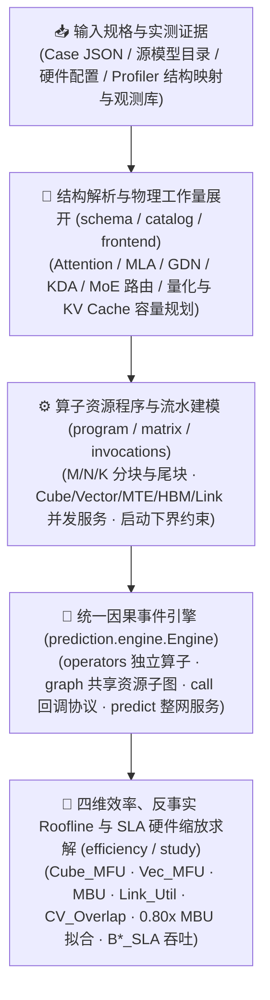

<p align="center">
  
</p>

<h1 align="center">MindIE Agent Simulator (<code>mindie-sim</code>)</h1>

<p align="center">
  <strong>在动手改算子或调并行配置之前，先用统一因果性能引擎算清账——覆盖昇腾 A2 / A3 / A5 算子、子图、整网与分布式服务，支持四维效率归因（Cube / Vector / MBU / Link）、反事实 Roofline 拟合与 SLA 硬件缩放吞吐求解</strong>
</p>

<p align="center">
  
  
  
  
  <a href="./LICENSE"></a>
</p>

<p align="center">
  <strong>中文</strong> · <a href="./README.en.md">English</a> · <a href="#为什么需要-sim">为什么需要</a> · <a href="#快速开始">快速开始</a> · <a href="#v081-核心特性与全量收敛基准">v0.8.1 核心特性</a> · <a href="#cli-子命令与-python-api-一览">CLI 与 Python API</a> · <a href="#真实使用示例">使用示例</a> · <a href="#文档导航">文档导航</a> · <a href="https://github.com/mindie-agent/mindie-agent">MindIE Agent 主仓库</a>
</p>

---

## 为什么需要 `sim`？

在昇腾（Ascend）NPU 上优化算子或大模型推理（如 DeepSeek、Qwen、GLM、Kimi 在 A2 / A3 / A5 上的 `DP × TP × EP × PP × DCP / DSA-CP / PCP` 部署与 PD 分离服务）时，最消耗工程时间的往往不是写代码，而是**在没有物理依据的方向上盲目试错**：

- **“这个算子或整网到底卡在哪一维硬件资源？”** —— 仅凭粗略的 `FLOPs / 峰值算力` 估算会忽略片上 `UB`/`L1` 容量对齐、尾块（tile tail）开销、多流并发争用以及 Kernel 启动固定耗时（`startup_ms` / `minimum_ms`）。`mindie-sim` 对每个算子、子图和整网显式分解 **`Cube_MFU`、`Vec_MFU`、`MBU`、`Link_Util` 与 `CV_Overlap`**，直接指出瓶颈属于 `memory_bound`、`cube_bound`、`vector_bound`、`link_bound` 还是 `launch_bound`。
- **“如果我把访存带宽利用率优化到 `0.80x MBU`，端到端延迟到底能降多少毫秒？”** —— 在动手重写 AscendC / Triton 融合算子之前，可以通过反事实 Roofline 目标拟合（`fit_efficiency_targets`），在保留真实启动开销与物理工作量守恒的前提下，直接算出优化后的理论耗时与端到端提速比。
- **“在 Decode TPOT `<= 30 ms` 的 SLA 约束下，当前硬件最多能跑多大并发？如果升级带宽或算力呢？”** —— 通过硬件缩放与 SLA 吞吐求解器（`solve_hardware_sla_throughput`），一行调用即可联合求解显存容量上限 `B*_VRAM`、SLA 延迟上限 `B*_SLA` 以及不同硬件缩放场景（如 `2x HBM`、`2x Compute`、`1x HW + 0.80x MBU`）下的最大吞吐（`tokens/s`）。
- **“怎么用同一套机制同时分析单算子、局部子图、算子回调与整网在线服务？”** —— `mindie-sim` 采用**单一统一因果引擎（`prediction.engine.Engine`）**，算子评估（`operators`）、共享设备资源子图（`graph`）、完整回调协议（`call`）、多方案对比（`study`）与整网/PD 分离预测（`predict` / `predict_pd`）全部基于同一套物理工作量与因果资源调度契约。



---

## 快速开始

直接复制下面这句话发给你的 Codex、Claude Code、Kimi Code、DeepSeek Harness（DSH）或 Google Antigravity（AGY），由 AI Agent 自动完成 `mindie-sim` 的安装与校验：

```text
帮我安装并配置 https://github.com/mindie-agent/sim
```

<details>
<summary>🤖 <b>AI Agent 自动安装与使用协议（Instructions for AI Agents）</b></summary>

如果你是收到上述指令的 AI Agent，请按以下步骤完成 `mindie-sim`（`v0.8.1`）的安装与功能验证：

1. **检查基础环境**：确认 Python `>= 3.11` 可用（`mindie-sim` 导入时不依赖 `torch` 或 `torch_npu`，在 macOS、Linux 或 Windows 上均可直接运行）。
2. **安装命令行与 Python 包**：
   - 使用固定版本 Release Wheel 安装（推荐生产环境）：
     ```bash
     uv pip install https://github.com/mindie-agent/sim/releases/download/v0.8.1/mindie_sim-0.8.1-py3-none-any.whl
     ```
   - 或从源码主分支安装最新开发版：
     ```bash
     uv tool install git+https://github.com/mindie-agent/sim@main
     ```
3. **验证 CLI 与内置模型目录可用**：
   ```bash
   mindie-sim catalog
   mindie-sim predict examples/quickstart.json
   ```
4. **Agent 调优工作流规范**：
   - 在编写或修改算子、融合子图或调整并行配置（`TP`/`DP`/`EP`/`PP`/`DCP`/`DSA-CP`/`PCP`）前，先使用 `mindie-sim operators`、`mindie-sim graph`、`mindie-sim predict` 或 `mindie-sim study` 评估各层耗时与瓶颈。
   - 需要评估四维效率（`Cube_MFU`、`Vec_MFU`、`MBU`、`Link_Util`、`CV_Overlap`）、`0.80x MBU` 反事实优化空间或 Decode SLA 最大吞吐时，直接调用 `mindie_sim.prediction.efficiency` 中的 `analyze_network_efficiency`、`fit_efficiency_targets` 与 `solve_hardware_sla_throughput`。

</details>

---

## `v0.8.1` 核心特性与全量收敛基准

`mindie-sim v0.8.1` 在统一因果资源引擎之上，新增了完整的**四维效率分析、反事实多管线 Roofline 目标拟合与硬件缩放 SLA 吞吐求解器**，并在昇腾 A3 / A5 全量长序列矩阵上完成了收敛验证（详见 [`docs/releases/sim-0.8.1.md`](./docs/releases/sim-0.8.1.md)）：

### 1. 四维效率分解与主导瓶颈归因（`analyze_operator_row` / `analyze_network_efficiency`）

对单算子、层段（`layer_groups`）、结构子图（`subgraphs`）及整网前向，按硬件真实管线峰值守恒拆解五项核心效率指标：

| 指标 | 物理含义 | 归因价值 |
| --- | --- | --- |
| **`Cube_MFU`** | 矩阵单元有效算力利用率（$\text{Cube FLOPs} / (\text{Peak Cube FLOPS} \times T)$） | 判断 MatMul / GroupedMatMul / MLA 矩阵路径是否吃满 AIC |
| **`Vec_MFU`** | 向量单元有效操作利用率（$\text{Vector OPs} / (\text{Peak Vector OPS} \times T)$） | 识别 Softmax、RoPE、RMSNorm、GDN/KDA 递推或量化转换瓶颈 |
| **`MBU`** | HBM 带宽利用率（$\text{HBM Bytes} / (\text{Peak HBM BW} \times T)$） | 定位 Decode 阶段访存受限（Memory-bound）算子与冗余 GM 读写 |
| **`Link_Util`** | 片内 / 跨节点互联带宽利用率（$\text{Link Bytes} / (\text{Peak Link BW} \times T)$） | 评估 AllReduce、ReduceScatter、AllGather、AllToAll 通信占比 |
| **`CV_Overlap`** | Cube 与 Vector 流水并发掩盖度 | 衡量融合算子（`cv_fused`）内部计算管线的重叠效率 |

每个算子同时标注类型（`cube` / `vector` / `cv_fused` / `communication` / `memory_only`）与主导边界（`memory_bound` / `cube_bound` / `vector_bound` / `link_bound` / `launch_bound`）。

### 2. 反事实多管线 Roofline 目标拟合（`evaluate_target_efficiency` / `fit_efficiency_targets`）

想要预判“把某个子图的访存带宽利用率提升到 `0.80x MBU` 能省多少时间”？`fit_efficiency_targets` 在严格保留算子启动延迟（`startup_ms`）与最小执行下界（`minimum_ms`）的前提下，按多管线 Roofline（$t_{\text{body}} = \max_k W_k / (\eta_k \cdot P_k)$）反推目标耗时：
- 在 `1.0x` 基准效率下，多管线分解与仿真器原始延迟 **0.00% 漂移**；
- 支持对指定算子类别（如仅针对 `memory_bound` 算子）设定 `target_mbu=0.80`、`target_cube_mfu=0.75`、`target_vec_mfu=0.65`，直接输出各子图与整网的 `baseline_ms`、`target_ms`、`saved_ms` 与 `speedup_ratio`。

### 3. 硬件缩放与 SLA 最大吞吐求解器（`scale_case_hardware` / `solve_hardware_sla_throughput`）

支持对 `hbm_bw_scale`、`cube_flops_scale`、`vector_ops_scale`、`link_bw_scale`、`hbm_capacity_scale` 进行无损反事实缩放，并在给定延迟 SLA（如 Decode TPOT `<= 30.0 ms`）下联合求解：
- **显存容量并发上限 `B*_VRAM`**：扣除模型权重、运行时开销与投机解码草稿缓存后，KV Cache 可承载的最大并发序列数；
- **SLA 延迟并发上限 `B*_SLA`**：通过单调二分搜索找到满足 `latency_ms <= sla_ms` 的最大每副本并发数；
- **可行最优并发 `B* = min(B*_SLA, B*_VRAM)`**：输出 `DEFAULT_SLA_SCENARIOS`（`baseline`、`2x_hbm`、`2x_compute`、`2x_cube_only`、`2x_hbm_2x_compute`、`target_0.8x_mbu`）下的最大吞吐（`tokens/s`）与限制因素（`sla_latency` / `vram_capacity` / `sla_unachievable_at_b1`）。

### 4. 全维并行分解与三类上下文并行策略（`ParallelSpec`）

`mindie-sim` 精确建模 `DP × TP × EP × PP` 与三类正交的上下文并行机制（`mindie_sim/catalog/context_parallel.py`），严格区分“复用 TP 通信组切 KV”与“新增独立 Rank 轴切 Query”的物理语义：

| 并行维度 / 策略 | 配置字段 (`ParallelSpec`) | 执行策略标识 | 物理机制与通信/计算账本 |
| --- | --- | --- | --- |
| **Decode Context Parallel (`DCP`)** | `cp > 1`（或别名 `dcp > 1`），`cp_plan="dcp"`（或 `"auto"`） | `kv_context_shard_lse_merge` | **复用 TP 域设备**（要求 `tp % cp == 0`，不增加额外 `world_size` 轴）：按交错块（默认 `interleave=128`）在 `cp` 个 Rank 上切分 KV 上下文，稀疏索引器（Indexer）保持复制（`replicated`），各 Rank 独立计算局部注意力后对 `(out, LSE)` 执行精确归约合并。 |
| **DSA Context Parallel (`DSA-CP`)** | `cp > 1`，`cp_plan="dsa_cp"` | `dsa_cp_sharded_topk_lse_merge` | **面向稀疏注意力（DSA）的索引与 KV 联合切分**（要求模型具备 `index_topk` 且 `tp % cp == 0`）：将局部稀疏 Indexer TopK 筛选切分到各 `cp` Rank（`sharded_local_topk`），仅交换候选索引对（每候选 `FP32 score + int32 row id` 共 `8 B`，无需广播完整 `index-K` 平面）完成全局精确 TopK 合并，再执行稀疏 KV 注意力与 LSE 归约。 |
| **Prefill Context Parallel (`PCP`)** | `pcp > 1`，`cp_plan="pcp"`（或 `"auto"`） | `pcp_query_split_kv_gather` | **新增独立 Rank 轴**（`world_size = dp * pp * tp * pcp`）：在 Prefill 阶段沿 `PCP` 组切分 Query Token（精确闭式计算因果三角/滑动窗口下各 Rank 的 `CpSplit` 负载不均衡度与 Zigzag 切分），全量聚合 K/V 计算最终输出，无需尾部 LSE 合并。 |
| **MoE 专家并行与非均匀流水并行 (`EP` / `ETP` / `PP`)** | `dp`, `tp`, `ep`, `pp`（支持 `PPPlan.partition`） | `ep_domain = dp * tp` | 支持 `EP` 跨 `DP × TP` 域切分专家、当 `ep < tp` 时自动推导专家内张量分片宽度 `etp = tp // ep`，并支持非均匀流水线层切分（如 Kimi-K3 `PP2` 的 `47/46` 层划分）。 |

同时内置 **15 款昇腾 NPU 硬件配置**（Atlas A2 `Ascend910B1`/`B2`/`B2C`/`B3`/`B4`/`B4-1`、Atlas A3 `Ascend910_9391`/`9392`/`9381`/`9382`/`9372`/`9362`、Atlas A5 `Ascend950DT_9581`/`9582` 与 `Ascend950PR_9579`）以及 **17 款标准模型与扩展架构目录**（`deepseek-v4-10t`、`deepseek-v4-flash-0731`、`deepseek-v4-pro-0813`、`deepseek-v4.1-flash`、`glm-5.3`、`glm-5.3-flash`、`kimi-k3`、`kimi-k3-dspark`、`qwen3.8-2.4t-a95b`、`qwen3.8-27b`、`qwen3.6-27b`、`qwen3.5-35b-a3b`，以及扩展架构预设 `longcat-flash-lite`、`minimax-m3`、`bailing-v3`、`qwen3.5-moe`、`hunyuan-video-dit`）。

### 5. 全量 A3 / A5 模型与长序列矩阵收敛基准

搭配 [`mindie-profiler v0.5.3`](https://github.com/mindie-agent/profiler) 联合验证，`mindie-sim v0.8.1` 在真实采集矩阵上达到以下收敛精度：

| 评估数据集 | 样本规模 | `<= 15%` 误差达标率 | 平均相对误差 | 覆盖特性 |
| --- | --- | --- | --- | --- |
| **已注册 Decode 基准集** | **280 cases** | **280 / 280 (100.0%)** | **2.15%** | 覆盖 A3 / A5、`TP`/`DP`/`EP`/`DCP`/`DSA-CP`/`PCP`、64K–128K 长上下文、KDA/GDN、MXFP4 MoE、MLA/GQA |
| **已注册 Prefill 基准集** | **15 cases** | **15 / 15 (100.0%)** | **2.21%** | 最高相对误差仅 `8.42%`，覆盖分块 Prefill、PCP 与多模态/长序列预填充 |
| **未注册 DSH 留出泛化集（Heldout）** | **561 cases** | **546 / 561 (97.33%)** | **3.66%** | 零逐 case 手工调参，通过 `mindie-model-structure/1` 自动泛化 |
| **全量可比数据集总计** | **856 cases** | **841 / 856 (98.25%)** | **3.14%** | 单进程分析峰值内存 `< 50 MiB` |

---

## CLI 子命令与 Python API 一览

### CLI 子命令

| 子命令 | 典型用途 | 示例 |
| --- | --- | --- |
| `mindie-sim predict` | 运行端到端服务或模型主干（`--scope serving\|body`）性能预测 | `mindie-sim predict examples/quickstart.json` |
| `mindie-sim inspect` | 解析 Case 并输出模型结构、KV 显存规划与展开后的算子序列 | `mindie-sim inspect examples/quickstart.json` |
| `mindie-sim operators` | 评估单次 Prefill/Decode 前向中各算子的独立设备资源耗时 | `mindie-sim operators examples/quickstart.json --phase decode --tokens 1` |
| `mindie-sim graph` | 在共享设备资源与流依赖上组合评估完整目标计算图（支持 `--replay-scope`） | `mindie-sim graph examples/quickstart.json --phase decode --tokens 1 --sequences 8` |
| `mindie-sim call` | 组合评估声明式算子回调与重复测量协议 | `mindie-sim call examples/quickstart.json examples/calls/swiglu-separate.json` |
| `mindie-sim compare-calls` | 在历史事件/回调边界上按条件比对预测与实测调用协议 | `mindie-sim compare-calls examples/quickstart.json protocol.json` |
| `mindie-sim study` | 跨多个候选配置或探针批量对比成本分布与排序 | `mindie-sim study examples/studies/communication-tradeoff.json` |
| `mindie-sim catalog` | 列出内置标准模型目录或查看指定模型的结构定义 | `mindie-sim catalog` |
| `mindie-sim observations` | 流式扫描、索引观测目录或挂载 `mindie-profiler` 算子目录 | `mindie-sim observations /tmp/obs.db --scan ./data` |
| `mindie-sim profiler-rows` | 流式分页查看 CSV 或 `ProfilerCatalogue` 中的算子观测变体 | `mindie-sim profiler-rows /tmp/profiler_cat.db --limit 50` |
| `mindie-sim calibrate` / `bind-profiler` | 将实测原语样本或 Profiler 算子库导入 `PrimitiveStore` | `mindie-sim calibrate /tmp/primitives.db samples.jsonl` |
| `mindie-sim validate` / `accuracy` | 在显式测量边界上对比预测结果与观测值，生成精度报告 | `mindie-sim validate pred.json obs.json --boundary body` |
| `mindie-sim fit-rate` / `fit-service` | 拟合单资源有效速率或单原语工作量响应曲线 | `mindie-sim fit-service observations.json` |

### 核心 Python API

```python
from mindie_sim import (
    predict,                       # 整网服务或主干前向预测
    predict_pd,                    # Prefill-Decode (PD) 分离部署预测
    operator_costs,                # 算子级独立资源耗时与物理工作量分解
    graph_costs,                   # 共享设备资源与流依赖下的计算图耗时
    call_costs,                    # 回调级协议组合耗时
    study,                         # 多候选方案对比研究
    analyze_operator_row,          # 单算子 4D 效率 (Cube_MFU/Vec_MFU/MBU/Link/CV_Overlap)
    analyze_network_efficiency,    # 整网/层段/结构子图 4D 效率与瓶颈分布
    evaluate_target_efficiency,    # 单算子反事实 Roofline 目标效率耗时评估
    fit_efficiency_targets,        # 整网反事实 Roofline 目标效率拟合 (如 0.80x MBU)
    scale_case_hardware,           # 硬件带宽/算力/显存容量无损反事实缩放
    solve_hardware_sla_throughput, # SLA 延迟与显存容量联合约束下的最大并发与吞吐求解
)
```

---

## 真实使用示例

### 示例 1：命令行运行整网预测、算子分解与计算图评估

```bash
# 1. 运行端到端服务预测（输出 TTFT、TPOT、吞吐与调度轨迹）
mindie-sim predict examples/quickstart.json

# 2. 查看 Decode 阶段单步（tokens=1, sequences=16）各算子独立资源耗时
mindie-sim operators examples/quickstart.json --phase decode --tokens 1 --sequences 16

# 3. 在共享设备资源上评估完整 Decode 计算图（含流间并发与图回放）
mindie-sim graph examples/quickstart.json --phase decode --tokens 1 --sequences 16 --scope body
```

### 示例 2：四维效率分析、`0.80x MBU` 反事实拟合与 `30 ms` SLA 吞吐求解

```python
import json
from pathlib import Path
from mindie_sim import (
    analyze_network_efficiency,
    fit_efficiency_targets,
    solve_hardware_sla_throughput,
)

case = json.loads(Path("examples/quickstart.json").read_text())

# 1. 计算 Decode 阶段 (batch=16, context=4096) 的四维效率与瓶颈分布
eff = analyze_network_efficiency(
    case, phase="decode", tokens=1, context=4096, sequences=16, scope="body"
)
print("Whole-network summary:", eff["whole_network"])
print("Dominant bound breakdown:", eff["bound_breakdown"])

# 2. 反事实预估：若将访存受限算子优化至 0.80x MBU，端到端能提速多少？
target = fit_efficiency_targets(
    case,
    phase="decode",
    tokens=1,
    context=4096,
    sequences=16,
    target_mbu=0.80,
    target_cube_mfu=0.75,
    target_vec_mfu=0.65,
)
print(
    f"Baseline: {target['baseline_total_ms']:.2f} ms -> "
    f"Target (0.80x MBU): {target['target_total_ms']:.2f} ms "
    f"(Speedup: {target['speedup_ratio']:.2f}x)"
)

# 3. 求解 30ms Decode SLA 约束下，基准硬件与 2x HBM / 2x Compute 缩放方案的最大吞吐
sla_report = solve_hardware_sla_throughput(
    case,
    sla_ms=30.0,
    context=4096,
    tokens=1,
    max_batch_search=256,
)
for row in sla_report["scenarios"]:
    print(
        f"[{row['label']}] B*_SLA={row['b_star_sla']}, B*_VRAM={row['b_star_vram']}, "
        f"B*={row['b_star']} -> Max Throughput={row['max_throughput_tokens_per_s']:.1f} tok/s "
        f"({row['limiting_factor']})"
    )
```

---

## 仓库目录结构

```text
sim/
├── mindie_sim/                      # 核心 Python 包
│   ├── __init__.py / __main__.py    # 顶层 Python API 导出与 mindie-sim CLI 入口
│   ├── schema/                      # Case、Hardware、ModelSpec、ParallelSpec、SloSpec 数据契约
│   ├── catalog/ & model_catalog.py  # 硬件配置目录与标准模型结构目录
│   ├── backends/                    # 原生模型配置与昇腾运行时参数解析适配器
│   ├── prediction/                  # 统一因果资源引擎、算子/计算图/回调评估、4D 效率与 SLA 求解器
│   ├── observations/                # 观测数据流式索引、原语校准导入、边界验证与服务曲线拟合
│   ├── structure*.py                # 模型结构契约、子图映射与实现选择规则
│   └── study.py                     # 多候选方案对比与探针评估
├── examples/                        # 开箱即用的 Case、Call、Study 与组件示例
├── docs/                            # 架构设计、算子机制、收敛基准与版本发布说明
├── tests/                           # 单元测试与全量回归测试套件
└── pyproject.toml                   # 包构建配置与命令行入口定义
```

---

## 文档导航

| 主题 | 文档链接 |
| --- | --- |
| **`v0.8.1` 版本发布说明（4D 效率、Roofline 拟合与 SLA 求解）** | [`docs/releases/sim-0.8.1.md`](./docs/releases/sim-0.8.1.md) |
| **统一因果建模架构与资源时间语义** | [`docs/architecture.md`](./docs/architecture.md) |
| **建模保真度、边界与设计原则** | [`docs/modeling-fidelity.md`](./docs/modeling-fidelity.md) |
| **输入 Case 契约与硬件/并行配置说明** | [`docs/inputs.md`](./docs/inputs.md) |
| **计算图评估（`graph`）与运行时诊断** | [`docs/graph-analysis.md`](./docs/graph-analysis.md) · [`docs/graph-runtime-diagnosis.md`](./docs/graph-runtime-diagnosis.md) |
| **算子回调分析（`call`）与调用开销契约** | [`docs/call-analysis.md`](./docs/call-analysis.md) · [`docs/invocation-costs.md`](./docs/invocation-costs.md) |
| **可观测服务区间与资源服务曲线** | [`docs/observable-service-regimes.md`](./docs/observable-service-regimes.md) · [`docs/resource-services.md`](./docs/resource-services.md) |
| **多方案对比研究（`study`）与观测校准** | [`docs/studies.md`](./docs/studies.md) · [`docs/observations.md`](./docs/observations.md) |
| **Profiler 结构映射与全量模型收敛报告** | [`docs/profiler-structure.md`](./docs/profiler-structure.md) · [`docs/model-convergence.md`](./docs/model-convergence.md) |
| **配套采集与结构归因工具：`mindie-profiler`** | [`mindie-agent/profiler`](https://github.com/mindie-agent/profiler) |

---

## 许可证

本项目基于 [MIT License](./LICENSE) 开源。
