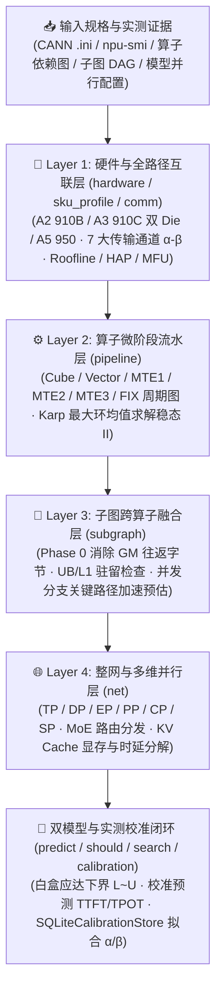

<p align="center">
  
</p>

<h1 align="center">MindIE Agent Simulator (<code>mindie-sim</code>)</h1>

<p align="center">
  <strong>在动手写几百行 AscendC / Triton 代码之前，先给 AI 编程助手装上“昇腾 NPU 物理推演罗盘”——通过四层确定性建模与实测校准，一秒算出硬件理论下界、微阶段流水瓶颈、跨算子融合收益与整网并行最优配置</strong>
</p>

<p align="center">
  
  
  
  <a href="./LICENSE"></a>
</p>

<p align="center">
  <strong>中文</strong> · <a href="./README.en.md">English</a> · <a href="#为什么需要-sim">为什么需要</a> · <a href="#快速开始">快速开始</a> · <a href="#核心能力与子命令一览">核心能力与子命令</a> · <a href="#真实使用场景">使用场景</a> · <a href="#文档导航">文档导航</a> · <a href="https://github.com/mindie-agent/mindie-agent">MindIE Agent 主仓库</a>
</p>

---

## 为什么需要 `sim`？

在昇腾（Ascend）NPU 上优化算子或大模型推理（如 DeepSeek、Qwen、Kimi K3 在 A2/A3/A5 上的 `DP × TP × EP × PP × DCP` 部署）时，开发者和 AI Agent 最常遇到的痛点不是“不会写代码”，而是**在错误的方向上盲目试错**：

- **“这个算子到底还能不能更快？理论天花板在哪？”** —— 仅凭粗略的 `FLOPs / 峰值算力` 算出的理想数字往往脱离实际（忽略了热降频、片上 `UB`/`L1` 容量对齐、尾块 Wave 量化以及通信启动延迟 $\alpha$）。
- **“为什么我给 `UB` 或 `L0C` 开了双缓冲，端到端耗时却一毫秒没降？”** —— 达芬奇架构算子内部包含 `MTE2`、`MTE1`、`Cube (M)`、`FIX`、`Vector (V)`、`MTE3` 多条并发流水线，不求解周期依赖图的**最大环均值（Initiation Interval, $II$）**，就看不出真正卡死周期的限制环在哪里。
- **“我该花半天抠单算子内部指令，还是先把上下游算子融合掉？”** —— 如果不先在 Phase 0 核算生产者-消费者子图之间可消除的 GM 往返字节（`removable_gm_bytes`）与并发关键路径 $\max(P+C, Q+G)$，很容易在毫无收益的分支上浪费算力与时间。
- **“手头没空闲真机，或者想在几十种并行/分块配置里挑最优，怎么免上机预筛？”** —— 需要一套既有白盒物理下界（Should-Cost）、又能通过 [`mindie-profiler`](https://github.com/mindie-agent/profiler) 实测数据持续校准（Predictive Model）的双模型仿真器。

`mindie-sim`（包名 `mindie_sim`）是 MindIE Agent 生态中独立的**昇腾 NPU 四层性能建模、Roofline / HAP 评估与双模型决策引擎**，专门在写代码前回答三个核心问题：**理论物理极限是多少？现在慢在哪一层？这个优化方向值不值得做（Go / No-Go）？**



---

> **实测 Kernel 耗时绑定与 CAModel 微阶段导入说明**：
> - **精确复用已采集的 Kernel 耗时（`profiled_kernels`）**：若已有 [`mindie-profiler`](https://github.com/mindie-agent/profiler) 采集数据，可先通过 `mindie-profiler kernels --manifest ... --output-dir ...` 生成去重的 Kernel / Shape 清单库，再由 `mindie-sim operator-plan` 或 `mindie-sim predict --operator-config ...` 中的 `profiled_kernels` Provider 读取精确绑定的实测完成时间。捕获计时范围由每条 binding 显式声明（`timing_scope: profiled_device_kernel`），不会改动本次运行自身的测量协议（`--timing-scope`），因此同一次运行中其余算子的实测校准仍照常生效（已有专有校准与既有通信拓扑模型优先，且保留原始 SKU、环境、cell 与完整 I/O 校验）。**注意证据边界**：采集数据仅提供该算子的**实测完成时间下限（completion floor）**，共享资源占用仍沿用算子显式声明的工作量契约（`occupancy_basis: declared_work_proxy`、`resource_occupancy: not_captured`，**并非实测硬件 occupancy**；未声明工作量的算子直接报错拒绝）；该入口不会自动推导语义 lowering 绑定，也**不构成整网预测精度提升的独立验收结论**（`independent_accuracy_acceptance: False`）。详见 [`docs/operator-execution-plans.md`](./docs/operator-execution-plans.md) 与 [`profiler` Kernel 清单文档](https://github.com/mindie-agent/profiler/blob/main/examples/kernel-inventory/README.md)。
> - **CAModel 仿真微阶段导入**：开发期 CAModel trace 可由 `mindie-profiler camodel` 导出微阶段时长，再输入 `mindie-sim pipeline --durations`；其输出保留 `simulated` 来源标记，不得混作真机实测结果。

## 快速开始

宿主机资源：大模型长 decode、校准扫参和并发预测应通过 `remote-dev` 在远端 Linux
服务器运行。本地只运行小规模验证；macOS 的 CLI 与 Python `predict()` 都会在展开
超预算算子图之前报 `host_capacity_requires_remote`，不要绕过此限制。
预测默认最多为每个副本保留 4096 个算子的明细，其余步骤明确标记 `detail_omitted`；
指标和物理校准覆盖统计仍包含全部步骤。只看指标用 `--trace-detail summary`；远端
确需完整算子证据时用 `--trace-detail full`。`trace_capture` 表示明细是否完整。

### 方式一：直接把链接发给你的 Agent 自动安装（推荐）

复制下面这句话发给你的 Claude Code、Codex、Kimi Code 或 Cursor，让它自动完成 `mindie-sim` 的安装与校验：

```text
帮我安装并配置 https://github.com/mindie-agent/sim
```

<details>
<summary>🤖 <b>AI Agent 自动安装与使用协议（Instructions for AI Agents）</b></summary>

如果你是收到上述指令的 AI Agent，请按以下步骤为当前用户完成 `mindie-sim` 的环境安装与功能验证：

1. **检查基础环境**：确认 Python `>= 3.11` 可用（`mindie-sim` 零第三方运行时强依赖，导入时不依赖 `torch` 或 `torch_npu`，在任意笔记本或开发机上均可离线运行）。
2. **安装命令行与 Python 包**：
   - 使用 `uv` 安装全局 CLI 工具（推荐）：
     ```bash
     uv tool install git+https://github.com/mindie-agent/sim@main
     ```
   - 或安装到当前 Python 环境：
     ```bash
     uv pip install git+https://github.com/mindie-agent/sim@main
     ```
3. **验证 CLI 与内置模型目录可用**：
   ```bash
   mindie-sim --version
   mindie-sim models
   ```
4. **Agent 调优工作流规范**：
   - 在动手编写或修改 AscendC / Triton 算子与模型并行代码前，先调用 `mindie-sim hardware` / `subgraph` / `pipeline` 或 `mindie-sim should` / `predict` 进行收益预判（Go / No-Go）。
   - 当用户仅提供模糊家族名（如 `"A2"` 或 `"A3"`）时，提醒或自动结合 `npu-smi info` 快照 / 精确 `soc_version`（如 `Ascend910B4`、`Ascend910_9362`）调用，避免模糊 SKU 假设。

</details>

### 方式二：终端手动一行安装（适合人类开发者）

只要本机装有 Python `>= 3.11` 和 `uv`（或 `pip`），一行命令即可安装：

```bash
# 安装为全局 CLI 工具
uv tool install git+https://github.com/mindie-agent/sim@main

# 或安装到当前虚拟环境
uv pip install git+https://github.com/mindie-agent/sim@main
```

克隆仓库在本地运行示例与测试套件：

```bash
git clone https://github.com/mindie-agent/sim.git
cd sim
uv pip install -e ".[test]"
pytest -m "not live_npu"
```

---

## 核心能力与子命令一览

### 1. 四层确定性仿真架构（Layer 1 – Layer 4）

1. **Layer 1 — 硬件规格、片上存储与全路径互联（`hardware`, `sku_profile`, `comm`, `theoretical_model`）**：
   - **A2 / A3 / A5 多型号精确建模**：内置昇腾 910B（A2：`Ascend910B1`–`Ascend910B4`）、昇腾 910C（A3 双 Die 合封：`Ascend910_9391` / `9392` / `9381` / `9382` / `9372` / `9362`）与昇腾 950（A5：`Ascend950DT_9581` / `9582` / `9599`、`Ascend950PR_9599` / `9589`）四维解耦规格（`cube_spec`、`vector_spec`、`memory_hierarchy_spec`、`clock_and_topology_spec`），支持 `CANN .ini + SKU 注册表 -> npu-smi 实机探针 -> 调用方显式覆盖` 三级解析。若仅传模糊家族名（如 `"A2"` / `"A3"`），拒绝盲猜并诚实返回 `ambiguous_soc_sku_requires_exact_soc_or_ini_or_probe`。
   - **片上搬运与 7 大跨卡/主机传输通道（$\alpha\text{-}\beta$ 模型）**：完整覆盖片上搬运通道（`GM_TO_UB`、`UB_TO_GM`、`GM_TO_L1`、`L1_TO_L0`）与 7 类外部传输通道（`d2d_intra_package` 双 Die SIO、`d2d_intra_node` 机内 `HCCS`、`d2d_inter_node` 机间 `ROCE`、`H2D`、`D2H`、`RH2D` 远端 KV 池入卡、`RD2H` 远端出卡），支持启动开销 $\alpha$ 与有效载荷带宽 $\beta$ 核算、Pinned vs. Pageable 内存区分以及 PCIe `LnkSta` 降速检测。
   - **Roofline / HAP（硬件可达性能）与 MFU 评估**：提供 `compute_hap_score` 与 `evaluate_operator_hap`，将实测耗时与硬件 Roofline 理论下界锚定对比，量化算子及模型的硬件可达性能（HAP）与 MFU 瓶颈。
2. **Layer 2 — 算子微阶段周期流水求解器（`pipeline`）**：
   - 针对 `Cube (M)` / `Vector (V)` / `MTE1` / `MTE2` / `MTE3` / `FIX` 构建多阶段周期资源依赖有向图（DAG），通过 **Karp 最大环均值算法（Maximum Cycle-Mean Solver）** 求解软件流水稳态最小启动间隔（Initiation Interval, $II$），提取卡死性能的关键递归环（Critical Recurrence Cycle），并校验 `UB` / `L1` / `L0A` / `L0B` / `L0C` 容量驻留与双缓冲对齐约束。
3. **Layer 3 — 子图跨算子融合分析器（`subgraph`）**：
   - 在动手写融合算子前执行 Phase 0 生产者-消费者 DAG 分析：精确核算融合后可消除的中间张量 GM 读写往返流量（`removable_gm_bytes`），检查集合通信屏障（Collective Barrier）与片上 `UB` / `L1` 驻留可行性门禁，并按并发分支关键路径 $\max(P+C, Q+G)$ 预估子图融合加速比。
4. **Layer 4 — 整网与分布式多维并行推演（`net`）**：
   - 支持 `TP` / `DP` / `EP` / `PP` / `CP`（`DCP`）/ `SP` 多维并行切分、MoE Token 路由分发（Dispatch / Combine）、KV Cache 显存占用与时延建模、投机解码（`DSpark` 接受长度摊销）、Prefix Cache 命中率折算，以及可选桥接 `msmodeling`（`tensor_cast`）。

### 2. 双模型决策工作流与实测校准（Dual-Model & Calibration）

除四层基础命令外，`mindie-sim` 提供面向 A2 / A3 真实推理场景的**预测模型（Predictive）+ 应达规范模型（Normative Should-Cost）**双轨工具链：

| CLI 子命令 | 定位与核心作用 | 典型输入 | 核心输出内容 |
| --- | --- | --- | --- |
| **`mindie-sim hardware`** | Layer 1 硬件规格、片上 Buffer 校验、7 通道传输下界与热态频率敏感度矩阵 | `--soc` / `--ini` / `--npu-smi-file` / `--buffers` / `--transfers` | 解析后的四维硬件能力、Buffer 冲突报告、链路耗时下界与频率折算表 |
| **`mindie-sim pipeline`** | Layer 2 算子微阶段周期流水求解与变体对比（内置无量纲拓扑 `--self-check`） | `--graph <dag.json>`、`--durations`、`--compare-variant` | 稳态最小周期 `minimum_period_ns`（$II$）、关键限制环、各 Pipe 利用率与变体加速比 |
| **`mindie-sim subgraph`** | Layer 3 Phase 0 生产者-消费者子图融合可行性与 GM 流量消除收益评估 | `--dag <dag.json>`、`--candidate-fusion`、`--profile-report` | `removable_gm_bytes`、可行性门禁判定、融合前后关键路径耗时对比 |
| **`mindie-sim net`** | Layer 4 整网多维并行（`DP×TP×EP×PP×DCP`）步骤拆解与 `msmodeling` 对齐 | `--model-spec`、`--parallel`、`--measured-ms` | 并行步耗时分解、通信暴露占比与三值对齐报告 |
| **`mindie-sim predict`** | **白盒物理下界 + 实测校准预测**：下降 Dense / GQA / MLA / MoE 算子图，结合物理校准（`--physical-calibration`）或校准库输出端到端指标 | `--input <case.json>`、`--calibration-db`、`--physical-calibration` | TTFT / ITL / TPOT / E2E 时延、吞吐/SLO Goodput、显存规划与逐算子耗时明细 |
| **`mindie-sim predict --framework-config`** | 显式调度、host提交、输出处理与异步流传输成本 | `--input examples/framework/case.json --framework-config examples/framework/profile.json` | 引擎与客户端token时间；[使用说明](docs/framework-lifecycle.md) |
| **`mindie-sim should`** | **Go / No-Go 优化顾问（应达成本模型）**：不靠拍脑袋乘效率系数，而是枚举合法执行计划，给出乐观物理下界 $L$、可行目标上界 $U$ 与见证时间线 | `--input <case.json>`、`--constraints`、`--search-budget` | 理论乐观下界 `L`、合法计划可行目标 `U`、瓶颈证人与优化空间评估 |
| **`mindie-sim execution-replay`** | 完整执行计划身份与严格全 kernel 证据回放，只生成对照报告 | `--input examples/execution-replay/mixed.json` | 孤立/共享跨度、回退覆盖、身份匹配与声明留出集误差；不修改成本或拟合阶段；[使用说明](docs/execution-replay.md) |
| **`mindie-sim search`** | **候选并行与运行配置寻优**：对搜索域内所有合法候选执行完整预测仿真，自动过滤 OOM 与违反 SLO 的配置并给出独立复核的最优推荐 | `--input <case.json>`、`--search-spec`、`--calibration-db` | 候选配置排名表、OOM/SLO 淘汰原因与最优配置推荐回执 |
| **`mindie-sim calibration`** | **实测校准数据库（`SQLiteCalibrationStore`）**：管理 `mindie-profiler` / `torch_npu` 实测样本、生成待测 Manifest、拟合通信与算子 $\alpha/\beta$ 曲线 | `--db <cal.db>` + `inventory` / `coverage` / `manifest` / `ingest` / `import-a3` / `import-comm` / `run` | 样本覆盖率报告、去重待测请求清单、拟合后的算子与通信带宽模型 |
| **`mindie-sim models` / `model-info`** | 查看内置的真实大模型配置目录（DeepSeek V4、GLM-5.3、Kimi K3、Qwen3.8 等）及单模型层结构参数 | `mindie-sim models` 或 `mindie-sim model-info --key <model_key>` | 模型层数、注意力机制（MLA/GQA）、MoE 专家规格与参数字典 |
| **`mindie-sim pipeline-microbatches`** | 有限微批次（Microbatch）PP 流水气泡与时间线仿真（非简单除以 PP） | `--stages 3,5 --microbatches 8 --transfer-ms 0.2` | 精确的 Stage 气泡率、总跨度与微批次时间线 |
| **`mindie-sim operator-plan`** | 可选 Vector 指令流与 BF16 Cube 有限流水，接入既有资源 DAG | `--input examples/operator-plans/mixed.json` | 细化阶段、容量、来源、回退及资源时间线；[使用说明](docs/operator-execution-plans.md) |
| **`mindie-sim collective-plan`** | 显式成员生产者同步、组内消费者 gate 与共享物理链路竞争 | `--input examples/collectives/shared-link.json` | 非流式依赖图、成员就绪、实际服务与字节守恒；不自动适配 EP/DCP；[使用说明](docs/collective-plans.md) |

---

## 真实使用场景

### 场景 1：改代码前先用 `predict`、`should` 和 `search` 判断优化空间与最佳配置

直接运行仓库 `examples/` 下自带的示例，体验从预测、应达边界评估到配置搜索的完整工作流：

```bash
# 1. 预测 A3 上 Dense 与 MLA+MoE 模型的 TTFT / TPOT / 显存与算子明细
mindie-sim predict --input examples/a3_dense_predict.json
mindie-sim predict --input examples/a3_mla_moe_predict.json

# 2. Go / No-Go 顾问：计算语义乐观下界 L 与可行目标 U，判断当前实现离物理极限还有多远
mindie-sim should --input examples/a3_should_dense.json

# 3. 在多个候选并行/运行配置中搜索满足显存与 SLO 约束的最优方案
mindie-sim search --input examples/a3_search_dense.json
```

### 场景 2：核查硬件 SKU 规格、片上 Buffer 容量与 7 通道传输下界（Layer 1 `hardware`）

指定精确的昇腾 SoC 型号（如 `Ascend910B4` 或 `Ascend910_9362`），一键获取片上存储上限与频率边界：

```bash
# 查看内置模型列表与单个模型结构详情
mindie-sim models
mindie-sim model-info --key kimi-k3

# 解析指定昇腾 SKU 的四维硬件能力与热态边界
mindie-sim hardware --soc Ascend910B4 --sustained-mhz 1650:1650
```

### 场景 3：用 Python API 求解算子微阶段流水 $II$（Layer 2）与 HAP 硬件可达性能评分

在编写自定义算子前，用 Python API 计算 Roofline HAP 得分并求解微阶段流水线的稳态最小周期 $II$：

```python
from mindie_sim import compute_hap_score, solve_periodic_pipeline

# 1. 计算实测算子相对于 Roofline 硬件理论下界的 HAP 评分 (0.0 ~ 1.0)
hap = compute_hap_score(ideal_lower_bound_ms=0.18, measured_device_ms=0.225)
print("Operator HAP score:", hap)  # 0.8

# 2. 求解算子内 MTE2 -> MTE1 -> Cube(M) -> FIX -> Vector(V) -> MTE3 周期依赖图的稳态最小周期 II
graph = {
    "nodes": [
        {"id": "load_gm_to_l1", "pipe": "MTE2", "duration_ns": 420},
        {"id": "load_l1_to_l0", "pipe": "MTE1", "duration_ns": 180},
        {"id": "cube_mmad", "pipe": "M", "duration_ns": 640},
        {"id": "fix_l0c_to_ub", "pipe": "FIX", "duration_ns": 210},
        {"id": "vec_act", "pipe": "V", "duration_ns": 300},
        {"id": "store_ub_to_gm", "pipe": "MTE3", "duration_ns": 390},
    ],
    "edges": [
        {"src": "load_gm_to_l1", "dst": "load_l1_to_l0", "distance": 0},
        {"src": "load_l1_to_l0", "dst": "cube_mmad", "distance": 0},
        {"src": "cube_mmad", "dst": "fix_l0c_to_ub", "distance": 0},
        {"src": "fix_l0c_to_ub", "dst": "vec_act", "distance": 0},
        {"src": "vec_act", "dst": "store_ub_to_gm", "distance": 0},
        # 双缓冲跨 Tile 释放边 (distance=2)
        {"src": "load_l1_to_l0", "dst": "load_gm_to_l1", "distance": 2},
        {"src": "store_ub_to_gm", "dst": "fix_l0c_to_ub", "distance": 2},
    ],
}
solution = solve_periodic_pipeline(graph, total_tiles=64)
print("Steady-state II (ns):", solution["minimum_period_ns"])
print("Bottleneck pipe / cycle:", solution["dominant_pipe"], solution["critical_cycle"])
```

### 场景 4：使用 `SQLiteCalibrationStore` 管理实测校准闭环

当预测遇到未校准的算子 Shape 时，开启 `--record-misses` 将缺失算子写入本地 SQLite 校准库，生成可执行测试清单并在实测后回填拟合：

```bash
# 1. 预测时将未校准的算子 Shape 记录到 SQLite 校准库并导出待测清单
mindie-sim predict \
  --input examples/a3_dense_predict.json \
  --calibration-db /tmp/a3_calibration.db \
  --record-misses \
  --requests-output /tmp/pending_manifest.json

# 2. 查看校准库样本统计与待测请求状态
mindie-sim calibration --db /tmp/a3_calibration.db inventory
mindie-sim calibration --db /tmp/a3_calibration.db requests --status pending
```

---

## 仓库目录结构

```text
sim/
├── mindie_sim/                      # 核心 Python 包（四层仿真器 + A2/A3 双模型与物理校准引擎）
│   ├── __main__.py                  # mindie-sim CLI 入口与子命令分发器
│   ├── hardware.py / sku_profile.py # Layer 1: A2/A3/A5 多型号硬件规格、片上 Buffer 与三级动态解析
│   ├── comm.py / thermal.py         # Layer 1: 7 通道互联 (D2D/H2D/D2H/RH2D/RD2H) α-β 求解与热态频率边界
│   ├── theoretical_model.py / modeling_inputs.py # Roofline 理想下界、HAP 硬件可达性能评分与建模输入契约
│   ├── pipeline.py / pipeline_graph.py # Layer 2: 算子微阶段周期依赖图与 Karp 最大环均值稳态 II 求解器
│   ├── subgraph.py                  # Layer 3: Phase 0 生产者-消费者子图融合分析与 GM 流量消除评估
│   ├── net.py / tensor_cast_provider.py # Layer 4: 整网多维并行分解与 msmodeling (tensor_cast) 桥接
│   ├── a3_framework.py / a3_should.py / a3_search.py # 预测模型 (predict)、应达模型 (should) 与配置搜索 (search)
│   ├── a3_calibration_store.py / a3_physical_calibration.py # SQLiteCalibrationStore 与 A2/A3 物理参数拟合
│   └── model_configs/               # 内置真实大模型结构配置 (DeepSeek V4, Kimi K3, GLM-5.3, Qwen3.8 等)
├── examples/                        # 开箱即用的 predict / should / search / 算子图 JSON 示例
├── docs/                            # 硬件规格集成、双模型设计、算子图与 A2/A3 实测精度报告
├── tools/accuracy/                  # 离线精度冻结、数据集组装与盲测评分工具链
├── tests/                           # 单元测试与常驻 A2/A3 NPU 真机非破坏性测试（@pytest.mark.live_npu）
└── pyproject.toml                   # Python 打包配置（定义 mindie-sim 脚本入口）
```

---

## 文档导航

| 文档主题 | 链接 |
| --- | --- |
| 示例配置与快速运行说明 | [examples/README.md](./examples/README.md) |
| A2 / A3 实测物理校准方法、盲测集结果与精度分析 | [docs/a2-a3-measured-accuracy.md](./docs/a2-a3-measured-accuracy.md) |
| 预测性能（Predictive）与应达性能（Should-Cost）双模型设计 | [docs/a3-dual-model.md](./docs/a3-dual-model.md) |
| 多型号硬件能力规格（SKU Profile）与全路径互联集成设计 | [docs/hardware-profile-integration.md](./docs/hardware-profile-integration.md) |
| 算子图（Operator Graph）建模说明 | [docs/a3-operator-graph.md](./docs/a3-operator-graph.md) |
| 算子 Shape 线性度测量与拟合方案 | [docs/operator-shape-campaign.md](./docs/operator-shape-campaign.md) |
| 精度评测工具与 Schema 说明 | [tools/accuracy/README.md](./tools/accuracy/README.md) · [tools/accuracy/schema.md](./tools/accuracy/schema.md) |
| MindIE Agent 仿真系统总体架构（主仓库） | [mindie-agent/docs/simulation-system.md](https://github.com/mindie-agent/mindie-agent/blob/main/docs/simulation-system.md) |
| 关联剖析组件：`mindie-profiler`（实测 Profiling 原地解析与对比） | [mindie-agent/profiler](https://github.com/mindie-agent/profiler) |

---

## A2 predictive support and fitted physical calibration (v0.8, measured round)

The predictive path now targets **A2 (`Ascend910B4`) and A3 (`Ascend910_9362`)**
through the same machine-physics layer, with no per-SKU fudge factors:

* **A2 first-class**: profile-derived `MachineSpec` (clock precedence
  override > live `npu-smi` > CANN `.ini`), evidence-corrected AIC/L2 catalog,
  HCCS mesh + no-SIO link model, mesh vs switched semantics, and per-op fabric
  scope instead of `links[0]`.
* **Physical calibration** (`mindie_sim/a3_physical_calibration.py`): a versioned,
  provenance-bearing artifact fitted only on train measurements
  (`launch + max(compute, memory)` with fitted tiles, wave quantization,
  L2 blend and shape-tail terms). `predict --physical-calibration PATH
  --timing-scope SCOPE` uses it; unmodeled families fall back with the artifact's
  own reason. Timing scopes (batched amortized vs per-call) are never mixed.
* **Structural fixes**: additive launch (no max-composed 20 µs floor), AIC count
  from the machine, invented efficiency floors removed, correct PV contraction
  axis, exact `machine_key` calibration joins.

Measured on real A2/A3 hardware in this round (train-only fits; blinded test set 2
frozen before any outcome): A2 344 train conditions / 66 heldout, A3 212 train /
80 heldout. Fitted CV: **A2 GEMM 9.71 %**, A2 add/rmsnorm/swiglu/softmax 2.4–4.0 %,
**A3 GEMM 16.05 % (per-call) / 16.10 % (batched)**, A3 rmsnorm 6.13 %, softmax 6.98 %.
Frozen held-out test set 2: **A2 22.80 % WAPE (coverage 0.9545)**,
**A3 45.72 % WAPE (coverage 0.9125)**, combined 29.67 % over 136/146 conditions.
Both verdicts are **rejected** against the predeclared gates; the fitted layer is
strongest where it applies (A2 GEMM 4.78 %, A3 GEMM 16.87 %), and the remaining
error is concentrated in unmodeled batched families and protocol/declaration
mismatches. A5 is deliberately deferred.

Full method, tables, gates, limitations and evidence paths:
[`docs/a2-a3-measured-accuracy.md`](docs/a2-a3-measured-accuracy.md).

## Large-operator calibration and whole-network validation

The model now carries measured **fused attention** (GQA and absorbed MLA,
prefill/decode), **grouped matmul / MoE** and **MC2** (dispatch + combine +
grouped matmul) physics, fitted train-only with 5-fold CV, and it is validated
against a real serving benchmark on A3 (Qwen2.5-7B, TP1, vLLM-Ascend, eager and
ACLGraph):

* A3 fitted CV: attention **4.19 %**, `moe_gate_up` **3.44 / 5.59 %**
  (narrow / wide), `moe_down` 2.36 %, grouped matmul 1.65 %, dense GEMM
  8.84 % (per-call) / 11.50 % (batched).
* Whole-network graph mode (after the attention-byte, weight-streaming and
  replayed-graph launch fixes): TPOT **14.64 / 14.69 / 14.84 ms** for
  128 / 1024 / 4096-token prompts vs measured **14.44 / 14.73 / 15.11 ms**
  (exact per-request estimator; the earlier 15.71/15.24/15.10 was ~8.8% high from
  merged SSE token deltas);
  the batched scope brackets them at 14.67 / 14.66 / 14.68 ms.
* MC2 is a **sum**, not an overlap: chain = 1.0–1.2× the measured legs.
* A5 (`Ascend950DT_9582`) bf16 is now measured and fitted: gemm **0.59 %** CV,
  absorbed-MLA attention 8.29 %, copy 0.28 %, MoE grouped 1.5–3.1 %; fp8 is
  still pending.
* The pre-fix long-prompt error was traced to materialising the attention score
  matrix to HBM (18.15 GB/layer → 0.305 GB/layer); prefill prediction dropped
  1147.6 → 225.3 ms analytic (323.1 ms fitted) for a measured 342.6 ms TTFT.

Method, contracts (128-expert GMM cap, A2 silent mask, absorbed-MLA support),
measured campaigns and residual gaps:
[`docs/large-operator-calibration.md`](docs/large-operator-calibration.md).

---

## 许可证

本项目采用 [MIT License](./LICENSE) 开源。
