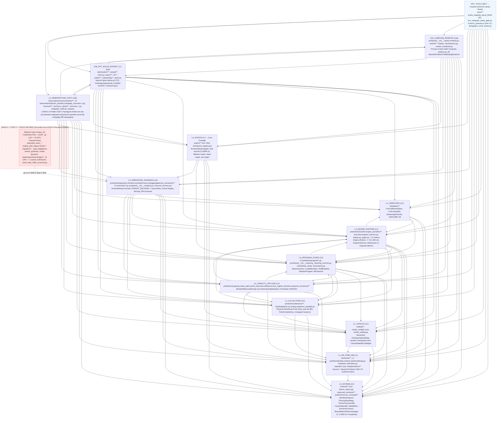

# Architecture

`mindie-sim` is a **runtime-agnostic, hardware-neutral single-spine causal simulator**.
Public entry points include `mindie_sim.api` (`compose_case`, `evaluate_step`,
`evaluate_three_tiers`, `optimize_ladder`, `evaluate_service`, `solve_sla`,
`sweep_topology`, `export_structure`), `mindie_sim.solve.solve_deployment`,
`mindie_sim.export`, and `mindie_sim.predict`. Every supported workload domain
(LLM, VLM, Diffusion/DiT), hardware generation, and deployment mode executes on
the same discrete-event `prediction.runtime.engine.Engine` and one immutable
`PrimitiveTable`. There is no separate GPU, A3, PD, target-projection, or
calibrated engine.

The intended level is analytical resource/phase modeling plus causal event
simulation. Timing is approximate. Correct structure does not require reproducing
kernel instructions or a compiler schedule. Choose detail by repeated cost,
heldout trends and decision stability; see `modeling-fidelity.md` for the
industry comparison, refinement policy and current calibration limits.

## Single-spine layering & `Core <-> RuntimeStackAdapter` firewall

Core packages (L0–L3 plus generic solver, rewrite, and export frameworks) are
100% runtime-agnostic and follow a strict acyclic unidirectional DAG enforced by
`AG010` (layer ordering + package SCC checks):

| Layer | Canonical Subsystems (`ag015:architecture-manifest`) | Input -> Output | Responsibility |
| --- | --- | --- | --- |
| **L0 Contracts & Pure Metadata** | `L0_SCHEMA`: `schema/**`, `observed_contracts/**`, `public/errors.py`, `coverage/**` | validated inputs -> frozen `ScenarioContract`, `CheckpointQuantMap`, `SLAContract`, `DeploymentMode`, `TensorPrecisionABI`, `CacheStateABI` (single native storage-geometry builder), `StateEffect`, `OwnerScheduleSpec`, `CoDesignOpportunity`, `AbiQueryKey`, `PhysicalRankMap`, `BenchPlanV2`, `BenchEnvFingerprint`, `CampaignManifest`, `OperatorMatrixManifest`, `UnmodeledCapabilityError`, CANN 9.3 pure `observed_contracts` | Immutable domain types, explicit 4-mode deployment & role-SLA validation, deterministic digests, pure coverage/error/CANN-contract & cross-repo bench-matrix vocabulary; zero runtime-vendor imports |
| **L1 Hardware, Primitives & Catalog** | `L1_HW_PRIM_ABI` (`backends/**`, L1 `primitives/{loader,schema,sealer,tilelang}.py`, `hardware_derivation.py`, `data/abi/*.json`, `data/primitives/**`), `L1_CATALOG` (`catalog/**`, `model_configs/*.json`, `model_catalog.py`) | native `config.json` / `> 50 MiB` streamed ModelSlim or HF quant metadata + curated checkpoints (`curated_checkpoints.json`) -> `ModelSpec`, `CheckpointQuantMap`, `Hardware`, `PrimitiveTable`, sealed `data/abi/cann93_shipping_abi_*.json` | Ascend + hardware-neutral primitive/ABI facts (zero shipping NVIDIA/CUDA profiles or GPU kernels), read-only streaming quantization descriptors, `CacheStateABI` delegation |
| **L2 Unified Engine, Program, Templates, Collectives & Memory** | `L2_ENGINE_RUNTIME` (`prediction/{runtime,engine_periodic}/**`, `execution/capture_barriers.py`, `engine.py`, `graph.py`, L2 `efficiency/{exposed_*,metrics,resource_attribution,roofline_graph,step_metrics,unmodeled_gate}.py`), `L2_PROGRAM_SCHED` (L2 `prediction/program/*.py`, `primitives/{__init__,lowering,_lowering_comms}.py`, `prediction/{scheduling,values}/**`, `fusion/ports.py`, core L2), `L1_TEMPLATES` (`templates/**`, L2 compiler lowering), `L2_COLLECTIVES` (`prediction/collectives/**`, `sharding/{local_tp,routing,sequence_parallel}.py`), `L2_CAPACITY_OFFLOAD` (`prediction/{capacity,cache_path,cache_execution,offload,service_regime_domains,response_functions}/**`) | lowered `GraphIR` + injected lowering/quant plans -> `StepEvaluation`, `LayerRunProgram`, `StreamExposureResult`, `FormulaKernelSpec`, `ResidentMemoryReceipt` (`usable`, `current_live`, `reclaimable`, `historical_peak`) | Single hardware-neutral `Engine` (`Python == C11 ABI v4`) + `PrimitiveTable`, formal `EngineObserver` Protocol, CATLASS/DSL/fused template bounds, addressed read-only `AdmissionMemoryView.preview_access` + completion-time L2 settlement, per-slot/gen `RefillPipeline`, unified physical directional host-DMA (`host_solo:{dir}:d{rank}`) & `RootComplexKey` |
| **L3 Operator Families, Graph Execution & Sharding** | `L3_OPERATORS_SHARDING`: `prediction/{operators,frontend,scheduler,disaggregated,pd_connector}/**`, L3 `prediction/execution/*.py`, `prediction/program/{__init__,recipes}.py`, `observations/resource_services.py`, `fusion/{__init__,bridge,control_rewrite,graph,pool}.py`, `sharding/{__init__,context_parallel,ffn_rules}.py`, `compose/operator_defaults.py`, `graph_analysis.py`, `rewrite.py`, `transforms.py`, L3 `efficiency/{__init__,analysis,attribution,capacity_window,cost,peaks,sla}.py`, core L3 builders | `OpSpec` + geometry -> `KernelBinding`, `OwnerScheduleSpec`, `Program`, `CohortReplay`, `ServingStep`, `PDHandoff`, Roofline/SLA analysis | Governed single-rank Ascend/hardware-neutral kernels (`TARGET_BACKEND` + pinned `SourceRef`; zero GPU/CUDA or dead `custom_framework/*` kernels), cohort/graph replay, causal serving scheduler & per-chunk `PDConnector`, distributed CP/FFN sharding |
| **L4 Pluggable Runtime Stacks (Firewall)** | `L4_STACKS`: `stacks/**` | `(ModelSpec, CheckpointQuantMap, Hardware, ParallelSpec)` -> `ResolvedStackOptions`, `RuntimeQuantPlan`, `StackLoweringPlan`, optional `LaunchConfigCodec` | Encapsulates all inference-engine specifics behind `RuntimeStackAdapter` (`mindie-sim.stack-adapter/1`), custom JSON manifests, and `mindie_sim.stacks` entry points (`vllm-ascend`, `diffusion-native`, `ideal-target`, `raw-eager`); domain-aware default routing; never imports L5 (`compose/`, `rewrite/`, `export/`) |
| **L5a Composition & Rewrite Algebra** | `L5A_COMPOSE_REWRITE`: `compose/{__init__,inputs,runtime}.py`, `rewrite/**`, `feature_mechanisms.py`, `runtime_advisor.py`, `sku_comparison.py`, `custom_hardware.py` | frozen `ScenarioContract` -> process-cache-safe `Case`, `(replica, op_id)`-scoped `RewritePlan` `/2`, `AppliedPlan`, `OptimalityCertificate` (`dual_cert.py`) | Case composition, neutral synthetic `custom_hardware.py` builder, canonical GraphIR rewrites, per-unit L1 prefetch/tile-binding liveness verification, and exact-witness Eq.7 verification (zero `rewrite -> optimization` SCC) |
| **L5b Optimization, Solvers, Spine, Export, CLI & Profiler SSOT** | `L5B_OPT_SOLVE_EXPORT_CLI` (`optimization/**`, `sweep/**`, `solve.py`, `export/**`, `cli/**`, `public/**`, `onboarding/**`, `prediction/spine.py`, `api.py`, `__init__.py`, `__main__.py`), `L5_OBSERVATIONS_SSOT` (`observations/communication/**`, L5 `observations/*.py`, `structure/**`, `structure_values/**`, `structure_*.py`, `subgraph_math.py`, `cohort_accuracy.py`, `study.py`) | frozen `ScenarioContract` & captures -> `DeploymentOutcome`, `CoDesignOpportunity`, 4-sheet `.xlsx` / `agent_brief.json` / `trace_view.json` / `digest.md`, Stage-4 onboarding receipts, packaged `mindie-sim obs {scoreboard,subgraph-parity,bench-packets,reconcile-campaign,diff-campaigns}`, `mindie-model-structure/1` | Hardware-neutral `PredictionSpine` (zero hardcoded vendor `stack_id`, zero L3->L4 `stacks` import), full-grid SLA/PD Pareto solvers, independent `L*` dual bound, pure 4-sheet export with `OpOccurrence` reconciliation, CLI/SDK entrypoints, packaged bench-packet & campaign reconciliation, and cross-repo `mindie-profiler` SSOT |
| **DEV Out-of-Band Tooling** | `DEV_TOOLS`: `tools/**` | CLI scripts / ABI probes / wheel verification | Dev-time `probe_shipping_abi.py`, thin `live_subgraph_parity_gate.py` & `bench_packets.py` delegates, and `verify_wheel.py`; mapped in `AG015-A` file ownership (`Rule #3`), strictly excluded from `AG015-B` library reachability roots |

Model labels and source revisions are provenance. Physical work does not branch
on them. Family adapters decode native configurations into structural records;
they contain no latency correction tables. Hardware profiles are data, not
alternate execution algorithms.

## Machine-Checked Architecture Ownership Manifest (`AG015-A`)

<!-- ag015:architecture-manifest:start -->
```json
{
  "schema": "mindie-sim.ag015-architecture-manifest/1",
  "bilingual_mirror_required": false,
  "subsystems": [
    {
      "id": "L0_SCHEMA",
      "layer": "L0",
      "selectors": [
        "mindie_sim/schema/**",
        "mindie_sim/observed_contracts/**",
        "mindie_sim/public/errors.py",
        "mindie_sim/coverage/**"
      ],
      "allowed_edges": []
    },
    {
      "id": "L1_HW_PRIM_ABI",
      "layer": "L1",
      "selectors": [
        "mindie_sim/backends/**",
        "mindie_sim/primitives/loader.py",
        "mindie_sim/primitives/schema.py",
        "mindie_sim/primitives/sealer.py",
        "mindie_sim/primitives/tilelang.py",
        "mindie_sim/hardware_derivation.py",
        "data/abi/*.json",
        "data/primitives/**"
      ],
      "allowed_edges": ["L0_SCHEMA"]
    },
    {
      "id": "L1_CATALOG",
      "layer": "L1",
      "selectors": [
        "mindie_sim/catalog/**",
        "mindie_sim/model_configs/*.json",
        "mindie_sim/model_catalog.py"
      ],
      "allowed_edges": ["L0_SCHEMA", "L1_HW_PRIM_ABI"]
    },
    {
      "id": "L1_TEMPLATES",
      "layer": "L2",
      "selectors": ["mindie_sim/templates/**"],
      "allowed_edges": [
        "L0_SCHEMA",
        "L1_HW_PRIM_ABI",
        "L2_ENGINE_RUNTIME",
        "L2_PROGRAM_SCHED"
      ]
    },
    {
      "id": "L2_ENGINE_RUNTIME",
      "layer": "L2",
      "selectors": [
        "mindie_sim/prediction/runtime/**",
        "mindie_sim/prediction/engine_periodic/**",
        "mindie_sim/prediction/execution/capture_barriers.py",
        "mindie_sim/prediction/engine.py",
        "mindie_sim/prediction/graph.py",
        "mindie_sim/prediction/efficiency/exposed_breakdown.py",
        "mindie_sim/prediction/efficiency/exposed_program.py",
        "mindie_sim/prediction/efficiency/metrics.py",
        "mindie_sim/prediction/efficiency/resource_attribution.py",
        "mindie_sim/prediction/efficiency/roofline_graph.py",
        "mindie_sim/prediction/efficiency/step_metrics.py",
        "mindie_sim/prediction/efficiency/unmodeled_gate.py"
      ],
      "allowed_edges": [
        "L0_SCHEMA",
        "L1_HW_PRIM_ABI",
        "L1_CATALOG",
        "L1_TEMPLATES",
        "L2_PROGRAM_SCHED",
        "L2_COLLECTIVES",
        "L2_CAPACITY_OFFLOAD"
      ]
    },
    {
      "id": "L2_PROGRAM_SCHED",
      "layer": "L2",
      "selectors": [
        "mindie_sim/prediction/program/binding.py",
        "mindie_sim/prediction/program/catalog.py",
        "mindie_sim/prediction/program/coalesce.py",
        "mindie_sim/prediction/program/implementation_audit.py",
        "mindie_sim/prediction/program/implementation_registry.py",
        "mindie_sim/prediction/program/invocation.py",
        "mindie_sim/prediction/program/kernel_groups.py",
        "mindie_sim/prediction/program/lowering.py",
        "mindie_sim/prediction/program/native_coverage.py",
        "mindie_sim/prediction/program/physical_key.py",
        "mindie_sim/prediction/program/pipeline.py",
        "mindie_sim/prediction/program/primitives.py",
        "mindie_sim/prediction/program/stages.py",
        "mindie_sim/primitives/__init__.py",
        "mindie_sim/primitives/lowering.py",
        "mindie_sim/primitives/_lowering_comms.py",
        "mindie_sim/prediction/scheduling/**",
        "mindie_sim/prediction/fusion/ports.py",
        "mindie_sim/prediction/values/**",
        "mindie_sim/prediction/mechanism.py",
        "mindie_sim/prediction/native_binding.py",
        "mindie_sim/prediction/physical_recipe_base.py",
        "mindie_sim/prediction/results.py",
        "mindie_sim/prediction/streams.py",
        "mindie_sim/prediction/tensors.py",
        "mindie_sim/prediction/source_program_service.py",
        "mindie_sim/prediction/lowering.py",
        "mindie_sim/prediction/structure_groups.py",
        "mindie_sim/prediction/fusion_regions.py",
        "mindie_sim/prediction/implementations.py",
        "mindie_sim/prediction/instructions.py",
        "mindie_sim/prediction/ownership.py",
        "mindie_sim/prediction/projections.py",
        "mindie_sim/prediction/rewrite_mhc_rules.py",
        "mindie_sim/prediction/transactions.py"
      ],
      "allowed_edges": [
        "L0_SCHEMA",
        "L1_HW_PRIM_ABI",
        "L1_CATALOG",
        "L2_ENGINE_RUNTIME",
        "L2_COLLECTIVES",
        "L2_CAPACITY_OFFLOAD"
      ]
    },
    {
      "id": "L2_COLLECTIVES",
      "layer": "L2",
      "selectors": [
        "mindie_sim/prediction/collectives/**",
        "mindie_sim/prediction/communication.py",
        "mindie_sim/prediction/topology.py",
        "mindie_sim/prediction/sharding/local_tp.py",
        "mindie_sim/prediction/sharding/routing.py",
        "mindie_sim/prediction/sharding/sequence_parallel.py"
      ],
      "allowed_edges": [
        "L0_SCHEMA",
        "L1_HW_PRIM_ABI",
        "L1_CATALOG",
        "L2_ENGINE_RUNTIME",
        "L2_PROGRAM_SCHED"
      ]
    },
    {
      "id": "L2_CAPACITY_OFFLOAD",
      "layer": "L2",
      "selectors": [
        "mindie_sim/prediction/capacity/**",
        "mindie_sim/prediction/cache_path/**",
        "mindie_sim/prediction/cache_execution/**",
        "mindie_sim/prediction/offload/**",
        "mindie_sim/prediction/cache_representation.py",
        "mindie_sim/prediction/memory_traffic.py",
        "mindie_sim/prediction/prefix_reads.py",
        "mindie_sim/prediction/service_regime_domains/**",
        "mindie_sim/prediction/response_functions/**"
      ],
      "allowed_edges": [
        "L0_SCHEMA",
        "L1_HW_PRIM_ABI",
        "L1_CATALOG",
        "L2_ENGINE_RUNTIME",
        "L2_PROGRAM_SCHED",
        "L2_COLLECTIVES"
      ]
    },
    {
      "id": "L3_OPERATORS_SHARDING",
      "layer": "L3",
      "selectors": [
        "mindie_sim/prediction/operators/**",
        "mindie_sim/prediction/execution/__init__.py",
        "mindie_sim/prediction/execution/cohort.py",
        "mindie_sim/prediction/execution/cohort_launch.py",
        "mindie_sim/prediction/execution/cohort_native.py",
        "mindie_sim/prediction/execution/cohort_reuse.py",
        "mindie_sim/prediction/execution/cohort_traffic.py",
        "mindie_sim/prediction/execution/context.py",
        "mindie_sim/prediction/execution/decode_probe.py",
        "mindie_sim/prediction/execution/dispatch.py",
        "mindie_sim/prediction/execution/layer_runs.py",
        "mindie_sim/prediction/execution/lazy_dag.py",
        "mindie_sim/prediction/execution/lazy_submit.py",
        "mindie_sim/prediction/execution/operator_replay.py",
        "mindie_sim/prediction/execution/rank_ledger.py",
        "mindie_sim/prediction/execution/runner.py",
        "mindie_sim/prediction/execution/serving_io.py",
        "mindie_sim/prediction/execution/split_barrier.py",
        "mindie_sim/prediction/execution/state.py",
        "mindie_sim/prediction/execution/streams.py",
        "mindie_sim/prediction/execution/submission.py",
        "mindie_sim/prediction/execution/weight_prefetch.py",
        "mindie_sim/prediction/program/__init__.py",
        "mindie_sim/prediction/program/recipes.py",
        "mindie_sim/observations/resource_services.py",
        "mindie_sim/prediction/scheduler/**",
        "mindie_sim/prediction/fusion/__init__.py",
        "mindie_sim/prediction/fusion/bridge.py",
        "mindie_sim/prediction/fusion/control_rewrite.py",
        "mindie_sim/prediction/fusion/graph.py",
        "mindie_sim/prediction/fusion/pool.py",
        "mindie_sim/prediction/sharding/__init__.py",
        "mindie_sim/prediction/sharding/context_parallel.py",
        "mindie_sim/prediction/sharding/ffn_rules.py",
        "mindie_sim/prediction/frontend/**",
        "mindie_sim/prediction/disaggregated/**",
        "mindie_sim/prediction/pd_connector/**",
        "mindie_sim/prediction/__init__.py",
        "mindie_sim/prediction/api.py",
        "mindie_sim/prediction/body_defaults.py",
        "mindie_sim/prediction/call_builders.py",
        "mindie_sim/prediction/evaluation.py",
        "mindie_sim/prediction/feedforward.py",
        "mindie_sim/prediction/graph_analysis.py",
        "mindie_sim/prediction/implementation_selection.py",
        "mindie_sim/prediction/operator_analysis.py",
        "mindie_sim/prediction/physical_recipe_registry.py",
        "mindie_sim/prediction/rewrite.py",
        "mindie_sim/prediction/structure.py",
        "mindie_sim/prediction/transforms.py",
        "mindie_sim/prediction/efficiency/__init__.py",
        "mindie_sim/prediction/efficiency/analysis.py",
        "mindie_sim/prediction/efficiency/attribution.py",
        "mindie_sim/prediction/efficiency/capacity_window.py",
        "mindie_sim/prediction/efficiency/cost.py",
        "mindie_sim/prediction/efficiency/peaks.py",
        "mindie_sim/prediction/efficiency/sla.py",
        "mindie_sim/compose/operator_defaults.py"
      ],
      "allowed_edges": [
        "L0_SCHEMA",
        "L1_HW_PRIM_ABI",
        "L1_CATALOG",
        "L1_TEMPLATES",
        "L2_ENGINE_RUNTIME",
        "L2_PROGRAM_SCHED",
        "L2_COLLECTIVES",
        "L2_CAPACITY_OFFLOAD"
      ]
    },
    {
      "id": "L4_STACKS",
      "layer": "L4",
      "selectors": ["mindie_sim/stacks/**"],
      "allowed_edges": [
        "L0_SCHEMA",
        "L1_HW_PRIM_ABI",
        "L1_CATALOG",
        "L2_PROGRAM_SCHED",
        "L3_OPERATORS_SHARDING"
      ]
    },
    {
      "id": "L5A_COMPOSE_REWRITE",
      "layer": "L5a",
      "selectors": [
        "mindie_sim/compose/__init__.py",
        "mindie_sim/compose/inputs.py",
        "mindie_sim/compose/runtime.py",
        "mindie_sim/rewrite/**",
        "mindie_sim/feature_mechanisms.py",
        "mindie_sim/runtime_advisor.py",
        "mindie_sim/sku_comparison.py",
        "mindie_sim/custom_hardware.py"
      ],
      "allowed_edges": [
        "L0_SCHEMA",
        "L1_HW_PRIM_ABI",
        "L1_CATALOG",
        "L1_TEMPLATES",
        "L2_ENGINE_RUNTIME",
        "L2_PROGRAM_SCHED",
        "L2_COLLECTIVES",
        "L2_CAPACITY_OFFLOAD",
        "L3_OPERATORS_SHARDING",
        "L4_STACKS",
        "L5B_OPT_SOLVE_EXPORT_CLI"
      ]
    },
    {
      "id": "L5B_OPT_SOLVE_EXPORT_CLI",
      "layer": "L5b",
      "selectors": [
        "mindie_sim/optimization/**",
        "mindie_sim/sweep/**",
        "mindie_sim/solve.py",
        "mindie_sim/export/**",
        "mindie_sim/cli/**",
        "mindie_sim/public/__init__.py",
        "mindie_sim/public/api.py",
        "mindie_sim/public/api_support.py",
        "mindie_sim/public/cli.py",
        "mindie_sim/public/contracts.py",
        "mindie_sim/public/environment.py",
        "mindie_sim/public/formula_sdk.py",
        "mindie_sim/public/profiles.py",
        "mindie_sim/public/services.py",
        "mindie_sim/public/values.py",
        "mindie_sim/onboarding/**",
        "mindie_sim/prediction/spine.py",
        "mindie_sim/api.py",
        "mindie_sim/__init__.py",
        "mindie_sim/__main__.py"
      ],
      "allowed_edges": [
        "L0_SCHEMA",
        "L1_HW_PRIM_ABI",
        "L1_CATALOG",
        "L1_TEMPLATES",
        "L2_ENGINE_RUNTIME",
        "L2_PROGRAM_SCHED",
        "L2_COLLECTIVES",
        "L2_CAPACITY_OFFLOAD",
        "L3_OPERATORS_SHARDING",
        "L4_STACKS",
        "L5A_COMPOSE_REWRITE",
        "L5_OBSERVATIONS_SSOT"
      ]
    },
    {
      "id": "L5_OBSERVATIONS_SSOT",
      "layer": "L5b",
      "selectors": [
        "mindie_sim/observations/communication/**",
        "mindie_sim/observations/__init__.py",
        "mindie_sim/observations/bench_packets.py",
        "mindie_sim/observations/calibration.py",
        "mindie_sim/observations/campaign_reconcile.py",
        "mindie_sim/observations/captures.py",
        "mindie_sim/observations/comparison.py",
        "mindie_sim/observations/multilevel.py",
        "mindie_sim/observations/scoreboard.py",
        "mindie_sim/observations/service_fitting.py",
        "mindie_sim/observations/service_fitting_capture.py",
        "mindie_sim/observations/subgraph_parity.py",
        "mindie_sim/structure/**",
        "mindie_sim/structure_values/**",
        "mindie_sim/structure_contracts.py",
        "mindie_sim/structure_implementations.py",
        "mindie_sim/structure_subgraphs.py",
        "mindie_sim/subgraph_math.py",
        "mindie_sim/cohort_accuracy.py",
        "mindie_sim/study.py"
      ],
      "allowed_edges": [
        "L0_SCHEMA",
        "L1_HW_PRIM_ABI",
        "L1_CATALOG",
        "L1_TEMPLATES",
        "L2_ENGINE_RUNTIME",
        "L2_PROGRAM_SCHED",
        "L2_COLLECTIVES",
        "L2_CAPACITY_OFFLOAD",
        "L3_OPERATORS_SHARDING",
        "L4_STACKS",
        "L5A_COMPOSE_REWRITE",
        "L5B_OPT_SOLVE_EXPORT_CLI"
      ]
    },
    {
      "id": "DEV_TOOLS",
      "layer": "DEV",
      "selectors": ["tools/**"],
      "allowed_edges": [
        "L0_SCHEMA",
        "L1_HW_PRIM_ABI",
        "L1_CATALOG",
        "L1_TEMPLATES",
        "L2_ENGINE_RUNTIME",
        "L2_PROGRAM_SCHED",
        "L2_COLLECTIVES",
        "L2_CAPACITY_OFFLOAD",
        "L3_OPERATORS_SHARDING",
        "L4_STACKS",
        "L5A_COMPOSE_REWRITE",
        "L5B_OPT_SOLVE_EXPORT_CLI",
        "L5_OBSERVATIONS_SSOT"
      ]
    }
  ]
}
```
<!-- ag015:architecture-manifest:end -->

### UML-1-AMEND



## Explicit deployment modes, 4-stage waterfall & co-design

- **Explicit 4-Mode `--deployment-mode` Contract (`schema/scenario.py`)**: Every
  sizing or report invocation binds one of four explicit modes—`colocated`,
  `pd_disaggregated`, `pd_prefill`, or `pd_decode`—with zero `"auto"`/`"pd"`
  guessing and zero `5000.0 ms` TTFT coercion. `pd_decode` requires an explicit
  `ReadyStateAssumption` and rejects `ttft_slo_ms`; `pd_prefill` requires
  `ttft_slo_ms` and rejects `tpot_slo_ms`/`itl_ms`; `colocated` and
  `pd_disaggregated` require `tpot_slo_ms` while keeping omitted `ttft_slo_ms`
  explicitly unconstrained.
- **4-Stage / 3-Owner Causal Waterfall**: Before-vs-After comparison executes on
  one causal graph chain on the same `Engine` and `PrimitiveTable`:
  `Before -> Graph_cfg ([1] ops_config) -> Graph_fwk ([2] framework_python) -> Graph_After ([3] kernel_dev_tune)`.
  `OptimizationMode="simulation"` restricts execution to shipping/proposed
  kernels and `config` track tuning only; `OptimizationMode="modeling"` unlocks
  verified framework rewrites and tiled kernel targets while keeping the
  independent physical lower bound `L*` (`optimization/dual_bound.py`) strictly
  separate from primal latencies.
- **Typed Co-Design Opportunities (`CoDesignOpportunity`)**: `MegaFusionBound`,
  `SpaceTimeTradeoffSpec` (`recover_ssm_snapshot_ring`,
  `prepared_weight_materialization`, `absorbed_kv_projection`,
  `activation_recompute`), and `CrossHwOffloadSpec` feed `ComparisonPlan`,
  Sheet 4 cards, and `agent_brief.json` with open Ascend/NPU kernel
  recommendations targeting **`TileLang / AscendC / Catlass`**.

## Resource time

Rates are work per millisecond inside the engine. Each task declares its resource
work and dependencies. Independent resources may serve the same ready task at
once; all requested work and any minimum duration must finish before completion.
Consumers of a fair resource share its rate, redistributing unused capped supply.
FIFO resources serialize host submissions or other explicitly ordered service.

A dependency, stream order and contention are distinct constraints. Two independent
streams can contend for the same memory or link. Moving them to different streams
cannot delete bytes or FLOPs. Host launch tasks may run ahead of device work;
graph capture replaces groups of submissions with graph-replay submissions.

`Device.service_modes` binds distinct instruction work to a shared physical
pipe at an explicit rate. UB-to-UB copy bytes and register issue slots can
therefore contend with other vector instructions without becoming separate
unlimited resources. Work remains in its native units; only engine service is
converted to the pipe's units. Ownership follows that physical pipe.

A measured primitive duration is an optional completion constraint on an exact
implementation identity. It does not alter FLOPs or bytes. If resource service is
slower, the physical program still determines completion. Hardware-rate calibration
changes a declared resource rate instead. No end-to-end residual is applied.

Explicit `kernels.invocations` rules bind device startup and an inclusive
completion minimum to implementation axes. Both start at original device
readiness: completion is `max(minimum, startup + body)`. Logical joins and nested
resource phases do not gain another invocation. Host launch/replay and transport
propagation remain separate. Hardware execution-class declarations provide
low-priority defaults; runtime rules override them. A3 profiles carry separately
labeled user-reported completion minima. Undeclared classes remain zero; an
unexplained residual does not establish a startup parameter. See
`invocation-costs.md`.

`ResourceService` optionally interpolates a one-resource invocation's response
inside a declared work domain. It turns service time into a per-invocation supply
cap while preserving physical work, ownership and shared capacity. Native units
and phase boundaries are checked before binding; opaque mixed-resource timings
cannot be decomposed by this interface. `RecipeContext.for_phase` composes an
isolated phase without inheriting the enclosing kernel's startup or completion
constraint. See `resource-services.md` for schema, explicit analytical behavior
outside the domain and the retained GPU copy replay.

Observable whole-kernel service regimes additionally support small-payload,
per-call and per-group responses without pretending to identify every internal
resource from elapsed time. Their declared domains and optional resource-rate
scaling feed one inclusive completion constraint through the same engine.
Parameters from operator observations are supported; the comparison API itself
does not silently fit them. See [observable service regimes](observable-service-regimes.md).

## Finite programs

`KernelProgram` is a finite stage DAG. `PipelineProgram` lazily issues at most its
slot window, retaining stage tails and allocation lifetimes. Finished tasks and
waiter lists are released. Trace history is a bounded deque; request metrics use
constant-sized aggregates per request.

Execution retains graph dependencies for pending operators and expands their
per-core programs only when inputs, stream predecessors and submission are ready.
Collective participants share their rendezvous before that expansion. Inactive
model layers therefore do not each retain a full set of core pipelines.

`TiledMatmul` explicitly partitions M/N tiles across physical cores and K panels. It keeps accumulator
buffers across K panels and releases operand buffers after consumption. Declared
buffer capacities and residency are independent per physical unit. Tail panels retain their
real dimensions. Default tiles are 128 x 128 x 128 with two slots. Operand reuse
is idealized across relevant M/N tiles by default; disabling `reuse_inputs` or
`reuse_weights` charges reload traffic. This is not a reconstruction of a vendor's
GEMM implementation, cache replacement or instruction schedule.

The opt-in `hierarchical_matmul` and `mapped_matmul` recipes separate private
L1 refill tiles from inner matrix operand tiles. Independent finite producer
and consumer windows overlap refills with micro products while preserving
MTE1 service, per-owner L0A/B storage and accumulator lifetime. The finite
selector filters declared candidates by capacity and ranks their resource
lower bounds; it does not infer vendor dispatch. Equal independent head/group
matrices retain separate operand domains. Aggregate expert geometry keeps its
separate approximate family binding until actual unequal row counts are modeled.
See `operators/matrix-mapping.md`.

The explicit `phase_matmul` alternative retains the selected mapping's
per-owner work in a short load/operand/compute/output phase chain. It omits
within-owner K/micro overlap and dynamic tile residency. It is a declared
fidelity choice for full-model screening, not an equal-time optimization of
the detailed recipe. Source-bound plans keep precedence. See
`graph-runtime-diagnosis.md` for the complete V4 cohort and work comparisons.

`steady_matmul` preserves nominal refill/operand/cube overlap through a bounded
finite-state recurrence and exact translated-cycle jumps. It compresses regular
K panels and repeated per-owner output tiles into resource-coupled tasks, with
finite buffers and unchanged physical work. Nominal output tiles remain serial;
external contention is a declared fluid approximation. The individual-output
control remains selectable. See `operators/steady-matrix.md`.

An explicit quantized-grouped source call can supply lazy owner rectangles to
that same matrix core. A declared partitioned output program publishes local
accumulators, reserves per-vector buffers, loads scales and executes finite
output chunks. This preserves source AIC/AIV dependencies without inferring
the historical kernel's dispatch or scalar latency from an event residual.
See `operators/grouped-source-execution.md`.

Every operator without a specialized source planner binds one of the five
declared physical mechanism classes (tiled attention, sparse indexer, chunked
linear attention, AIV vector/gather or topology collective). There is no
implicit aggregate `ResourceEnvelope` default. A source-derived `OpSpec`
declares `source_boundary="kernel"` or `"call"`. Its exact recipe id must bind a
`PlannedRecipe` before isolated analysis or iteration execution; family/program
defaults cannot substitute for its work and dependencies.
Calls require a kernel expander; an unexpanded call cannot be priced as one
kernel. Already expanded kernels retain their boundary through repeated passes.
Generic conversion/fusion passes preserve these implementation boundaries.
A bound source planner may use a compact physical phase model when that is
sufficient for its declared work and constraints. The binding requirement
establishes selection, not a minimum instruction-level modeling depth.
A custom recipe can introduce serial stages, transaction limits, conversion work,
additional resource roles and real tensor lifetimes using the same engine.
`Stage.previous` expresses named dependencies on the prior pipeline tile in
addition to same-stage pipe order. A nested program must respect its parent's
ready event, including independent-looking prefetches. The public operator
verifier delays input readiness and rejects any earlier resource service.

Typed register inventories retain source calls, active lanes, UB payload and
barriers. Their issue/port/lane projections are independent capacity bounds,
not a compiler instruction schedule or a dependency-latency model. A masked
single-lane operation still consumes an instruction call.

`QueuedStore` models finite issue/response slots and address-granule dependencies
on that engine. Memory contention delays responses and therefore queue reuse.
`TiledPointwise` preserves independent unit streams, grouping only identical
ownership/address phases. Subprograms can be nested inside a stage; allocations
remain live until its nested program completes. Scalar transfer parameters and
their actual validation limits are documented in `scalar-transfers.md`.

Matrix waves limit both compute and declared distributed copy-engine service to
participating units. A tail wave cannot borrow inactive units' transfer supply.
Devices with unified memory service do not acquire an artificial copy-engine
bottleneck. `Device.resource_units` separates vector and matrix scheduling units.

`RecurrentVector` models GDN decode as load, decay, key dot, delta, rank-one
update, query dot and store. State remains resident across a sequence's dependent
tokens. Independent sequence/head tasks share a launch; each retains its own
length and state. Tail waves cap vector and distributed copy service. This
expresses elementary work and state dependencies, not a compiled instruction
schedule or calibrated reduction/synchronization latency.

## Semantic frontend

[Explicit implementation domains](implementation-selection.md) resolve declared
phase and batch geometry alternatives before lowering in Serving and body/model
probes. Unmatched domains fail by default; analytical alternatives are explicit
and recorded. Source planner failures never trigger another branch.

Attention, FFN and residual builders are registries. Supported building blocks
include GQA/windowed attention; latent MLA; compressed/window caches, index/top-k
selection and shared owners; GDN/KDA state transitions; dense and MoE feed-forward;
hyper connections and attention residuals; optional MTP/DSpark and vision towers.

GEMMs keep logical arithmetic, packed payload, scales, activation traffic and
compute precision separate. `activation_quantization` inserts explicit producers
of low-precision activation payloads and scales. Activation group geometry is
independent of weight blocks. Optional `norm_quant` and `residual_norm` passes
remove intermediate traffic only when consumers allow it; live residual outputs
remain. Packed weight dequantization is still an analytical in-kernel assumption
for formats that require it. It is not a reconstruction of vendor instructions.

`TensorLayout` carries shape, stride, offset and backing shape. Splits and
permutations retain address maps. Reshapes that cross storage gaps and consumers
requiring contiguous inputs introduce real copy operators. The current GDN
builder uses this mechanism for projection slices, full-batch QKV packing,
phase slices, native inputs/exports and the output gate. `TensorValue.output`
distinguishes multiple outputs from one producer so equal Q/K shapes do not
alias in the copy cache. A contiguous consumer reuses a view when possible;
concatenation and caller-owned output assignment still perform transfers.

Declared native fusion groups reuse that semantic graph. The optional
`native_fusion` lowering folds a selected complete group into one resource
program after capture boundaries are assigned. Child work and dependencies
remain; redundant startup and only source-confirmed internal materializations
are removed. Structure export preserves semantic members and their executable
resource boundary. Profiler cohorts reconcile repeated candidates with equal
tensor contracts and physical work; `cohort_comparison` prices that same
declared program without assigning individual layer occurrences. Explicit
recipe bindings participate in structure identity. See
[native fusion resources](native-fusion-resources.md) and
[structure attribution](profiler-structure.md) for comparison limits.

The explicit `gdn_prefill_arch35` implementation selects the retained
noninterleaved QKVZ/BA non-spec caller. Its native convolution and Prepare/H/O
use the same planners as isolated analysis. Mixed batches keep a decode prefix,
a native prefill suffix and the actual output concatenation. Projection,
zero-fill and output normalization retain padded rows, while the core processes
only actual rows. Decode recurrence remains a declared analytical mechanism.
Other projection, speculative mixed, PCP and state-precision branches require
their own implementations; selecting an unimplemented branch is an error.

`final_norm_scope=all` normalizes the whole forward output before selecting rows
for logits, including unfinished prefill chunks. `selected` declares the
alternative software ordering explicitly. Selection carries its payload and
index traffic. PCP normalizes local rows before the selected hidden-state gather.

A draft body precedes one target verification body. A declared acceptance trace,
distribution or mean determines integer commits, never a discount on target work.
Burst tokens share their real commit time, preserving long inter-token gaps.
Draft prefill populates draft cache after target processing. Noncausal block draft
behavior and persistent feature layout are analytical declarations, not a claim
that all serving implementations use that schedule. Standalone draft checkpoints
can be inspected, but cannot serve target requests without a target model.

## Serving and placement

Requests retain arrival, admission, first-token, last-token and completion times.
The scheduler supports open-loop arrivals and closed-loop chains, sequence and
token budgets, chunked prefill and priority/running-first ordering. Cache is
reserved before work. Preemption releases cache and explicitly recomputes it.
A prefix cache hit still recomputes the last hidden state needed for sampling.

DP replicas have distinct memory/compute resources. EP can span DP and includes
idle collective participants. TP, EP/ETP, PP, CP and PCP derive separate groups.
CP shards KV within TP; PCP adds a physical query-shard axis. Unsupported PCP/CP
or PCP/EP schedules are rejected rather than ignored.

Each PP stage simulates one representative local shard. Its TP/PCP group requires
matching physical owner topology, resource roles and service-mode bindings.
Rates and per-owner capacities may differ and use conservative member values.
Combining different core counts requires per-rank execution, which is not yet
implemented; the representative path rejects it instead of mixing one rank's
total rate with another rank's unit count. Separate DP/PP groups may have
different geometry. CP uses maximum
local work/capacity and exact block ownership where implemented; sparse selection
still uses a balanced selected-row assumption. It is not per-rank skew simulation.

P/D pools share a clock and engine. A destination reserves cache before transfer;
the source owns cache until completion. Transfer consumes the physical connector
and both memory services. Decode starts after handoff. Source/destination token
budgets and destination concurrency cause real backpressure. The connector volume
uses the destination shard layout; heterogeneous layout conversion is not modeled.

## Capacity and metrics

Weights are derived from matrix terms, quantized formats and parallel ownership.
Cache is derived from owner layers, block sizes, compression, windows, persistent
recurrent states and selected draft geometry. Measured total memory never replaces
these terms. Workspace estimates simultaneous layer tensors, residual history,
draft feature staging and the default vision score buffers. Compiler graph pools,
communication reserves and runtime allocations are explicit user parameters.

Default request latencies use `device_token_commit`. Host scheduling, launch and
queue work that causes commit delay is included. Explicit `runtime.serving_io`
adds causal input/output copies and host preparation/results. Named
`metric_boundaries` distinguish actual device commits, host result readiness and
explicit client delivery; top-level metrics retain the legacy scheduler window
for compatibility. Undeclared client transport, serialization and consumption
remain outside prediction. See [Serving I/O](serving-io.md) for event and payload
contracts; a captured `client_stream` remains non-comparable unless its measured
boundary matches an explicit modeled delivery contract.

TTFT includes queueing. TPOT is `(last - first)/(output_tokens - 1)` and does not
replace maximum ITL. Throughput uses the modeled serving window. Unserved requests
remain in the SLO denominator. One-token responses have no TPOT/ITL interval.

Operator analysis precedes this service layer. `operators` runs each distinct
physical operator through the same recipes and engine and sums isolated device
times. This sum is neither a serving latency nor an overlap-aware graph span.
Operator errors are prioritized by cumulative effect and trend/ranking failures
before using TTFT/TPOT as service constraints. Structural bugs are corrected
independently of that timing tolerance.

`graph_costs` composes a subgraph or pure target model through `Execution`,
without request scheduling or sampling. It preserves source kernel expansion,
barriers, streams, physical contention and complete cross-DP expert cohorts.
The default excludes host submissions; an explicit alternative includes their
declared costs. It reports graph duration separately from isolated cost sums
and precedence/resource lower bounds. Target capture scope is inherited and
media geometry is explicit. See `graph-analysis.md`.

Expert cohorts synchronize inputs and join completions around each participant's
actual recipe. Collective setup, invocation supply caps and phase dependencies
remain part of those programs; a cohort does not replace them with an aggregate
resource-envelope task.

`call_costs` composes a complete declared callback and finite repetitions through
this same graph path. It excludes serving scheduler/completion work and retains
the chosen eager or replay submission schedule. Historical binding and conditional
event comparisons are separate consumers; see [call analysis](call-analysis.md).

An explicit `ring_collective` recipe adds receive-forward dependencies between
transport rounds on the same Engine. Each rank waits for its own prior source
service and its predecessor's prior arrival, with propagation overlapping other
traffic. It creates no global round barrier. Shared framing is applied once per
hop/message. The current domain is uniform-chunk transport within complete
local groups; cross-DP round coordination and reduction compute are not supplied
by this recipe. See [collective rounds](operators/collective-rounds.md).

## Boundedness

Engine storage is O(active tasks + active pipeline windows + request records).
The active iteration DAG scales with layers and requests, not historical output
tokens. Per-request statistics and final rows scale with request count. Exact
primitive lookups use a bounded LRU and indexed SQLite reads. Large observations
are streamed; the CLI refuses metadata documents larger than 50 MiB.

## Issue #34 boundaries

Node-local dense projection TP, physical expert-slot residency, shared prefix
pooling/read reuse, pure hardware derivation, indexed recurrent templates,
proved homogeneous graph reuse and exposed-time attribution extend the same
schema, Frontend DAG, Engine and Memory ledger. See
[`issue34-features.md`](archive/issue34-features.md) for canonical fields, units,
physical assumptions and compatibility rules. Placement roles are structural
annotations shared by graph and weight geometry; they never branch on vendor,
model or op-id text.
