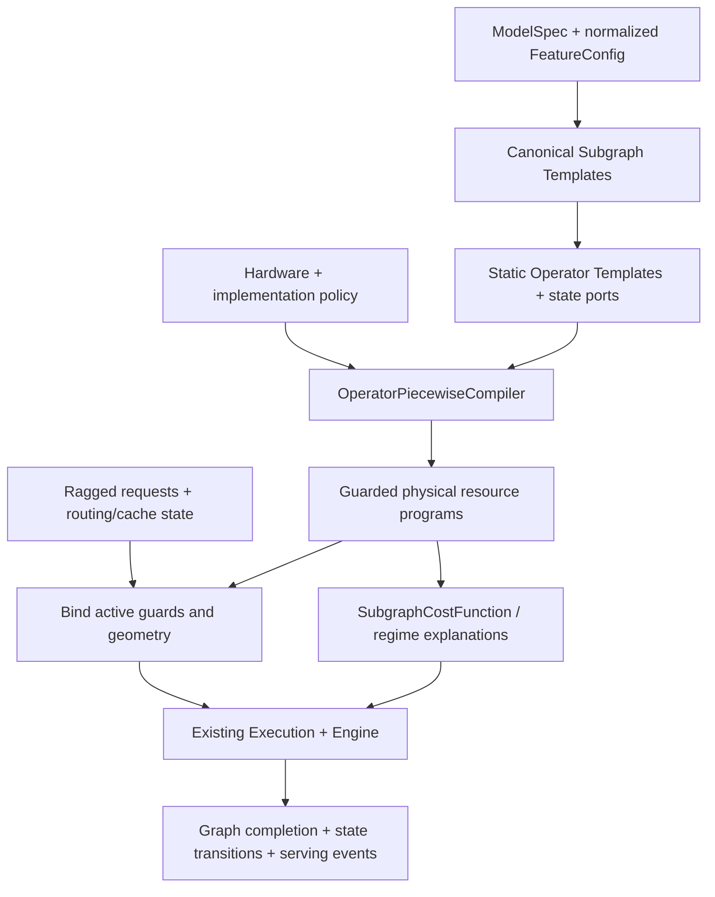

**系统性三级分段建模重构方案 — Systematic Refactoring Blueprint**

2026-11-07。设计与审阅文档，未实现运行时重构。依据本轮读取的工作区
（基线 HEAD `605d40f5`，其中有其他评审正在修改的未提交文件），不能将本文归因于
该提交的纯净快照。Astra（`gpt-6-astra`, `max`）的独立数学与架构审阅已合并；
Antigravity 的会话入口/评审意见尚未取得，本文可作为双方共享评审底稿。
本轮不运行完整 pytest、不加载权重、不启动设备或远程任务。

用户的核心直觉成立：结构决定绝大多数工作量、依赖与参数；不同 batch、query、
context 会跨越 tiling、dispatch 和资源瓶颈边界。应当编译这些机制产生的分段，
而不是为每个模型与 case 收集一张延迟表。严格版本是：

\[
(\text{ModelSpec},\text{FeatureConfig})
\longrightarrow \{G_s(\Theta_s)\}
\longrightarrow \{o_m(\Theta_{s,m})\}
\longrightarrow \text{条件化资源程序及其分段成本表达式}.
\]

这里有四项必须保留的限定：有限的是当前语义词表及有界工作域内的分段；
静态模型之外还需固定实现与硬件合同；`(B,q,s_kv)` 只在规定状态条件下充分；
单流物理 kernel 可以精确求和，但整个 kernel 的时间通常不能直接写成所有 pipe
总工作量的一个 `max`。本文的“精确”均指相对于明示的资源/阶段模型，
不是承诺原生硬件实测时间无误差。

**1. 现有代码已经具有的基础与真实缺口**

| 位置 | 本轮读到的职责 | 重构时的处理 |
| --- | --- | --- |
| `catalog/{specs,composable,deepseek,qwen,glm,kimi}.py`, `schema/model.py` | 配置映射为 `ModelSpec/LayerPlan`，含 KV/index/top-k owner、线性注意力、专家几何等 | 保留；将可复用结构实例化结果显式化，不新增模型延迟分支 |
| `prediction/frontend.py:50` | attention/FFN/residual registry；逐层组合、跨层 owner 字典、SP、PP、draft 与 logits | 抽出静态模板与状态端口绑定；保留迭代与请求边界 |
| `prediction/attention.py:211`, `mla.py:93` | 真实请求长度、projection、cache、compression、indexer、attention work | 同一套工作公式产生符号表达式和数值实例 |
| `prediction/feedforward.py`, `moe_callers.py`, `moe_transport.py`, `moe_token_partition.py` | 路由、实际/期望专家行数、量化运输、caller slicing/padding、shared branch | 以 `RoutingState` 和运输合同实例化，不能只按总 token 数缓存 |
| `prediction/moe_group_list.py`, `moe_init_mxfp8.py`, `moe_init_instructions.py` | group-list 物化、排序/计数/重排及所有者容量 | 保留真实 copy、prefix 与 sort 工作；不用一个“MoE 系数”代替 |
| `prediction/structure_groups.py:28` | 原生对应组的 metadata；本身不增加执行节点或时间 | 升级为类型化 template/fusion 合同的导出视图 |
| `prediction/native_fusion.py:243` | 在 capture 边界之后合并完整单 kernel 组；只有声明的 traffic profile 才删除内存访问 | 沿用；语义组不自动等于物理融合 |
| `prediction/program.py:30` | `Stage/KernelProgram/PipelineProgram/RecipeBook`；资源、槽位、生命周期 | 作为唯一可执行资源 IR 的基础 |
| `prediction/execution.py:600`, `engine.py` | stream 顺序、host 提交、collective rendezvous、资源竞争、完成事件 | 保留唯一执行路径；不得改为向服务层注入预测 sleep |
| `service_regimes.py`, `response_functions.py`, `service_regime_domains.py` | 显式观测响应、插值/物理响应及域检查 | 与结构分段区分；逐域降低经验响应依赖，保留观测及校验 |

`docs/architecture.md:289` 已明确区分 isolated operator sum、graph span 和 serving
latency；`native_fusion.py` 的 timing basis 已是 `resource_DAG_not_sum_of_kernel_durations`。
因此本次主要是“把已有机制变成可复用、可解释的模板及符号程序”，不是另造预测引擎。

本轮只做了 12 个内置配置的 CPU catalog smoke。结果中的 `complete/partial` 是
结构覆盖标记，绝非测量准确率。下表既展示有限组合，也暴露尚不能宣称全覆盖的地方：

| 用户关心的家族 | 当前结构映射 / 本轮读取的具体配置 | 需要明确的边界 |
| --- | --- | --- |
| DeepSeek V3 | 61 层 latent MLA；3 dense + 58 MoE；shared experts 按配置 | `optional_mtp_not_modeled`，部分 router/rope 语义仍有 gap |
| DeepSeek V3.2 | 上述 MLA + full LightningIndexer/DSA selection | 与 V3 相同的部分 gap；不能凭有 DSA 子图就称完整原生支持 |
| DeepSeek V4F | `deepseek-v4-flash`：43 层，2 SWA-only、21 C4 index/compress、20 C128 compress；mHC、MoE、分组低秩输出 | `latent_mqa` 与 latent MLA 必须分开；当前仍报告 rope gap |
| DeepSeek V4.1 扩展 | 40 层；C1/C2 compressed owner/consumer、candidate reuse、mHC | 保留现有能力；owner 与 consumer 不能合成同一种无状态层 |
| Qwen3 | GQA + QK norm；32B 为 dense，30B-A3B 为 MoE | 本轮两个配置结构完整；不能外推所有量化/运行时组合 |
| Qwen3.5 | 27B：48 GDN + 16 gated GQA；35B-A3B：30 GDN + 10 gated GQA，再组合 dense/MoE | 后者仍报告 partial rotary gap；vision/MTP 按声明实例化 |
| GLM-4.5 | `standard_glm` 的 GQA/partial rotary + dense/MoE 配置路径 | 不是本轮 12 个内置 smoke 条目；必须以具体配置检查覆盖 |
| GLM-5 | 仓库别名 `GLM-5` 当前指向 `glm-5.3`：78 MLA/DSA 层，full/shared indexer，3 dense + 75 MoE | 不能把该别名当成独立版本的验证；量化 exclusions 仍有 gap |
| GLM-5 Flash 扩展 | `glm-5.3-flash`：34 KDA + 11 MLA/DSA，mHC，dense/MoE，pooled indexer | 保留 KDA、pool/tail 语义，不能替换成普通 full attention |
| Kimi-K2.5 | 标准 latent MLA；1 dense + 60 MoE | 当前为语言骨干；视觉塔/projector 未覆盖，compressed-tensors 仍有 BF16 proxy |
| Kimi-K3 | 93 层：69 KDA + 24 MLA；latent MoE、attention residual、可选 DSpark/vision | quant exclusions 有 gap；draft 是独立结构，不能由 target 延迟乘系数 |
| Llama | `composable.generic_plans` 接收标准 GQA/MHA/MQA + dense FFN | `llama/mistral` 有显式已知通用路径；不是一个内置 Llama 版本的准确率声明 |
| Gemma4 | 当前没有专用 adapter/catalog entry | 必须新增配置适配与缺失语义，不能把已有 Gemma RMSNorm kernel 合同当成整个 Gemma4 支持 |

Gemma4 的目标适配至少要逐变体验证 local/global attention、KV sharing、K=V、
GELU gated FFN、归一化及缩放、PLE、MoE 和 draft；不能套用 Qwen 的 SwiGLU 模板。
官方 Transformers 文档列出这些配置轴；Google 文档也区分 dense、MoE、PLE
小模型及 unified 多模态模型。此处只据此列适配合同，不推断未核对的某个 checkpoint
尺寸或 Ascend dispatch。[Gemma4 实现文档](https://huggingface.co/docs/transformers/main/model_doc/gemma4)，
[Google 模型概览](https://ai.google.dev/gemma/docs/core)。

**2. 有限三级层次：用组合词表，避免模型 × 特性的笛卡尔积**

标准子图是具有稳定输入/输出/状态端口的语义模板；物理 kernel 分区是在实现
选择、layout、quantization、capture 和 fusion lowering 后得到的另一层视图。
以下是建议的完整 LLM 目标词表。表中的宏模板通过引用子模板组合，不重复计算子节点。
`C` 表示当前已有构造机制，`P` 表示仅部分合同，`N` 表示须新增语义。

| ID / 标准子图簇 | 内部机制与有限变体 | 静态参数 / 状态端口 | 状态 |
| --- | --- | --- | --- |
| E0 输入与嵌入 | embedding、输入 gather/copy、media token splice | vocab、hidden、representation、输入 layout | C |
| N0 归一化与普通残差 | RMS/LayerNorm、residual add、QK norm、cast；add/norm/quant 可融合 | width、epsilon、weight offset、保存的 residual 输出 | C/P：完整 Gemma variant 待核对 |
| A0 GQA/MHA/MQA | QKV projection、norm/RoPE、cache write、causal/noncausal/window attention、gate、O projection | head/rotary/window 几何；KV owner/consumer 端口 | C |
| A1 Latent MLA | direct-Q 或 Q-LoRA、KV-LoRA、norm/RoPE、Q absorption、latent attention、V expansion、O projection | ranks、nope/rope/value dims、cache representation | C |
| A2 Window/compressed shared-KV attention | window branch + compressed/sparse branch、online merge、grouped low-rank O、output gate | compression/window/group geometry；原始/压缩 KV 与选择端口 | C；不同于 A1 |
| A3 GDN | QKVZ/BA projection、conv history、prepare、chunked prefill 或 recurrent decode、gated norm/output | key/value heads、Dk/Dv、chunk、state/conv slots | C/P：显式实现域约束 |
| A4 KDA | QKV/gate projection、conv、prepare、chunk/recurrent state update、output | KDA heads/dims、gate rank、accepted-state 合同 | C/P：显式实现域约束 |
| K0 KV 生产与消费 | paged/contiguous store、layout/quant/scale、owner alias、跨 stage transfer | page size、row format、owner map、readiness | C |
| K1 压缩与池化 | weighted pool、gated ring、KPool、尾组、compressor state | ratio、state rows、pool policy；上次余数/状态 | C |
| I0 Indexer 生产 | Q/index-K/weights projection、norm/RoPE、量化/scale、index cache | index heads/dim、input source、representation | C |
| I1 Indexer 选择 | score、top-k、pooled tail、candidate filter、CP gather/merge | selection K、candidate block geometry；owner/selection 端口 | C/P |
| F0 Dense gated FFN | gate/up、activation、down、TP reduction | hidden/intermediate、SiLU/SiTU/其他明示 activation | C；Gemma GELU 专门语义 N |
| F1 Router 与排列 | logits/hash、group selection、top-k weights、histogram/prefix、sort、pack | E、k、group constraints、router precision；routing ledger | C/P：部分 native router 语义缺失 |
| F2 Expert transport | dispatch/combine、scales/counts、MC2 通知与分块，或 AllToAll/AllGather/本地分支 | EP/ETP/source group、wire dtype、topology、protocol | C |
| F3 Routed grouped FFN | 每专家 gate/up、dequant/activation/quant、down；可选 latent down/up/norm | expert hidden/intermediate、packed formats；每 rank/expert 行数 | C/P：期望和整数执行域分开 |
| F4 Shared expert branch | dense shared FFN、optional gate、SP gather/scatter、routed/shared join | shared width、stream policy、join/reduction 边界 | C |
| R0 Hyper-connection | projection、inverse RMS、affine/gate、Sinkhorn、pre/post mix | hc multiplier、迭代数、FP32 参数 | C |
| R1 Attention residual | residual stack、norm、learned score、softmax/mix、cast、slot 管理 | block size、source slots；跨层 residual state | C |
| E1 外部表与逐层输入 | Engram lookup/mix；Gemma PLE lookup/projection/gating | table geometry、placement、token/lookup state | C：Engram；N：PLE，不混同两者 |
| O0 输出边界 | final norm、hidden selection、LM head、logits gather、sampling | vocab、norm scope、selected row policy | C |
| D0 Draft/verify 宏 | MTP 或 DSpark 输入、draft 子图/heads、target verify、accept/commit、cache 更新 | draft spec、draft length、target sharing；acceptance state | C/P：按家族与实现逐项覆盖 |
| V0 多模态入口宏 | vision encoder/projector，或明确的其他 media encoder/直接投影 | media geometry、encoder config；cache/reuse | C/P；K2.5 vision、Gemma audio/unified N |

A0/A1/A2 引用 K/I 子模板；MoE 宏引用 F1→F2(dispatch)→F3→F2(combine)，
并可 fork F4；D0 引用已有 attention/FFN/residual 模板。最后生成的算子 DAG 中每项
工作只有一个 owner。归一化可在语义树中邻接 attention/FFN，在物理视图中与相邻
模板合法融合；计算物理成本时绝不再把语义父/子成本相加。

该词表覆盖本轮审查到的已实现 LLM 机制及用户点名家族所需的目标扩展。
这不是“所有未来架构只有 22 类”的定理。未知 core 必须保留 coverage hole 或新增
registry 项。当前的 `projection_only/unmodeled` 不能被重构过程提升为完整支持。
DiT 等非 LLM 路径保持自己的 builder，不能被这个 LLM 词表删除或错误纳入。

并行、量化与软件执行选项作为**正交变换及合同**，不是继续复制上述模板：

| 特性 | 对结构/物理工作的确定性作用 | 不允许的简化 |
| --- | --- | --- |
| TP | shard Q/O/FFN dimensions，KV head replication，插入 allreduce 或 reduce-scatter | 所有 latency 直接除以 TP |
| DP | 请求归属到独立 replica；EP 可跨 replica 形成 cohort | 把 global B 当 local B，或漏掉空闲发送方的接收计算 |
| EP / ETP | EP 分专家，ETP 分专家矩阵；定义 assignment 与 source/destination ranks | 将 EP 当作 FFN intermediate 的 TP |
| CP / PCP | KV block ownership、query ranges、partial attention merge、KV/hidden gather | pairs/bytes 无条件均匀除以 CP；忽略 interleave 尾部 |
| SP | residual/FFN local rows、attention gather、输出 scatter/trim | 与 caller TP slice 混为一谈；当前不支持组合必须继续报错 |
| PP | stage ownership、P2P、跨 stage KV/residual dependency | 将整模型简单乘层数或平分时间 |
| BF16 / W8A8 | 按 op role 确定 weight/activation/accumulator/output/scale；显式 activation quant | 全图只设一个 dtype；把 int8 scale 流量消掉 |
| W4A8 / MXFP8 / MXFP4 | pack、group/block scales、MSD/转换阶段、不同专家/共享角色格式 | 把位宽比当 latency 比；只乘 FLOPs 折扣 |
| MC2 / AllToAll / DeepEP | 选择 dispatch/compute/combine 的 kernel、chunk、stream 与同步程序 | 固定 overlap 百分比；根据测量是否存在选择分支 |
| SharedKV | owner 生产，consumer 依赖且照付读取；跨 stage 可能需要真实复制 | consumer 再生成完整 KV；或共享后所有读取消失 |
| DSA / LightningIndexer | index cache、score/top-k、candidate cardinality与访问几何 | 将 top-k 后 attention 缩短但漏掉 indexer 成本 |
| Graph Mode | bucket、各 op 的 active/physical/allocated rows、capture segments、host replay | 视为 native fusion；所有算子无条件用同一个 padded T |
| MTP | draft + 一次完整 target verify + 接受/提交状态变更 | target 时间乘 acceptance rate |

当前部分实现组合确实受限。例如 frontend 的 SP 要求 unchunked AllToAll，
部分 pool/indexer 实现禁止 CP/PCP；MC2 caller padding 与 source partition 也有明确
约束。编译器必须验证组合域，不能将“词表可组合”理解为“所有积组合都已有实现”。

**3. 静态参数怎样固定，剩下的自由变量究竟是什么**

`FeatureConfig` 建议只是现有 `Runtime/ParallelSpec/QuantSpec` 等的规范化投影，
不是第二份用户配置 schema。设硬件为 \(A\)，已声明的 implementation/dispatch
policy 为 \(I\)：

\[
\Theta_s=\operatorname{Instantiate}(\text{LayerPlan},\text{FeatureConfig}),\qquad
\Theta_{s,m}=\operatorname{LowerStatic}(G_s,\Theta_s,I,A).
\]

模型+特性决定语义结构；硬件容量和实现合同还决定合法 tile、owner、buffer 与
dispatch 候选。若实现由 shape 选择，编译的是整个 guard policy，各分段内实现固定。
未知 vendor dispatch 不能从模型结构唯一推出，应使用明示 analytical mapping 或
多个实现 scenario。源码给出的结构是机制证据，不等于某次 capture 的 binary 身份。

| 算子 | 被 \(\Theta\) 固定的参数 | 动态参数 |
| --- | --- | --- |
| GQA QKV GEMM | \(K=h\)，\(N=H_q'd_k+H_{kv,prod}'(d_k+d_v)+N_{gate}\) | \(M=T_{physical}\) |
| GQA attention | local \(H_q',H_{kv}',g=H_q'/H_{kv}',d_k,d_v\)，window、mask、cache dtype、page | 请求 query/context、有效 pairs、page/layout state |
| O GEMM | \(K=H_q'd_v,N=h\) | 输出行数；必要的 TP collectives |
| Dense FFN | gate/up: \((K,N)=(h,2I_{local})\)；down: \((I_{local},h)\) | \(M=T_{physical}\) |
| MLA | Q-LoRA \((h,r_q),(r_q,H_q'(d_n+d_r))\)；KV \((h,r_{kv}+d_r)\)；absorb 的每 head \((d_n,r_{kv})\) | token 行；attention 的动态 KV 轴；direct-Q 是独立静态变体 |
| Routed FFN | \(h_e\) 或 latent width、\(I_e/ETP\)、E、k、专家 owner、quant | 每专家 \(n_e\)、每 peer assignment / payload / padding |
| GDN/KDA | \(H_k,H_v,d_k,d_v\)、conv kernel、chunk、state dtype | 各请求 q、prefill/decode、state readiness/accepted slots |
| Collective | group 成员、算法、topology、transport format、chunk policy | 各 peer bytes、ready times、实际/分配 rows |

这里“固定 N/K”特指 weight-bearing matrix 的静态权重维；attention QK 的 sequence
轴不是固定权重维，仍随请求变化。TP 大于 KV heads 时需要 replication；grouped
吸收矩阵仍有独立 head 的权重域，不能把 \(T H\) 行当成共享一份权重的普通 GEMM。
合法整除、padding 和 local-head 映射使用现有 ownership 逻辑。

一个实际的静态实例：本轮 `qwen3-32b` 配置为 \(h=5120,H_q=64,H_{kv}=8,
d_k=d_v=128,I=25600\)。取合法 TP=8、BF16、无 output gate，得到
\(H_q'=8,H_{kv}'=1,g=8\)；QKV GEMM 固定 \((N,K)=(1280,5120)\)，
O GEMM 固定 \((5120,1024)\)，gate/up 固定 \((6400,5120)\)，down 固定
\((5120,3200)\)。所有 GEMM 的 M 来自相应执行行数；attention 的有效 pairs、
tile/split、KV 读取仍由动态输入决定。该推导无需任何这组 shape 的延迟样本。

为避免 context 定义差一个当前 token，本文取 \(s_i=c_i+q_i\)，其中 \(c_i\) 是本轮
开始前的上下文长度。因此同质 batch 简写 \(x=(B,q,s_{kv})\) 且 \(s_{kv}=c+q\)。
实际输入应保留 ragged vector：

\[
X=\{(q_i,c_i,\text{phase}_i,\text{query ranges}_i,
\text{replica}_i,\text{sampling/draft flags}_i)\}_{i=1}^B.
\]

必要的充分状态 \(Z\) 另含：owner KV/index/candidate readiness 与 representation，
compressed residual/ring 状态、GDN/KDA/conv 的槽位与驻留，路由分配及 peer 流量，
cache/offload/page 状态，MTP acceptance/commit 与所有 collective 参与者。
媒体工作还需要 media geometry。无需装载权重或重算隐藏张量来获得这些记录；未知
数据依赖量采用显式分布/scenario，并报告其条件性。

于是通用函数是
\[
(F_s,Z_{out})=\mathcal G_s(X,Z_{in};\Theta_s,A,I,\eta),
\]
而 \(F_s(B,q,s_{kv})\) 是固定其他条件后的切片。不能仅凭三个 shape 数声称 MoE、
cache miss 或 speculative acceptance 都确定。即使 ragged 请求完全相同，token
内容也能导致不同的 expert assignment、selected block locality 和 prefix reuse。

常用派生量有
\[
T=\sum_iq_i,\quad U=\sum_is_i,\quad
QK_{causal}=\sum_i\left(q_is_i-\frac{q_i(q_i-1)}2\right).
\]
窗口则为 \(\sum_i\sum_{t=1}^{q_i}\min(c_i+t,W)\)；无因果 block 为
\(\sum_iq_is_i\)。不能用 \(B\bar q\bar s\) 代替这些量，也不能把 projection padding
误计为真实 attention token 或真实路由 assignment。

**4. 分段算子编译的严格数学表述**

固定 \((\Theta,A,I)\) 和状态合同后，以离散 regime 向量 \(d\) 表示 implementation、
tile、tail、wave、split、bucket、active-expert 及 protocol 分支。定义
\[
\mathcal D_d=\{(X,Z):\operatorname{guards}(X,Z;\Theta,A,I)=d\}.
\]
对某个隔离 resource stage，令 \(W_{p,d}(X,Z)\) 为物理资源工作量、\(R_p(A)\) 为
相同原生单位/ms 的供给、\(c^{struct}_{p,d}\) 为显式结构供给 cap、
\(\eta_{p,a}\) 为可选的 hardware/access-class 效率：
\[
\overline R_{p,d}=\min(\eta_{p,a}R_p,c^{struct}_{p,d}),\qquad
t_{p,d}=\frac{W_{p,d}}{\overline R_{p,d}},\qquad 0<\eta_{p,a}\le1
\]
（只有当 \(R_p\) 确为该服务定义的物理上限时，才施加 \(\eta\le1\)）。core ownership、
wave participation 和 per-invocation supply caps 是显式结构约束，不揉进 \(\eta\)。
未声明额外 cap 时取 \(c^{struct}=+\infty\)；零工作取零时间，正工作且无合法供给
必须报错。p 应区分真正的 owner/resource：pinned 分布式工作先逐 owner 计算，
并保留全体共享 HBM/Link 的总容量约束；不能以平均 owner 替代最慢 owner。
多个阶段/任务竞争时，可用速率随事件变化，不能仅凭这条隔离公式求整个程序时间。

适用的结论是：若固定 regime 中的工作、setup、rates/caps 是输入的解析函数，
阶段/事件数量在该域固定且有限，调度由有限次算术、比较和固定 tie-breaking 决定，
则在进一步固定竞争 active-set、event order 和 critical branch 后，完成时间具有
分段解析表示。对于多项式/有理工作与常量率，通常得到分段多项式/有理表达式；
全为 max-plus 可闭式化时更简单。此时 setup、release、cap 与 guard 也须属于同一
代数子集；仅 work 为有理式而 cap 含指数，不能推出有理完成时间。
未知自适应策略、不受限循环或不充分状态不满足前提。

更强而便于证明的代数子集命题是：若任务及事件展开在域内一致有限，所有 work/
setup/release/rate/cap 表达式为分母严格为正的有理式，guard 为相应代数比较，
所有分支均有限且程序终止，则在理想实数
算术下，可按事件/仲裁分支构造有限半代数划分，每个规则 cell 内完成时间为有理式。
证明只需逐事件展开算术与 min/max 分支，再清除正分母；相等事件的低维边界也必须
纳入并确定归属。这不主张浮点 bitwise 等价，更不覆盖任意 Python recipe。

真实输入是整数格点；“解析”描述这些格点上所用表达式的连续延拓。
不应以任意有限数据点都可插值为论据；分段必须由实现机制和资源约束生成。

有限性分三层：当前 template/recipe registry 是有限的；单次实例的 executable
program 是有限的；只有声明 \(B\le B_{max},q_i\le q_{max},s_i\le s_{max}\) 等有界域，
并使 Z 所驱动的全部离散决策与事件数也有统一有限上界，才可保证代数子集全域
可展开的有限分层。无界 context 的 \(\lceil s/N_t\rceil\) 产生可数无穷段；整数决策
局部有界、无奇点积聚时可为局部有限。可以保存有限规则生成器而不枚举它们。
组合整个模型的 regime 笛卡尔积会爆炸，
必须按访问域惰性细化。

**4.1 离散结构边界**

| 机制 | guard / 计数 | 必须随之改变的真实工作 |
| --- | --- | --- |
| GEMM M tile | \(j_M=\lceil T/M_t\rceil\) | tail 行、reuse、weight reload、owner 分配 |
| GQA query tile | \(j_q=\lceil qg/M_t\rceil\) | 是否跨 head 复用 KV、有效 query 行 |
| KV tile | \(j_s=\lceil s/N_t\rceil\) | 因果 horizon、page 边界、tail 读取 |
| core waves | \(w=\lceil J/C\rceil\) | active owners 与每 owner 工作；tail wave 不能借空核供给 |
| Split-K/KV | \(P=\pi_I(X,Z)\) | split 输入读取、partial buffer、归约/merge、额外 kernel |
| graph bucket | \(b(T)=\min\{b\in\mathcal B:b\ge T\}\) | 各 kernel 的独立 physical/active rows 和 replay |
| compression | \(\Delta n_i=\lfloor s_i/r\rfloor-\lfloor(s_i-q_i)/r\rfloor\) | 新完整组、残留状态、store；不是 \(\lceil q_i/r\rceil\) |
| window/top-k/candidate | \(\min(c_i+t,W),\min(c_i+t,K)\) 与真实 block 有效行 | 饱和区、重复/去重 policy、index scan |
| MoE activity | \(E_a=\sum_e1[n_e>0]\)，\(\sum_en_e=kT_{valid}\) | 每专家 weight load、grouped tile、padding、peer 分布 |
| transport/quant | \(\lceil bytes/granule\rceil\)、\(\lceil d/group\rceil\) | wire framing、scale、buffer/credit/queue 容量 |

例如 \(j_q=a,j_s=b\) 的 guard 是
\((a-1)M_t<qg\le aM_t\)、\((b-1)N_t<s\le bN_t\)。但 GEMM 的
\((a-1)M_t<Bq\le aM_t\) 在原始 \((B,q,s)\) 空间已是双曲边界，不是多面体。
只有在升维坐标 \(T=Bq\) 下成为线性条带，且仍需保留 \(T=Bq\) 一致性约束。

`P(x)` 必须来自显式 dispatch 合同或声明的 analytical selection；当前一些 MLA
实现只接受显式 `num_kv_splits`。不能把重构设计中的自动选择公式冒充已复原的
vendor 策略。\(w\times t_{fulltile}\) 也不是普遍精确公式：不同任务尾长、因果三角区、
不同专家行数和 load balance 会使同一 wave 中各 owner 完成时间不同。

MoE 的“活跃专家饱和”需区分实际整数执行与期望模型。若均匀 top-k、每 token
选择互异专家且 token 间独立，则
\[
\mathbb E[E_a]=E\left[1-(1-k/E)^T\right].
\]
这是平滑趋近 E，不是有限 T 上硬切换为 \(\min(E,kT)\)；后者只是上界。
现有 `RoutingPolicy.expert_moments` 也显式采用 inclusion probability。
\(F(\mathbb E[n])\ne\mathbb E[F(n)]\)，特别是在 ceil/wave/max 后；精确分布积分或
声明的 scenario sampling 才能支持期望/分位数主张。

**4.2 同一个离散 cell 内还有连续 pipe 竞争边界**

对能够用独立并行资源包络表示的阶段：
\[
h_d=\max_p t_{p,d},\qquad
\mathcal R_{d,p}=\mathcal D_d\cap\bigcap_{p'}\{t_{p,d}\ge t_{p',d}\}.
\]
所以不必发生 tile/dispatch 变化，也可由 MTE2-bound 转为 Cube-bound、Vector-bound
或 Link-bound。相等时记录共同瓶颈并采用稳定 tie-break；不制造一个观测驱动阈值。

可用物理 pipe 集合至少包括 Cube、Vector、MTE2、MTE1、MTE3、Fixpipe、Link，
并保留共享 HBM、具体 link tier、必要的 scalar/issue 服务。MTE2/MTE3/Fixpipe 的
流量可能共同约束于 HBM；它们不是各自拥有一条独占 HBM。不同架构没有某独立 pipe
时由 hardware resource mapping 表达，不能硬加瓶颈。[Ascend 物理数据路径](https://www.hiascend.com/document/detail/en/CANNCommunityEdition/910/programug/Ascendcopdevg/docs/en/guide/programming_guide/advanced_programming/hardware_implementation/basic_architecture.md)。

同一物理 pipe 上的多个 service mode 不是独立资源。例如 vector 算术、UB copy、
register issue 若映射到同一 Vector pipe，要先按各自单位/速率归一化并相加 demand，
再对真正独立的资源取 max；不能对这些别名各取 max 而虚增供给。校准机器级 rate
与设置单 invocation 的 supply cap 也须区分，二者都继续受共享容量约束。

对 dense GEMM 的一个固定映射/驻留 cell，可写示意式
\[
t_C=aT,\quad t_H=b+cT,\quad t_V=v_0+v_1T,
\qquad T_{C\leftrightarrow H}=\frac b{a-c}\quad(a>c).
\]
系数来自 \(2TNK\)、真实 weight/activation/output/scale bytes 和有效资源供给。
\(a\le c\) 时不存在该正向交点；交点不在当前 guard 内则不是当前分段边界。
同质 attention 的 \(Ts\) 与 KV sweep 也产生连续竞争边界。

但“每个 pipe 都只对 \((T,Bs,Ts)\) 线性/双线性”过强。因果三角项需要
\(\sum_iq_i^2\)，grouped GEMM 需要 \(\{n_e\}\)，page/quant 需要取整项，
部分 sort 算法还有 \(n\log n\)，概率路由含指数项。应为每个 family 声明充分的
work coordinates \(\phi(X,Z)\)。若 \(t_p=a_p^T\phi+b_p\)，支配区域在 \(\phi\)
空间是半空间交；在原始输入空间是这些半空间的逆像，通常为半代数区域，含
log/exp 时甚至超出半代数类。不要用只支持 axis-aligned boxes 的经验域检查器
承诺证明全部符号分段。

**4.3 pipe 总量的 max 是下界/特定阶段模型，不是所有 kernel 的等式**

\[
L_m=\max_p\frac{W_{m,p}}{R_p^{effective}}
\]
是资源容量下界的典型形式；Roofline 本身也是性能上界/时间下界框架。
[Berkeley Lab Roofline 说明](https://amcr.lbl.gov/departments/computer-science-department/ppan/roofline-performance-model/)。
若 kernel 是 load→compute→store 串行链，忽略 setup 的时间为三段之和而非三者 max。
流水重叠则必须包含 fill/drain、buffer slots、阶段依赖和 owner caps。

例如无限制中间 buffering、不同资源、等长 n 个 tile 的理想两级流水：
\[
C_{i,L}=C_{i-1,L}+l,\quad
C_{i,C}=\max(C_{i,L},C_{i-1,C})+c,
\quad F=l+c+(n-1)\max(l,c).
\]
该式已经分为 load-bound 与 compute-bound；有限槽位/共享 HBM/尾块再增加 guard
与 recurrence。单 tile 时是 \(l+c\)，不是 \(\max(l,c)\)。

通用 `f_m` 定义为同一物理程序在隔离资源环境下的 makespan：
\[
f_m(X,Z;\Theta)=\operatorname{Makespan}_{Engine}(P_m(X,Z;\Theta)).
\]
能证明闭式的程序导出表达式；其他程序保留阶段 DAG/有限 recurrence 作为可执行
分段表示。资源竞争还会引入“谁先完成/谁释放 buffer/哪个 cap 激活”的边界，
不能只记录最后获胜的 pipe。无需把所有细粒度程序改造成 instruction simulator。

`steady_matmul` 对规定的隔离递推可精确压缩，但它对外部竞争明确采用 fluid
approximation；`phase_matmul` 也是明示 fidelity 选项。新的编译器不得将它们改称
与详细 tile 在任意外部竞争下等价。

**5. 回答“子图是不是当前分段下各算子的求和”**

**是：对充分条件成立的单流、后融合物理 kernel 链，这是精确等式。**
设物理 kernel 为 \(K_1,\dots,K_M\)，每个 \(f_m\) 包含自己的设备调用边界与内部
流水；kernel 之间没有额外等待，使用相同已声明的状态/资源条件，则
\[
F_s(X;\Theta_s)=\sum_{m=1}^{M} f_{m,r_m(X)}(X;\Theta_{s,m}),\qquad
\mathcal R_{\boldsymbol r}=\bigcap_m\mathcal R_{m,r_m}.
\]
子图确实是一个更复杂的分段函数，不必要求所有算子处于同名的 bound。
相邻 kernel 可分别 MTE2-bound、Vector-bound、Cube-bound。

“在同一 stream”只保证顺序，不保证不存在空隙。令 \(a_m\) 为外部输入/提交就绪，
\(S_m=\max(C_{m-1},a_m)\)，\(C_m=S_m+f_m\)。则从 \(S_1\) 到 \(C_M\) 的时间
还要加 \(\sum_{m>1}\max(0,a_m-C_{m-1})\)。若有外部竞争，\(f_m\) 必须是该
执行上下文下的条件时间，而不能代入隔离测量值。
host launch 可以提前提交并与 device 重叠；不能给每个 kernel 再无条件加一次
host launch 延迟。Graph replay 改变提交和 padding，但并不自动合并设备 kernel。

用户指出的三个子图边界效应应精确表达如下。

**5.1 原生融合：对物理 kernel 求和**

`qkv_norm_rope`、`add_rmsnorm_quant`、`dequant_swiglu_quant`、`mla_prolog`
是需要明示实现合同的融合边界示例；前端声明组、transforms 和原生 planner 的
实际角色名称与覆盖域应保留。融合后可能是一个 kernel，或一个含多个 kernel 的
native call。最终计价分区必须展开 multi-kernel call，不能把多次 launch 强行变成一个；
这不要求在 capture/generic fusion 之前提前全局展开所有 source calls。

\[
\{\text{semantic ops}\}\xrightarrow{\text{layout/quant/fusion lowering}}
\{\text{physical kernel programs}\}.
\]
消去的只是确定内部驻留的 materialization、重复 startup/launch；外部消费者需要
的 residual、scale、rstd、KV 等仍须保留。融合内部存在 load/vector/cube 依赖，
融合 kernel 的时间也不等于原来各 semantic op 隔离时间之和。
当前 `native_fusion.py` 已禁止跨 stream/stage/phase/capture 边界，并默认保留
workspace；这些约束应作为编译器不变量。

保留现有 invocation 计费合同：从原始 device readiness 计，
\(f=\max(t_{minimum},t_{startup}+t_{body})\)，其中 minimum 仅在明示且适用时存在。
这不是把 minimum 与 body 相加；嵌套 phase 不再继承一次 startup/minimum，
host submit/replay 与传输传播延迟仍分别建模。

**5.2 子图内多流 fork-join：compose 资源程序，不仅 compose 两个标量**

shared expert 与 routed branch 在显式开启多流时可重叠；MC2 chunk 或明示
prefill attention/communication schedule 也可重叠。不存在对应 stream/依赖
声明时，不得从算法名称推断重叠。

若分支无共享瓶颈、无交叉依赖且同时 ready，
\[
F=F_{prefix}+\max(F_A,F_B)+F_{join}.
\]
一般情形则为
\[
F=F_{prefix}+\Phi(P_A,P_B;A,I,Z)+F_{join},
\]
其中 \(\Phi\) 是统一 Engine 对两个资源程序的 contention-aware makespan。
只传 \(f_A,f_B\) 信息不足：两个各需 1 ms 的 HBM-only 分支共享同一带宽，
合计至少 2 ms；两个各 1 ms、资源完全互不相交的分支可在 1 ms 完成。
孤立时间相同，合成结果不同。

phase DAG 的依赖下界与每资源总需求下界可同时报告；实际预测仍由 engine 调度。
不要引入“通信重叠系数”“shared expert 折扣”补偿已知依赖。collective 的 peer
readiness、host/launch、shared HBM 与 Link 都是程序输入或节点。

**5.3 跨层 KV/路由/状态耦合：子图是带状态转换的函数**

\[
(t_\ell,Z_{\ell+1})=G_\ell(X,Z_\ell;\Theta_\ell).
\]
SharedKV owner/consumer 的静态 map 属于 \(\Theta\)；已生产的 cache/index/top-k
及其 readiness、跨 stage 路径属于 \(Z\)。consumer 省去哪些 projection/store 由
具体实现决定：GQA 共享 owner 可只做 Q；V4 window 与 long compressed cache
的 ownership 不同，不能把两种共享套成同一个删除规则。

MoE 层间可能有不同且相关的 \(n_{\ell,e}\)。全层复用一个平均 routing 向量只是一种
声明的统计近似；不能声称从模型 shape 得到真实逐层路由。压缩残留、accepted KDA
state、MTP commits 同理。标量成本表无法承担状态更新；状态端口必须留在图上。

以上三类是语义子图直接相加的主要结构边界。host 空隙、外部竞争、cache 驻留等
还属于运行条件；不能把“三类”理解为单流等式在所有部署中自动成立的证明。

**6. 建议的具体模块与接口**

保持 `mindie_sim.predict → Frontend → Execution → Engine`，新增一个共享的
符号/模板层，并使数值 lowering 消费相同表达式。以下为拟新增/重构职责，不是已实现 API。



图中 `SubgraphCostFunction` 是资源程序的分析门面，通用 evaluate 使用已有执行
路径；只对可证明的隔离 serial/parallel/recurrence 子集导出闭式。没有第二个
“piecewise engine”，也没有将总时间包装成无资源占用 sleep 的快路径。

| 位置 | 类型/职责 | 与现有实现的接合 |
| --- | --- | --- |
| `schema/subgraphs.py`（新） | `SubgraphTemplate`, `SubgraphInstance`, `OperatorTemplate`, typed ports、static signature、coverage | 复用 `ModelSpec/LayerPlan/QuantSpec`；单一当前 schema |
| `prediction/subgraphs/registry.py`（新） | 上述有限词表、builder registry、组合合法域 | 复用 `ATTENTION_BUILDERS/FFN_BUILDERS/RESIDUAL_BUILDERS`，逐项收敛重复分支 |
| `prediction/subgraphs/instantiate.py`（新） | 静态维度、ownership、quant role、并行与实现合同归一化；template interning | `Frontend.body` 从静态重复搭图转为模板绑定 |
| `prediction/subgraphs/state.py`（新） | request/owner/routing/recurrent/acceptance 端口与状态读写声明 | 复用 scheduler/cache/routing 记录，取代无类型 owner 字典的隐含合同 |
| `prediction/piecewise/expressions.py`（新） | 带单位和整数域的 `Const/Var/Add/Mul/Min/Max/FloorDiv/CeilDiv/Sum` 等 | 工作公式一份定义；数值绑定也使用同一 AST |
| `prediction/piecewise/guards.py`（新） | categorical、interval、整数同余/ceil、关系式 guard；覆盖、交界归属、优先级 | 复用域基础组件；不把任意关系式硬塞入旧 box schema |
| `prediction/piecewise/compiler.py`（新） | `OperatorPiecewiseCompiler`：guarded dispatch、work、owner/caps、phase DAG、可证明闭式 | 扩展 recipe provider 的显式接口，避免依赖 Python 代码 tracing |
| `prediction/piecewise/composition.py`（新） | `SubgraphCostFunction`：serial、fork/join、state composition、critical-path 解释 | `graph_costs/Execution` 为通用求值路径 |
| `prediction/piecewise/diagnostics.py`（新） | regime、工作量、瓶颈/critical chain、边界距离、fidelity、参数来源 | 复用 structure/cohort 导出与 cost diagnostics |
| `prediction/program.py`, `mechanism.py`（扩展） | 为现有 Stage/Work/OperatorPlan 提供符号模板绑定接口 | 最终仍生成原有 resource tasks、allocation、caps、event edges |
| `observations` / 现有 physical-service fitting（扩展） | 独立参数识别与 heldout comparison | 不在 compiler 内学习 timing，不用 validation 回填预测 |

每个核心模块尽量小于 800 行，文件首 30 行保留项目规定的 `[Role]`、
`[Invariants]`、`[Timeouts & Locks]`、`[Side-Effect Policy]`。
不要将新的大型 dispatch switch 挤回 `frontend.py` 或 `execution.py`。

接口草案：

```python
# Design sketch: names below are proposed, not current public APIs.
templates = instantiate(model, normalized_features)
compiled = compiler.compile(
    templates, hardware, implementation_policy, analysis_domain
)
bound = compiled.bind(request_geometry, state_ports)
iteration_work = bound.to_iteration_work()  # existing execution contract
result = execution.add(iteration_work, replica, release_ms)

cost = SubgraphCostFunction(compiled)
cost.explain(request_geometry, state_ports)  # guards, work, bottlenecks, assumptions
cost.evaluate_isolated(request_geometry, state_ports)  # same Engine
cost.closed_form()  # expression OR explicit 'not certified' with reason
```

返回值必须区分 `resource_lower_bound`、`isolated_device_time`、`graph_span`、
`graph_with_submission_span` 和 serving TTFT/TPOT/ITL。`closed_form` 的适用性
判断依赖程序结构，绝不依赖“有无实测数据”。

编译顺序必须保持已有边界语义：

1. 配置规范化，验证 layer/quant/parallel/owner 合同；建立静态子图与状态端口。
2. 按请求/capture 几何选择显式 implementation guards；保留 draft/target region。
3. 执行选定 implementation/layout/copy/activation conversion lowering，保留 source
   call/kernel 边界与原有局部展开行为。
4. 按现有 `lower_regions` 顺序分配 capture segment，再应用合法 native fusion；
   尊重必须由 source planner 自行展开的 call/kernel 边界。
5. 按现有 `Execution.add → RecipeBook.expand` 由选定 recipe 展开剩余 source calls，
   继承 capture/stream/调用边界，再 prepare/resource lowering；同源生成符号/数值
   work、owner、buffer、phase/loop，编译惰性 regime decision DAG。
6. Execution 绑定 ready/stream/collective，与统一 Engine 执行；导出本次命中的 regime。

这是两阶段的“静态部分求值 + 动态 guard 绑定”，不是每次请求重新编译整个模型。
physical partition 取决于动态 guard 时，缓存该 guard 下的模板，不把分区提前当成固定值。

同一符号工作 AST 是关键：不能让 `compiler.py` 再手抄一套 attention/MoE FLOPs
和 bytes 公式。现有 recipe 不便立即符号化时先提供明确的 opaque program 节点，
仍由 engine 执行并标出未导出闭式；不能悄悄用 envelope 替换选中的原生程序。

template key 包含结构维度、role quant/layout、implementation 语义、mapping/硬件
能力、fusion 与 state-port 合同、parallel/topology 和 fidelity。模型名字、观测记录
是否存在、request ID 不进入性能分支；源码 revision 保留 provenance，语义变化的
实现版本用于 cache invalidation。实例 layer ID 通过端口重定位；owner/consumer
角色、不同矩阵域、不同 weight residency 不得因去掉 layer ID 被错误合并。

禁止预先生成 \(\prod_m|\mathcal R_m|\) 的整模型分段表。使用共享表达式 DAG、
有限容量 LRU 和惰性 guards；重复层共享模板，但实际 invocation/state ports
仍逐次绑定。沿用 PipelineProgram 的 active-slot 窗口、任务释放与 bounded trace。
首要资源约束仍为日常进程 RAM ≤512 MiB，不整体读取 >50 MiB 的 capture。

**7. 用结构分段替代密集 service-regime 依赖的边界**

> **Supersession Note (2026-11-08)**: 本节早期关于 `service_regimes` / calibration 在零样本结构分段路径中共存的过渡方案已被 [`docs/extensibility-zero-profile-cutover-review.md`](extensibility-zero-profile-cutover-review.md) 正式取代：零样本 `mindie_sim.prediction.piecewise` 路径完全基于静态结构 `Theta`、动态几何 `X, Z` 与硬件声明供给求值，不读取或回退到 `service_regimes`。

这里需要区分三个对象：`structural regime` 是执行机制的 guard；`physical service`
是某个硬件资源的响应；`observable service_regime` 是有来源的 kernel/call 响应。
改名或把观测 knots 转成表达式，并不自动实现 0-shot。

当前 `service_regimes` 不只是 dense empirical table：它支持 affine/roofline 等物理
响应、插值、continuity domains，以及两种执行语义：

| 模式 | 当前语义 | 在新设计中的地位 |
| --- | --- | --- |
| `completion_floor` | 保留资源程序，设备完成受 inclusive response 约束 | 精确 native boundary 的可选观测约束；不识别内部各 pipe 占用 |
| `joint_native` | 对一个明示本地 kernel 使用声明的 `busy_ns` queue demand；原解析 work 留作 reference | 独立的显式观测模型；不能伪称为结构编译的资源等价优化 |
| resource service/rate | 一种已识别资源/phase 的供给或 response | 在单位/域/owner 相符时，可成为 \(R_p\) 或 \(\eta_{p,a}\) 的来源 |

`Execution._context` 当前已经把以上模式分开。迁移以实际 boundary/recipe/domain
为单位：先提供 0-shot structural program 与 diagnostics，再用保留的观测独立验证；
替换配置中已经被结构+资源参数覆盖的响应项，保留原始 observation identity。
不能删除现有结构机制、fixture、historical raw capture，也不保留第二套 legacy runtime。

**0-shot** 定义为：新 model/shape 不依赖该 case 的测量，就可通过配置、实现机制
和硬件 profile 生成完整结构预测。它不意味着无需实现信息、不存在硬件不确定性，
或一定达到实测准确率。参数不确定时给出 sensitivity/scenario，不能凭空标注
统计置信区间。相同单 engine 上可以显式比较 analytical 与 calibrated 参数集。

**Few-shot** 应针对硬件服务，而不是每个模型拟合。推荐识别小集合：
Cube（compute format/合法 mapping 类）、Vector（操作/归约类）、MTE1、
MTE2/MTE3/共享 HBM（访问与参与 owner 类）、Fixpipe、Link tiers/协议、
有独立来源的 invocation startup。不能假定所有 shape/格式共用一个 \(\eta_p\)，
也不能逐 shape 创建 \(\eta\) 将经验表换个名字。

\[
\hat y_j(\eta)=\operatorname{Makespan}(P_j;\eta),\qquad
\eta^*=\arg\min_\eta\sum_{j\in train}\rho(\hat y_j(\eta)-y_j).
\]

这里允许使用 isolated multi-resource kernel 作为额外校验，但如果要同时识别
多个 \(\eta\)，必须有足够的独立激励/phase 观测。对 \(y=\max(a/\eta_C,b/\eta_H)\)，
Cube 持续占优时 \(\eta_H\) 不可识别；任何一个总时间都不能唯一推出所有 pipe。
校准设计应先查 sensitivity Jacobian 的秩/条件数，再决定测几个点；不能预先承诺
“每个 pipe 两个样本足够”。

优先选择能区分竞争解释的少数实验：跨越候选 dominance boundary、最小/大工作量
区分 startup 和 slope、改变 active owners 识别供给、独立保持 source boundary、
验证 contention。token/context/heldout 模型/运行批次用于验证，不能回流 training。
本轮不执行任何 primitive/device 测量。

连续性要求也要分开：固定结构下的两个 pipe max 在交点连续，导数可变；真实
bucket/split/fusion dispatch 允许有因果依据的跳跃。新的 structural compiler 不可
照搬 empirical continuity group 的“每个 seam 必须连续”约束，更不能平滑掉 wave
阶梯。域无洞、无歧义，与函数全局连续/单调是不同命题。

**8. 三个可验证的端到端实例**

**Qwen3 dense GQA block。** 先实例化 N0→A0→N0→F0，其中 A0 分出 projection、
QK norm/RoPE、KV write、attention、O projection/TP collective。权重 N/K 固定；
同质 decode \(q=1,T=B\)，attention pairs \(=Bs\)。GEMM 可能随 B 从 weight/HBM
主导转为 Cube 主导；attention 则跨 head/query tile、KV tile、Split-K/merge 域。
capture bucket 只对声明执行 padding 的 op 生效。后融合、没有额外并行/等待的
物理链精确求和；TP collective 也必须包含其协议程序和 ready 条件。

**DeepSeek V4F 的一个 C4 层。** mHC 前处理→A2 projection/window KV；K1 按
\(\lfloor s/4\rfloor-\lfloor(s-q)/4\rfloor\) 更新压缩行；I0/I1 score/top-k；
window 与 selected compressed attention→grouped O→mHC；再组合 routed/shared MoE。
参数 \(r=4\)、window、index K、grouped O 维度已由 LayerPlan 固定，动态的是本轮
新压缩行、请求 horizon、selection/routing 条件。C128 层没有 C4 的 indexer；
不能拿同一个“DSA 层均值”乘全部层数。

**Kimi-K3 latent MoE + shared branch。** F1 产生或绑定逐专家行数，F3 的输入维
是 expert latent width；latent projection、norm 位置、transport 与 shared 分支
使用各自合同。shared branch 在明示 shared stream 上可 fork；两分支的 GEMM 和
HBM 会竞争，即使通信仅存在 routed 分支，也不能直接取两个隔离标量的 max。
后续 attention-residual 的输入 slots 随层推进，必须从 R1 状态端口绑定。

**9. 分阶段落地与可检验验收标准**

| 阶段 | 交付范围 | 进入下一阶段的证据 |
| --- | --- | --- |
| P0 结构合同 | 固定目标 families/features/domain，登记 support gaps、kernel/call/fusion、state ports | 每个已有路径保留真实 work/布局/owner/stream；未知语义仍明确暴露 |
| P1 模板化 | 从 GQA/dense 开始抽出 immutable templates；Frontend 动态绑定；structure 导出可追溯 | 与旧构造器在受支持域的独立工作/依赖合同一致；没有重复权重/scale/launch |
| P2 算子符号 IR | norm/copy/GEMM→GQA/MLA→indexer/MoE/transport→recurrent；复用现有 source planners | 可证明子集的表达式与同程序 engine 结果相符；其余保留明示可执行程序 |
| P3 子图组合 | serial certificate、fork/join/resource composition、SharedKV 与 stateful composition | 串行等式、共享资源竞争反例、跨层生产/消费与完整 EP cohort 验证 |
| P4 校准解耦 | 可选资源服务参数、regime explanation、逐域退出密集经验响应 | 未用观测的模型/shape 可预测；heldout trend/ranking 与 matched boundary 独立报告 |
| P5 扩展与交付 | Gemma4、现有语义 gap、真实组合覆盖、CPU runtime/RAM 基准 | 保持单 schema/engine，明确准确率域与成本；完整 maintained suite 由交付评审运行 |

不要把每阶段都要求“全部 family、全部 native kernel 闭式化”。先覆盖重复工作量
和决策敏感性最大的模板；更细建模需要成本/趋势/排序反例。模板覆盖、闭式覆盖、
结构正确性和测量准确率四项分别报告，不能互相替代。

必要验证是行为或独立数学不变量，不是检查类名/静态字符串/文档 prose：

| 验证 | 独立不变量 / 反例 |
| --- | --- |
| ragged attention | \(\sum_i[q_ic_i+q_i(q_i+1)/2]\) 与枚举有效 pairs 一致；同均值异 ragged 不错误合并 |
| tiling/waves | 在 \(kM_t-1,kM_t,kM_t+1\)、\(kN_t\) 两侧验证真实 tails/owners；空核不能供给 pinned work |
| symbolic partition | 有界整数域 guard 唯一命中、边界归属明确；domain miss 与不支持语义分别报错 |
| pipe crossover | 两边由相应解析 branch 主导，交点相等；没有虚构 dispatch 跳变 |
| pipeline | 单 tile 是 load+compute(+store)，多 tile 保留 fill/drain；slots=1 不出现不可能重叠 |
| serial composition | 相同状态/无外部等待时 sum=graph；增加一个晚到输入必须增加真实 gap |
| contention | 两条 HBM-only 分支合计 bytes/bandwidth；互不相交资源允许重叠；共享 HBM 不复制容量 |
| pipe alias | 两种各需 1 ms 的模式绑定同一 pipe 时为 2 ms，绑定独立资源才允许 1 ms；单位转换后相加 |
| readiness/invocation | 推迟唯一输入必须平移所有服务与完成；嵌套 prefetch 不提前；startup/minimum 不重复收费 |
| fusion | 外部活跃输出/scale 不丢失；只消去有合同的内部物化；一真实 kernel 只收费一次 startup |
| SharedKV | owner store/residency 计一次，consumer read 逐次计；consumer 不得早于 owner；跨 stage bytes 保留 |
| compression | 分块累计新完成行望远镜相消为最终 floor；不能每 chunk 独立 ceil |
| MoE | \(\sum_en_e=kT_{valid}\)，peer 发送=接收，零专家不读 weights；等总 token 不同 skew 产生不同 waves |
| quantization | packed payload、scale、zero-point、runtime residency 分账；role override 不影响其他角色 |
| MTP | draft/target work 不随 acceptance 打折；相同 verify 的不同接受数只改变 commit/cache 进展 |
| calibration | 同边界/单位/实现才可绑定；heldout 不进入训练；改模型 label 不改变结构性能 |
| bounded execution | 同一最大 active work、更多完成迭代不积累历史；RAM/CPU 单独报告 |

结构测试不得要求所有 dispatch 的时间全局单调或连续；可在已固定实现与单调工作
域验证单调性。统计路由还要分别验证 conservation、期望公式和真实整数 realization，
不能对期望行数的 ceil 结果贴“精确”标签。

本轮只交付设计、源码核查和上述 12 项 catalog smoke；**未运行 pytest、CPU
仿真 benchmark、primitive measurements 或 service accuracy campaign**。
用户说明的并行完整测试属于其他评审，不在本轮冒报完成。后续实现交付仍须遵守
项目完整 maintained suite 的要求。

**10. 评审需要决定的具体架构结论**

建议接受“有限组合词表 + 明示状态 + 同源符号资源程序 + 惰性分段 + 单 Engine”这条
主线。对用户最直接的回答是：绝大多数 shape 区域确实可以从结构推导，不必逐 case
测；单流后融合 kernel 链确实按当前 regime 精确相加；重叠则按资源程序组合，
跨层共享则按带状态的子图组合。

建议 Astra/Antigravity 的合并评审聚焦四个可审查对象：模板词表及缺失语义登记，
`(X,Z,Theta,A,I)` 合同，symbolic IR 与现有 Program 的单一来源，以及每个闭式
优化的适用条件。Antigravity 尚未反馈的意见应以明确 attribution 加入；不能把本稿
标为已获双方共同认可。实际 runtime 重构应作为后续独立变更执行。
